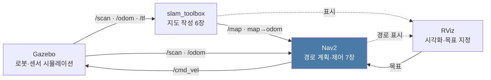
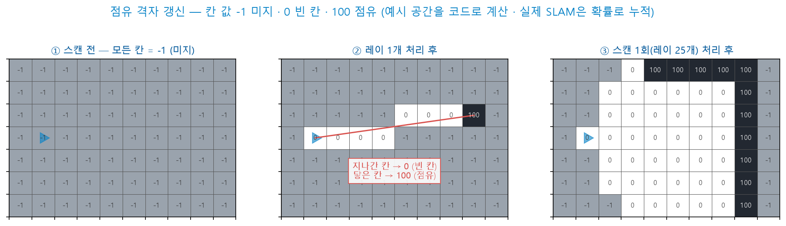
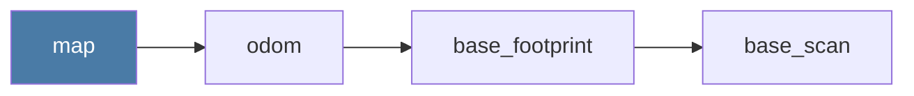
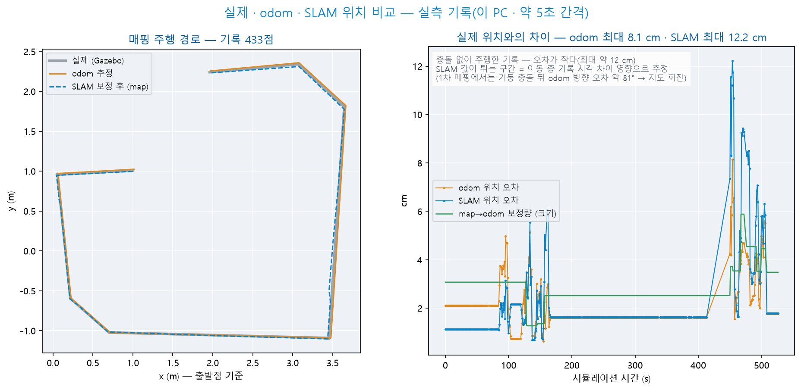
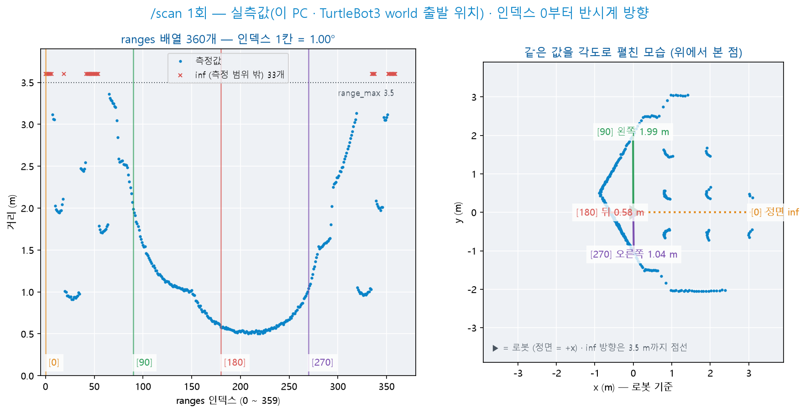
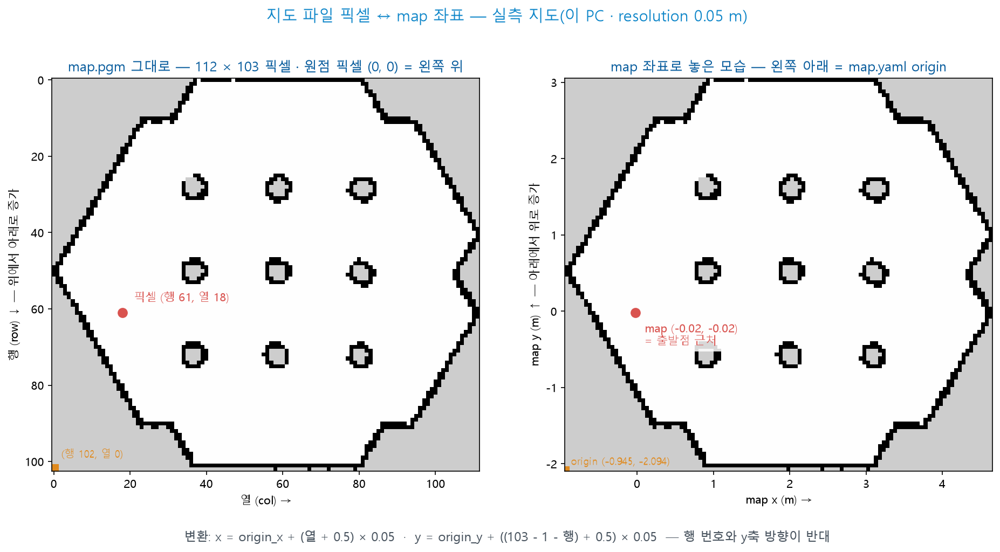
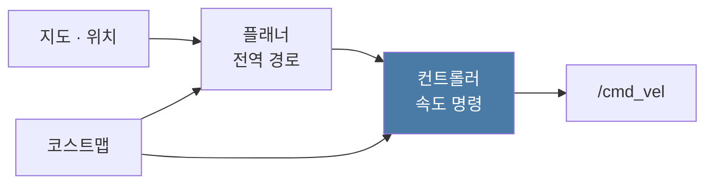
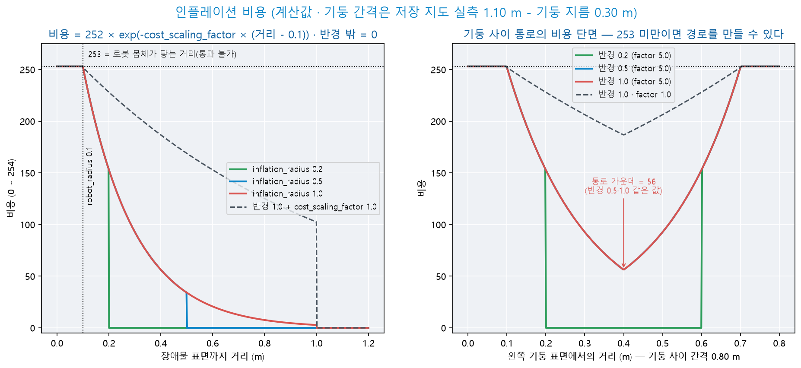
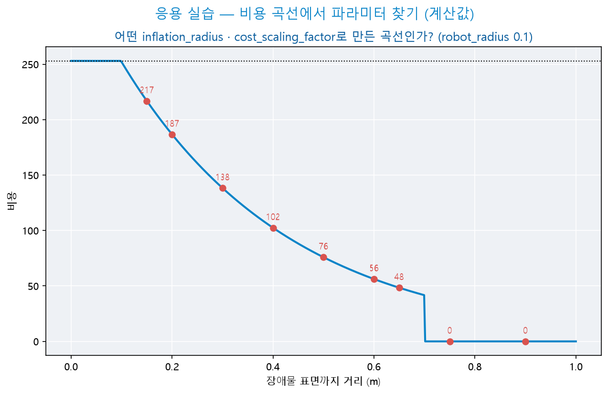

# Day 7 — SLAM 실습 · Gazebo와 TurtleBot3

**2026-10-12 · 한국폴리텍대학교 하이테크과정 ROS2**

이 자료는 수업의 개념 설명과 실습 절차·명령어를 복습용으로 정리한 문서입니다. 복습 기준 = 이 자료 + 수업 중 필기.

---

## 목차

1. [복습과 오늘의 목표](#1-복습과-오늘의-목표)
2. [Gazebo·RViz·브리지 — 시뮬레이터와 시각화 도구](#2-gazeborviz브리지--시뮬레이터와-시각화-도구)
3. [실습 ① — 설치와 렌더링 확인](#3-실습---설치와-렌더링-확인)
4. [SLAM의 원리 — 지도와 위치의 동시 추정](#4-slam의-원리--지도와-위치의-동시-추정)
5. [실습 ② — world 기동과 관찰](#5-실습---world-기동과-관찰)
6. [실습 ③ — 매핑과 지도 저장](#6-실습---매핑과-지도-저장)
7. [실습 ④ — Nav2 목표 주행](#7-실습---nav2-목표-주행)
8. [Nav2 파라미터 — 경로와 속도의 조정](#8-nav2-파라미터--경로와-속도의-조정)
9. [실습 ⑤ — 내비게이션 스크립트](#9-실습---내비게이션-스크립트)
10. [미니프로젝트 — 직접 작성한 지도에서 두 지점 왕복](#10-미니프로젝트--직접-작성한-지도에서-두-지점-왕복)
11. [정리 — SLAM의 요구 조건과 실습 차량](#11-정리--slam의-요구-조건과-실습-차량)
12. [보충](#12-보충)
13. [실습 과제 — LiDAR 랜덤 주행과 장애물 회피](#13-실습-과제--lidar-랜덤-주행과-장애물-회피)
14. [다음 시간](#14-다음-시간)

---

## 1. 복습과 오늘의 목표

### 1.1 지난 시간 복습

| 지난 내용 | 오늘 수업과 연결되는 내용 |
|------|------|
| Day 6 자료 4.5 — 인식 → 판단 → 행동 | TurtleBot3도 **같은 구조** 위에서 동작 — 판단을 Nav2(Navigation 2)가 담당 |
| Day 6 자료 4.1 — 토픽 계약(이름·타입·의미와 단위·주기) | 오늘 `/cmd_vel`의 **타입이 turtlesim과 다르다**는 사실을 토픽 계약 관점에서 확인(5.5) |
| Day 3 자료 8장 — launch 일괄 기동 | TurtleBot3 launch가 노드 여러 개를 일괄 기동(5.1) |
| Day 3 자료 9장 미로 · Day 6 자료 4.5 — 직접 작성한 판단 노드 | Nav2 = 기성 경로 계획·제어 — 판단 노드를 직접 만들지 않음 |

환경 점검(수업 시작 시 각자 실행) — 오늘은 **강의실 PC의 WSL2**(Windows Subsystem for Linux 2)를 다시 사용합니다.

```bash
ros2 doctor                                  # 설치 상태 재확인
ros2 run turtlesim turtlesim_node            # 창이 표시되면 GUI 정상 → 확인 후 종료(오늘은 미사용)
```

- Day 4\~6을 RPi5에서 진행했으므로 PC 환경이 **그대로 남아 있는지** 먼저 확인합니다
- 환경이 초기화된 경우의 대응 = Day 1 자료 3장을 다시 수행 — 오전 내 미완이면 교수에게 알림

### 1.2 오늘의 목표 — turtlesim에서 표준 시뮬레이터로

turtlesim으로 익힌 체계를 **표준 도구에서** 확인합니다.

| 축 | 지금까지 | 오늘 |
|------|------|------|
| 시뮬레이터 | turtlesim — 2D · 물리 없음 | **Gazebo** — 3D · 물리 엔진 · 센서 모델 |
| 감지 | 가상 벽 좌표(Day 3) · 카메라(Day 4·5) · 초음파(Day 6) | **LiDAR(Light Detection and Ranging)** — 360° 전 방향 거리 |
| 지도 | 없음(코드에 벽 좌표 기재) | **직접 작성한 점유 격자 지도** |
| 판단 | 직접 작성한 상태 기계 | **Nav2** — 기성 경로 계획·제어 |
| 로봇 | turtle | **TurtleBot3** — 기성 모델·기성 패키지 |

- **오늘 완성할 것** — 직접 작성한 지도 위에서 **두 지점을 왕복하는 TurtleBot3**(RViz 목표 지정 + Python 스크립트)
- 오늘 배우는 것은 도구 자체가 아니라 **같은 체계가 유지된다는 점**입니다 — 노드·토픽·launch·파라미터가 기성 패키지에서도 그대로 사용됩니다

> **오늘의 핵심 —** **오늘 새로 작성하는 노드는 9장 스크립트 하나뿐입니다.** 나머지 작업은 **설치 · 기동 · 관찰 · 조정**입니다. 기성 패키지에서도 같은 체계가 유지되는지 확인하고 그 패키지를 다루는 능력을 익힙니다.

### 1.3 오늘의 흐름

**오전 — 도구 · 원리 · 지도**

| 단계 | 절 | 내용 | 산출물 |
|:--:|:--:|------|------|
| ① 개념 | 2장 | Gazebo·RViz·브리지 각각의 역할 | 도구 구분 |
| ② 설치 | 3장 | 패키지 설치 · 렌더링 확인 | 동작 환경 |
| ③ 원리 | 4장 | SLAM(Simultaneous Localization and Mapping) · 점유 격자 · 좌표 프레임 | 개념 |
| ④ 관찰 | 5장 | world 기동 · 토픽 7종 · `/scan`·`/cmd_vel` 확인 | 관찰 표 |
| ⑤ 매핑 | 6장 | slam_toolbox로 지도 작성 · 저장 | `map.yaml` |

**오후 — 내비게이션 · 조정 · 스크립트**

| 단계 | 절 | 내용 | 산출물 |
|:--:|:--:|------|------|
| ⑥ 내비게이션 | 7장 | Nav2 기동 · 초기 위치 · 목표 주행 | 목표 도달 |
| ⑦ 파라미터 | 8장 | 값을 바꾸며 경로·속도 변화 관찰 | 실험 기록 |
| ⑧ 스크립트 | 9장 | Python으로 목표 지정 | `waypoint_tour.py` |
| ⑨ 미니프로젝트 | 10장 | 직접 작성한 지도에서 두 지점 왕복 | 왕복 주행 |

- 11장 정리 이후의 **12장 보충**은 진도에 여유가 있을 때 다루는 독립 소재

### 1.4 준비물·작업 환경

| 품목 | 확인 사항 |
|------|------|
| 강의실 PC + WSL2 | Ubuntu 24.04 + ROS2 Jazzy — Day 1 구축분(1.1에서 확인) |
| 인터넷 | 오늘 설치 다운로드 규모가 큼 |
| terminator 창 분할(3개로 시작 · 6장부터 5개) | ① 시뮬레이터 launch · ② **모니터 `/cmd_vel`** · ③ 작업 명령 |
| VS Code(WSL 연결) | 9장 스크립트 작성 |
| 필기구 | 「예측」 단계에서 실행 전에 결과를 적음 |
| AI 코딩 도구 | 응용 실습과 9장 3·4단계의 코드 작성 |
| RPi5 | **오늘 미사용** — 전원을 끈 채 보관 |

- 오늘 모니터 터미널에서 관찰할 토픽 = **`/cmd_vel`**(TurtleBot3의 명령 토픽). 이 토픽은 지금까지 사용한 `/turtle1/cmd_vel`과 **이름·타입이 모두 다릅니다**(5.5)
- Day 2 자료 2장의 터미널 배치를 그대로 사용합니다

> **진행 방식 —** 각 절에서 설명과 실습을 단계별로 번갈아 진행합니다.
>
> - 실습에서는 단계마다 결과를 확인한 뒤 다음 단계로 넘어갑니다. 「예측」이 있는 단계에서는 실행 전에 결과를 먼저 적습니다
>
> - 그림의 수치는 실제 값입니다 — 이 강의를 준비하며 실행한 TurtleBot3 world의 측정값이거나, 예시 공간을 코드로 계산한 값입니다(그림 제목에 구분 표기)
>
> - 절 끝의 「응용 실습」에는 코드가 없습니다 — AI 코딩 도구로 작성하는 과제입니다. 조건을 이해해야 해결할 수 있습니다

---

## 2. Gazebo·RViz·브리지 — 시뮬레이터와 시각화 도구

### 2.1 turtlesim에서 Gazebo로

| 항목 | turtlesim | Gazebo |
|------|------|------|
| 차원 | 2D | **3D** |
| 물리 | 없음 — 명령대로 즉시 이동 | **물리 엔진** — 중력·충돌·마찰 |
| 센서 | 없음(위치 `pose`만) | **센서 모델** — LiDAR·카메라·IMU(Inertial Measurement Unit, 관성 측정 장치) |
| 로봇 | 그림 | **기구 모델** — 바퀴·관절·질량 |
| 환경 | 빈 화면 | **world 파일** — 벽·장애물·조명 |

- **Gazebo** = 물리 엔진을 탑재한 3D 시뮬레이터. 로봇·센서·환경 모델을 지원합니다. ROS 호환성도 높습니다
- 이 과정은 **Gazebo Harmonic**을 사용합니다 — ROS2 Jazzy의 권장 조합(3.1)
- Day 1 자료 2.6에서 "Day 7 실습에서 사용"으로 예고한 도구입니다. 오늘 실제로 사용합니다

### 2.2 RViz — 시뮬레이터가 아닌 시각화 도구

> **핵심 —** **RViz는 로봇을 움직이지 않습니다.** ROS2 토픽으로 받은 센서 데이터·로봇 모델·경로를 **3D로 표시**할 뿐입니다. RViz 창을 닫아도 로봇은 계속 동작합니다. 반대로 **Gazebo 창을 닫으면 시뮬레이션 launch 전체가 종료**됩니다(5.1).

| 도구 | 역할 | 오늘의 용도 |
|------|------|------|
| **Gazebo** | 세계를 시뮬레이션 — 로봇·센서·물리 | 로봇이 놓인 환경(관찰용) |
| **RViz** | ROS2 토픽을 3D로 표시 — `/scan`·`/map`·`/tf`·경로 | **SLAM·Nav2 실습의 주 화면** — 목표 지정도 이 화면에서 수행 |

- 실물 로봇에서는 Gazebo 없이 **RViz만 사용합니다** — Day 6에서 다룬 초음파 값도 RViz로 표시할 수 있습니다(12장)
- 오늘 실습은 대부분 **RViz 창에서** 진행됩니다. Gazebo 창은 로봇의 실제 위치를 확인하는 용도입니다

**오늘 사용하는 도구 4종의 관계**



| 도구 | 역할 | 없을 때 |
|------|------|------|
| Gazebo | 로봇·센서·물리를 계산해 토픽으로 내보냄 | 로봇과 센서 값이 없음 |
| slam_toolbox | 센서 값으로 지도를 작성하고 위치를 보정 | 지도가 없음 → Nav2 기동 불가 |
| Nav2 | 지도 위에서 경로를 계획하고 `/cmd_vel` 발행 | 목표까지 스스로 이동하지 못함 |
| RViz | 토픽을 표시하고 목표를 입력 | 결과를 볼 수 없음(로봇은 동작) |

- 매핑(6장)과 내비게이션(7장)은 **따로 기동**합니다 — 지도를 먼저 만든 뒤 저장하고, 그 지도로 Nav2를 기동합니다

### 2.3 TurtleBot3 — 기성 로봇 모델

**TurtleBot3**(ROBOTIS) = ROS2 교육·연구용 표준 소형 로봇. 오늘은 실물 없이 **Gazebo 모델**(burger)을 사용합니다.

| 제원(burger 모델) | 값 |
|------|------|
| 구동 | 차동 2륜 — 바퀴 간격 0.160 m · 반지름 0.033 m |
| 센서 | **LDS(Laser Distance Sensor)** — TurtleBot3의 LiDAR 모델 · 360° · 0.12\~3.5 m · 5 Hz |
| 명령 토픽 | `/cmd_vel` |
| 오도메트리 | `/odom` — 30 Hz |

- 모델은 **URDF(Unified Robot Description Format)**·SDF(Simulation Description Format) 파일로 기술됩니다 — XML(eXtensible Markup Language) 형식. 오늘은 **작성하지 않고 존재만 확인**합니다(5.1)
- 실습 차량(Day 6·9\~)과 다른 점 = LiDAR·인코더 오도메트리의 유무 → 11.1 대조표

### 2.4 브리지 — Gazebo와 ROS2의 연결


- Gazebo 내부 통신(gz transport)과 ROS2의 통신(DDS: Data Distribution Service — Day 1 자료 2.5)은 **서로 다른 체계**입니다 → **브리지 노드**가 토픽을 양방향으로 변환합니다
- 브리지는 TurtleBot3 launch 안에서 **자동 기동**됩니다(5.1 · 일괄 기동 방식은 Day 3 자료 8장) — 직접 작성하지 않습니다

아래 표에 브리지가 변환하는 토픽 7종을 정리했습니다. 이 표가 오늘 관찰의 기준입니다.

| ROS2 토픽 | 타입 | 방향 | 뜻 |
|------|------|:--:|------|
| `/clock` | Clock | GZ→ROS | **시뮬레이션 시계** |
| `/joint_states` | JointState | GZ→ROS | 바퀴 관절 각 |
| `/odom` | Odometry | GZ→ROS | 오도메트리 |
| `/tf` | TFMessage | GZ→ROS | 좌표 변환 |
| **`/cmd_vel`** | **TwistStamped** | **ROS→GZ** | 속도 명령 — **타입 주의**(5.5) |
| `/imu` | Imu | GZ→ROS | 관성 센서 |
| `/scan` | LaserScan | GZ→ROS | LiDAR |

- **`/clock`** — `use_sim_time:=True`를 지정한 ROS2 노드는 이 시계를 따릅니다 → 오늘 모든 launch에 이 인자를 지정하는 이유

### 2.5 확인 활동 — 개념 점검

실습에 앞서 개념을 구두로 확인합니다.

| # | 질문 | 확인 대상 |
|:--:|------|------|
| 1 | Gazebo 창(GUI: Graphical User Interface)을 닫으면 로봇은 멈추는가. RViz 창을 닫으면 어떻게 되는가 | 2.2·5.1 launch 전체 종료 / RViz = 표시만 |
| 2 | RViz에는 LiDAR 점이 보이지만 Gazebo 창은 검다. 로봇은 동작 중인가 | 2.2·2.4 토픽이 수신되면 동작 중 — 표시 문제 |
| 3 | launch 하나로 노드 여러 개가 실행된다. Day 3에서 다룬 어느 기능인가 | 2.4 launch 일괄 기동의 실제 사례 |
| 4 | Day 2 `my_teleop`으로 `/cmd_vel`에 Twist를 발행하면 어떻게 되는가 | 2.4 타입 불일치 — 계약 위반 |

> **자주 하는 실수 —** RViz의 **2D Pose Estimate·Nav2 Goal은 Nav2에 입력을 보내는 버튼**입니다 — 2D Pose Estimate는 `/initialpose` 토픽을 발행하고, Nav2 Goal은 `navigate_to_pose` 액션 목표를 보냅니다. RViz가 로봇을 움직이는 것이 아니라 **Nav2가 그 입력을 받아** 로봇을 움직입니다. RViz만 켜 두고 로봇이 움직이기를 기다리지 않습니다.

---

## 3. 실습 ① — 설치와 렌더링 확인

### 3.1 설치 목표 — 필요한 패키지

| 패키지 | 역할 | Day 1 설치분 대비 |
|------|------|------|
| `ros-jazzy-ros-gz` | **Gazebo Harmonic + 브리지** | 신규 |
| `ros-jazzy-turtlebot3-gazebo` | TurtleBot3 모델·world·launch | 신규 |
| `ros-jazzy-turtlebot3-teleop` | 키보드 조종 | 신규 |
| `ros-jazzy-turtlebot3-navigation2` | Nav2 설정·launch(Nav2 본체 동반) | 신규 |
| `ros-jazzy-slam-toolbox` | SLAM | 신규 |
| `ros-jazzy-nav2-simple-commander` | 9장 Python API(Application Programming Interface) | 신규 |
| `mesa-utils` | `glxinfo` — 렌더링 확인 | 신규 |
| RViz2 | 시각화 | **Day 1 `ros-jazzy-desktop`에 포함** |

### 3.2 설치 실행

- `ros-gz`를 설치하면 ROS 배포판에 맞는 Gazebo도 **함께 설치**됩니다 — 별도 저장소 등록이 필요하지 않습니다
- 패키지 이름 규칙 = `ros-jazzy-` + 패키지명(밑줄을 하이픈으로) — Day 1 자료 3.4와 동일

```bash
sudo apt update
sudo apt install -y ros-jazzy-ros-gz \
  ros-jazzy-turtlebot3-gazebo ros-jazzy-turtlebot3-teleop \
  ros-jazzy-turtlebot3-navigation2 ros-jazzy-slam-toolbox \
  ros-jazzy-nav2-simple-commander mesa-utils
```

- `-y` = 설치 여부를 묻는 질문(`Do you want to continue? [Y/n]`)에 「예」로 답하는 옵션입니다 — 빠뜨리면 이 질문에서 멈추고 다운로드가 시작되지 않습니다
- `sudo` 비밀번호를 입력한 뒤 다운로드 진행 줄(`Get:`)이 출력되기 시작하면 **이 터미널은 그대로 두고** 다른 터미널에서 2장을 진행합니다 — 다운로드 규모가 커서 대기가 발생합니다
- 환경변수 등록 — 오늘 실행하는 **모든 launch에 필요**합니다:

```bash
echo 'export TURTLEBOT3_MODEL=burger' >> ~/.bashrc
source ~/.bashrc
echo $TURTLEBOT3_MODEL                       # burger 출력 확인
```

> **자주 하는 실수**
>
> - **`TURTLEBOT3_MODEL`이 비어 있으면** launch가 모델 파일을 찾지 못해 실패합니다. 새 터미널마다 적용되도록 `.bashrc`에 등록합니다
> - 패키지를 **찾을 수 없다**는 오류(`Unable to locate package`) → `sudo apt update`를 다시 실행해 `Err:`·`E:`로 시작하는 줄이 없는지 확인 → 오류 줄이 있으면 교수에게 알림 · 오류 줄이 없어도 같은 오류가 나면 3.5(소스 빌드)
> - 설치 중 터미널을 닫으면 패키지가 **일부만 설치된 상태**가 됩니다 — 완료 메시지가 출력될 때까지 터미널을 유지합니다

### 3.3 렌더링 확인 — GPU 가속인가 소프트웨어 렌더링인가

Gazebo는 3D 렌더링 부하가 큰 프로그램입니다. WSL2에서는 렌더링이 Windows의 GPU 드라이버를 거쳐 가속되지만(WSLg), 조건에 따라 이 가속이 활성화되지 않을 수 있습니다.

```bash
glxinfo -B | grep -iE "renderer|device"
```

| 출력 | 상태 | 조치 |
|------|------|------|
| `D3D12 (NVIDIA …)` · `D3D12 (Intel …)` 등 | **GPU 가속** | 그대로 진행 |
| `llvmpipe` | 소프트웨어 렌더링 | 아래 「`llvmpipe`일 때의 조치」 |

- 발생 원인 — Ubuntu 24.04의 그래픽 라이브러리(Mesa 25.x)가 WSL의 GPU 경로(d3d12)를 **자동으로 선택하지 못하는 사례**가 보고되었습니다 → 대부분 수동 지정으로 해결됩니다
- Day 1 자료 3.3의 대응표(`echo $DISPLAY` · `wsl --update` · `xeyes`)를 **먼저** 거칩니다 — GUI 자체가 표시되는지 확인한 뒤에 이 절을 진행합니다

**`llvmpipe`일 때의 조치** — 순서대로

| 단계 | 조치 | 확인 | 아니면 |
|:--:|------|------|------|
| ① | `export GALLIUM_DRIVER=d3d12` → `glxinfo -B` 재확인 | `D3D12`로 바뀜 → 5.1 world 기동까지 진행 | ②로 |
| ①-1 | ① 상태로 5.1 world 기동 | 창이 **유지**되면 `.bashrc`에 등록 | 창이 **몇 초 뒤 사라지면** → `unset GALLIUM_DRIVER` → **②로** |
| ② | 소프트웨어 렌더링 사용(① 해제 · 필요하면 `LIBGL_ALWAYS_SOFTWARE=1`) | 창 유지 · 갱신이 느림 | 교수에게 알림 |

- ①-1의 「창이 사라짐」 = GPU 메모리 할당 실패로 Gazebo 서버와 창이 함께 종료되는 경우입니다(이 강의 준비 PC 실측 — Intel 내장 GPU · 커널 로그 `dxgkio_create_allocation` 오류). GPU 종류에 따라 발생 여부가 다릅니다
- ②는 느리지만 오늘 실습 전체를 진행할 수 있습니다 — 같은 PC 실측에서 시뮬레이션이 실제 시간의 약 0.25\~0.35배 속도로 진행되었습니다(화면 오른쪽 아래 실시간 비율 표시)
- 주 화면은 RViz입니다(2.2). Gazebo 창은 관찰용입니다
- Windows 측 GPU 드라이버 갱신은 관리자 권한이 필요하므로 수업 중에는 시도하지 않습니다

### 3.4 설치 완료 확인

```bash
gz sim --version                                          # Gazebo Sim, version 8.x
ros2 pkg list | grep -E "turtlebot3|slam_toolbox|nav2_bringup"
echo $TURTLEBOT3_MODEL                                    # burger
```

| 확인 | 정상 |
|------|------|
| `gz sim --version` | `8.x`(Harmonic) 출력 |
| `pkg list` | `turtlebot3_gazebo` · `turtlebot3_navigation2` · `slam_toolbox` · `nav2_bringup` 표시 |
| 환경변수 | `burger` |

- 세 항목이 모두 정상이면 4장으로 진행합니다(설치 대기 중 2장을 마쳤다면 4장 → 5장)

### 3.5 패키지를 찾을 수 없을 때 — 소스 빌드

> **조건부 경로**
>
> 이 절은 3.2의 apt 설치에서 **turtlebot3 계열 패키지를 찾을 수 없을 때만** 실행하는 조건부 경로입니다.

```bash
mkdir -p ~/turtlebot3_ws/src && cd ~/turtlebot3_ws/src
git clone -b jazzy https://github.com/ROBOTIS-GIT/DynamixelSDK.git
git clone -b jazzy https://github.com/ROBOTIS-GIT/turtlebot3_simulations.git
git clone -b jazzy https://github.com/ROBOTIS-GIT/turtlebot3.git
git clone -b jazzy https://github.com/ROBOTIS-GIT/turtlebot3_msgs.git
cd ~/turtlebot3_ws && colcon build --symlink-install
echo 'source ~/turtlebot3_ws/install/setup.bash' >> ~/.bashrc
```

- `DynamixelSDK` = 실물 TurtleBot3의 모터 제어 라이브러리입니다 — `turtlebot3` 저장소의 일부 패키지가 빌드에 이 라이브러리를 요구하므로 함께 받습니다(이 강의 준비에서는 이 빌드를 실행하지 않았습니다 · 확인요망)
- 빌드에 수 분에서 십수 분이 걸립니다 — 절차는 Day 3 자료 3장의 colcon 빌드와 동일합니다
- `ros-gz` · `slam_toolbox` · Nav2는 apt 설치를 유지합니다(이 경로는 TurtleBot3 계열만)

---

## 4. SLAM의 원리 — 지도와 위치의 동시 추정

### 4.1 문제 — 지도와 위치의 상호 의존

| 질문 | 필요한 정보 |
|------|------|
| 로봇이 어디에 있는가(위치 추정) | **지도** |
| 지도를 어떻게 작성하는가(지도 작성) | **로봇의 위치** |

- 지도와 위치는 서로를 전제하므로 두 추정 문제를 **동시에** 풀어야 합니다. 이 방법이 **SLAM**(Simultaneous Localization and Mapping — 동시 위치 추정과 지도 작성)입니다
- Day 3 미로 실습에서는 **지도(가상 벽 좌표)를 코드에 미리 기재**했습니다. SLAM은 **같은 역할의 지도를 센서로 직접 작성**합니다

### 4.2 LiDAR와 점유 격자

- **LiDAR** — 레이저를 회전시키며 **방향별 거리**를 측정하는 센서. TurtleBot3의 LDS = 360방향(1° 간격) · 0.12\~3.5 m · 초당 5회
- 측정값 = `sensor_msgs/msg/LaserScan`의 **`ranges` 배열 360개** — Day 2 수업 보충에서 소개한 배열형 메시지의 실제 사례입니다(5.3에서 확인)

**점유 격자(occupancy grid)** = 공간을 격자로 나누고 칸마다 값을 둔 지도

| 값 | 뜻 | RViz 표시 |
|:--:|------|------|
| −1 | 미지(아직 관측하지 않음) | 회색 |
| 0 | 자유(지나갈 수 있음) | 흰색 |
| 100 | 점유(벽·장애물) | 검정 |

**점유 격자 지도의 작성 방식**

- 타입 = `nav_msgs/msg/OccupancyGrid` — `int8[] data`(6.2에서 필드 확인)
- 초음파 센서(Day 6)는 **정면 1방향**만 측정합니다 — SLAM이 성립하려면 여러 방향의 거리 측정값이 필요합니다(11.2)

> **예측** — 모든 칸이 −1인 격자에서 레이저 한 줄이 벽에 닿았습니다. 레이저가 **지나간 칸**과 **닿은 칸**은 각각 어떤 값이 됩니까? 레이저가 닿지 않은 칸은 어떻게 됩니까?



- 지나간 칸 = 0(자유) · 닿은 칸 = 100(점유) · 레이저가 닿지 않은 칸 = −1 유지
- 레이저 25개를 처리하면 로봇 앞쪽의 빈 공간과 벽이 드러납니다 — 로봇이 이동하며 칸 값 갱신을 반복하면 지도가 완성됩니다
- 실제 slam_toolbox는 한 번의 관측으로 값을 확정하지 않고 여러 번의 관측을 **확률로 누적**합니다 — 그림은 원리를 나타내는 예시 계산입니다

### 4.3 좌표 프레임 — map · odom · base_footprint



| 프레임 | 뜻 | 발행 주체 |
|------|------|------|
| `map` | 세계 고정 — 지도의 원점 | **SLAM**(slam_toolbox) |
| `odom` | 출발점 기준 누적 이동 | 구동 플러그인(오도메트리) |
| `base_footprint` | 로봇 바닥 중심 | 로봇 모델(`robot_state_publisher`) |
| `base_scan` | LiDAR 부착 위치 | 로봇 모델(고정 변환) |

- **오도메트리(odometry)** — 바퀴 회전량을 누적해 이동량을 추정. 미끄러짐으로 오차가 쌓이면 추정 위치가 실제 위치와 어긋납니다
- **`map→odom` 변환** = SLAM이 오도메트리 누적 오차를 **보정하는 값**. 매핑 중 로봇 표시가 순간적으로 이동하는 현상은 보정이 적용된 결과입니다
- ROS2 표준 프레임(`earth`·`map`·`odom`·`base_link`) 가운데 오늘은 `map`·`odom`과 `base_link`를 바닥면에 투영한 `base_footprint`를 다룹니다

> **예측** — 매핑하며 순회하는 동안 실제 위치(Gazebo)와 odom 추정 위치의 차이는 어떻게 됩니까? 벽이나 기둥에 **부딪힌 경우**와 부딪히지 않은 경우를 나누어 적습니다.



- 부딪히지 않고 천천히 순회한 기록에서는 odom 오차가 최대 8.1 cm였습니다 — 시뮬레이션의 바퀴는 거의 미끄러지지 않습니다
- 같은 world에서 기둥에 부딪혀 바퀴가 미끄러진 뒤에는 odom의 **방향**이 약 81° 어긋났습니다. 그 결과 지도가 회전했습니다(6.3)
- 오차는 시간 자체보다 **미끄러짐·충돌**에서 생깁니다. 실물 차량은 바닥 마찰과 바퀴 공회전 때문에 시뮬레이션보다 오차가 큽니다

<details>
<summary>예측 대조</summary>

- 부딪히지 않은 경우 = 차이가 작게 유지됨(그림: 최대 8.1 cm)

- 부딪힌 경우 = 방향 오차가 크게 생기고 이후 위치 추정이 계속 어긋남 → SLAM 보정(`map→odom`)으로도 회복되지 않으면 지도가 회전함

- SLAM 위치 오차가 일부 구간에서 odom보다 크게 보이는 것은 이동 중 두 값을 기록한 시각이 조금씩 달랐던 영향으로 추정됩니다

</details>

- 변환은 **`/tf`·`/tf_static` 토픽**으로 발행됩니다. **`tf2`는 이 변환을 다루는 라이브러리 이름**입니다. 「tf2 토픽」은 존재하지 않습니다
- 확인 = `ros2 run tf2_tools view_frames` → 프레임 트리를 PDF로 출력(5.4). 이 과정의 범위는 **개념 확인까지**입니다. 프레임 트리 작성과 URDF 편집은 범위 밖입니다
- 센서가 로봇 중심에서 떨어져 있을 때 그 거리(오프셋)를 자동 반영하는 것이 `tf2` 체계의 역할입니다 — 실습 차량(Day 6)은 센서가 하나이므로 센서 오프셋은 **코드 상수로 보정**합니다

### 4.4 SLAM 도구의 출력

| 출력 | 형태 | 사용하는 노드 |
|------|------|------|
| 지도 | `/map` 토픽(OccupancyGrid) | RViz 표시 · Nav2 경로 계획 |
| 위치 보정 | `map→odom` 변환(`/tf`) | Nav2 · RViz |
| 포즈 그래프 | 파일(serialize) | slam_toolbox — 매핑 재개·지도 재사용 |

- Nav2가 SLAM에 요구하는 것은 **위 표의 첫 두 행**입니다 — `map→odom` 변환과 `/map` 토픽
- 도구 2종 — cartographer(제조사 안내의 기본 도구) · **slam_toolbox**(Nav2 표준 · 오늘 사용). 입력·출력이 같아 **교체할 수 있습니다** — Day 6 자료 4.5에서 다룬 원리의 사례입니다

### 4.5 확인 활동 — 개념 점검

| # | 질문 | 확인 대상 |
|:--:|------|------|
| 1 | 지도가 이미 있으면 SLAM이 필요한가 | 4.1·4.4 위치 추정만 수행(localization) |
| 2 | `ranges[0]`과 `ranges[180]`은 어느 방향인가 | 5.3 정면 · 후방(1° 간격 · 반시계) |
| 3 | 격자 값 −1 · 0 · 100은 각각 무엇인가 | 4.2 미지 · 자유 · 점유 |
| 4 | 로봇 표시의 갑작스러운 이동은 고장인가 | 4.3 `map→odom` 보정 — 정상 |

> **자주 하는 실수 —** `odom`을 「실제 위치」로 잘못 읽는 경우가 많습니다. **odom은 출발점 기준 추정**이며 미끄러짐·충돌이 생기면 실제 위치와 어긋납니다(4.3 그림). 지도 작성 중에는 SLAM이 그 차이를 `map→odom` 변환으로 계속 보정합니다.

---

## 5. 실습 ② — world 기동과 관찰

### 5.1 world 기동

```bash
# 터미널 1 — 시뮬레이터 (오늘 내내 유지)
export TURTLEBOT3_MODEL=burger
ros2 launch turtlebot3_gazebo turtlebot3_world.launch.py
```

| 확인 | 정상 | 아니면 |
|------|------|------|
| Gazebo 창 | 육각형 벽 안에 기둥 9개가 배치된 world가 표시됨(첫 실행은 바닥·조명 모델 다운로드와 로드로 **수십 초** · 인터넷 연결 필요) | 창이 표시된 뒤 몇 초 만에 사라짐 → 3.3 ①-1 → **이 절을 다시** |
| 로봇 | 기둥 왼쪽에 작은 점으로 보임(로봇 지름 약 14 cm) | 보이지 않음 → 아래 「로봇 찾기」 |
| 실행 속도 | 화면 오른쪽 아래 **실시간 비율** 표시 — 100%보다 낮을 수 있음 | — |

- 대안 world = `empty_world.launch.py`(빈 공간) · `turtlebot3_house.launch.py`(집 형태의 실내 공간)

**로봇 찾기** — world 전체가 보이면 로봇은 점 하나 크기입니다

| 순서 | 조작 |
|:--:|------|
| ① | 왼쪽 Entity Tree에서 `burger` 선택 → 오른쪽 클릭 → **Move to** — 화면이 로봇으로 이동 |
| ② | 화면이 로봇을 따라 움직이지 않으면 같은 메뉴의 **Follow**가 켜져 있는지 확인하고 해제 |
| ③ | 위에서 내려다보는 시점이 필요하면 상단 메뉴의 시점 전환(View Angle) 사용 |

**로봇이 넘어졌을 때** — 시뮬레이터를 끄지 않고 세웁니다

| 순서 | 조작 | 확인 | 아니면 |
|:--:|------|------|------|
| ① | 정지 명령 1회 — `ros2 topic pub --once /cmd_vel geometry_msgs/msg/TwistStamped "{}"` | 바퀴 회전이 멈춤 | — |
| ② | 출발 위치에 세운 자세로 옮김(아래 명령) | 로봇이 출발 위치에 똑바로 섬 | ③으로 |
| ③ | 터미널 1 Ctrl+C → `pgrep -a gz`로 잔존 확인 → 5.1 launch를 **다시** 실행 | world·로봇 정상 표시 | 교수에게 알림 |

```bash
# ② 출발 위치(-2.0, -0.5)에 세운 자세로 옮김
gz service -s /world/default/set_pose --reqtype gz.msgs.Pose --reptype gz.msgs.Boolean \
  --timeout 5000 --req 'name: "burger", position: {x: -2.0, y: -0.5, z: 0.01}, orientation: {w: 1}'
```

- ①을 먼저 하는 이유 = 구동 플러그인이 마지막 속도 명령을 유지하므로(5.5) 세운 뒤에도 바퀴가 계속 돌기 때문입니다
- ② 명령은 이 강의 준비에서 실행하지 않았습니다(확인요망) — 세운 뒤에는 `/odom`이 실제 위치와 달라집니다. `/odom`은 바퀴 회전량으로 계산하므로 옮긴 거리를 반영하지 않습니다
- 세운 뒤의 처리 — SLAM 중이면 6.3 관찰 표 「충돌」 행과 같이 slam_toolbox만 재시작 · Nav2 단계면 7.3 초기 위치를 **다시** 지정
- ③으로 재기동했으면 시뮬레이션 시각이 0부터 다시 시작하므로 SLAM·Nav2도 다시 기동하고 RViz 왼쪽 아래 **Reset**을 누릅니다

이 launch 하나가 수행하는 작업은 다음과 같습니다. 이는 Day 3 자료 8장에서 다룬 launch의 실제 사례입니다.

| 기동 항목 | 역할 |
|------|------|
| Gazebo **서버**(`-r -s`) | 물리·센서 계산 — 창 없음 |
| Gazebo **GUI**(`-g`) | 3D 창 — 서버와 별개 프로세스이지만 **함께 종료되도록 설정됨** |
| `robot_state_publisher` | 모델 파일 → `/tf` |
| spawn(`ros_gz_sim create`) | 로봇을 world에 배치(`-x -2.0 -y -0.5`) |
| 브리지(`parameter_bridge`) | 2.4 토픽 7종 변환 |

> **자주 하는 실수**
>
> - **Gazebo 창을 닫으면 터미널 1의 launch 전체(서버·브리지 포함)가 종료됩니다** — 이 launch는 창과 서버 가운데 하나가 종료되면 전체가 함께 종료되도록 설정되어 있습니다. 창의 처리 부담이 커도 닫지 않습니다(창을 최소화해도 속도는 거의 달라지지 않습니다 — 계산 부하의 대부분이 서버의 LiDAR 처리)
> - 다른 world를 실행하기 전에는 현재 시뮬레이션을 **완전히 종료**합니다(Ctrl+C 후 `pgrep -a gz`로 잔존 확인 → `gz sim` 줄이 남아 있으면 맨 앞 번호로 `kill <번호>`). 두 시뮬레이션이 동시에 실행되면 토픽이 뒤섞입니다
> - 터미널 1을 닫으면 시뮬레이터가 종료되어 로봇도 제거됩니다 — 터미널 1은 오늘 내내 유지합니다

모델 파일의 존재 확인(2.3) — 파일을 작성하지 않고 위치만 살펴봅니다.

```bash
ls $(ros2 pkg prefix turtlebot3_gazebo)/share/turtlebot3_gazebo/models/turtlebot3_burger/
ls $(ros2 pkg prefix turtlebot3_gazebo)/share/turtlebot3_gazebo/worlds/
```

- `model.sdf` = 로봇 모델(바퀴·LiDAR·구동 플러그인 설정이 이 파일 안에 있음) · `worlds/` = 환경 파일
- `ros2 pkg prefix` — 패키지의 설치 위치를 출력하는 명령(Day 3 자료 2.1 `pkg` 계열)

### 5.2 노드와 토픽 — 기동 항목 확인

```bash
# 터미널 3 — 작업
ros2 node list
ros2 topic list -t
rqt_graph
```

> **예측** — `ros2 node list`에 Gazebo가 노드로 나타납니까?

| 확인 | 정상 | 아니면 |
|------|------|------|
| 노드 목록 | `/ros_gz_bridge` · `/robot_state_publisher` 2개 — **Gazebo 자체는 목록에 없음** | — |
| 토픽 목록 | 2.4 표의 7종 + `/parameter_events` · `/rosout` | `/scan` 등이 빠짐 → 몇 초 뒤 **다시** 실행 |
| `rqt_graph` | 브리지 노드에서 토픽이 발행되는 구조 | — |

- 첫 조회에서 토픽이 빠지는 것은 탐색이 덜 끝난 상태이기 때문입니다(실측) — 고장이 아닙니다

- **Gazebo는 ROS2 노드가 아닙니다** — 브리지가 Gazebo와 ROS2를 잇는 경계입니다. `rqt_graph`에서 Day 1 자료 6.4의 turtlesim 노드 자리에 브리지가 있습니다
- 토픽 7종을 2.4 표와 대조하며 하나씩 확인합니다

### 5.3 `/scan` 필드 확인 3단계 — LaserScan

새 타입이 등장했습니다. Day 2 자료 2.4의 3단계를 적용합니다.

```bash
ros2 topic list -t | grep scan                      # ① 타입 — sensor_msgs/msg/LaserScan
ros2 interface show sensor_msgs/msg/LaserScan       # ② 구조
ros2 topic echo /scan --once                        # ③ 값 — 한 건만 (배열 360개)
ros2 topic hz /scan                                 # 시뮬레이션 기준 5 Hz
```

- `hz`의 측정 기준은 실제 시간입니다 — 시뮬레이션이 실제보다 느리면 5 Hz보다 낮게 출력됩니다(이 강의 준비 PC = **2.9 Hz** · 소프트웨어 렌더링)

```
std_msgs/Header header
float32 angle_min            # 시작 각 (rad)
float32 angle_max            # 끝 각
float32 angle_increment      # 측정 간격 — 1° ≈ 0.0175
float32 time_increment
float32 scan_time
float32 range_min            # 0.12
float32 range_max            # 3.5
float32[] ranges             # ← 방향별 거리 (배열형)
float32[] intensities
```

| 필드 | 값(burger) | 뜻 |
|------|------|------|
| `angle_min` · `angle_max` | 0 · ≈6.28 | 정면에서 시작해 360° 전체 |
| `angle_increment` | ≈0.0175 | 1° 간격 → 360개 |
| `range_min` · `range_max` | 0.12 · 3.5 | 측정 범위(m) — 범위를 벗어나면 `inf` |
| **`ranges`** | 360개 | **Day 2 수업 보충 배열형의 실제 예** |

- `echo`를 계속 실행하지 않습니다 — 초당 5회 출력되는 360개 배열은 판독할 수 없습니다. 주기는 `hz`로 확인합니다(Day 2 자료 2장 모니터 원칙)

> **예측** — `ranges[0]`은 로봇의 정면입니다. `ranges[90]` · `ranges[180]` · `ranges[270]`은 각각 어느 방향입니까? 출발 위치에서 정면 3.5 m 안에 물체가 없으면 `ranges[0]`은 어떤 값입니까?



- 인덱스가 증가할수록 측정 방향이 **반시계 방향**으로 이동합니다(Day 1 자료 2.3 오른손 법칙) — [90] = 왼쪽 · [180] = 뒤 · [270] = 오른쪽
- 측정 범위(0.12\~3.5 m)를 벗어난 방향의 값은 `inf`입니다 — 출발 위치의 정면 [0]이 `inf`였고, 360개 가운데 33개가 `inf`였습니다
- 왼쪽 그래프의 곡선 = 육각형 벽 · 짧게 끊긴 점 무리 = 기둥입니다. 오른쪽 그림의 점 위치를 Gazebo 창의 기둥 배치와 대조합니다

### 5.4 `/odom`과 `/tf`

```bash
ros2 topic echo /odom --once          # pose.pose.position · twist — 출발점 기준
ros2 topic echo /tf --once            # transforms[] — frame_id · child_frame_id
ros2 run tf2_tools view_frames        # frames_*.pdf 생성 → 트리 확인
```

| 확인 | 값 |
|------|------|
| `/odom`의 `header.frame_id` | `odom` |
| `/odom`의 `child_frame_id` | `base_footprint` |
| 프레임 트리 | `odom → base_footprint → base_scan …` |

- 4.3 표와 대조합니다 — 지금은 **`map` 프레임이 없습니다**. SLAM을 기동하면(6장) `map` 프레임이 트리의 맨 위에 추가됩니다

> **예측** — Gazebo 창의 로봇 위치(Entity Tree `burger` → Pose)와 `/odom`의 `position`은 같은 값입니까?

- **확인** — 두 값을 대조합니다. 출발 직후 Gazebo = (−2.0, −0.5) · `/odom` = (0, 0)입니다
- 같지 않은 것은 원점이 다르기 때문입니다. Gazebo는 world의 원점 기준이고, odom은 **로봇이 출발한 위치 기준**입니다(4.3). 로봇을 직진시킨 뒤 두 값의 **이동량**을 비교하면 같습니다(실측 = 2.29 m 이동에 두 값 모두 2.29 m)
- `/odom`은 시뮬레이션의 구동 플러그인이 생성합니다 — 실습 차량에는 이 값을 산출하는 인코더가 없습니다(11.1)

### 5.5 teleop과 `/cmd_vel` 타입 — 계약 확인

```bash
# 터미널 2 — 모니터 (오늘 내내 유지)
ros2 topic echo /cmd_vel
# 터미널 3
ros2 run turtlebot3_teleop teleop_keyboard
```

| 키 | 동작 |
|:--:|------|
| `w` · `x` | 직진 속도 증가 · 감소(1회에 0.01 m/s) |
| `a` · `d` | 회전 속도 증가 · 감소(1회에 0.1 rad/s) |
| `s` 또는 space | **정지** |

- `teleop_keyboard`는 Day 1 `turtle_teleop_key`(누르는 동안 발행)와 달리 **누적형**입니다 — 키를 놓아도 속도가 유지되므로 **정지 키를 습관적으로 사용**합니다
- 출력되는 속도가 `0.30000000000000004`처럼 표시될 수 있습니다 — 이 값은 0.01을 여러 번 더한 실수 계산의 표현 오차이며 정상입니다
- 상한 = 0.22 m/s · 2.84 rad/s(burger)
- 모니터(터미널 2)에 메시지가 출력되고 Gazebo의 로봇이 움직입니다 — Day 2 자료 2장의 **명령 → 메시지 → 화면 변화** 확인

**필드 확인 3단계 — TwistStamped**

```bash
ros2 topic list -t | grep cmd_vel                       # ① geometry_msgs/msg/TwistStamped
ros2 interface show geometry_msgs/msg/TwistStamped      # ② 구조
```

```
std_msgs/Header header        # stamp · frame_id
geometry_msgs/Twist twist     # ← Day 1의 Twist가 이 안에 들어 있음
```

- ③ 값은 모니터 터미널에서 확인합니다 — 매 메시지에 `header.stamp`(발행 시각)가 함께 출력됩니다
- Jazzy부터 TurtleBot3 계열 패키지는 **시각 정보가 포함된 `TwistStamped`를 사용**합니다 — 수신 측이 명령의 발행 시각을 판별할 수 있는 형식입니다
- 다만 Gazebo의 구동 플러그인은 이 시각으로 명령을 폐기하지 않습니다. 발행이 끊겨도 플러그인이 **마지막 명령을 계속 유지**하므로 정지 명령을 보내야 로봇이 멈춥니다(아래 실습 ② · Day 6 자료 7.2 ⑤ 안전 감시와 대조)

**타입이 다른 메시지를 발행하면** — teleop을 종료(Ctrl+C)한 뒤 진행합니다

> **예측** — 같은 토픽 `/cmd_vel`에 Day 1에서 사용한 `Twist`를 발행하면 로봇이 움직입니까? 터미널에 오류가 출력됩니까?

```bash
# 터미널 3 — ① Twist 발행(초당 5회 반복)
ros2 topic pub -r 5 /cmd_vel geometry_msgs/msg/Twist "{linear: {x: 0.1}}"
# 터미널 5 — ② 그 상태에서 토픽 정보 확인
ros2 topic info /cmd_vel
```

| 확인 | 결과 |
|------|------|
| 로봇 | 움직이지 않음 |
| 터미널 3 | `publishing #1 …`이 계속 출력됨 — **오류 없음** |
| `topic info` | `Type:` 줄에 `Twist`와 `TwistStamped` **두 타입**이 함께 표시됨 |

- `Type:`에 타입이 둘이면 같은 이름의 토픽에 **서로 다른 타입의 발행자와 구독자**가 있다는 뜻입니다 — 「움직이지 않지만 오류가 없을 때」의 진단 수단입니다
- 확인 후 터미널 3을 Ctrl+C로 종료합니다

**`TwistStamped`로 발행하면** — 실습 ②

```bash
ros2 topic pub -r 5 /cmd_vel geometry_msgs/msg/TwistStamped "{twist: {linear: {x: 0.1}}}"
```

> **예측** — 로봇이 전진한 뒤 Ctrl+C로 발행을 중단하면 로봇은 멈춥니까?

- **확인** — 발행을 멈추어도 로봇은 **계속 전진**합니다(마지막 명령 유지)
- 정지하려면 속도 0 메시지를 한 번 보냅니다:

```bash
ros2 topic pub --once /cmd_vel geometry_msgs/msg/TwistStamped "{}"
```

> **핵심 — 타입 불일치의 결과 —** ROS2는 토픽 이름이 같아도 **타입이 다르면 연결하지 않으며** 그 사실을 알리지도 않습니다. Day 2 수업 보충의 `my_teleop`(Twist 발행)으로 TurtleBot3를 움직일 수 없는 이유입니다. `my_teleop`을 `TwistStamped`로 수정하는 작업은 10장 도전 과제입니다.

### 5.6 RViz — LiDAR 데이터 표시

```bash
# 터미널 4
rviz2
```

> **예측** — RViz의 초기 Fixed Frame은 `map`입니다. 지금(SLAM 기동 전) 왼쪽 Global Status에는 무엇이 표시됩니까?

- **확인** — `Frame [map] does not exist` 오류가 표시됩니다. 5.4에서 확인한 대로 아직 `map` 프레임이 없기 때문입니다 → Fixed Frame을 `odom`으로 바꾸면 오류가 사라집니다

| 설정 | 값 |
|------|------|
| Global Options → Fixed Frame | `odom`(앞의 예측 확인 뒤 변경) |
| Add → By topic → `/scan` | LaserScan — 점군 표시(기본 점 크기가 작음 — Size 값을 늘림) |
| Add → TF | 프레임 화살표 |
| Add → RobotModel(선택) | Description Topic = `/robot_description` |

- teleop으로 로봇을 회전시키며 벽을 나타내는 점군의 위치가 바뀌는지 관찰합니다 → **Gazebo 창의 벽 배치와 대조**
- Gazebo 창의 화면 갱신이 느린 환경(3.3 ②)에서는 RViz 화면으로 로봇 위치를 확인하는 것이 수월합니다
- 6장부터 RViz 창에 `/map`을 추가하고 7장에서 Nav2 전용 설정으로 교체합니다

**관찰 정리**

| 관찰 | 확인한 것 |
|------|------|
| 노드 목록에 Gazebo 없음 | 브리지가 시뮬레이터와 ROS2의 **경계** |
| 토픽 7종 | 시계 · 오도메트리 · 변환 · 명령 · 센서 3종 |
| `/scan` = 360개 배열 · 5 Hz | 배열형 메시지의 실제 예 — 대용량 메시지는 `hz`로 주기 확인 |
| `/cmd_vel` = `TwistStamped` | **계약 확인** — Twist 발행은 오류 없이 무시됨 · `topic info`의 타입 2개로 진단 |
| RViz | 표시만 — 로봇을 움직이지 않음 |

### 5.7 응용 실습 — 정면·왼쪽·오른쪽 최소 거리 노드

- `/scan`을 구독해 **정면·왼쪽·오른쪽 세 구간의 최소 거리**를 초당 1회 출력하는 노드를 작성합니다
- 출력 단위는 Day 6 자료 4.1의 거리 토픽 계약과 같은 **cm**로 맞춥니다
- 코드는 AI 코딩 도구로 작성합니다. 아래 조건을 요청 내용에 포함하고 결과를 「확인」과 대조합니다

| 조건 | 내용 |
|------|------|
| 구간 | 정면 = 인덱스 ±10 · 왼쪽 = 80\~100 · 오른쪽 = 260\~280 |
| 제외 | `inf`와 `range_min` 미만 값 |
| QoS(Quality of Service) | `/scan`은 센서 데이터 QoS로 발행됨 — 구독도 같은 설정 |

- **확인** — teleop으로 로봇을 기둥 앞으로 옮긴 뒤 정면 거리가 줄어드는지 확인합니다. 로봇을 왼쪽으로 회전시키면 정면에 있던 기둥이 오른쪽 구간에서 측정되어야 합니다

<details>
<summary>실습 정리</summary>

- 정면 구간은 **배열의 양 끝에 걸칩니다** — 인덱스 350\~359와 0\~10을 함께 확인해야 합니다. 0\~10만 사용하면 정면의 왼쪽 절반만 측정됩니다

- 출발 위치에서는 정면의 값이 `inf`입니다 — 구간 안의 값이 모두 제외되면 최소값이 없으므로 「없음」을 출력하는 분기가 필요합니다

- 단위 변환(m → cm)을 빠뜨리면 Day 6 노드와 연결할 때 값이 100배 다르게 해석됩니다

</details>

### 5.8 응용 실습 — 세 거리 조건을 만족하는 위치 찾기

- 다음 세 값이 동시에 출력되는 위치로 로봇을 옮깁니다: **정면 약 50 cm · 왼쪽 `inf`에 가까운 큰 값 · 오른쪽 약 50 cm 이하**
- 확인 수단은 5.7의 노드입니다. 노드 출력만 보고 teleop으로 위치를 맞춥니다(Gazebo 창은 보지 않습니다)

<details>
<summary>실습 정리</summary>

- 정면과 오른쪽의 거리가 짧고 왼쪽이 열린 곳 = 기둥 두 개가 앞과 오른쪽에 있는 모서리 근처입니다

- 거리 값만으로 위치를 찾는 이 과정이 **위치 추정**의 원리입니다 — AMCL(Adaptive Monte Carlo Localization)은 같은 과정을 지도와 360개 거리로 자동 수행합니다(7.3)

</details>

---

## 6. 실습 ③ — 매핑과 지도 저장

### 6.1 slam_toolbox의 역할과 기동

Nav2에 필요한 입력(4.4)은 `/map`과 `map→odom` 변환입니다. **지도를 만드는 노드가 별도로 필요**합니다 — turtlesim에는 이 단계가 없었습니다(벽 좌표를 코드에 기재).

| 항목 | slam_toolbox |
|------|------|
| 구분 | Nav2 표준 2D SLAM 도구 |
| 입력 | `/scan` · `/odom`(`/tf`) |
| 출력 | `/map` · `map→odom` 변환 |
| 실행 방식 | online(실시간) · async(처리가 지연되어도 최신 스캔을 사용 — 성능이 낮은 PC에서 유리) |

오늘의 터미널 배치(Day 2 자료 2장 방식):

| 터미널 | 용도 |
|:--:|------|
| 1 | 시뮬레이터 launch(유지) |
| 2 | **모니터** `/cmd_vel`(유지) |
| 3 | SLAM → 이후 Nav2 |
| 4 | RViz |
| 5 | teleop · 스크립트 · 저장 |

```bash
# 터미널 3 — SLAM (터미널 1 시뮬레이터 유지)
ros2 launch slam_toolbox online_async_launch.py use_sim_time:=True
```

| 인자 | 뜻 |
|------|------|
| `use_sim_time:=True` | `/clock`(2.4)을 따름 — 이 launch의 기본값도 True이지만 명시함(7.2 Nav2 launch의 기본값은 False) |
| `slam_params_file:=` | 설정 파일 지정 — 오늘은 기본값 사용 |

기동 확인:

```bash
ros2 node list | grep slam                  # /slam_toolbox
ros2 topic list | grep map                  # /map 등장
```

- `/map`이 목록에 없으면 → 터미널 3의 마지막 출력에서 오류를 확인 → 명령을 잘못 입력했으면 Ctrl+C 후 **6.1의 launch 명령을 다시** 실행 · 그래도 없으면 `ros2 topic hz /scan`으로 센서 수신부터 확인

> **자주 하는 실수 —** `use_sim_time`의 기본값은 launch마다 다릅니다 — slam_toolbox(`online_async_launch.py`) = True · Nav2(`navigation2.launch.py`) = False. False인 노드는 **실제 시각**(시스템 시계)을 사용하므로 그 시각이 `/scan`의 시각(시뮬레이션 시계)과 맞지 않습니다. 이 경우 TF(좌표 변환) 시간 오류가 출력되고 지도나 위치가 갱신되지 않습니다. 기본값에 기대지 않고 오늘 실행하는 SLAM·Nav2 launch에는 `use_sim_time:=True`를 명시합니다.

### 6.2 RViz — 지도 표시와 OccupancyGrid 3단계

RViz(터미널 4 · 5.6 유지)를 **위에서 내려다본 지도 화면**으로 바꿉니다. LaserScan만 있으면 지금 LiDAR가 닿은 벽의 점만 보입니다. Map을 추가해야 지금까지 LiDAR가 닿은 범위와 아직 닿지 않은 영역이 함께 보입니다.

| 순서 | 설정 | 확인 |
|:--:|------|------|
| ① | Global Options → Fixed Frame = **`map`**(5.6의 `odom`에서 교체) | Global Status에 오류 없음 |
| ② | Add → By topic → `/map` → **Map** | 격자 지도가 표시됨 — Add 직후 최대 약 5초 뒤(지도 발행 간격 5초) |
| ③ | 오른쪽 **Views** 패널 → Type = **TopDownOrtho** → **Zero** | 지도를 위에서 내려다본 평면 화면 |
| ④ | LaserScan(5.6)은 그대로 둠 | 지도 위에 현재 스캔 점이 함께 표시됨 |

| 지도 색 | 뜻 |
|------|------|
| 흰색 | LiDAR 빔이 지나간 빈 공간 — **관측된 범위** |
| 검정 | 벽·기둥(점유) |
| 회색 | 아직 관측되지 않은 영역(미지) |

- 스캔 점만 보이고 흰색·회색 격자가 보이지 않으면 → Displays 목록에 Map이 있고 Topic이 `/map`인지 확인 → 없으면 **②를 다시** · Map이 있어도 비어 있으면 ①의 Fixed Frame이 `map`인지 확인 → 그래도 비어 있으면 6.1 기동 확인(`/map` 등장)부터 **다시**
- 기본 시점(Orbit)에서는 지도가 비스듬히 보여 회색 영역을 놓치기 쉽습니다 — 오늘 매핑은 TopDownOrtho 시점으로 진행합니다. 로봇이 화면 밖으로 벗어나면 Views 패널의 **Zero**를 다시 누릅니다

- 프레임 트리에 `map`이 추가되었습니다 — `ros2 run tf2_tools view_frames` 재실행 → `map → odom → base_footprint …`(5.4와 대조)

**필드 확인 3단계 — OccupancyGrid**

```bash
ros2 topic list -t | grep map                        # ① nav_msgs/msg/OccupancyGrid
ros2 interface show nav_msgs/msg/OccupancyGrid       # ② header · info · data
ros2 topic echo /map --once | head -20               # ③ info까지만 — data는 수만 개
```

> **예측** — `info.width`가 112, `info.height`가 103이면 `data` 배열의 원소는 몇 개입니까? 칸 한 변이 0.05 m이면 지도의 가로 길이는 몇 m입니까?

| 필드 | 뜻 |
|------|------|
| `info.resolution` | 칸 한 변의 길이(m) — 기본 0.05 |
| `info.width` · `height` | 가로·세로 칸 수 |
| `info.origin` | 지도 원점의 위치 |
| **`data`** | int8[] — −1·0·100(4.2) · width×height개 |

- 이미지(Day 4) · LiDAR(5.3) · 지도 = 배열형 메시지 3종 — 대용량 메시지는 `echo`로 전체를 출력하지 않습니다

<details>
<summary>예측 대조</summary>

- `data` = 112 × 103 = **11,536개** · 가로 = 112 × 0.05 = **5.6 m**(이 강의 준비 실측 지도의 값 — 순회 범위에 따라 크기가 달라집니다)

- 지도 크기는 고정이 아니라 **관측한 범위에 맞추어 확장됩니다** — 매핑 중에 다시 조회하면 width·height가 바뀌어 있을 수 있습니다

</details>

### 6.3 순회 — 지도 완성

```bash
# 터미널 5 — teleop
ros2 run turtlebot3_teleop teleop_keyboard
```

**RViz로 지도를 확인하며 주행** — 이 강의 준비의 매핑과 같은 조건입니다. 화면은 6.2의 위에서 내려다본 지도(TopDownOrtho)를 사용합니다.

| 확인 | 화면 | 조치 |
|------|------|------|
| 관측된 범위 | 흰색 영역이 로봇 주변에서 넓어짐 | — |
| 미관측 영역 | 벽 안쪽에 남은 회색 칸 | 그쪽으로 로봇을 이동해 관측 → 아래 **③을 다시** |
| 현재 스캔 | 스캔 점이 검은 벽 위에 겹침 | 어긋나면 아래 관찰 표 「충돌」 행 |
| 마치는 기준 | 벽 안쪽에 회색 칸이 없음 + 출발점 복귀 | 6.4 저장으로 진행 |

- 벽 바깥의 회색은 LiDAR가 닿을 수 없는 영역이므로 확인 대상이 아닙니다 — 벽 **안쪽**의 회색만 확인합니다
- teleop 키를 누른 뒤에는 Gazebo 창이 아니라 RViz에서 로봇 위치와 스캔 점의 변화를 확인합니다

| 순서 | 동작 |
|:--:|------|
| ① | 천천히 전진(0.1 m/s 이하) — RViz에서 회색(미지)이 흰색·검정으로 바뀌는 것을 관찰 |
| ② | 벽을 따라 **한 방향으로** 순회 — 벽·기둥과 **30 cm 이상** 거리 유지 · 회전은 0.5 rad/s 이하 |
| ③ | 회색이 남은 영역으로 이동해 관측 |
| ④ | **출발점으로 복귀**(루프 폐합) |
| ⑤ | 미관측 영역이 남으면 ③으로 반복 |

| 관찰 | 뜻 |
|------|------|
| 지도가 순간적으로 정렬됨 | `map→odom` 보정(4.3) — 정상 |
| 빨간 현재 스캔이 검은 벽과 어긋남 · 지도 전체가 회전 | 벽·기둥 **충돌** → 바퀴 미끄러짐 → odom 방향 오차(4.3 그림) → 터미널 3 slam_toolbox만 재시작 → RViz 왼쪽 아래 **Reset** → **①부터 다시** |
| 벽이 이중으로 표시 | 급회전·급가속으로 오도메트리 오차 누적 → 천천히 |
| 회색 잔존 | 미관측 영역 — 이동해 관측 |

> **좋은 지도의 조건 —** **느린 이동 · 완만한 회전 · 충돌 없음 · 출발점 복귀.** 부딪히면서 좌우로 흔들리는 장면이 보이면 그 순간 odom 방향이 어긋나고 있습니다. 지도의 품질에 따라 7장 내비게이션의 성공 여부가 달라집니다.

- 매핑에는 시간이 걸립니다 — 시뮬레이션이 실제보다 느리게 진행되므로(5.1 실시간 비율) 이 강의 준비 실측에서는 실제 시간 25분 동안 시뮬레이션 시간이 약 7분만 경과했습니다. 창을 최소화해도 빨라지지 않습니다

- 순회 2회 이상 — 1회 순회 후 저장(6.4) → 2회 순회 후 다른 이름으로 저장(`-f ~/map2`)해 **두 지도를 비교**합니다

### 6.4 지도 저장 — map.yaml과 map.pgm

```bash
# 터미널 5 (teleop 종료 후 · SLAM은 실행 중)
ros2 run nav2_map_server map_saver_cli -f ~/map
ls ~/map.*
cat ~/map.yaml
```

- 성공 = `Received a 112 X 103 map @ 0.05 m/pix` · `Map saved successfully` 출력(크기는 지도마다 다름)
- 대기 후 실패하면 → SLAM(터미널 3)이 실행 중인지 확인 → 실행 중이 아니면 SLAM을 기동하고 지도를 다시 작성 · 실행 중인데도 실패하면 명령 끝에 `--ros-args -p map_subscribe_transient_local:=true`를 추가해 **6.4의 저장 명령을 다시** 실행

```
image: map.pgm
mode: trinary
resolution: 0.050
origin: [-0.945, -2.094, 0]
negate: 0
occupied_thresh: 0.65
free_thresh: 0.196
```

- 위 값은 이 강의 준비 실측 지도의 값입니다 — `origin`은 순회 범위에 따라 지도마다 다릅니다

| 항목 | 뜻 |
|------|------|
| `image` | 격자 이미지 파일(회색조 — 검정 = 점유) |
| `resolution` | 칸 한 변 0.05 m — 6.2 `info.resolution` |
| `origin` | 이미지 왼쪽 아래 모서리의 map 좌표 |
| `occupied_thresh` · `free_thresh` | 점유·자유 판정 임계값 |

- `map.pgm`을 이미지 뷰어로 엽니다 — 지도는 **이미지 파일(`map.pgm`)과 설정 파일(`map.yaml`)** 한 쌍으로 구성됩니다
- slam_toolbox 자체 저장(포즈 그래프)은 12.1에서 다룹니다

### 6.5 지도 파일의 픽셀과 map 좌표

> **예측** — `map.pgm`은 이미지이므로 픽셀 위치가 (행, 열)로 표시됩니다. 이미지의 맨 위 행(행 0)은 지도의 위쪽입니까, 아래쪽입니까? `map.yaml`의 `origin`은 이미지의 어느 모서리에 해당합니까?



- 이미지의 행 번호는 **위에서 아래로** 증가하지만, map의 y는 **아래에서 위로** 증가합니다 — 두 방향이 반대입니다
- `origin`은 이미지의 **왼쪽 아래 모서리**에 해당하는 map 좌표입니다
- 변환 = x = origin_x + (열 + 0.5) × 0.05 · y = origin_y + ((높이 − 1 − 행) + 0.5) × 0.05 — 실측 지도에서 픽셀(행 61, 열 18) = map (−0.02, −0.02) = 출발점 근처

**파일의 값과 토픽의 값**

| 칸 | `map.pgm` 픽셀 값 | `/map` 토픽 값 | 실측 지도 칸 수 |
|------|:--:|:--:|:--:|
| 점유 | 0(검정) | 100 | 729 |
| 미지 | 205(회색) | −1 | 2,978 |
| 자유 | 254(흰색) | 0 | 7,829 |

- 같은 지도이지만 **파일과 토픽이 다른 값 체계**를 사용합니다 — 파일은 회색조 밝기, 토픽은 점유 확률(%)입니다. 행 순서도 반대입니다(파일 = 위쪽 행부터 · 토픽 = 아래쪽 행부터)

### 6.6 응용 실습 — 지도 면적 계산

- 저장한 `~/map.pgm`을 읽어 **자유 · 점유 · 미지 칸의 수와 면적**(m²)을 출력하는 Python 스크립트를 작성합니다
- 코드는 AI 코딩 도구로 작성합니다. 칸 한 변의 길이는 `map.yaml`에서 읽습니다

- **확인** — 세 종류 칸 수의 합이 width × height와 같아야 합니다. 자유 면적이 RViz에서 본 흰 영역의 넓이와 비슷한지 확인합니다

<details>
<summary>실습 정리</summary>

- 파일의 값은 0 · 205 · 254입니다 — `/map` 토픽의 −1 · 0 · 100으로 집계하면 모든 칸이 「그 밖」으로 분류됩니다(6.5 표)

- 면적 = 칸 수 × 0.05² — 실측 지도의 자유 칸 7,829개 = 약 19.6 m²

</details>

### 6.7 응용 실습 — 픽셀 좌표를 map 좌표로 변환

- `map.pgm`을 이미지 뷰어로 열어 **기둥 하나의 중심 픽셀**(행, 열)을 읽습니다
- 6.5의 변환으로 그 픽셀의 map 좌표를 구합니다(계산은 AI 코딩 도구로 작성한 스크립트 또는 수기)
- RViz 상단 **Publish Point**로 같은 기둥 중심을 클릭하고 `ros2 topic echo /clicked_point --once`로 좌표를 받아 대조합니다

<details>
<summary>실습 정리</summary>

- 행 번호를 그대로 y로 사용하면 기둥이 지도의 **위아래가 뒤집힌 위치**로 계산됩니다 — 높이 − 1 − 행으로 변환해야 합니다

- 두 값의 차이가 0.05 m(한 칸) 안팎이면 정상입니다 — 클릭 위치와 픽셀 읽기에 각각 오차가 있습니다

</details>

### 6.8 응용 실습 — `use_sim_time` 누락 증상 확인

- slam_toolbox를 종료하고 `use_sim_time:=False`를 **지정해** 다시 기동합니다 — 인자를 빼기만 하면 이 launch의 기본값(True)이 적용되어 증상이 나타나지 않습니다(6.1 콜아웃)
- RViz에서 지도가 갱신되는지, 터미널 3에 어떤 메시지가 출력되는지 기록합니다
- 기록한 증상만 보고 원인을 설명한 뒤 올바른 명령으로 다시 기동해 지도가 갱신되는지 확인합니다

<details>
<summary>실습 정리</summary>

- 이 실습의 증상은 이 강의 준비에서 실측하지 않았습니다(확인요망) — 실제로 출력된 메시지를 기록해 아래 설명과 대조합니다

- `use_sim_time:=False`이면 slam_toolbox는 **실제 시각**을 사용합니다. `/scan`에는 **시뮬레이션 시각**이 기록되어 있습니다 — 두 시각이 맞지 않아 좌표 변환 시간 오류가 출력되고 지도가 갱신되지 않습니다(6.1 콜아웃)

- 증상이 노드 이름이 아니라 **시간 오류**로 나타난다는 점이 진단의 단서입니다

</details>

### 6.9 응용 실습 — 회전된 지도의 원인 찾기

- 이 강의 준비 중 매핑에서 생긴 실제 상황입니다. 같은 시점의 세 위치는 아래 표와 같습니다

| 위치 | x · y | 방향 |
|------|:--:|:--:|
| 실제(Gazebo · 출발점 기준) | 2.04 · −0.18 | 75.5° |
| odom 추정 | 1.99 · −0.24 | 156.2° |
| SLAM(map) | 1.96 · −0.03 | 152.2° |

- RViz에서는 빨간 현재 스캔이 지도의 벽과 어긋나 보였습니다. 직전에 로봇은 후진했습니다. 뒤쪽 0.20 m에는 기둥이 있었습니다
- 세 값을 비교해 **어긋난 것이 위치인지 방향인지**, 원인이 무엇인지 설명합니다. 같은 상황을 직접 재현할 필요는 없습니다

<details>
<summary>실습 정리</summary>

- 위치(x·y)는 세 값이 수 cm 안에서 비슷하지만 **방향이 약 80° 어긋났습니다** — odom 방향 오차입니다

- SLAM 방향도 odom 추정을 그대로 반영했습니다 — 스캔 정합이 이만큼 큰 방향 오차를 보정하지 못하면 지도가 회전된 채 누적됩니다

- 원인 = 기둥 충돌과 후진 중 **바퀴 미끄러짐** — 바퀴 회전량으로 계산한 방향과 실제 방향이 달라졌습니다(4.3 그림). 조치 = slam_toolbox 재시작 후 충돌 없이 다시 순회(6.3)

</details>

---

## 7. 실습 ④ — Nav2 목표 주행

### 7.1 Nav2의 구조 — 판단 노드의 대체

**Nav2(Navigation 2)** = ROS2의 표준 내비게이션 패키지 집합. 지도와 위치가 있으면 목표까지의 경로를 계획하고 속도 명령을 발행합니다.



| 구성 | 역할 | Day 3·6 대응 |
|------|------|------|
| 위치 추정(AMCL — Adaptive Monte Carlo Localization) | 지도 위 로봇의 위치 | — |
| 전역 플래너 | 출발 → 목표 경로 | 미로의 "어디로" |
| 컨트롤러(DWB — 동적 윈도 방식 로컬 컨트롤러) | 경로를 따라 속도 명령 · 장애물 회피 | 판단 노드 |
| 속도 평활·충돌 감시 | 속도 변화 완화 · 근접 시 감속·정지 → 최종 `/cmd_vel` 발행 | Day 6 자료 7.2 ⑤ 안전 감시 |
| 코스트맵(전역·지역) | 장애물 주변 비용 지도 | 가상 벽 여유 0.2 |
| 행동 서버 | 진행할 수 없으면 회복(후진·회전) | BACK·TURN |

- Day 6 자료 4.5의 3단 구조와 동일합니다 — 인식(LiDAR) → **판단(Nav2)** → 행동(`/cmd_vel` → 브리지 → 로봇). **판단 노드를 기성 패키지로 교체**한 구조입니다
- 목표 지정 = 액션 `navigate_to_pose` 요청(Day 2 자료 3.1 목표·피드백·결과) — `ros2 action list`로 확인

### 7.2 기동

```bash
# 터미널 3 — SLAM 종료(Ctrl+C) 후 Nav2 기동
export TURTLEBOT3_MODEL=burger
ros2 launch turtlebot3_navigation2 navigation2.launch.py use_sim_time:=True map:=$HOME/map.yaml
```

| 인자 | 뜻 |
|------|------|
| `map:=` | 저장한 지도 — **절대 경로**(`~` 대신 `$HOME`) |
| `use_sim_time:=True` | 필수 |
| `params_file:=` | 8장 실험용 — 기본값 = 패키지의 `burger.yaml` |

- **SLAM과 Nav2를 동시에 기동하지 않습니다** — 두 패키지가 모두 `map→odom`을 발행하려 하므로 충돌합니다(동시 사용은 12.2)
- Nav2 launch가 **전용 설정의 RViz를 함께 실행**합니다 — 기존 RViz(터미널 4)를 닫습니다

기동 확인:

```bash
ros2 node list          # /amcl · /planner_server · /controller_server · /bt_navigator …
```

| 확인 | 정상 | 아니면 |
|------|------|------|
| RViz 지도 | 6.4에서 저장한 지도가 표시됨 — Add 조작 불필요 | 터미널 3의 첫 오류 확인 → `map:=` 경로(`$HOME/map.yaml`)·`use_sim_time:=True`를 고쳐 **7.2의 launch 명령을 다시** 실행 |
| 로봇·LiDAR 점 | 아직 표시되지 않음(지도만 표시) — 7.3 초기 위치 지정 뒤 표시 | — |
| 노드 목록 | Nav2 노드 출력 | 몇 초 뒤 `node list`를 **다시** 실행(첫 조회의 탐색 지연 · 5.2와 같은 현상) |

- 저장한 지도가 RViz에 표시되는 경로 = `map:=` → map_server가 `map.yaml`·`map.pgm`을 읽어 `/map` 발행 → Nav2용 RViz 설정에 미리 들어 있는 Map 표시가 수신합니다. 이 RViz는 처음부터 위에서 내려다본 시점(TopDownOrtho)입니다
- 초기 위치를 받기 전의 AMCL은 `map→odom` 변환을 발행하지 않으므로 로봇과 LiDAR 점을 지도 위에 놓을 수 없습니다(2026-10-12 실습 확인)
- Fixed Frame이 `odom`인 다른 RViz 창(5.6)을 함께 열어 두었다면 그 창에서는 로봇과 LiDAR 점이 보입니다

### 7.3 초기 위치 — 2D Pose Estimate

시작 시점의 Nav2에는 로봇의 지도상 위치 정보가 없습니다. **따라서 사용자가 초기 위치를 먼저 지정합니다.**

| 순서 | 동작 |
|:--:|------|
| ① | RViz 상단 **2D Pose Estimate** 클릭 → Gazebo의 로봇 위치에 해당하는 지도 지점 클릭 · 진행 방향으로 드래그 |
| ② | LiDAR 점군이 지도의 벽과 일치하는지 확인 — 어긋나면 **①을 다시** |
| ③ | 터미널 5 teleop으로 **소폭 이동** — 초록 화살표(추정 위치 후보) 군집이 작아짐 = 위치 추정 수렴 |
| ④ | teleop **Ctrl+C** — 이후 Nav2가 `/cmd_vel`을 발행하므로 동시 발행 금지(두 명령이 섞여 전달됨 — Day 6 자료 8.3) |

> **자주 하는 실수 —** 초기 위치를 설정하지 않고 목표를 지정하면 Nav2가 출발 위치를 잘못 추정하므로 로봇이 **벽으로 향할 수 있습니다.** 로그에 "AMCL cannot publish a pose"가 반복되면 초기 위치가 설정되지 않은 상태입니다.

- 모니터(터미널 2)에서 `/cmd_vel`을 **Nav2가** 발행하는지 확인합니다 — teleop 종료 후에는 Nav2만 발행합니다

- ③의 수렴은 값으로도 확인할 수 있습니다: `ros2 topic echo /amcl_pose --once`의 `covariance` 첫 값(x 분산)이 작아집니다 — 이 강의 준비 실측에서 x 표준편차가 0.47 m → 0.21 m로 줄었습니다

### 7.4 목표 지정 — Nav2 Goal

> **예측** — 목표를 기둥 너머에 지정하면 경로는 기둥 표면에 붙어서 지나갑니까, 떨어져서 지나갑니까?

| 순서 | 동작 |
|:--:|------|
| ① | RViz 상단 **Nav2 Goal** 클릭 → 목표 지점 클릭 · 도착 방향으로 드래그 → 즉시 출발 |
| ② | RViz 관찰 — 전역 경로(선) · 지역 경로 · 코스트맵 색 · 로봇 이동 |
| ③ | 도달 → 정지 · 터미널 로그 "Goal succeeded" |

- **확인** — 경로는 기둥에서 떨어져 지나갑니다(실측 = 장애물까지 최소 0.45 m · 평균 0.53 m). 이유는 8.2에서 다룹니다
- 출발하지 않으면 → 7.3 초기 위치가 설정되었는지 · teleop이 종료되었는지 확인 → **①을 다시**
- 「Failed to create plan」이 출력되면 → 목표가 지도 밖에 있습니다 → 흰 영역(자유)에 목표를 다시 지정 → **①을 다시**
- 기둥 안쪽을 목표로 지정해도 실패하지 않고 **기둥 근처에서 도달**로 끝날 수 있습니다 — 경로 계획기가 목표 반경 0.5 m 안의 가장 가까운 빈 칸까지 경로를 만들기 때문입니다(`planner_server`의 `GridBased.tolerance` 0.5 · 실측)

| 관찰 | 뜻 |
|------|------|
| 전역 경로 | 플래너가 지도 전체에서 계산한 경로 |
| 지역 경로 | 컨트롤러가 근거리에서 갱신하는 경로 |
| 벽 주변의 색 띠 | 코스트맵 — 벽에서 떨어져 주행하는 이유(8.2) |
| 출발 전 제자리 회전 | 목표 방향 정렬 |

- 이 클릭 하나 = `navigate_to_pose` 액션 목표 전송(7.1) — RViz가 **액션 클라이언트로 직접** 전송합니다. `/goal_pose` 토픽으로 발행되지 않으므로 `topic echo /goal_pose`로는 확인되지 않습니다(`ros2 action info /navigate_to_pose`에서 RViz가 클라이언트로 표시됨)

### 7.5 반복 — 목표 3곳과 장애물

- 목표 3곳(기둥 사이 · 벽 근처 · 먼 구석)을 차례로 지정하고 **각 도달 시간을 기록**합니다 → 8장 실험의 기준값
- 장애물 — Gazebo GUI 상단의 도형(박스)을 경로 위에 놓고 주행 중 **재계획**을 관찰합니다(지역 코스트맵에 새 장애물 · 경로 우회). Gazebo 창의 화면 갱신이 느려 조작하기 어려우면 12.4의 지도 편집으로 장애물 배치를 대신합니다
- 도달 실패 시 회복 행동(제자리 회전·후진)을 관찰합니다 — Day 3 BACK·TURN과 대응
- 목표 주변에서 제자리 회전이 반복되면 → 위치 추정 불량 → 7.3 초기 위치를 **다시** 지정
- 로봇이 벽에 지나치게 붙으면 → 지도 품질 문제(벽이 이중으로 그려짐) → 6장 재매핑

### 7.6 응용 실습 — RViz 없이 목표 보내기

- RViz의 Nav2 Goal 버튼 대신 **명령어로** 같은 목표를 보냅니다 — Day 2 자료 5.1의 액션 CLI(`ros2 action send_goal`)를 사용합니다
- 액션 이름 · 타입 · 목표 필드는 `ros2 action list -t`와 `ros2 interface show`로 직접 찾습니다(코드 작성 없음 · 명령은 AI 코딩 도구로 구성할 수 있음)
- 목표 좌표는 Publish Point(6.7)로 읽은 자유 영역 한 지점입니다

- **확인** — 로봇이 출발하고 터미널에 `Goal finished with status: SUCCEEDED`가 출력되어야 합니다

<details>
<summary>실습 정리</summary>

```bash
ros2 action send_goal /navigate_to_pose nav2_msgs/action/NavigateToPose \
  "{pose: {header: {frame_id: map}, pose: {position: {x: 2.57, y: 0.43}, orientation: {w: 1.0}}}}"
```

- 출력 순서 = `Goal accepted with ID …` → (주행) → `Result: error_code: 0` → `Goal finished with status: SUCCEEDED`

- `--feedback`을 지정하면 남은 거리(`distance_remaining`) 등이 출력됩니다 — 이 강의 준비 실측에서 **초당 약 100건**이 출력되어 화면이 덮였습니다. 진행 상황을 보지 않아도 되면 `--feedback` 없이 실행합니다. 실행 중 Ctrl+C를 누르면 목표가 취소될 수 있습니다(확인 중)

- `frame_id`를 빠뜨리면 좌표의 기준이 정해지지 않습니다 — `map`을 지정합니다

</details>

### 7.7 응용 실습 — 출발하지 않는 로봇

- 다음 세 원인을 **하나씩 일부러 만들어** 각각 어떤 증상이 나타나는지 기록합니다. 원인마다 확인이 끝나면 정상 상태로 되돌립니다

| # | 만들 원인 |
|:--:|------|
| ① | Nav2를 재기동한 뒤 초기 위치(2D Pose Estimate)를 지정하지 않고 목표 전송 |
| ② | teleop을 실행한 채 Nav2 목표 전송 — 주행 중 teleop 키 입력 |
| ③ | 지도 밖 좌표로 목표 전송(7.6 명령 사용) |

- 세 증상을 표로 정리하고 증상만으로 원인을 구분하는 방법을 한 줄씩 적습니다

<details>
<summary>실습 정리</summary>

- ① 위치 추정이 없어 Nav2가 목표를 처리하지 못하거나 로봇이 예상과 다른 방향으로 출발합니다 — 터미널에 AMCL이 위치를 발행하지 못한다는 경고가 반복됩니다

- ② 두 노드가 같은 `/cmd_vel`에 발행합니다(Day 6 자료 8.3) — 모니터 터미널에 두 발행자의 값이 섞여 출력될 것으로 예상합니다(이 강의 준비에서는 시험하지 않음 · 확인 중)

- ③ 즉시 실패합니다(실측 = 0.1초 미만 · `FAILED`/`ABORTED`) — 로봇은 전혀 움직이지 않습니다. 기둥 안쪽 좌표를 지정하면 실패하지 않을 수 있다는 점(7.4)과 구분합니다

</details>

---

## 8. Nav2 파라미터 — 경로와 속도의 조정

### 8.1 파라미터 파일 — burger.yaml

```bash
cat $(ros2 pkg prefix turtlebot3_navigation2)/share/turtlebot3_navigation2/param/burger.yaml | head -40
ros2 param list /controller_server | head
ros2 param get /controller_server FollowPath.max_vel_x
ros2 param get /global_costmap/global_costmap inflation_layer.inflation_radius
```

| 서버(노드) | 담당 값(기본) |
|------|------|
| `/controller_server` | 속도 상한 `FollowPath.max_vel_x`·`max_speed_xy` 0.3 · 도달 허용 오차 0.25 |
| `/planner_server` | 플래너 종류 |
| `/global_costmap` · `/local_costmap` | `inflation_radius` 0.5 · `cost_scaling_factor` 5.0 |
| (코스트맵 공통) | `robot_radius` 0.1 |
| `/amcl` | 위치 추정 입자 수 등 |

- Nav2의 파라미터 체계는 Day 3 자료 5장과 동일합니다 — 서버(노드)마다 파라미터가 있습니다. 조회와 변경은 `param list/get/set`으로 합니다. 차이 = **노드 이름에 네임스페이스**(`/global_costmap/global_costmap`)
- 파라미터 이름은 반드시 `param list`로 확인합니다 — 버전마다 다를 수 있습니다

### 8.2 실험 ① — 인플레이션 반경

코스트맵 = 지도에 **장애물 주변 비용 띠**를 더한 것. 띠의 폭 = `inflation_radius` · 띠 안에서 비용이 줄어드는 정도 = `cost_scaling_factor`.

> **비용 산식 —** 비용 = 252 × exp(−cost_scaling_factor × (거리 − 내접 반경)) — 장애물에서 멀어질수록 지수적으로 감소합니다. 플래너는 비용이 낮은 칸을 지나는 경로를 택하므로 **띠가 넓을수록 로봇이 벽에서 멀리** 주행합니다.

```bash
ros2 param set /global_costmap/global_costmap inflation_layer.inflation_radius 1.0
ros2 param set /local_costmap/local_costmap inflation_layer.inflation_radius 1.0
```

| 값 | 예측(실행 전에 적음) |
|:--:|------|
| 0.2 | |
| 0.5(기본) | 기준 — 7.4에서 관찰한 경로 |
| 1.0 | 기둥 사이 통로(간격 약 0.8 m)를 지나갈 수 있는가 |

- 7.5의 기준 목표로 재지정 → 경로 모양·도달 시간을 대조해 기록합니다
- 바꾼 값은 RViz의 색 띠에 **즉시** 반영됩니다(실측) — 반영되지 않으면 파일 방식(8.5) 사용



- 왼쪽 = 장애물 표면에서 떨어진 거리별 비용 · 오른쪽 = 기둥 두 개 사이 통로를 가로지른 비용 단면(계산값)
- 통로 가운데의 비용은 **반경 0.5와 1.0에서 같은 56**입니다 — 반경은 띠의 **폭**만 정합니다. 띠 안의 비용은 `cost_scaling_factor`가 결정합니다
- 253(로봇 몸체가 닿는 거리)에 이르는 칸은 기둥 표면 0.1 m 안쪽뿐입니다 — 따라서 반경 1.0에서도 통로를 지나갈 수 있습니다

<details>
<summary>예측 대조</summary>

- 0.2 = 띠가 얇아져 경로가 기둥에 더 가까이 지나갑니다

- 1.0 = **기둥 사이로 그대로 통과**했습니다(이 강의 준비 실측) — 화면의 색 띠는 넓어지지만 통로 가운데 비용은 변하지 않습니다

- `cost_scaling_factor`를 1.0으로 낮추자 통로 가운데 비용이 약 187로 올랐습니다. 화면 전체가 분홍빛이 되었지만 경로는 여전히 통로를 지났습니다(실측) — 이 world에서는 통로를 막으려면 비용이 253에 이르러야 합니다

</details>

### 8.3 실험 ② — 속도 상한

```bash
ros2 param set /controller_server FollowPath.max_vel_x 0.1
ros2 param set /controller_server FollowPath.max_speed_xy 0.1
```

| 값 | 예측(실행 전에 적음) |
|:--:|------|
| 0.3(기본) | 기준 — 주행 중 최대 선속도 |
| 0.1 | 도달 시간은 몇 배가 되는가 |

- 모니터(터미널 2)에서 `/cmd_vel`의 `twist.linear.x`가 상한을 넘지 않는지 확인합니다
- 두 파라미터를 **함께** 바꾸는 것은 `max_vel_x`(전진 속도)와 `max_speed_xy`(평면 속도의 크기)가 각각 상한으로 작동하기 때문입니다 — 하나만 바꾸면 다른 하나가 계속 제한합니다(8.7)
- 실물 로봇 주행(Day 9)에서는 속도 상한이 **제동 거리**와 직결됩니다 — 상한값은 그때 다시 정합니다

<details>
<summary>예측 대조</summary>

- 기본값에서 주행 중 최대 선속도 = 0.300(상한과 같음 · 실측)

- 0.1 = 도달 시간이 늘어나지만 정확히 3배는 아닙니다 — 가감속·제자리 회전 구간의 소요 시간은 속도 상한과 관계가 적습니다

- 반대로 두 값을 **0.5로 올렸을 때** 최대 선속도는 0.289였습니다(실측) — 상한은 「이 값까지 허용」을 뜻합니다. 실제 속도는 컨트롤러(DWB)가 경로와 장애물 조건으로 선택합니다. 0.29를 선택한 정확한 이유는 확인 중입니다

</details>

### 8.4 실험 ③ — 도달 허용 오차

```bash
ros2 param list /controller_server | grep goal_tolerance     # 이름 확인 — 여러 개가 나옴
ros2 param set /controller_server goal_checker.xy_goal_tolerance 0.05
```

- 도달 판정에 사용되는 이름은 `goal_checker.xy_goal_tolerance`입니다 — 목록의 `FollowPath.xy_goal_tolerance`는 컨트롤러 내부 값으로 별개입니다
- 실행 중 바꾼 값은 Nav2를 재기동하면 0.25로 돌아갑니다(8.5)

| 값 | 예측(실행 전에 적음) |
|:--:|------|
| 0.25(기본) | 목표에서 몇 cm 떨어진 곳에 멈추는가 |
| 0.05 | 0.25보다 가까이 멈추는가 |
| 0.5 | 0.25보다 멀리(일찍) 멈추는가 |

- 정지 위치 = `ros2 topic echo /amcl_pose --once`의 `position` · 목표 = 지정한 좌표 → 두 점 사이의 거리를 계산합니다
- 같은 목표 · 같은 출발점에서 비교합니다(7.6 명령으로 목표를 보내면 매번 같은 좌표가 됩니다)

<details>
<summary>예측 대조</summary>

- 이 강의 준비 실측(같은 목표 · 같은 출발점) — 0.05 → **3.7 cm** · 0.25 → **5.5 cm** · 0.5 → **4.5 cm**

- 허용 오차를 10배 바꾸어도 **멈춘 위치는 거의 같았습니다** — 「허용 오차 안에 들어오면 그 자리에서 도달」로 예측했다면 0.5에서는 약 50 cm 앞에서 멈추어야 하지만 그렇지 않았습니다

- 이유의 일부 = 도달 판정은 **위치 + 방향** 두 조건입니다(방향 허용 오차 0.25 rad ≈ 14°) — 위치 조건을 일찍 만족해도 방향이 일치하지 않으면 계속 이동·회전합니다. 이 world에서 50 cm 앞에서 끝나지 않은 정확한 이유는 확인 중입니다(목표 방향을 접근 방향에 맞춘 시험에서도 5.7 cm까지 접근)

- 소요 시간은 같은 조건에서도 64\~81초(시뮬레이션 시간)로 편차가 커서 이 실험의 비교 지표로 사용하지 않습니다

</details>

### 8.5 실험 방법 정리 — 실행 중 변경과 파일 변경

| 방식 | 명령 | 특징 |
|------|------|------|
| 실행 중 변경 | `ros2 param set …` | 즉시 · **재기동 시 소멸** · 일부 값은 미반영 |
| 파일 변경 | yaml 사본 편집 → `params_file:=` 재기동 | 영구 · Day 3 자료 5장 `--params-file`과 같은 구조 |

```bash
cp $(ros2 pkg prefix turtlebot3_navigation2)/share/turtlebot3_navigation2/param/burger.yaml ~/nav_exp.yaml
# 편집 후
ros2 launch turtlebot3_navigation2 navigation2.launch.py use_sim_time:=True map:=$HOME/map.yaml params_file:=$HOME/nav_exp.yaml
```

실험 기록 양식:

| 파라미터 | 값 | 경로 모양 | 도달 시간(3회 평균) | 비고 |
|------|:--:|------|:--:|------|
| (기본) | | | | 기준 |
| | | | | |

> **핵심 —** 파라미터는 기성 패키지를 **코드 수정 없이** 대상 로봇·환경에 맞추는 수단입니다. Day 9 실물 회피 주행의 임계값 조정도 같은 작업입니다. 값을 바꾸기 전에 **그 이유와 예상 결과를 먼저 기록**합니다. 변경 후에는 예상과 실제 결과를 대조합니다(Day 3 자료 9장 2단계와 동일).

### 8.6 응용 실습 — 비용 곡선에서 파라미터 찾기



- 위 곡선은 8.2의 비용 산식으로 만들었습니다(`robot_radius` 0.1). 어떤 `inflation_radius`와 `cost_scaling_factor`로 사용했는지 찾습니다
- 그림의 빨간 점 9개의 비용 값을 사용합니다. 찾은 값으로 같은 곡선을 matplotlib로 그려 겹쳐 봅니다(코드는 AI 코딩 도구로 작성)

- **확인** — 다시 그린 곡선이 빨간 점 9개를 모두 지나야 합니다

<details>
<summary>실습 정리</summary>

- `inflation_radius` = **0.7** — 비용이 0으로 떨어지는 거리입니다(0.65에서 48 · 0.75에서 0)

- `cost_scaling_factor` = **3.0** — 두 점의 비율로 구합니다: 비용(0.2) ÷ 비용(0.4) = exp(f × 0.2) → 187 ÷ 102 ≈ 1.83 → f ≈ ln 1.83 ÷ 0.2 ≈ 3.0

- `inflation_radius`는 그래프에서 **끊기는 위치**로, `cost_scaling_factor`는 **기울어지는 정도**로 읽습니다 — 두 파라미터가 곡선의 서로 다른 모양을 정합니다

</details>

### 8.7 응용 실습 — 상한을 올려도 빨라지지 않을 때

- `FollowPath.max_vel_x`와 `FollowPath.max_speed_xy`를 모두 0.5로 올렸지만, 주행 중 최대 선속도는 0.29 안팎으로 기본값(0.3)일 때보다 빨라지지 않았습니다(이 강의 준비 실측)
- Nav2 안에서 속도 명령은 세 단계를 거칩니다: `/cmd_vel_nav`(컨트롤러) → `/cmd_vel_smoothed`(속도 평활) → `/cmd_vel`(충돌 감시). **어느 단계에서 속도가 정해졌는지** 진단합니다
- 세 토픽을 동시에 구독해 주행 중 `twist.linear.x`의 최댓값을 각각 출력하는 노드를 작성합니다(코드는 AI 코딩 도구로 작성)

<details>
<summary>실습 정리</summary>

- 실측 = 세 토픽의 최댓값이 모두 0.289 — 평활·충돌 감시 단계는 속도를 줄이지 않았습니다. **컨트롤러가 처음부터 0.29를 선택했습니다**

- 상한은 「이 값까지 허용」입니다 — 실제 속도는 컨트롤러가 경로·장애물 조건으로 점수를 매겨 고릅니다. 이 world에서 0.29를 고른 정확한 이유는 확인 중입니다

- `max_vel_x`만 올리면 `max_speed_xy`(평면 속도의 크기 상한)가 그대로 0.3이므로 두 값을 함께 바꿉니다(8.3)

</details>

---

## 9. 실습 ⑤ — 내비게이션 스크립트

### 9.1 설계

| 항목 | 내용 |
|------|------|
| 스크립트 | `~/ros2_scripts/waypoint_tour.py` — Day 2 방식(패키지 미등록 · `python3` 실행) |
| 입력 | 두 지점의 좌표(map 좌표계 기준 · RViz에서 읽음) · 왕복 횟수 |
| 출력 | 회당 도달 결과 · 소요 시간 |
| 수단 | `nav2_simple_commander`의 **`BasicNavigator`** — Nav2 액션을 감싼 Python API |
| 전제 | Nav2 기동 · 초기 위치 설정 완료(7.3) |

- **Node 클래스를 만들지 않습니다** — `BasicNavigator` 자체가 노드입니다. 이 점에서 Day 2 자료 6장의 구조와 다릅니다
- 좌표 확인 방법 — RViz 상단 **Publish Point** 도구로 지도를 클릭 → `ros2 topic echo /clicked_point --once`(x·y)

### 9.2 코드 작성 — 4단계

`~/ros2_scripts/waypoint_tour.py`를 4단계로 완성합니다. 단계 1·2는 새 API이므로 코드를 제공합니다. 단계 3·4는 앞 단계 코드를 바탕으로 AI 코딩 도구로 작성합니다. 단계마다 실행해 확인한 뒤 다음 단계로 넘어갑니다.

| 단계 | 내용 | 코드 |
|:--:|------|------|
| 1 | 한 지점 이동 — `goToPose` · `isTaskComplete` · `getResult` | 제공 |
| 2 | 이동 중 남은 거리 출력 — `getFeedback` | 제공(단계 1에 추가) |
| 3 | 두 지점 왕복 · 회당 소요 시간 | AI 코딩 도구로 작성 |
| 4 | 실패하면 1회 재시도 — 일부러 실패를 만들어 확인 | AI 코딩 도구로 작성 |

- 좌표는 직접 작성한 지도의 **자유 영역**에서 Publish Point로 읽습니다(9.1). 아래 코드의 좌표는 이 강의 준비 실측 지도의 값입니다

**단계 1 — 한 지점 이동**

```python
import time
from geometry_msgs.msg import PoseStamped
from nav2_simple_commander.robot_navigator import BasicNavigator, TaskResult
import rclpy

GOAL = (2.57, 0.43)                           # ① 목표 (map 좌표, m) — 자기 지도에서 읽은 값으로 교체

def make_pose(nav, x, y):                     # ② 좌표 → PoseStamped
    p = PoseStamped()
    p.header.frame_id = 'map'
    p.header.stamp = nav.get_clock().now().to_msg()
    p.pose.position.x = x
    p.pose.position.y = y
    p.pose.orientation.w = 1.0                # 도착 방향 = map의 +x
    return p

def main():
    rclpy.init()
    nav = BasicNavigator()
    t = time.time()                           # ③ 현재 위치(amcl_pose)를 먼저 받음 — 아래 경고 참조
    while not nav.initial_pose_received and time.time() - t < 5.0:
        rclpy.spin_once(nav, timeout_sec=0.1)
    nav.waitUntilNav2Active()                 # ④ Nav2 준비 대기
    nav.goToPose(make_pose(nav, *GOAL))       # ⑤ 액션 목표 전송
    while not nav.isTaskComplete():           # ⑥ 완료까지 확인 반복
        pass
    print(nav.getResult())                    # ⑦ 결과
    nav.destroy_node()                        # Nav2는 그대로 둠 (lifecycleShutdown 사용 안 함)
    rclpy.shutdown()

if __name__ == '__main__':
    main()
```

| # | 기능 |
|:--:|------|
| ① | 목표 좌표 — **직접 작성한 지도에 맞게 수정** |
| ② | `PoseStamped` 만들기 — `frame_id='map'`(map 좌표계 기준 · Day 2 수업 보충 Header) |
| ③ | `amcl_pose`가 수신될 때까지 최대 5초 대기 — 초기 위치 덮어쓰기 방지(아래 경고) |
| ④ | Nav2 활성 대기 — 초기 위치는 7.3에서 사용자가 먼저 설정 |
| ⑤ | `goToPose` = `navigate_to_pose` 액션 요청(Day 2 자료 3.1) |
| ⑥ | `isTaskComplete` 확인 반복 — 이 함수가 0.1초씩 대기하므로 빈 반복이어도 과부하가 없음(실측 = 초당 약 10회) |
| ⑦ | 결과 열거형(enum) 출력 |

> **예측** — 터미널에 마지막으로 출력되는 결과는 어떤 형태입니까? 수치입니까, 이름입니까?

- **확인** — `TaskResult.SUCCEEDED`가 출력되고 로봇이 목표에서 멈추면 단계 2로 넘어갑니다
- 출력은 `SUCCEEDED`이지만 **로봇이 목표와 다른 곳에 멈추면** → 아래 경고의 상황입니다 → RViz에서 로봇 표시와 Gazebo 위치를 대조 → 7.3 초기 위치를 **다시** 지정 → **단계 1을 다시** 실행

> **자주 하는 실수 — 초기 위치 덮어쓰기**
>
> - ③의 대기 줄을 빼면 `waitUntilNav2Active()`가 현재 위치를 받기 전에 **초기 위치 (0, 0)을 Nav2에 보낼 수 있습니다** — 로봇이 출발점이 아닌 곳에 있으면 위치 추정이 그만큼 어긋납니다
>
> - 이 강의 준비 실측: 로봇이 (2.5, 0.4)에 있을 때 위치 추정이 (0, 0)으로 덮어써졌습니다. 로봇은 약 2.5 m 떨어진 곳으로 주행했지만 결과는 `SUCCEEDED`였습니다 — **결과 값만으로는 알아차릴 수 없습니다**
>
> - 실행할 때마다 발생하지는 않습니다(위치 수신이 먼저 끝나면 정상). 이 때문에 ③을 항상 둡니다

**단계 2 — 남은 거리 출력**

단계 1의 ⑥ 반복을 다음으로 바꿉니다.

```python
    while not nav.isTaskComplete():
        fb = nav.getFeedback()                # 최신 피드백 1건
        if fb:
            print(f'남은 거리 {fb.distance_remaining:.2f} m', end='\r')
    print()                                   # 줄바꿈 후 결과 출력
```

> **예측** — 남은 거리는 1초에 몇 번 갱신됩니까? 출력 줄은 몇 줄로 쌓입니까?

- **확인** — 한 줄에서 값만 바뀌며 줄어들어야 합니다(`end='\r'`). 이 강의 준비 실측 = 초당 약 10회 갱신 · 2.96 m → 0
- 줄이 계속 쌓이면 → `end='\r'`을 빠뜨린 상태 → 추가 후 **단계 2를 다시** 실행

**단계 3 — 두 지점 왕복 · 소요 시간**(AI 코딩 도구로 작성)

- 요청에 포함할 조건 = 두 지점 A·B · A → B 1회 이동 · 지점마다 결과와 소요 시간 출력 · 단계 2의 남은 거리 출력 유지

> **예측** — 소요 시간을 `time.time()`으로 측정하면 Gazebo 화면 오른쪽 아래의 시뮬레이션 시간으로 구한 값과 같습니까?

- **확인** — 두 지점 모두 `SUCCEEDED` · 소요 시간이 지점마다 한 줄씩 출력되면 단계 4로 넘어갑니다

<details>
<summary>예측 대조</summary>

- 다릅니다 — `time.time()`은 **실제 시각**입니다. 시뮬레이션이 실제보다 느리면 소요 시간이 그만큼 길게 측정됩니다

- 이 강의 준비 실측 = 실제 223.5초 ↔ 시뮬레이션 78.9초(약 2.8배) · 실제 163.5초 ↔ 64.9초(약 2.5배)

- 시뮬레이션 시간으로 측정하려면 피드백의 `navigation_time`(경과 시간 — 시뮬레이션 시계)을 사용합니다. 10장의 3회 평균은 **같은 시계**로 측정한 값끼리만 비교합니다

</details>

**단계 4 — 실패하면 1회 재시도**(AI 코딩 도구로 작성)

- 요청에 포함할 조건 = 결과가 `SUCCEEDED`가 아니면 같은 목표를 1회 다시 보냄 · 재시도 결과도 출력
- 실패를 의도적으로 유발할 목표 = **지도 밖 좌표**(예: 지도 왼쪽 경계보다 0.5 m 바깥)

> **예측** — 기둥 **안쪽**(점유 칸)을 목표로 지정하면 실패합니까?

- **확인** — 지도 밖 좌표를 목표로 지정하면 **즉시 실패**하고, 재시도도 같은 결과로 실패해야 합니다(실측 = 0.1초 미만 · `FAILED`)

<details>
<summary>예측 대조</summary>

- 기둥 안쪽을 목표로 지정해도 **실패하지 않았습니다**(실측 = 기둥 중심에서 0.22 m 떨어진 곳에서 `SUCCEEDED`) — 경로 계획기가 목표 반경 0.5 m 안의 빈 칸까지 경로를 만들기 때문입니다(7.4)

- 같은 조건으로 다시 보내면 같은 결과가 반복됩니다 — 재시도는 원인이 일시적일 때(경로 위의 움직이는 장애물 등)만 효과가 있습니다

</details>

<details>
<summary>참고 코드 — 단계 4까지 합친 `waypoint_tour.py`</summary>

```python
import time
from geometry_msgs.msg import PoseStamped
from nav2_simple_commander.robot_navigator import BasicNavigator, TaskResult
import rclpy

POINTS = [(0.0, 0.0), (2.57, 0.43)]          # 왕복할 두 지점 (map 좌표, m) — 직접 작성한 지도의 값으로 교체
LAPS = 3                                      # 왕복 횟수

def make_pose(nav, x, y):
    p = PoseStamped()
    p.header.frame_id = 'map'
    p.header.stamp = nav.get_clock().now().to_msg()
    p.pose.position.x = x
    p.pose.position.y = y
    p.pose.orientation.w = 1.0
    return p

def go(nav, goal, label):
    t0 = time.time()
    nav.goToPose(goal)
    while not nav.isTaskComplete():
        fb = nav.getFeedback()
        if fb:
            print(f'{label} 남은 거리 {fb.distance_remaining:.2f} m', end='\r')
    return nav.getResult(), time.time() - t0

def main():
    rclpy.init()
    nav = BasicNavigator()
    t = time.time()
    while not nav.initial_pose_received and time.time() - t < 5.0:
        rclpy.spin_once(nav, timeout_sec=0.1)
    nav.waitUntilNav2Active()
    for lap in range(LAPS):
        for x, y in POINTS:
            goal = make_pose(nav, x, y)
            label = f'lap {lap+1} → ({x}, {y})'
            result, sec = go(nav, goal, label)
            if result != TaskResult.SUCCEEDED:
                print(f'\n실패 {label} — {result} · 재시도 1회')
                result, sec = go(nav, goal, label)
            print(f'\n{label} {result} — 실제 시간 {sec:.1f} s')
    nav.destroy_node()
    rclpy.shutdown()

if __name__ == '__main__':
    main()
```

</details>

> **자주 하는 실수**
>
> - `frame_id`를 `odom`으로 두면 좌표가 **출발점 기준**으로 해석되어 로봇이 지도의 다른 위치로 향합니다
> - 지도 밖 좌표를 목표로 지정하면 즉시 실패합니다. 반대로 기둥·벽 안쪽 좌표는 실패하지 않고 근처에서 도달로 처리될 수 있습니다(단계 4)
> - `nav.lifecycleShutdown()`을 호출하면 **Nav2 전체가 종료**되어 다음 실행 전 7.2 재기동이 필요합니다

**코드 읽기 — Python 문법 ⑧ 함수와 반복** — Day 4·5에서 다룬 형태가 다시 등장하므로 확인합니다.

| 코드 | 뜻 |
|------|------|
| `def make_pose(nav, x, y):` … `return p` | 함수 정의 — 인자 3개 · `return`으로 값 반환(Day 5 자료 5.3 재등장) |
| `make_pose(nav, *GOAL)` | `*` = 튜플을 풀어 인자 여러 개로 전달 — `make_pose(nav, 2.57, 0.43)`과 같음 |
| `while not … and time.time() - t < 5.0:` | 두 조건을 모두 만족하는 동안 반복 — 수신되었거나 5초가 지나면 종료 |
| `while not nav.isTaskComplete():` | `isTaskComplete()`가 참이 될 때까지 반복 — 확인 반복(폴링) |
| `for lap in range(LAPS):` · `for x, y in POINTS:` | 정수 반복(Day 5 자료 5.3 재등장) · **튜플 풀기** — `(x, y)` 쌍을 두 변수에 대입(참고 코드) |
| `return a, b` · `result, sec = go(…)` | 값 두 개를 한 번에 반환하고 두 변수로 받기(참고 코드) |
| `lap+1` | 0부터 시작하는 번호를 1부터 시작하는 표시 번호로 변환 |

**코드 읽기 — Python 문법 ⑨ 객체·모듈·문자열**

| 코드 | 뜻 |
|------|------|
| `from A import B, C` | 한 모듈에서 여러 이름을 가져오기(Day 5 자료 10.3 ⑤ 재등장) |
| `p.pose.position.x = x` | 중첩 객체의 필드 — 점(`.`)으로 단계를 따라 접근(Day 2 `msg.linear.x` 재등장) |
| `nav.get_clock().now().to_msg()` | 메서드 연쇄 호출(Day 3 자료 9장 정답 재등장) |
| `result != TaskResult.SUCCEEDED` | **enum 비교** — 이름이 있는 상수와 대조(`!=` = 같지 않으면) |
| `nav.initial_pose_received` | 객체의 속성(변수) 읽기 — `BasicNavigator`가 위치를 받으면 `True`가 됨 |
| `f'{sec:.1f} s'` | f-문자열 자릿수 지정(Day 5 자료 10.3 ⑦ 재등장) |
| `print(..., end='\r')` | 줄바꿈 대신 커서를 줄 처음으로 이동 — 진행 표시를 한 줄에 갱신 |
| `time.time()` | 실제 시각(초) — 시뮬레이션 시계와 별개(단계 3) |

- **Day 8·9의 코드에도 9.2의 두 표를 같은 형태로 다시 싣습니다** — 지금 모두 암기할 필요는 없습니다. 코드를 읽을 때마다 이 두 표를 참조해 확인합니다

### 9.3 실행과 관찰

```bash
# 터미널 5 (Nav2 기동 · 초기 위치 설정 후)
cd ~/ros2_scripts
python3 waypoint_tour.py
# 터미널 6
ros2 action list                       # /navigate_to_pose …
ros2 action info /navigate_to_pose     # 클라이언트 목록 확인
ros2 topic info /cmd_vel -v            # 발행자 노드 확인
```

> **예측** — `action info`의 클라이언트는 몇 개입니까? `/cmd_vel`을 발행하는 노드는 무엇입니까?

| 관찰 | 확인(이 강의 준비 실측) |
|------|------|
| `action info` | 클라이언트 **8개** — `/basic_navigator`(스크립트) · RViz 4 · Nav2 내부 노드 3 / 서버 = `/bt_navigator` |
| `/cmd_vel` 발행자 | `collision_monitor`(Nav2의 충돌 감시 · 7.1) — 스크립트는 발행하지 않음 |
| RViz 경로 | 7.4 클릭과 동일하게 표시 |
| 터미널 출력 | 회당 도달·소요 |

- 클라이언트 목록에서 스크립트를 식별하는 이름 = `/basic_navigator` — `BasicNavigator`가 만든 노드 이름입니다

- 스크립트의 역할은 **목표를 전송하고 결과를 받는 것뿐**입니다 — 판단·제어는 Nav2가 담당합니다. 이 구조는 Day 6 자료 4.5에서 다룬 책임 분리의 사례입니다

### 9.4 변형 과제

| 과제 | 내용 |
|:--:|------|
| ⓐ | 지점 3개 → `followWaypoints([…])`로 한 번에 요청 |
| ⓑ | 실패 시 재시도 대신 `cancelTask()` 후 다음 지점으로 |
| ⓒ | 회당 소요를 파일에 기록 — `with open('tour.csv', 'a')`(Day 5 자료 10.3 ⑤ 파일 문법) |
| ⓓ | `POINTS`를 파라미터로 — `BasicNavigator`도 노드이므로 `declare_parameter` 사용 가능(Day 3 자료 5장) |

### 9.5 응용 실습 — 도착 방향 지정

- 왕복할 때 A에서는 **90°(map의 +y 방향)**, B에서는 **180°**를 향해 멈추도록 스크립트를 고칩니다
- 도착 방향은 `orientation`의 `z`·`w` 두 값으로 지정합니다(코드는 AI 코딩 도구로 작성)
- **확인** — 도착 후 RViz의 로봇 화살표 방향과 `ros2 topic echo /amcl_pose --once`의 `orientation`을 대조합니다

<details>
<summary>실습 정리</summary>

- 각도(yaw)를 그대로 지정하면 안 됩니다 — 쿼터니언으로 변환합니다: `z = sin(yaw / 2)` · `w = cos(yaw / 2)`(yaw는 라디안). 90° = z 0.7071 · w 0.7071 / 180° = z 1.0 · w 0.0

- 주의할 점 = `orientation.z = math.radians(90)` · `w = 1.0`처럼 각도를 z에 지정해도 **오류 없이 SUCCEEDED**입니다 — 크기가 1이 아닌 쿼터니언을 정규화해 다른 각도(약 115°)로 해석하기 때문입니다(실측 = 잘못된 값으로는 약 125°에서 멈춤 — 해석된 115°와의 차이가 방향 허용 오차 14° 이내 · 올바르게 변환한 90°로는 103°에서 멈춤 — 역시 허용 오차 이내)

- 오류가 없으므로 **멈춘 방향을 확인하는 단계**를 두어야 잘못된 방향을 발견할 수 있습니다

</details>

### 9.6 응용 실습 — 남은 거리 그래프

- 단계 2의 남은 거리를 `navigation_time`(시뮬레이션 시간)과 함께 CSV(Comma-Separated Values)로 저장하고, 왕복 1회분의 그래프를 matplotlib로 그립니다(코드는 AI 코딩 도구로 작성)
- 그래프에서 **직선으로 줄어드는 구간의 기울기**(m/s)를 읽고 `max_vel_x`(8.3)와 비교합니다

<details>
<summary>실습 정리</summary>

- 기울기 = 그 구간의 평균 전진 속도입니다 — 상한(0.3)보다 약간 낮은 값으로 측정됩니다(8.3 실측 = 최대 0.289 · 평균은 더 낮음)

- 출발 직후와 도착 직전의 완만한 구간 = 제자리 회전·가감속 — 속도 상한을 바꾸어도 이 구간은 짧아지지 않습니다(8.3 「정확히 3배는 아님」의 근거)

- 시간축을 `time.time()`으로 그리면 기울기가 실시간 비율만큼 작게 측정됩니다(단계 3)

</details>

---

## 10. 미니프로젝트 — 직접 작성한 지도에서 두 지점 왕복

### 10.1 과제

| 구성 | 담당 |
|------|------|
| 지도 | 6장에서 **직접 저장한** `map.yaml` |
| 위치 추정 · 계획 · 제어 | Nav2(7장) |
| 목표 지정 | **직접 작성한 스크립트**(9장) |
| 조정 | 8장 파라미터 |

**요구 동작**:

1. 직접 작성한 지도로 Nav2 기동 · 초기 위치 설정
2. 두 지점 A·B를 스크립트로 **3회 왕복**
3. 회당 소요 시간을 기록해 평균 산출
4. 파라미터 1종을 바꾸어 **3회 평균 재측정 · 비교**

### 10.2 설계 — 지점 선정과 측정

| 항목 | 권장 |
|------|------|
| A·B 배치 | 거리 2 m 이상 · **사이에 기둥 1개 이상**(경로 계획이 필요한 배치) |
| 좌표 | Publish Point로 읽음 · 벽·기둥에서 0.5 m 이상 |
| 측정 | 스크립트 출력의 소요 시간 · **3회 평균**(Day 3 자료 9장 방식) · 비교하는 값은 **같은 시계**로 측정(9.2 단계 3) |
| 비교 파라미터 | `max_vel_x`(속도) 또는 `inflation_radius`(경로) 중 하나 |

### 문제 (단계별 과제)

**최소 완성** — 직접 작성한 지도로 Nav2를 기동하고 RViz에서 목표를 지정해 로봇을 **한 지점에 도달**시킵니다. 여기까지는 모든 학생이 완성합니다.

1. **1단계 — 왕복 주행** — `waypoint_tour.py`로 A↔B 3회 왕복 · 회당 소요 시간 기록 · 실패 0
2. **2단계 — 조정 비교** — 파라미터 1종 변경 후 3회 평균 재측정 · 표로 비교 · **변경 이유와 예상 결과를 먼저 기록**

**도전** — 여력이 있으면 하나를 택합니다.

| 경로 | 내용 |
|:--:|------|
| ⓐ | Day 2 수업 보충 `my_teleop`을 **TwistStamped로 개조**해 TurtleBot3를 수동 조종(5.5의 계약 위반 해소 — 12.3) |
| ⓑ | 장애물을 경로 위에 놓고 왕복 — 재계획 소요 시간을 비교 |
| ⓒ | `followWaypoints`로 4지점 순환 |

<details>
<summary>1단계·2단계 정답 및 풀이 보기</summary>

- **1단계** — 9.2 참고 코드에서 직접 작성한 지도에서 읽은 좌표로 `POINTS`만 교체 · `LAPS = 3`. 실패 0의 조건 = 두 좌표가 모두 자유 영역이며 벽·기둥에서 충분히 떨어짐(10.2). 기록 = 출력의 「… 실제 시간 … s」 6줄
- **2단계** — 속도 상한(`max_vel_x`·`max_speed_xy` 함께)을 절반으로 낮추면 소요 시간은 늘지만 정확히 2배가 되지는 않습니다(회전·가감속 구간의 소요 시간은 크게 변하지 않으므로). 인플레이션 반경을 늘리면 경로가 벽에서 더 떨어지지만, 반경 1.0에서도 로봇이 이 world의 기둥 사이 통로를 지나갑니다(8.2 실측). 값은 환경마다 다르므로 **"이유·예상 → 측정 → 대조"의 순서**로 진행하는 것이 정답입니다
- **3회 평균으로 비교하는 이유** — 위치 추정과 제어에는 확률적 요소가 있어 실행마다 결과가 다릅니다(Day 3 자료 9장 · Day 5 분류 정확도와 같은 관점)
- **도전 ⓐ 요점** — `TwistStamped()` 생성 · `header.stamp` 지정 · `twist.linear.x`로 필드가 한 단계 중첩됨 · 토픽 `/cmd_vel`. 상세 = 12.3

</details>

- **Day 8·9 대응** — 오늘 Nav2가 수행한 판단은 Day 8(판단 노드)·Day 9(회피 상태 기계)에서 **다시 직접 작성한 노드**가 담당합니다. 실습 차량의 센서가 초음파 1방향뿐이므로 지도를 작성할 수 없습니다. 따라서 SLAM·Nav2를 사용하지 않습니다. 오늘과 Day 8·9의 차이를 11장에서 정리합니다

---

## 11. 정리 — SLAM의 요구 조건과 실습 차량

### 11.1 대조표 — 요구 조건 ↔ 실습 차량

| 요구 조건 | TurtleBot3(오늘) | 실습 차량(Day 6·9\~) |
|------|------|------|
| 다방향 거리 | LiDAR 360° · 3.5 m | **초음파 1방향** · 정면 |
| 오도메트리 | 바퀴 인코더 → `/odom` | **없음** — 시간 기반 추정만 |
| 좌표 변환 | TF 트리(map·odom·base) | **없음** — 센서 1개 고정 · 코드 상수 보정 |
| 로봇 모델 | URDF(기성) | 없음 |
| 지도 | 점유 격자 | **없음** — 회피만 |
| 경로 계획 | Nav2 | 상태 기계(RUN·BACK·TURN) |

- 결론 — 실습 차량은 **지도 없이 회피로 주행**합니다. 이 주행 방식은 Day 3 미로 상태 기계를 실물로 구현한 형태입니다
- SLAM·Nav2를 실물에서 사용하려면 TurtleBot3 열의 구성이 필요합니다 — LiDAR와 인코더가 있는 키트(TurtleBot3 실물 등). Day 12 진로 안내에서 다룹니다

### 11.2 초음파와 LiDAR 비교

| 항목 | 초음파(HC-SR04 · Day 6) | LiDAR(LDS · 오늘) |
|------|------|------|
| 방향 | 1(약 15° 폭) | 360 |
| 범위 | 2\~400 cm | 12\~350 cm |
| 주기 | 약 10 Hz | 5 Hz |
| 매질 | 소리 | 빛 |
| 가격 | 수천 원 | 수만\~수십만 원 |
| 용도 | 근접 회피 | 지도 · 위치 추정 |

- 센서 하나의 차이로 **수행할 수 있는 기능의 범위**가 달라집니다 — Day 6 자료 3.1 표와 연결

### 11.3 이후 과정과 연결되는 내용 → Day 8·9

| 이후 과정에 그대로 적용되는 것 | 오늘까지만 사용하는 것 |
|------|------|
| 노드 · 토픽 · 계약 · launch · 파라미터 | Gazebo · TurtleBot3 모델 |
| `/cmd_vel`로 구동을 명령하는 구조 | SLAM · Nav2(센서 조건 미충족) |
| "확인 → 분기"의 문제 해결 순서 | RViz(선택 — 초음파 값 표시에는 사용 가능) |

- Day 6 자료 7장의 모터 노드는 **`Twist`를 구독**합니다 — teleop과 판단 노드가 발행하는 타입입니다. `TwistStamped`는 기성 패키지의 관례이지만 실습 차량의 메시지 계약은 직접 정합니다(Day 6 자료 4.1)

### 11.4 요약

| 항목 | 내용 |
|------|------|
| Gazebo · RViz | 시뮬레이터(물리·센서) ↔ 시각화 도구(표시만) — **RViz는 로봇을 움직이지 않음** |
| 브리지 | Gazebo 내부 통신과 ROS2를 잇는 노드 · 토픽 7종 · Gazebo는 ROS2 노드가 아님 |
| `/cmd_vel` | **TwistStamped** — Twist를 발행하면 오류 없이 무시됨(계약 불일치) |
| SLAM | 지도와 위치의 상호 의존을 동시에 해결 · 출력 = `/map` + `map→odom` |
| 프레임 | `map → odom → base_footprint` · `tf2` = 라이브러리 / `/tf` = 토픽 |
| 매핑 | slam_toolbox + teleop 순회(느린 이동 · 완만한 회전 · 출발점 복귀) → `map_saver_cli` → yaml + pgm |

**요약 (계속)**

| 항목 | 내용 |
|------|------|
| Nav2 | 위치 추정 → 플래너 → 컨트롤러 → `/cmd_vel` · **판단 노드를 기성 패키지로 교체** |
| 절차 | 초기 위치(2D Pose Estimate) → 목표(Nav2 Goal) · teleop과 동시 발행 금지 |
| 파라미터 | `inflation_radius` · `max_vel_x` · 도달 허용 오차 — 코드 수정 없이 조정 · 이유·예상 → 측정 |
| 스크립트 | `BasicNavigator` — 목표를 보내고 결과를 받을 뿐, 판단·제어는 Nav2 |
| 실습 차량 | 초음파 1방향 · 인코더 없음 → 지도 없이 회피 주행(Day 9) |
| **다음 시간** | **인식·판단·행동 통합**(10/19) — `/sign_stable`을 받는 판단 노드 · turtlesim 검증. **환경 = RPi5 복귀** |

---

## 12. 보충

> 오늘 계획한 실습을 마치고 시간이 남을 때 다루는 소재입니다. 각 항목은 서로 독립적이며 다음 시간에 필요한 선행 개념을 포함하지 않습니다.

### 12.1 cartographer — 또 다른 SLAM

```bash
sudo apt install ros-jazzy-turtlebot3-cartographer
ros2 launch turtlebot3_cartographer cartographer.launch.py use_sim_time:=True
```

- 제조사 안내의 기본 도구 — cartographer의 입력·출력이 slam_toolbox와 같으므로 **Nav2를 수정 없이 사용**(Day 6 자료 4.5 「교체 가능」의 사례)
- 같은 world를 두 도구로 매핑해 지도 품질·CPU(Central Processing Unit) 점유율(`top`)을 비교합니다
- slam_toolbox 자체 저장 — RViz의 SlamToolboxPlugin 패널 → **Serialize Map**(포즈 그래프) → 나중에 이어서 매핑 가능

### 12.2 매핑하며 주행 — SLAM과 Nav2 동시 실행

지도 없이 Nav2를 기동하고 slam_toolbox를 함께 실행합니다. 목표를 지정할 때마다 **로봇이 미지 영역으로 주행하므로 지도가 확장됩니다**(Nav2 공식 튜토리얼 방식).

```bash
ros2 launch nav2_bringup navigation_launch.py use_sim_time:=True \
  params_file:=$(ros2 pkg prefix turtlebot3_navigation2)/share/turtlebot3_navigation2/param/burger.yaml
ros2 launch slam_toolbox online_async_launch.py use_sim_time:=True
ros2 launch nav2_bringup rviz_launch.py use_sim_time:=True
```

- `params_file` = burger용 설정 — `nav2_bringup`의 기본 설정(`nav2_params.yaml`)은 `/cmd_vel`을 `Twist`로 발행하므로 로봇이 움직이지 않습니다(5.5 타입 불일치). 기본 설정의 로봇 반경도 0.22 m로 burger(0.1 m)보다 큽니다
- 위 조합은 이 강의 준비에서 실행하지 않았습니다(확인요망)
- `turtlebot3_navigation2`의 launch(AMCL·map_server 포함)와는 **동시 실행 금지** — `map→odom`을 AMCL과 slam_toolbox가 함께 발행하므로 충돌합니다(7.2)
- 미지 영역의 경계(frontier)에 목표를 자동으로 지정하면 **자율 탐사**가 됩니다 — 이 교육과정의 범위 밖에 있는 다음 단계

### 12.3 my_teleop의 TwistStamped 전환

Day 2 수업 보충의 발행 부분만 바꿉니다.

```python
from geometry_msgs.msg import TwistStamped

self.pub = self.create_publisher(TwistStamped, '/cmd_vel', 10)
...
msg = TwistStamped()
msg.header.stamp = self.get_clock().now().to_msg()
msg.header.frame_id = ''
msg.twist.linear.x = lin                     # twist. 한 단계 깊어짐
msg.twist.angular.z = ang
self.pub.publish(msg)
```

- 바뀌는 것 = 타입 · `msg.twist.` 한 단계 중첩 · 시각 지정. 발행 전용 반복문과 종료 시의 정지 발행 구조는 Day 2와 동일(정지 메시지도 TwistStamped)
- 시각을 포함하는 이유 — 수신 측이 **오래된 명령을 판별할 수 있도록** 하기 위해서입니다. 다만 Gazebo 구동 플러그인은 이 시각으로 명령을 폐기하지 않습니다(5.5 실측) — 판별 기능의 실제 사용 여부는 수신 노드의 설계에 달려 있습니다(Day 6 자료 7.2 ⑤ 안전 감시)

### 12.4 지도 편집 — 가상 벽

- `map.pgm`을 이미지 편집기(GIMP 등)로 열어 **검정 선을 그리면** Nav2가 벽으로 인식합니다 — 출입 금지 구역을 만드는 가장 단순한 방법
- 이 방법은 Day 3 가상 벽(코드의 좌표)을 **지도로 구현한 형태**입니다. 저장 후 Nav2를 재기동합니다(7.2)
- 지도 편집은 Gazebo 창을 조작하지 않고 재계획을 관찰하는 대체 수단이기도 합니다(7.5 장애물 삽입 대신)

### 12.5 Gazebo 창 없이 진행하는 방법

- 5.1 launch로 기동한 상태에서 Gazebo 창을 닫으면 **서버·브리지까지 모두 종료**됩니다(창과 서버가 함께 종료되도록 설정 · 실측). 따라서 창만 닫는 방법으로는 진행할 수 없습니다
- 서버만 기동하려면 launch 대신 구성 요소를 따로 실행해야 합니다 — `gz sim -r -s <world 파일>`(서버만) · `ros_gz_sim create`(로봇 배치) · 브리지 · `robot_state_publisher`. 이 강의 준비에서는 서버 단독 기동과 로봇 배치·`/scan` 발행까지만 확인했으나, 브리지를 포함한 전체 실습은 검증하지 않았습니다(확인 중)
- `gz sim` 옵션 — `-s` 서버만 · `-g` GUI만 · `-r` 시작 즉시 실행 · `--render-engine ogre` = 구 렌더링 엔진으로 전환(GPU 문제 시 대안 · 확인 중)
- 실물 차량(Day 6·9\~)에서는 Gazebo를 사용하지 않습니다 — 오늘 Gazebo 창이 느리게 갱신되어도 이후 과정에 영향이 없습니다

---

## 13. 실습 과제 — LiDAR 랜덤 주행과 장애물 회피

**학습목표**
- `/scan`으로 정면 장애물을 판단하고 `/cmd_vel`로 주행 명령을 발행하는 노드를 작성할 수 있다.
- `/odom`의 방향 변화로 회전 각도를 판정할 수 있다.

### 13.1 과제 — turtlesim 랜덤 주행을 TurtleBot3로

- Day 6 과제(turtlesim 랜덤 주행 방식을 실습 차량으로 구현)와 같은 동작을 Gazebo의 TurtleBot3에서 LiDAR로 구현합니다 — 랜덤으로 주행하다가 장애물을 만나면 180° 회전한 뒤 계속 주행합니다

| 항목 | 조건 |
|------|------|
| 구독 | `/scan` — 정면 ±30° 구간의 최소 거리 · `inf`와 `range_min` 미만 제외 |
| 발행 | `/cmd_vel` — `TwistStamped`(5.5) |
| 랜덤 주행 | 직진 0.15 m/s · 1\~3초마다 각속도를 −0.8\~0.8 rad/s에서 무작위로 선택 |
| 장애물 판단 | 정면 최소 거리 0.35 m 미만 → 정지 → 제자리 180° 회전 → 랜덤 주행 복귀 |
| 180° 판정 | `/odom`의 방향 변화를 누적 |
| 종료 | Ctrl+C → 정지 명령 1회 발행 |

- 실행 전에 Nav2와 teleop을 종료합니다 — 다른 노드가 `/cmd_vel`을 함께 발행하면 명령이 섞입니다(7.3 ④)

### 13.2 코드 — `random_avoid.py`

`~/ros2_scripts/random_avoid.py`로 저장합니다(9.1과 같은 방식 — 패키지 미등록 · `python3`으로 실행).

```python
#!/usr/bin/env python3
# random_avoid.py — LiDAR로 장애물을 판단하며 랜덤 주행하는 노드 (TurtleBot3 · Gazebo)
import math
import random

import rclpy
from rclpy.node import Node
from rclpy.qos import qos_profile_sensor_data
from rclpy.signals import SignalHandlerOptions
from geometry_msgs.msg import TwistStamped
from nav_msgs.msg import Odometry
from sensor_msgs.msg import LaserScan

FORWARD_SPEED = 0.15            # ① 직진 속도 (m/s)
TURN_SPEED = 1.0                #    180° 회전의 각속도 (rad/s)
STOP_DISTANCE = 0.35            #    정면 거리가 이보다 가까우면 장애물로 판단 (m)
FRONT_ANGLE = math.radians(30)  #    정면 구간 = 좌우 30°
RANDOM_TURN = 0.8               #    랜덤 각속도의 최대 크기 (rad/s)


def normalize(angle):
    """각도를 -π ~ π 범위로 맞춤"""
    return math.atan2(math.sin(angle), math.cos(angle))


class RandomAvoid(Node):
    def __init__(self):
        super().__init__('random_avoid')
        self.pub = self.create_publisher(TwistStamped, '/cmd_vel', 10)       # ② TwistStamped
        self.create_subscription(LaserScan, '/scan', self.on_scan,
                                 qos_profile_sensor_data)                     # ③ 센서 데이터 QoS
        self.create_subscription(Odometry, '/odom', self.on_odom, 10)
        self.front = None          # 정면 구간의 최소 거리 (m)
        self.yaw = None            # 현재 방향 (rad)
        self.state = 'FORWARD'     # FORWARD = 랜덤 주행 · TURN = 180° 회전
        self.angular = 0.0         # 랜덤 주행의 각속도 (rad/s)
        self.next_change = None    # 각속도를 다시 정할 시각 (s)
        self.turned = 0.0          # 회전한 누적 각도 (rad)
        self.last_yaw = None
        self.turn_dir = 1.0        # 회전 방향 (1 = 왼쪽 · -1 = 오른쪽)
        self.create_timer(0.1, self.loop)   # 0.1초마다 판단

    def on_scan(self, msg):                                                   # ④ 정면 최소 거리
        values = []
        for i, r in enumerate(msg.ranges):
            angle = normalize(msg.angle_min + i * msg.angle_increment)
            if abs(angle) <= FRONT_ANGLE and msg.range_min <= r <= msg.range_max:
                values.append(r)
        self.front = min(values) if values else math.inf   # 구간에 값이 없으면 장애물 없음

    def on_odom(self, msg):                                                   # ⑤ 쿼터니언 → 방향
        q = msg.pose.pose.orientation
        self.yaw = math.atan2(2 * (q.w * q.z + q.x * q.y), 1 - 2 * (q.y * q.y + q.z * q.z))

    def send(self, linear, angular):
        msg = TwistStamped()
        msg.header.stamp = self.get_clock().now().to_msg()
        msg.twist.linear.x = linear
        msg.twist.angular.z = angular
        self.pub.publish(msg)

    def loop(self):                                                           # ⑥ 상태 판단
        if self.front is None or self.yaw is None:
            return                                   # 센서 값을 받기 전에는 대기
        now = self.get_clock().now().nanoseconds / 1e9
        if self.state == 'FORWARD':
            if self.front < STOP_DISTANCE:
                self.state = 'TURN'
                self.turned = 0.0
                self.last_yaw = self.yaw
                self.turn_dir = random.choice([1.0, -1.0])
                self.get_logger().info(f'장애물 {self.front:.2f} m → 180° 회전 시작')
                self.send(0.0, 0.0)
                return
            if self.next_change is None or now >= self.next_change:          # ⑦ 랜덤 각속도
                self.angular = random.uniform(-RANDOM_TURN, RANDOM_TURN)
                self.next_change = now + random.uniform(1.0, 3.0)
            self.send(FORWARD_SPEED, self.angular)
        else:  # TURN — /odom의 방향 변화로 회전 각도를 누적                  # ⑧ 180° 판정
            self.turned += abs(normalize(self.yaw - self.last_yaw))
            self.last_yaw = self.yaw
            if self.turned >= math.pi:
                self.state = 'FORWARD'
                self.next_change = None
                self.get_logger().info(f'회전 완료 {math.degrees(self.turned):.0f}° → 랜덤 주행')
                self.send(0.0, 0.0)
            else:
                self.send(0.0, TURN_SPEED * self.turn_dir)


def main():
    rclpy.init(signal_handler_options=SignalHandlerOptions.NO)   # ⑨ Ctrl+C 뒤에도 정지 명령 발행
    node = RandomAvoid()
    try:
        rclpy.spin(node)
    except KeyboardInterrupt:
        pass
    finally:
        node.send(0.0, 0.0)          # 종료 전 정지
        node.destroy_node()
        rclpy.shutdown()


if __name__ == '__main__':
    main()
```

| # | 기능 |
|:--:|------|
| ① | 동작 수치 — 속도 · 판단 거리 · 정면 구간 · 랜덤 각속도 범위 |
| ② | `/cmd_vel` = `TwistStamped` — `Twist`로 발행하면 오류 없이 움직이지 않음(5.5) |
| ③ | `/scan`은 센서 데이터 QoS로 발행되므로 구독도 같은 설정(5.7) |
| ④ | 정면 ±30° 안의 유효 거리 가운데 최솟값 · 값이 없으면 `inf`(장애물 없음) |
| ⑤ | `/odom`의 쿼터니언 → 방향(yaw) |
| ⑥ | 상태 2개 — FORWARD(랜덤 주행) ↔ TURN(180° 회전) · 0.1초마다 판단 |
| ⑦ | turtlesim 랜덤 주행과 같은 방식 — 1\~3초마다 각속도를 무작위로 다시 정함 |
| ⑧ | 회전 각도 = `/odom` 방향 변화의 누적 — 시간으로 측정하지 않음(아래 정리) |
| ⑨ | `SignalHandlerOptions.NO` — Ctrl+C를 `KeyboardInterrupt`로 받아 `finally`에서 정지 명령 발행 |

### 13.3 실행과 확인

```bash
# 터미널 5 — 시뮬레이터(터미널 1) 실행 중 · Nav2·teleop 종료 상태
python3 ~/ros2_scripts/random_avoid.py
```

| 확인 | 정상 | 아니면 |
|------|------|------|
| 출발 | 직진하면서 방향을 조금씩 바꿈 | 움직이지 않음 → `ros2 topic info /cmd_vel`의 `Type:` 개수 확인(5.5) → **13.3을 다시** |
| 장애물 | 정면 약 0.35 m에서 정지 → 제자리 회전 → 터미널에 「회전 완료 …°」 | 벽에 닿음 → `STOP_DISTANCE`를 늘린 뒤(예: 0.45) **13.3을 다시** |
| 종료 | Ctrl+C → 로봇 정지 | 계속 움직임 → `ros2 topic pub --once /cmd_vel geometry_msgs/msg/TwistStamped "{}"` |

- 이 강의 실습 실측(2026-10-12 · burger · 약 59 m 주행) — 장애물 판단과 180° 회전 60회(판단 거리 0.24\~0.35 m · 회전 180\~184°) · 전 방향 최소 거리 0.12 m · 0.13 m 미만 근접 7회 · Ctrl+C 뒤 마지막 명령 = 속도 0
- 도전 — 정면 ±30° 밖의 좌우 구간도 감시해, 장애물이 가까우면 반대쪽으로 방향을 바꾸도록 고칩니다(아래 정리의 근접 관측)

<details>
<summary>실습 정리</summary>

- 회전 각도를 시간으로 측정하지 않는 이유 — 시뮬레이션이 실제보다 느리게 진행되므로(5.1 실시간 비율) 실제 시간 기준으로 「1 rad/s × 3.14초」 동안 회전 명령을 보내면 시뮬레이션 안에서는 180°보다 작게 회전합니다. `/odom`의 방향 변화는 시뮬레이션 안의 회전량입니다

- 회전 각도를 누적할 때 `normalize`를 사용하는 이유 — 방향(yaw)은 −180°\~180° 범위이므로 경계를 넘을 때 값이 360° 가까이 뛰므로, 두 값의 차이를 −π\~π 범위로 맞춘 뒤 더합니다

- 판단 구간은 정면 ±30°뿐입니다 — 그 밖의 방향에서 가까워지는 장애물은 판단하지 않습니다. 약 59 m 주행에서 0.13 m 미만 근접이 7회 관측되었고, 판단 시점의 정면 거리가 0.24 m까지 줄어든 경우도 있었습니다

</details>

### 13.4 카메라 모델(`burger_cam`)로 실행

| 모델(`TURTLEBOT3_MODEL`) | 센서 |
|------|------|
| `burger`(지금까지 사용) | IMU · LiDAR — 카메라 없음 |
| `burger_cam` | IMU · LiDAR · 광각 카메라(`/camera/image_raw` · 320 × 240) |

| 순서 | 조작 | 확인 | 아니면 |
|:--:|------|------|------|
| ① | 터미널 1에서 Ctrl+C로 world 종료 → `pgrep -af "gz sim"` | 출력 없음 | `pkill -f "gz sim"` → **①을 다시** |
| ② | 같은 터미널에서 `export TURTLEBOT3_MODEL=burger_cam` → 5.1 launch | 카메라가 달린 로봇 표시 | 5.1 확인 표 |
| ③ | 새 터미널에서 `ros2 run rqt_image_view rqt_image_view` → `/camera/image_raw` 선택 | 로봇 앞의 기둥·벽 영상 | 목록에 없음 → ②의 `export` 확인 → **②를 다시** |
| ④ | `python3 ~/ros2_scripts/random_avoid.py` | 랜덤 주행 · 장애물 앞 180° 회전 | 13.3 확인 표 |

```bash
# ① 종료 확인 — 출력이 없으면 정상
pgrep -af "gz sim"
# ② 모델 변경 후 기동 (터미널 1)
export TURTLEBOT3_MODEL=burger_cam
ros2 launch turtlebot3_gazebo turtlebot3_world.launch.py
# ③ 카메라 영상 (새 터미널)
ros2 run rqt_image_view rqt_image_view
```

- ①에서 Gazebo 창을 닫아 종료하지 않습니다 — 창을 닫으면 launch는 끝나도 Gazebo 서버가 남는 경우가 있습니다(이 강의 실습 기록)
- `export`는 그 터미널에서만 적용됩니다 — `.bashrc`에는 `burger`가 등록되어 있으므로, 다른 터미널에서 Nav2 등을 기동하면 그 터미널에도 같은 `export`를 실행합니다
- Gazebo 안의 로봇 이름이 `burger_cam`이 됩니다 — 5.1 「로봇이 넘어졌을 때」 ② 명령의 `name: "burger"`를 `name: "burger_cam"`으로 바꿉니다
- `random_avoid.py`는 코드 수정 없이 동작합니다 — 토픽 이름과 타입(`/scan` · `/odom` · `/cmd_vel` = `TwistStamped`)이 같습니다
- 이 강의 실습 PC(소프트웨어 렌더링) 실측 — 영상 초당 약 1.8회 · `/scan` 초당 약 0.3회(burger 약 3회) · 시뮬레이션 실시간 비율 약 0.06 · 랜덤 주행 회전 2회 모두 181°. burger보다 크게 느려졌습니다

---

## 14. 다음 시간

**Day 8 — 인식·판단·행동 통합**(10/19)

| 항목 | 내용 |
|------|------|
| 환경 | **RPi5 복귀** — 오늘 사용한 PC(WSL2)에서 RPi5 환경으로 전환 |
| 내용 | Day 5의 표지판 인식 결과(`/sign_stable`)를 받아 주행을 결정하는 **판단 노드** 작성 |
| 검증 | turtlesim에서 인식 → 판단 → 행동을 먼저 확인 · Day 9에서 판단 노드를 실물 차량에 적용 |
| 연결 | Day 6 자료 4.5의 최소 구조를 카메라·AI 분류로 확장 |

- 준비 — RPi5는 Day 6 상태 그대로 가져옵니다. Day 5 자료 11장 미니프로젝트의 **필수 단계**(`/sign_stable` 발행)를 마쳐 둡니다
