# Day 8 — 손모양 학습 · 인식-판단-행동 통합 · 시스템 보강 · 손모양 명령 주행

**2026-10-19 · 한국폴리텍대학교 하이테크과정 ROS2**

이 자료는 수업의 개념 설명과 실습 절차·명령어를 복습용으로 정리한 문서입니다. 복습 기준 = 이 자료 + 수업 중 필기.

---

## 목차

1. [복습과 오늘의 목표](#1-복습과-오늘의-목표)
2. [인식-판단-행동 구조와 인식 단계](#2-인식-판단-행동-구조와-인식-단계)
3. [토픽 계약 설계](#3-토픽-계약-설계)
4. [실습 ① — 판단 노드](#4-실습---판단-노드)
5. [실습 ② — 통합 실행](#5-실습---통합-실행)
6. [실습 ③ — 통합 시스템 보강](#6-실습---통합-시스템-보강)
7. [미니프로젝트 — 손모양 명령 주행](#7-미니프로젝트--손모양-명령-주행)
8. [요약](#8-요약)
9. [보충](#9-보충)

---

## 1. 복습과 오늘의 목표

### 1.1 지난 시간 복습

| Day | 산출물 | 토픽 |
|:--:|------|------|
| 2\~3 | `circle_driver`·`maze_driver` | `/cmd_vel` 발행 |
| 4 | 카메라 스택 구축 | `/camera/image_raw` 발행 |
| 5 | `color_tracker` | `/target_point` 발행 |
| 5 | `sign_classifier` | **`/sign_stable`** 발행 — 오늘 복사해 `hand_classifier`를 만듦 |
| 5 | `line_follower` (자습) | `/cmd_vel` 발행 |
| 6 | `us_node`·`motor_node` | `/us_dist` 발행 · `/cmd_vel` 구독 |

- 지금까지는 **각 노드를 따로 실행**해 확인했습니다 — 오늘은 **위 표의 노드를 하나의 시스템으로 연결**합니다

### 1.2 오늘의 목표 — 개별 노드에서 통합 시스템으로

자율주행에서는 세 단계가 반복됩니다.

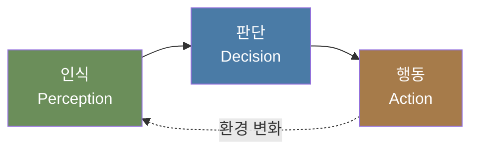

| 단계 | 역할 | 오늘의 노드 |
|------|------|------|
| **인식** | 센서 → 의미 있는 값 | `hand_classifier`(Day 5 `sign_classifier`를 복사 + 손모양 모델) |
| **판단** | 값 → 무엇을 할지 결정 | **`decision_maker`·`hand_driver`** ← 오늘 신규 |
| **행동** | 결정 → 구동 명령 | `/cmd_vel` → turtlesim → 7.5에서 Day 6의 모터 노드 |

> **오늘의 핵심 —** 인식 노드의 코드(Day 5)와 행동 노드(turtlesim · Day 6 모터 노드)는 그대로 사용합니다. **새로 만드는 것은 손모양 모델과 판단 노드**입니다. 오늘 배우는 것은 **셋을 연결하는 방법**입니다.

**오늘 완성할 것** — 손모양으로 명령을 내리면 turtlesim이 직진 · 정지 · 좌우회전 · 180° 회전을 실행합니다. 같은 구조로 실습 차량을 움직입니다.

### 1.3 오늘의 흐름

| 단계 | 절 | 내용 | 산출물 |
|:--:|:--:|------|------|
| ① 구조·인식 | 2장·3장 | 3단 구조 · 손모양 학습 · 토픽 계약 | 손모양 모델 · 계약 표 |
| ② 판단 | 4장 | 판단 노드 작성 — 상태 기계 | `decision_maker` |
| ③ 통합 | 5장 | launch로 전체 기동 · 연결 확인 | `full_launch.py` |
| ④ 보강 | 6장 | 안전 감시 · 반응 지연 실측 · 커스텀 msg · launch 인자 | 강화된 `decision_maker` |
| ⑤ 미니프로젝트 | 7장 | 손모양 명령 주행 → 실습 차량 실험 | `hand_driver` · 실측 표 |

- 8장 요약 이후의 **9장 보충**은 진도에 여유가 있을 때 다루는 독립 내용입니다

> 오늘은 turtlesim에서 검증한 구조를 **같은 날 7.5에서 실습 차량으로 옮깁니다.** turtlesim을 Day 6의 모터 노드로 교체하고, 회전 시간과 직진 속도를 실측합니다. 다음 시간(Day 9)에는 이 실측값으로 라인 주행과 초음파 정지를 결합합니다.

### 1.4 준비물

| 준비물 | 용도 | 확인 |
|------|------|------|
| 강의실 PC 웹캠(또는 노트북 카메라) | 손모양 촬영 — Teachable Machine(2.6) | 브라우저 카메라 권한 |
| RPi5 + 카메라 모듈 | 인식 노드 실행(2.7) | Day 4의 카메라 노드 실행 |
| Day 5 `sign_classifier` | `hand_classifier`의 복사 원본(2.7) | `my_car_pkg`가 빌드되어 있음 |
| 실습 차량(팀 공용 1대) | 7.5 실습 차량 실험 — Day 6 `motor_node` | 배터리 충전 |
| 줄자 · 스톱워치(휴대전화) | 회전 시간 · 직진 속도 실측 | — |
| 필기구 | 「예측」 단계에서 실행 전에 결과를 적음 | — |
| AI 코딩 도구 | 응용 실습과 4.2 · 7.3 단계의 코드 작성 | — |

- 개발은 RPi5에서 진행하고, turtlesim은 **RPi5 원격 데스크톱 화면**의 터미널에서 실행합니다(Day 6 자료 4.5와 같은 방식)
- 강의실 PC의 WSL2에서는 RPi5의 토픽이 조회되지 않습니다(9/28 강의실 실측)

> **진행 방식 —** 각 절에서 설명과 실습을 단계별로 번갈아 진행합니다.
>
> - 실습에서는 단계마다 결과를 확인한 뒤 다음 단계로 넘어갑니다. 「예측」이 있는 단계에서는 실행 전에 결과를 먼저 적습니다
>
> - 그림의 수치는 실제 값입니다 — 이 강의를 준비하며 PC의 WSL2(Ubuntu 24.04 · Jazzy)에서 turtlesim과 노드를 실행해 기록한 값이거나, 예시 점수 · 합성 영상을 코드로 처리한 값입니다(그림 제목에 구분 표기)
>
> - 절 끝의 「응용 실습」에는 코드가 없습니다 — AI 코딩 도구로 작성하는 과제입니다. 조건을 이해해야 해결할 수 있습니다

---

## 2. 인식-판단-행동 구조와 인식 단계

### 2.1 왜 노드를 나누는가

세 기능을 한 노드에 모두 포함할 수도 있습니다. 그러나 기능별로 나눕니다.

| 이유 | 내용 |
|------|------|
| **교체 가능** | 인식을 색 검출 → AI로 바꾸어도 **판단·행동은 동일** |
| **대상 교체** | 행동을 turtlesim → 모터로 바꾸어도 **인식·판단은 그대로** ← **7.5의 핵심** |
| 개별 확인 | 문제가 생겼을 때 어느 단계인지 좁힐 수 있음 |
| 병렬 처리 | 노드가 분리되면 각각 독립 실행(Day 2 수업 보충) |

- 이것이 Day 1 자료 2.2에서 말한 "**노드 = 기능 단위**"의 실제 효용
- 오늘 만드는 구조가 **7.5에서 노드 하나만 바꾸어 실물이 되는** 근거

### 2.2 각 단계의 책임 범위

| 단계 | 담당 기능 | **담당하지 않는 범위** |
|------|------|------|
| 인식 | 센서 → 값 (손모양 이름·좌표) | **행동을 결정하지 않음** — "정지하라"가 아니라 "`stop` 손모양이 인식되었다" |
| 판단 | 값 → 행동 결정 | **센서를 직접 읽지 않음** · 구동부를 직접 다루지 않음 |
| 행동 | 결정 → 구동 명령 | **결정의 근거를 확인하지 않음** — 받은 명령을 실행 |

> **자주 하는 실수 —** 인식 노드에서 `/cmd_vel`을 직접 발행하려는 생각이 들기 쉽습니다. **그러면 인식과 판단이 섞여** 나중에 규칙을 바꿀 때 인식 코드를 고쳐야 합니다.
>
> Day 5 자료 12장의 `line_follower`(자습)가 이 형태입니다(인식 + 판단 + 행동이 한 노드). Day 9에서 이 노드를 **인식(`line_detector`)과 판단(`line_driver`)으로 나눕니다.**

### 2.3 판단 노드의 처리 범위

판단 노드에는 **상태**가 있습니다. Day 3 자료 9.2의 미로 상태 기계와 같은 구조입니다.

| 상태 | 조건 | 행동 |
|------|------|------|
| `DRIVE` | 손모양 없음(`none`) | 전진 |
| `STOP` | `stop` 손모양 | 정지 |
| `RESUME` | `stop`이 사라짐 | 잠시 후 `DRIVE`로 |

- 상태를 두는 이유 — **같은 입력이라도 직전 상황에 따라 다르게 행동**해야 하기 때문
- 예: `none`이 입력되어도 **방금 멈춘 직후**라면 곧바로 출발하지 않고 잠시 기다림

### 2.4 왜 인식 단계를 다시 만드는가

Day 5에서는 인터넷의 표지 이미지로 `stop`·`go`를 학습했습니다. 그 결과 **붉은색만 보여도 `stop`으로 판정**하는 경우가 있었습니다.

| 구분 | Day 5 표지 학습 | 오늘 손모양 학습 |
|------|------|------|
| 데이터 | 인터넷의 표지 이미지 | PC 웹캠으로 직접 촬영 |
| 클래스 | `stop`·`go`·`none` 3종 | 6종(2.5) |
| 구분 단서 | 색만으로도 구분됨 | 모양으로만 구분됨 |
| 용도 | 정지 · 주행 | 직진 · 정지 · 좌우회전 · 180° 회전 명령 |

> **데이터가 결과를 정합니다 —** 모델은 사람이 의도한 특징이 아니라 **클래스를 가장 쉽게 구분하는 단서**를 학습합니다. `stop` 사진에만 붉은색이 있으면 모양 대신 색을 학습합니다 — 이를 **지름길 학습**(shortcut learning)이라고 합니다.
>
> Day 5 자료 8.4의 원칙 그대로 이 문제는 코드로 해결되지 않습니다. **데이터를 바꾸어야 합니다.**

### 2.5 클래스와 손모양 정하기

| 클래스 | 명령(7장) | 손모양의 예 |
|------|------|------|
| `stop` | 정지 | 손바닥을 편 채 정면 |
| `go` | 출발 · 직진 | 엄지를 위로 |
| `left` | 좌회전 90° | 검지로 왼쪽을 가리킴 |
| `right` | 우회전 90° | 검지로 오른쪽을 가리킴 |
| `uturn` | 180° 회전 | 주먹 |
| `none` | 명령 없음 | 손이 없는 장면 · 손을 내린 상태 |

- **손모양은 각자 정합니다** — 위 표는 예입니다. 클래스 이름은 표대로 영문 소문자를 사용합니다
- 클래스 이름은 `labels.txt`로 인식 노드에 전달되므로 **노드 코드는 고치지 않습니다**(Day 5 자료 10.3 — 라벨 읽기)

**손모양을 정하는 기준**

- **정지된 모양**으로 구분합니다 — 사진 한 장에는 움직임이 담기지 않습니다(9.7)
- 서로 닮지 않은 모양을 정합니다 — 펼친 손가락의 수나 방향을 다르게
- `left`·`right`를 같은 손의 좌우 대칭 모양으로 정하면 **혼동이 잦습니다**(Day 5 자료 14.3) — 대칭이면 사진을 더 많이 촬영합니다
- `none`에는 손이 없는 장면과 **명령이 아닌 손동작**을 함께 포함합니다 — 머리를 만지는 손 · 내려놓은 손
- 7.5의 실습 차량 실험에서는 팀이 모델 하나를 사용합니다 — 팀 안에서 손모양을 맞추어 두면 모델을 바꾸지 않고 교대로 실험할 수 있습니다

### 2.6 촬영 · 학습 · 재학습

절차는 Day 5 자료 7장\~8장과 같습니다. 강의실 PC 브라우저에서 진행합니다.

1. **Teachable Machine** 접속 → **Image Project** → **Standard image model**(Day 5 자료 7.3 ①)
2. Class 1의 이름을 `stop`으로 변경 → **Webcam** → **Hold to Record**로 약 100장 촬영
3. **Add a class**로 나머지 5종을 추가해 같은 방식으로 촬영 — 클래스마다 장수를 비슷하게
4. **Train Model** — 1\~3분 동안 **이 탭을 화면에 유지**(다른 탭으로 이동하면 학습이 늦어지거나 멈춤)

- 카메라 권한이 거부되어 촬영 화면이 표시되지 않으면 → 주소창 자물쇠 아이콘에서 카메라를 **허용**으로 바꾸고 **2를 다시** 수행
- 진행 막대가 멈춘 채 5분이 지나면 → 탭을 새로 고치지 않고 교수에게 알림(새로 고치면 촬영분이 사라집니다)

**촬영 조건 통제** — 같은 조건으로만 촬영하면 모델이 그 조건에서만 동작합니다.

| 조건 | 변화 범위 | 이유 |
|------|------|------|
| 거리 | 카메라에서 30 · 60 · 100cm | 차량 카메라와 손의 거리가 일정하지 않음 |
| 위치 | 화면 가운데 · 왼쪽 · 오른쪽 | 손이 화면 어디에 있어도 판정되도록 |
| 각도 | 손목을 조금씩 기울임 | 같은 모양도 기울기가 달라짐 |
| 배경 | 최소 2종 — 얼굴 · 옷 포함 | 배경을 단서로 학습하는 것을 방지 |
| 사람 | 팀원 2명 이상의 손 | 손의 크기 · 피부색을 단서로 학습하는 것을 방지 |

> **자주 하는 실수 —** 손을 한 자리에 고정한 채 연속 촬영하면 **거의 같은 사진 100장**이 됩니다. 촬영하는 동안 거리 · 위치 · 기울기를 계속 바꿉니다(Day 5 자료 7.2와 같은 원리).

**검증과 오분류 유도** — 학습이 끝나면 Preview에서 확인합니다.

| 시도 | 확인 항목 |
|------|------|
| 6종을 차례로 만듦 | 각 클래스 막대가 90% 이상 |
| `left`와 `right`를 번갈아 만듦 | 둘이 서로 혼동되지 않는가 |
| `go`와 `stop`을 번갈아 만듦 | 손가락 모양의 차이로 구분되는가 |
| 손을 멀리 · 화면 가장자리에 | 신뢰도가 크게 떨어지지 않는가 |
| 다른 사람의 손 · 다른 배경 | 촬영하지 않은 조건에서도 판정되는가 |

**재학습** — 오분류가 난 조건의 사진을 해당 클래스에 **30\~50장 추가**하고 **Train Model**을 다시 실행합니다.

- 이 순환을 **최소 1회** 수행합니다 — 첫 학습 결과로 끝내지 않습니다(Day 5 자료 8.5)
- 어떤 조건에서 틀렸는지 기록합니다 — 7.5 실습 차량에서 오작동할 때 원인을 찾는 근거가 됩니다

> **학습 프로젝트를 저장합니다 —** Teachable Machine에서는 탭을 닫으면 작업 내용이 사라집니다. 좌상단 메뉴의 **Save project to Drive** 또는 **Download project as file**로 저장합니다. **Day 9에서 차량 카메라 시점의 사진을 더해 다시 학습**할 때 이 프로젝트를 다시 엽니다.

**반출** — **Export Model** → **Tensorflow Lite** → **Floating point** → **Download my model**(Day 5 자료 9.2)

- 압축을 풀면 `model_unquant.tflite`·`labels.txt` 두 파일이 있습니다
- `labels.txt`의 줄 순서가 모델의 출력 번호 순서입니다

> **예측** — 2.5의 표 순서대로 클래스를 만들었다면 `labels.txt`는 몇 줄입니까? `uturn`은 몇 번입니까?

<details>
<summary>예측 대조</summary>

- 6줄 · `uturn` = 4번 — 번호는 0부터 시작합니다

```
0 stop
1 go
2 left
3 right
4 uturn
5 none
```

- Teachable Machine의 클래스 순서를 바꾸어 학습하면 번호도 바뀝니다 — 노드는 번호를 `labels.txt`로 이름에 대응시키므로 두 파일을 항상 함께 옮깁니다

</details>

### 2.7 손모양 인식 노드 만들기와 RPi5 적용

Day 5의 `sign_classifier`는 그대로 두고, 그 코드를 복사해 손모양 전용 노드 `hand_classifier`를 만듭니다. 노드 이름과 토픽 이름이 인식 대상을 나타내야 연결도만 보고도 무엇을 판정하는 노드인지 알 수 있습니다.

| 구분 | Day 5 | 오늘 |
|------|------|------|
| 노드 · 파일 | `sign_classifier` · `sign_classifier.py` | `hand_classifier` · `hand_classifier.py` |
| 모델 폴더 | `model/` | `model/hand/` |
| 토픽 | `/sign` · `/sign_confidence` · `/sign_stable` | `/hand` · `/hand_confidence` · `/hand_stable` |

**①** 모델 파일을 RPi5로 옮깁니다.

```bash
mkdir -p ~/ros2_ws/src/my_car_pkg/model/hand
```

- VS Code 원격 탐색기에서 `model/hand` 폴더로 두 파일을 끌어다 놓습니다(Day 5 자료 9.3 ②와 같은 방법)
- `ls ~/ros2_ws/src/my_car_pkg/model/hand`에 `model_unquant.tflite` · `labels.txt`가 보이면 → ②로 진행
- 두 파일이 `model/` 바로 아래에 들어갔으면 → Day 5 표지판 모델을 덮어쓴 것입니다. 두 파일을 `hand` 폴더로 옮기고 **①을 다시** 확인
- `model` 폴더가 없다는 오류가 나오면 → Day 5 자료 9.3 **②-1부터** 수행

**②** Day 5 파일을 복사한 뒤 사본에서 이름을 고칩니다.

```bash
cd ~/ros2_ws/src/my_car_pkg/my_car_pkg
cp sign_classifier.py hand_classifier.py
```

| 위치 | 고치기 전 | 고친 뒤 |
|------|------|------|
| 클래스 | `class SignClassifier(Node):` | `class HandClassifier(Node):` |
| 노드 이름 | `super().__init__('sign_classifier')` | `super().__init__('hand_classifier')` |
| 모델 경로 2줄 | `os.path.join(share, 'model', …)` | `os.path.join(share, 'model', 'hand', …)` |
| 발행 토픽 3개 | `'/sign'`으로 시작하는 이름 | 앞부분을 `'/hand'`로 |
| 로그 문구 | `'sign_classifier ready …'` | `'hand_classifier ready …'` |
| `main` | `node = SignClassifier()` | `node = HandClassifier()` |

- `'/sign_stable'` 줄은 Day 5 자료 11.3의 안정화 코드를 넣었을 때만 있습니다 — 없으면 2.8의 필수 단계에서 추가합니다
- VS Code의 찾기(`Ctrl+F`)로 `sign`을 검색하면 고칠 곳이 모두 표시됩니다 — 고친 뒤 다시 검색해 남은 곳이 없는지 확인합니다

> **예측** — 모델 경로 2줄만 고치지 않고 빌드하면 오류가 납니까? ⑤에서 로그의 `labels:`에는 무엇이 출력됩니까?

**③** `hand_classifier.py`에 좌우 반전 파라미터를 추가합니다.

```python
# __init__ — threshold·period 선언 다음 줄
self.declare_parameter('flip', False)                     # ⑩ 좌우 반전 켜고 끄기

# infer — img = cv2.resize(...) 다음 줄
if self.get_parameter('flip').value:                      # ⑩ 켜져 있으면
    img = cv2.flip(img, 1)                                # 좌우 반전
```

- 추론할 때마다 값을 확인하므로 실행 중 `param set`으로 바꾸어도 즉시 반영됩니다(Day 5 자료 10.5)

> **예측** — 왼쪽을 가리키는 영상에 `cv2.flip(img, 1)`을 적용하면 화살표는 어느 쪽을 가리킵니까? 두 번째 인자를 `0`으로 바꾸면 어떻게 됩니까?

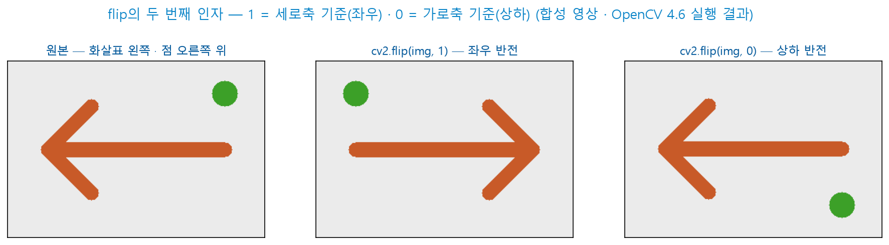

- `cv2.flip`의 두 번째 인자 = 반전 축 — `1`은 세로축 기준(좌우 반전) · `0`은 가로축 기준(상하 반전)
- 상하 반전에서는 화살표의 방향이 유지되고 점의 위치만 아래로 이동합니다
- 그림은 손 사진이 아니라 화살표를 그린 합성 영상에 OpenCV를 적용한 결과입니다

<details>
<summary>예측 대조</summary>

- `flip(img, 1)` = 오른쪽을 가리킴 — `left` 손모양이 `right`로 판정되는 원인과 같은 변환입니다

- `flip(img, 0)` = 왼쪽 그대로 · 위아래만 뒤집힘 — 좌우 혼동은 해소되지 않습니다(2.9)

</details>

**코드 읽기 — Python 문법 ① 파라미터와 조건** — Day 5 자료 10.3의 형태가 다시 나타납니다.

| 코드 | 뜻 |
|------|------|
| `self.declare_parameter('flip', False)` | 이름과 기본값으로 파라미터 선언 — 기본값이 `False`이면 참·거짓 타입 |
| `self.get_parameter('flip').value` | 점 연결 — 파라미터 객체를 얻은 뒤 그 값을 읽음 |
| `if ….value:` | 참·거짓 값을 그대로 조건으로 사용 — `….value == True`로 적지 않음 |
| `img = cv2.flip(img, 1)` | 결과를 같은 변수에 다시 대입 — 이후 줄은 반전된 영상을 사용 |
| `line.split(' ', 1)[1]` | 라벨 읽기(Day 5 문법 ⑤) — `2 left` → `left` |

- 이 표는 **Day 9의 코드 설명에도 같은 형태로 다시 실립니다** — 지금 모두 암기할 필요는 없습니다. 코드를 읽을 때마다 표를 참조해 확인합니다

**④** `setup.py`에 노드와 모델 폴더를 등록합니다 — 모델 폴더는 Day 5 자료 9.3 ③과 같은 형식입니다.

```python
# entry_points의 console_scripts 목록에 추가
'hand_classifier = my_car_pkg.hand_classifier:main',

# data_files 목록에 추가
('share/' + package_name + '/model/hand', ['model/hand/model_unquant.tflite',
                                           'model/hand/labels.txt']),
```

**⑤** 빌드하고 실행합니다.

```bash
cd ~/ros2_ws && colcon build && source install/local_setup.bash
ros2 run my_car_pkg hand_classifier
```

- 로그에 `labels: ['stop', 'go', 'left', 'right', 'uturn', 'none']`이 출력되면 → 2.8로 진행
- 라벨이 예전 3종으로 출력되면 → 모델 경로 2줄을 고치지 않아 Day 5 모델을 읽은 것입니다. ②의 표를 확인하고 **빌드부터 다시** 실행
- 모델 파일을 열 수 없다는 오류(`model/hand`가 포함된 경로)가 나오면 → ④의 `data_files` 줄을 확인하고 **빌드부터 다시** 실행
- `executable 'hand_classifier' not found`가 나오면 → ④의 `entry_points` 줄을 확인하고 **빌드부터 다시** 실행
- `IndentationError`가 나오면 → ③의 들여쓰기를 주변 줄과 맞추고 **빌드부터 다시** 실행

> **Tip — 정확도가 부족할 때 —** PC 웹캠과 RPi5 카메라는 렌즈 특성이 다릅니다. 판정이 계속 불안정하면 RPi5 카메라로 촬영한 사진을 학습에 추가합니다(Day 5 자료 14.1).

<details>
<summary>예측 대조 (②의 예측)</summary>

- 오류 없이 빌드 · 실행됩니다 — Day 5 모델 파일도 같은 패키지 안에 있기 때문입니다

- `labels:`에 Day 5의 3종(`stop` · `go` · `none`)이 출력됩니다 — 이 노드는 손모양이 아니라 Day 5 표지판 모델로 판정합니다

- 경로 오류는 실행을 멈추지 않으므로 **로그의 라벨 목록**으로만 확인할 수 있습니다

</details>

### 2.8 인식 단계 확인

판단 노드를 만들기 전에 인식 단계가 정상인지 확정합니다.

```bash
# 터미널 1
ros2 run camera_ros camera_node
# 터미널 2
ros2 run my_car_pkg hand_classifier
# 터미널 3
ros2 topic list
ros2 topic echo /hand_stable
```

- `/hand_stable`이 목록에 있으면 → 「손모양 확인」 단계로 진행
- `/hand`는 있지만 `/hand_stable`이 목록에 없으면 → 복사 원본에 Day 5 자료 11.3의 안정화 코드가 없던 것입니다. 다음 슬라이드의 **필수 단계**를 수행
- 터미널 1에 `no cameras available`이 나오면 → CSI(Camera Serial Interface) 케이블 접점을 확인하고(Day 4 자료 4.1) **터미널 1부터 다시** 실행 → 그래도 실패하면 **Day 4 자료 6장**(카메라를 사용할 수 없을 때)의 방법으로 전환
- 터미널 2에 `ModuleNotFoundError: ai_edge_litert`가 나오면 → Day 5 **10.1 ①부터** 다시 수행

**`/hand_stable` 필수 단계** — `/hand_stable`이 없을 때만 수행합니다.

1. Day 5 자료 11.3의 두 코드 블록을 `hand_classifier.py`에 추가 — `__init__` 4줄 · `infer` 말미 9줄(위치 = Day 5 자료 11.3 「추가 위치」 표) · 발행 토픽 이름은 `'/hand_stable'`로 적음
2. **빌드부터 다시** 실행한 뒤 터미널 2의 노드를 재실행
3. `ros2 topic list`에 `/hand_stable`이 표시되면 → 아래 손모양 확인으로 진행
4. 여전히 없으면 → `stable_pub` 선언과 발행 줄이 **둘 다** 포함되었는지 확인하고 **1부터 다시** 수행

- `stable_n` 연속 확인으로 판정의 변동을 걸러 냅니다 — 오늘 판단 노드는 이 토픽만 구독합니다(3.2)

**주기 측정** — 두 토픽의 발행 주기를 측정합니다.

> **예측** — `period`는 0.2초입니다. `/hand`와 `/hand_stable` 가운데 어느 토픽이 더 자주 발행됩니까? `/hand_stable`은 판정이 바뀔 때만 발행됩니까?

```bash
ros2 topic hz /hand           # Ctrl+C로 종료
ros2 topic hz /hand_stable
```

<details>
<summary>예측 대조</summary>

- 두 토픽 모두 약 5 Hz(0.2초마다)입니다 — `/hand_stable`도 추론할 때마다 발행되며, 값만 확정 판정으로 유지됩니다(Day 5 자료 11.3 `infer` 말미의 발행 줄)

- 5 Hz보다 낮게 측정되면 추론 한 번이 0.2초보다 오래 걸린 것입니다(5.3)

</details>

**손모양 확인** — 카메라 앞에서 6종을 차례로 만들며 터미널 3의 값을 대조합니다.

| 손모양 | `/hand_stable` | 그렇지 않으면 |
|------|------|------|
| `stop`·`go`·`uturn` | 같은 이름 | 비슷한 모양과 혼동 → 2.6 재학습 |
| `left` | `left` | `right`가 출력되면 → 아래 좌우 반전 |
| `right` | `right` | `left`가 출력되면 → 아래 좌우 반전 |
| 손을 치움 | `none` | 계속 같은 이름 → 2.6에서 `none` 보강 |

> **예측** — `stop`을 보이다가 손을 치우면 `/hand_stable`이 `none`으로 바뀌기까지 `/hand`의 판정이 몇 번 필요합니까? 시간은 약 몇 초입니까?

<details>
<summary>예측 대조</summary>

- `none` 판정 **3번 연속**(`stable_n` 3) — 첫 `none` 판정 뒤 두 번 더 기다리므로 약 0.4초, 손을 치운 순간부터는 약 0.4\~0.6초입니다

- 이 시간이 오늘 반응 지연의 가장 큰 비중을 차지합니다(6.2)

</details>

**판정 규칙 확인** — 모델은 6개 클래스의 점수를 산출합니다. 노드는 가장 높은 점수를 선택하고, 그 점수가 `threshold`(0.7) 미만이면 `none`으로 판정합니다(Day 5 자료 10.2).

| 경우 | stop | go | left | right | uturn | none | 판정 |
|------|:--:|:--:|:--:|:--:|:--:|:--:|:--:|
| ㉠ | 0.93 | 0.02 | 0.01 | 0.01 | 0.01 | 0.02 | |
| ㉡ | 0.03 | 0.02 | 0.52 | 0.38 | 0.02 | 0.03 | |
| ㉢ | 0.04 | 0.03 | 0.12 | 0.74 | 0.04 | 0.03 | |

> **예측** — ㉠\~㉢의 판정을 적습니다. `threshold`를 0.9로 올리면 어느 경우의 판정이 바뀝니까?

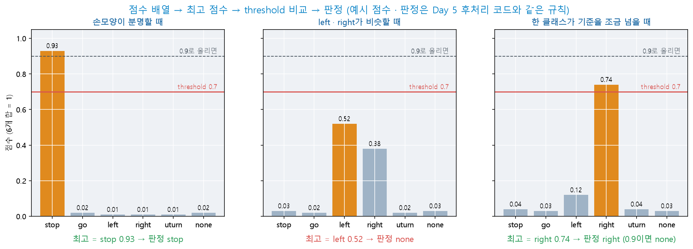

- 점수 6개의 합은 1입니다 — 한 클래스의 점수가 오르면 다른 클래스의 점수가 내려갑니다
- ㉡은 `left`가 가장 높지만 0.7 미만이므로 `none`입니다 — 비슷한 두 손모양에 점수가 나뉘면 판정이 도출되지 않습니다
- 그림의 점수는 예시 값입니다. 판정은 Day 5 후처리 코드와 같은 규칙으로 계산한 결과입니다

<details>
<summary>예측 대조</summary>

- ㉠ = `stop` · ㉡ = `none` · ㉢ = `right`

- `threshold` 0.9에서는 ㉢이 `none`으로 바뀝니다 — 기준을 높이면 오판정은 줄지만 판정이 도출되지 않는 프레임이 늘어납니다

</details>

**좌우가 바뀌어 판정될 때** — 브라우저의 웹캠 화면은 거울처럼 좌우가 반전되어 표시되는 경우가 많습니다. 학습 사진의 좌우가 RPi5 카메라 영상과 다르면 `left`와 `right`가 서로 바뀌어 판정됩니다.

```bash
ros2 param set /hand_classifier flip true
```

- `left`·`right`가 바르게 출력되면 → 노드를 실행할 때 `--ros-args -p flip:=true`를 지정합니다(launch에서는 5.1의 `parameters`에 `'flip': True`)
- 반전해도 같은 값이면 → 좌우 문제가 아니라 두 모양의 혼동입니다. `flip`을 `false`로 되돌리고 2.6에서 두 클래스를 재학습

- **인식 단계가 정상임을 먼저 확정**해야 오늘 문제가 생겼을 때 판단 노드를 원인으로 검토할 수 있습니다
- 이것이 4.3에서 다룰 **단계별 확인**의 예고입니다

### 2.9 응용 실습 — 반전해도 바뀌지 않는 판정

- 증상 — `ros2 param set /hand_classifier flip true`에 `Set parameter successful`이 출력되었지만 `left` 손모양이 계속 `right`로 판정됩니다
- 이 증상을 보인 학생의 ③ 코드는 아래와 같습니다

```python
if self.get_parameter('flip').value:
    img = cv2.flip(img, 0)
```

- 원인을 찾고, **전처리 결과를 이미지 파일로 저장하는 확인 스크립트**를 AI 코딩 도구로 작성해 수정 전후를 비교합니다

| 조건 | 내용 |
|------|------|
| 입력 | 손모양 사진 1장(카메라 영상에서 저장하거나 휴대전화로 촬영) |
| 처리 | 노드의 `infer`와 같은 순서 — 크기 조정 → 반전 |
| 출력 | 원본과 반전 결과를 나란히 붙인 이미지 1장 |

- **확인** — 결과 이미지에서 손가락이 가리키는 방향이 좌우로 바뀌어야 합니다

<details>
<summary>실습 정리</summary>

- 원인 = 두 번째 인자 `0` — 상하 반전이므로 좌우 방향은 바뀌지 않습니다(2.7 ③ 그림)

- `Set parameter successful`은 **값이 바뀌었다는 뜻**일 뿐이며, 코드가 그 값으로 무엇을 하는지는 이 메시지로 확인되지 않습니다

- 판정 이름만 보아서는 전처리의 오류를 찾기 어렵습니다 — 모델에 입력되는 영상을 직접 저장해 보는 방법이 가장 빠릅니다

</details>

### 2.10 응용 실습 — 신뢰도의 이동 평균

- `/hand_confidence`를 **최근 5회 신뢰도의 평균**으로 발행하도록 `hand_classifier`를 고칩니다
- 이동 평균은 Day 6 자료 10.1에서 초음파 거리값에 적용한 필터와 같은 원리입니다 — AI 코딩 도구로 작성합니다

| 조건 | 내용 |
|------|------|
| 평균 대상 | 매 추론의 신뢰도(가장 높은 점수) |
| 기록 길이 | 5 — 파라미터 `conf_window`로 변경 가능 |
| 시작 직후 | 기록이 5개 미만이면 있는 값만으로 평균 |

- **확인** — `ros2 topic echo /hand_confidence`에서 손모양을 바꿀 때 값이 한 번에 떨어지지 않고 몇 단계에 걸쳐 바뀌어야 합니다

<details>
<summary>실습 정리</summary>

- 평균을 내면 값의 요동이 줄어드는 대신 **변화가 늦게 나타납니다** — `stable_n`과 같은 상충 관계입니다(6.2)

- 평균한 신뢰도는 표시 · 기록용입니다 — 판정에는 해당 프레임의 점수를 그대로 사용합니다. 판정까지 평균으로 바꾸면 손모양이 바뀐 직후의 판정이 이전 손모양의 점수에 좌우됩니다

</details>

### 2.11 응용 실습 — 판정 열에서 `stable_n` 찾기

- 아래는 어떤 학생의 노드에서 기록한 판정 열입니다(0.2초 간격)
- 이 노드의 `stable_n`은 얼마입니까? 판정 열을 입력받아 `stable_n` 2 · 3 · 4 · 5의 출력 열을 계산하는 스크립트를 AI 코딩 도구로 작성해 확인합니다

| 순번 | 1 | 2 | 3 | 4 | 5 | 6 | 7 | 8 | 9 |
|------|:--:|:--:|:--:|:--:|:--:|:--:|:--:|:--:|:--:|
| `/hand` | stop | stop | none | stop | stop | stop | stop | go | go |
| `/hand_stable` | none | none | none | none | none | none | stop | stop | stop |

- 스크립트의 판정 규칙은 Day 5 자료 11.3의 안정화 코드와 같아야 합니다 — 시작할 때의 확정 값은 `none`입니다

<details>
<summary>실습 정리</summary>

- `stable_n` = 4 — 4번(`stop` 시작)부터 4개가 연속된 7번에서 처음 확정됩니다. 3이면 6번, 2이면 2번에서 확정됩니다

- 8 · 9번의 `go` 두 번으로는 확정이 바뀌지 않습니다 — 5이면 `stop`이 끝내 확정되지 않습니다

- 출력만 보고 설정값을 찾는 이 방법은 **실행 중인 노드의 설정을 확인할 수 없을 때**(기록 파일만 남은 경우) 사용합니다

</details>

### 2.12 응용 실습 — 흐려진 프레임만 건너뛰기

- 손모양을 유지하는 중 손이 잠시 흐려지면 그 프레임이 `none`이 되어 안정화 기록이 끊깁니다
- **`threshold` 미달로 `none`이 된 프레임은 안정화 기록에서 제외하도록** `hand_classifier`를 고칩니다 — AI 코딩 도구로 작성합니다

| 조건 | 내용 |
|------|------|
| 건너뛸 프레임 | 가장 높은 점수가 `threshold` 미만인 프레임 |
| 기록할 프레임 | 손을 치워 `none` 클래스 점수가 높은 프레임 — 반드시 기록 |

- **확인**
  - ① 손모양을 유지한 채 손을 조금씩 기울여도 확정이 유지됩니다
  - ② 손을 치우면 약 0.6초 뒤 `none`으로 바뀝니다

<details>
<summary>실습 정리</summary>

- 판정 **이름**(`name == 'none'`)으로 거르면 ②가 실패합니다 — 손을 치웠을 때의 실제 `none`도 기록에서 빠져 확정이 `none`으로 돌아오지 않습니다

- 미달 프레임과 실제 `none`은 이름이 같고 **점수**만 다릅니다 — 점수가 판정 이름으로 바뀌기 전의 신뢰도 값으로 걸러야 합니다

- 건너뛰는 동안에는 확정이 이전 값으로 유지됩니다 — 카메라가 계속 흐리면 마지막 명령이 계속 적용되는 위험이 있으므로 6.1의 신호 두절 감시와 함께 사용합니다

</details>

---

## 3. 토픽 계약 설계

### 3.1 계약이란

노드를 나누면 **노드 사이의 약속**이 필요합니다. 이 약속을 먼저 정하지 않고 코드부터 작성하면 노드가 연결되지 않습니다.

| 정할 것 | 예 |
|------|------|
| 토픽 **이름** | `/hand_stable` |
| **타입** | `std_msgs/msg/String` |
| **값의 의미** | `labels.txt`의 6종 중 하나(2.5) |
| **주기** | 약 5 Hz |
| **없을 때** | `none`을 계속 발행(침묵하지 않음) |

> **"없을 때 무엇을 발행하는가"를 반드시 정합니다 —** 손모양이 없다고 **발행을 멈추면** 판단 노드는 "손모양이 없는 것"과 "인식 노드가 정지한 것"을 구분할 수 없습니다. **`none`을 계속 보내는 것**이 안전합니다.

### 3.2 오늘의 계약 표

| 토픽 | 타입 | 발행 | 구독 | 의미 |
|------|------|------|------|------|
| `/camera/image_raw` | `sensor_msgs/Image` | `camera_node` | 인식 노드 | 원본 영상 |
| **`/hand_stable`** | `std_msgs/String` | `hand_classifier` | **판단 노드** | 안정화된 손모양 판정 |
| `/target_point` | `geometry_msgs/Point` | `color_tracker` | `decision_maker`(선택) | 대상 좌표·면적 |
| **`/cmd_vel`** | `geometry_msgs/Twist` | **판단 노드** | turtlesim(→ 7.5 모터) | 속도 명령 |
| `/turtle1/pose` | `turtlesim/Pose` | turtlesim | `hand_driver`(7장) | turtle의 방향 `theta` |

- **`/cmd_vel`을 발행하는 노드는 하나뿐**이어야 합니다 — 둘이 동시에 발행하면 명령이 뒤섞임(Day 1 자료 2.2의 N:1 문제). 판단 노드는 4장 `decision_maker`와 7장 `hand_driver` 가운데 **하나만** 실행합니다
- turtlesim은 `/turtle1/cmd_vel`을 구독합니다 — 실행할 때 **remapping**으로 `/cmd_vel`에 연결합니다(4.3 · Day 6 자료 8.1과 같은 방법)

> **자주 하는 실수 —** turtlesim을 remapping 없이 실행하면 판단 노드가 `/cmd_vel`에 정상 발행해도 **turtle이 움직이지 않습니다.** 두 토픽의 이름이 다르므로 연결 자체가 성립하지 않기 때문입니다. 오류 메시지도 출력되지 않습니다. `ros2 topic info /cmd_vel`의 **구독자 수가 0**이면 이 경우입니다.

### 3.3 연결도

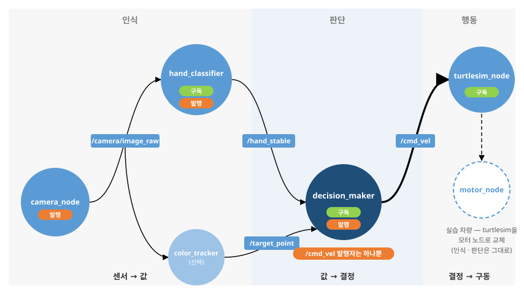

- 이 그림이 `rqt_graph`에 그대로 나타나야 합니다(5.3에서 확인)
- **점선이나 끊긴 화살표가 표시되면** 토픽 이름이 어긋난 것

**움직이는 그림 M8-1 — 손모양 명령의 전달 흐름(3.3)** (약 10.7초 자동 반복)


### 3.4 확인 활동 — 개념 점검

코드를 작성하기 전에 구두로 확인합니다.

| # | 질문 | 확인하려는 것 |
|:--:|------|------|
| 1 | 인식 노드가 `/cmd_vel`을 직접 발행하면 무엇이 곤란해지는가? | 2.2 — 책임 범위 |
| 2 | 손모양이 없을 때 인식 노드가 **발행을 멈추면** 판단 노드는 무엇을 구분할 수 없는가? | 3.1 — 침묵 ↔ 고장 |
| 3 | `/cmd_vel`을 두 노드가 동시에 발행하면 어떻게 되는가? | 3.2 — 발행자 단일 |
| 4 | `stop`이 사라지자마자 곧바로 출발하지 않는 이유는? | 2.3 — `RESUME` 상태 |
| 5 | 인식을 색 검출에서 AI로 바꾸면 판단 노드를 고쳐야 하는가? | 2.1 — 교체 가능 |

- 2번과 3번이 통합에서 실제로 문제가 발생하는 지점입니다
- 5번의 답이 "아니오"인 이유를 설명할 수 있으면 오늘 구조를 이해한 것

---

## 4. 실습 ① — 판단 노드

### 4.1 노드 설계

| 항목 | 내용 |
|------|------|
| 노드 이름 | `decision_maker` |
| 구독 | `/hand_stable` (`std_msgs/msg/String`) |
| 발행 | `/cmd_vel` (`geometry_msgs/msg/Twist`) |
| 파라미터 | `linear_speed`·`angular_speed`·`resume_delay` |
| 상태 | `DRIVE` · `STOP` · `RESUME` |
| 발행 주기 | 10Hz (타이머) |

**상태 전이**:

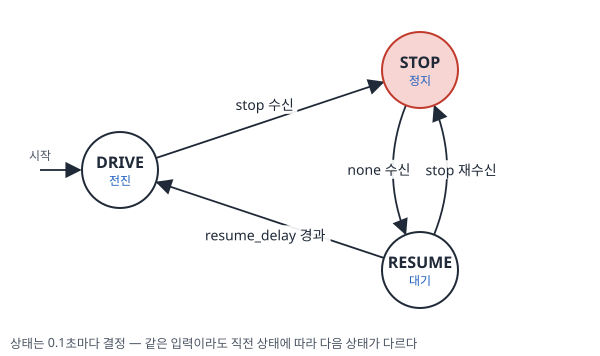

- `RESUME` 상태를 두는 이유 = 손을 내린 직후 급출발을 막는 것 · 실제 차량의 정지 후 재출발과 같은 취지

**움직이는 그림 M8-2 — `decision_maker`의 상태 전이(4.1 · 4.3 실측 시각)** (약 19초 자동 반복)


### 4.2 코드 작성 — 4단계

`~/ros2_ws/src/my_car_pkg/my_car_pkg/decision_maker.py`를 한 번에 완성하지 않고 4단계로 나누어 작성합니다. 단계마다 실행해 결과를 확인한 뒤 다음 단계로 넘어갑니다.

| 단계 | 추가 항목 | 작성 |
|:--:|------|------|
| 1 | 구독 · 보관 · 10Hz 고정 전진 발행 | 코드 제공 |
| 2 | `stop`이면 정지 | AI 코딩 도구 |
| 3 | 재출발 대기(`RESUME`) | AI 코딩 도구 |
| 4 | 상태 변화 로그 · `resume_delay` 파라미터 | 코드 제공 |

- 단계 4까지 합친 코드는 그 뒤의 「참고 코드」에 있습니다 — AI 코딩 도구의 결과와 대조할 때 사용합니다

**단계 1 — 구독 · 보관 · 고정 전진 발행**

```python
import rclpy
from rclpy.node import Node
from std_msgs.msg import String
from geometry_msgs.msg import Twist

class DecisionMaker(Node):
    def __init__(self):
        super().__init__('decision_maker')
        self.declare_parameter('linear_speed', 1.0)
        self.declare_parameter('angular_speed', 0.3)

        self.state = 'DRIVE'                                  # ② 초기 상태
        self.hand = 'none'

        self.sub = self.create_subscription(                  # ③ 인식 결과 구독
            String, '/hand_stable', self.on_hand, 10)
        self.pub = self.create_publisher(Twist, '/cmd_vel', 10)
        self.timer = self.create_timer(0.1, self.control)     # ④ 10Hz 제어 주기

    def on_hand(self, msg):
        self.hand = msg.data                                  # 보관만 — 판단은 타이머에서

    def control(self):
        # (단계 2·3 — 상태 전이를 이 자리에 추가)

        twist = Twist()                                       # ⑦ 상태별 행동
        if self.state == 'DRIVE':
            twist.linear.x = self.get_parameter('linear_speed').value
            twist.angular.z = self.get_parameter('angular_speed').value
        self.pub.publish(twist)                               # STOP·RESUME은 0으로 발행

def main(args=None):
    rclpy.init(args=args)
    node = DecisionMaker()
    try:
        rclpy.spin(node)
    except KeyboardInterrupt:
        pass
    finally:
        node.destroy_node()
        rclpy.shutdown()
```

| # | 설명 |
|:--:|------|
| ② | 상태와 최신 판정을 멤버 변수로 보관 |
| ③ | 구독 콜백은 **보관만** — Day 5 자료 10.3과 같은 구조 |
| ④ | **제어는 타이머가 담당** — 인식 주기와 제어 주기를 분리 |
| ⑦ | `Twist()`의 기본값이 0이므로 **STOP에서는 그대로 발행**하면 정지 |

**코드 읽기 — Python 문법 ① 클래스와 객체** — Day 5 자료 5.3·10.3의 형태가 이 노드에도 그대로 나타납니다.

| 코드 | 뜻 |
|------|------|
| `class DecisionMaker(Node):` | 괄호 = 상속 — `Node`를 상속한 새 클래스 |
| `def __init__(self):` | 객체를 만들 때 한 번 실행되는 초기화 메서드 |
| `super().__init__('decision_maker')` | 부모(`Node`)의 초기화를 먼저 실행 — 노드 이름 등록 |
| `self.state = 'DRIVE'` | `self.` = 이 객체의 변수 — `control()`에서 같은 값을 다시 사용 |
| `def control(self):` | 메서드 정의 — 타이머가 주기마다 호출 |

`setup.py` 등록:

```python
'decision_maker = my_car_pkg.decision_maker:main',
```

```bash
cd ~/ros2_ws && colcon build && source install/local_setup.bash
```

- `Summary: 1 package finished`가 출력되면 → 다음 실행 명령으로 진행
- `IndentationError`·`SyntaxError`가 나오면 → 오류가 가리키는 줄의 들여쓰기·괄호·따옴표를 확인하고 **빌드부터 다시** 실행

```bash
# 터미널 1 — RPi5 원격 데스크톱 화면의 터미널 · /turtle1/cmd_vel을 /cmd_vel로 연결
ros2 run turtlesim turtlesim_node --ros-args -r /turtle1/cmd_vel:=/cmd_vel
# 터미널 2
ros2 run my_car_pkg decision_maker
```

- turtle이 완만한 곡선으로 주행하면 → 단계 2로 진행. 이후 단계에서는 터미널 2만 Ctrl+C → 빌드 → 다시 실행합니다(터미널 1 유지)
- turtle이 전혀 움직이지 않으면 → `ros2 topic info /cmd_vel`의 구독자 수를 확인 → 0이면 터미널 1의 `-r` 부분이 빠진 것입니다. **터미널 1부터 다시** 실행 → 1이면 `ros2 topic hz /cmd_vel`을 확인하고 **터미널 2부터 다시** 실행
- `executable 'decision_maker' not found`가 나오면 → `setup.py` 등록 줄의 쉼표·따옴표를 확인하고 **빌드부터 다시** 실행

**단계 2 — `stop`이면 정지**(AI 코딩 도구로 작성)

- 요청에 포함할 조건 = 판정은 `control()`에서 · `on_hand`는 보관만 유지 · `self.hand`가 `'stop'`이면 상태 `'STOP'`, 그 밖의 판정이면 `'DRIVE'` · 행동 블록(⑦)은 변경하지 않음
- 터미널 3에서 판정 메시지를 명령으로 발행해 확인합니다

```bash
ros2 topic pub /hand_stable std_msgs/msg/String "{data: 'stop'}" --once
ros2 topic pub /hand_stable std_msgs/msg/String "{data: 'none'}" --once
```

> **예측** — `stop`으로 멈춘 turtle에 `none`을 발행하면 언제 다시 움직입니까?

- **확인** — `stop` 발행에 turtle이 멈추면 단계 3으로 넘어갑니다

<details>
<summary>예측 대조</summary>

- **곧바로**(다음 제어 주기 0.1초 안) 다시 움직입니다 — 단계 2에는 대기 상태가 없습니다

- 실제 차량이라면 손을 내리는 순간 급출발합니다 — 단계 3에서 재출발 전 대기(`RESUME`)를 둡니다(4.1)

</details>

**단계 3 — 재출발 대기(`RESUME`)**(AI 코딩 도구로 작성)

| 요청에 포함할 조건 | 내용 |
|------|------|
| 상태 3개 | `DRIVE` · `STOP` · `RESUME` — 4.1 상태도의 전이 4개 |
| 대기 시간 | `RESUME`에서 0.1초마다 누적 · 2.0초 이상이면 `DRIVE` |
| 누적값 | `STOP`이 될 때와 `RESUME`이 될 때 0으로 초기화 |
| 확인 순서 | `stop` 판정을 가장 먼저 확인 — 어느 상태에서든 즉시 `STOP` |

- **확인** — 단계 2의 두 명령으로 `stop` → `none`을 발행해 약 2초 뒤 다시 주행하면 단계 4로 넘어갑니다(정확한 시간은 4.3에서 측정)

**단계 4 — 상태 변화 로그 · `resume_delay` 파라미터**

```python
# __init__ — angular_speed 선언 다음 줄
self.declare_parameter('resume_delay', 2.0)          # ① 재출발 대기(초)
# __init__ — 맨 끝
self.get_logger().info('decision_maker started — state: DRIVE')

# control — 맨 앞
prev = self.state
# control — 상태 전이 블록 다음
if prev != self.state:                                # ⑥ 변화 시에만 로그
    self.get_logger().info(f'{prev} -> {self.state}')
```

- 단계 3의 대기 시간 `2.0`을 `self.get_parameter('resume_delay').value`로 바꿉니다

| # | 설명 |
|:--:|------|
| ① | 재출발 대기 시간을 **파라미터로**(Day 3 자료 5.3) — 현장에서 조정 |
| ⑥ | **변화 시에만 로그** — 매 주기 출력은 관찰을 방해 |

- **확인** — 노드를 다시 실행하면 `decision_maker started — state: DRIVE`가 출력됩니다. `stop`을 발행해 `DRIVE -> STOP` 한 줄이 출력되면 → 4.3으로 진행

<details>
<summary>참고 코드 — 단계 4까지 합친 `decision_maker.py`</summary>

```python
import rclpy
from rclpy.node import Node
from std_msgs.msg import String
from geometry_msgs.msg import Twist

class DecisionMaker(Node):
    def __init__(self):
        super().__init__('decision_maker')
        self.declare_parameter('linear_speed', 1.0)
        self.declare_parameter('angular_speed', 0.3)
        self.declare_parameter('resume_delay', 2.0)          # ① 재출발 대기(초)

        self.state = 'DRIVE'                                  # ② 초기 상태
        self.hand = 'none'
        self.resume_timer = 0.0

        self.sub = self.create_subscription(                  # ③ 인식 결과 구독
            String, '/hand_stable', self.on_hand, 10)
        self.pub = self.create_publisher(Twist, '/cmd_vel', 10)
        self.timer = self.create_timer(0.1, self.control)     # ④ 10Hz 제어 주기
        self.get_logger().info('decision_maker started — state: DRIVE')

    def on_hand(self, msg):
        self.hand = msg.data                                  # 보관만 — 판단은 타이머에서

    def control(self):
        prev = self.state

        if self.hand == 'stop':                               # ⑤ 상태 전이
            self.state = 'STOP'
            self.resume_timer = 0.0
        elif self.state == 'STOP':
            self.state = 'RESUME'
            self.resume_timer = 0.0
        elif self.state == 'RESUME':
            self.resume_timer += 0.1
            if self.resume_timer >= self.get_parameter('resume_delay').value:
                self.state = 'DRIVE'

        if prev != self.state:                                # ⑥ 변화 시에만 로그
            self.get_logger().info(f'{prev} -> {self.state}')

        twist = Twist()                                       # ⑦ 상태별 행동
        if self.state == 'DRIVE':
            twist.linear.x = self.get_parameter('linear_speed').value
            twist.angular.z = self.get_parameter('angular_speed').value
        self.pub.publish(twist)                               # STOP·RESUME은 0으로 발행

def main(args=None):
    rclpy.init(args=args)
    node = DecisionMaker()
    try:
        rclpy.spin(node)
    except KeyboardInterrupt:
        pass
    finally:
        node.destroy_node()
        rclpy.shutdown()
```

- ⑤ 상태 전이 — Day 3 자료 9.2 미로 상태 기계와 같은 형태

</details>

**코드 읽기 — Python 문법 ② 조건 분기와 비교** — 상태 기계의 기본 구조입니다(참고 코드 기준).

| 코드 | 뜻 |
|------|------|
| `if …:` `elif …:` `elif …:` | **`elif`** = 앞 조건이 거짓일 때 이어서 확인 — 위에서부터 **처음 참이 된 경우 하나만** 실행되고 나머지는 건너뜀 |
| `self.hand == 'stop'` | `a == b` = 값이 같은지 비교 — 대입 `a = b`와 다름 |
| `prev != self.state` | `!=` = 다름 — 상태가 바뀐 순간을 찾는 비교 |
| `self.resume_timer >= …` | `>=` = 크거나 같음 |
| 아래쪽 `if self.state == 'DRIVE':` | 위 분기와 **별개 블록** — 먼저 상태를 정하고, 그 상태에 따라 행동을 정하는 2단 구성 |

**코드 읽기 — Python 문법 ③ 누적과 중첩 속성**

| 코드 | 뜻 |
|------|------|
| `self.resume_timer += 0.1` | **`+=`** = 기존 값에 더해 다시 대입 — `x = x + 0.1`과 같음 |
| `twist = Twist()` | 빈 메시지 객체 생성 — 모든 필드가 기본값 0(Day 5 자료 5.3의 `Point()`와 같은 형태) |
| `twist.linear.x = …` | 점을 이어 **중첩 필드**에 대입 — `linear` 안의 `x` |
| `f'{prev} -> {self.state}'` | f-문자열 — 중괄호 안 변수의 값이 그 자리에 삽입됨 |
| `try:` … `except KeyboardInterrupt:` … `finally:` | Ctrl+C로 종료해도 `finally`의 정리는 반드시 실행됨 |

- 위 세 표는 **Day 9의 코드에도 같은 형태로 다시 실립니다** — 지금 모두 암기할 필요는 없으며, 코드를 읽을 때마다 참조해 확인합니다

### 4.3 단독 확인

인식 노드 없이 **명령으로 판정 메시지를 직접 발행해** 판단 노드만 먼저 확인합니다. 4.2 단계 1의 터미널 1(turtlesim) · 터미널 2(`decision_maker`)를 실행한 상태에서 진행합니다.

```bash
# 터미널 3 — 판정 메시지를 명령으로 발행 (stop을 발행하고 1~2초 뒤 none)
ros2 topic pub /hand_stable std_msgs/msg/String "{data: 'stop'}" --once
ros2 topic pub /hand_stable std_msgs/msg/String "{data: 'none'}" --once
```

| 조작 | 예측(실행 전에 적음) |
|------|------|
| `stop` 발행 | 로그 · turtle의 움직임 |
| `none` 발행 | 로그의 순서와 줄 수 · 다시 주행하기까지의 시간 |

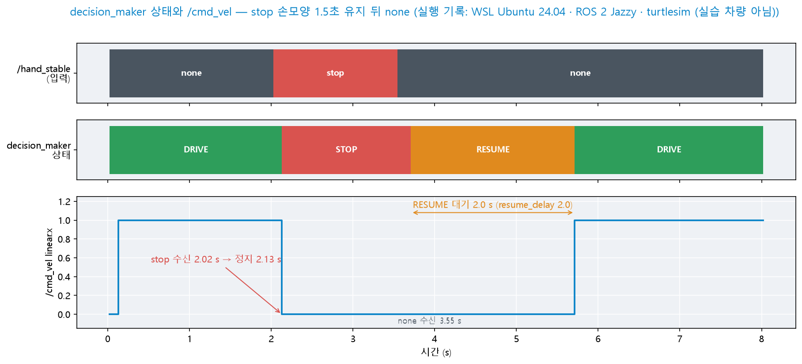

- 위에서부터 입력(`/hand_stable`) · `decision_maker`의 상태 · `/cmd_vel`의 `linear.x`입니다
- `stop` 수신 2.02초 → 정지 명령 2.13초 — 제어 주기 0.1초 안에 반영됩니다
- `none` 수신 3.55초 → `RESUME` 3.71초 → `DRIVE` 5.71초 — `RESUME`의 길이 2.0초가 `resume_delay`와 같습니다
- 그림은 PC의 WSL2에서 turtlesim으로 실행한 기록입니다(실습 차량 아님)

<details>
<summary>예측 대조</summary>

- `stop` 발행 = 0.1초 안에 정지 · 로그 `DRIVE -> STOP`

- `none` 발행 = 로그 2줄 `STOP -> RESUME` → `RESUME -> DRIVE` · 약 2.2초 뒤 다시 주행(상태 반영 최대 0.1초 + 대기 2.0초 + 다음 발행 최대 0.1초)

</details>

> **예측** — 정지한 turtle에 `none` 대신 `go`를 발행하면 어떻게 됩니까?

```bash
ros2 topic pub /hand_stable std_msgs/msg/String "{data: 'stop'}" --once
ros2 topic pub /hand_stable std_msgs/msg/String "{data: 'go'}" --once
```

- 4.3의 기록과 같이 동작하면 → 4.4로 진행
- `stop`을 발행해도 멈추지 않으면 → `ros2 topic list`로 토픽 이름이 `/hand_stable`인지 확인하고 **터미널 3을 다시** 실행
- 로그가 전혀 출력되지 않으면 → `ros2 node list`에 `/decision_maker`가 있는지 확인 → 없으면 **터미널 2를 다시** 실행

<details>
<summary>예측 대조</summary>

- `none`과 같습니다 — `RESUME`을 거쳐 약 2초 뒤 다시 주행합니다

- `decision_maker`는 **`stop`만 구분**합니다. `go` · `left` 등 나머지 판정은 모두 「`stop`이 아님」으로 처리됩니다. 6종 명령의 활용은 7장 `hand_driver`에서 다룹니다

</details>

> **이 확인 방법은 통합 전 필수 절차입니다 —** **상위 노드의 발행을 명령으로 대신해 하위 노드만 확인합니다.** 여기서 판단 노드가 정상임을 확인해 두면, 나중에 문제가 생겼을 때 **인식 노드를 먼저 점검**할 수 있습니다.

### 4.4 응용 실습 — 손모양으로 출발하기

- 실제 차량은 노드를 실행하자마자 주행하면 위험합니다. **`go` 손모양을 받아야 처음 출발하도록** `decision_maker`를 고칩니다 — AI 코딩 도구로 작성합니다

| 조건 | 내용 |
|------|------|
| 시작 상태 | 출발 대기 상태 `WAIT` — `/cmd_vel`에 0 발행 |
| 출발 | `WAIT`에서 `go`를 받으면 `DRIVE` |
| 그 밖 | `WAIT`에서는 `none` · `stop`을 받아도 그대로 · 출발 뒤 동작은 지금과 같음 |

- **확인**
  - ① 실행 직후 turtle이 멈추어 있음
  - ② `none`을 발행해도 움직이지 않음
  - ③ `go` 발행 즉시 주행
- 4.1 상태도에 `WAIT`와 전이를 필기로 추가합니다

<details>
<summary>실습 정리</summary>

- 시작 상태를 `'STOP'`으로만 바꾸면 첫 제어 주기에 `STOP -> RESUME`이 되어 2초 뒤 출발합니다 — 4.4 확인 항목 ②가 실패합니다

- 「정지」와 「출발 대기」는 **다음 상태로 넘어가는 조건이 다르므로** 다른 상태입니다. 상태를 추가할 때는 그 상태에서 다른 상태로 이어지는 전이를 먼저 정합니다

- 실습 차량(7.5)에서도 같은 안전 장치를 사용할 수 있습니다

</details>

### 4.5 응용 실습 — 번갈아 출력되는 STOP과 RESUME

- 증상 — `stop`을 발행한 뒤 turtle은 멈추어 있으나 로그가 0.1초마다 한 줄씩 계속 출력됩니다

```
[INFO] [decision_maker]: DRIVE -> STOP
[INFO] [decision_maker]: STOP -> RESUME
[INFO] [decision_maker]: RESUME -> STOP
[INFO] [decision_maker]: STOP -> RESUME
```

- 이 증상이 발생한 코드는 참고 코드와 상태 전이(⑤)의 **조건 순서만** 다릅니다. 원인이 되는 순서를 찾습니다
- 판정 열을 입력하면 주기별 상태 열을 출력하는 시험 스크립트를 AI 코딩 도구로 작성합니다(ROS 없이 실행). 그 스크립트로 두 순서를 비교합니다

| 조건 | 내용 |
|------|------|
| 입력 | 판정 열 — `stop` 8회 다음 `none` 25회(0.1초 간격) |
| 출력 | 주기마다 상태 1줄 |
| 비교 | 참고 코드의 순서 ↔ 바꾼 순서 |

<details>
<summary>실습 정리</summary>

- 원인 = `self.state == 'STOP'` 확인이 `self.hand == 'stop'` 확인보다 앞에 있음 — `STOP` 상태에서는 판정과 무관하게 `RESUME`으로 넘어가고, 다음 주기에 `stop`을 확인해 다시 `STOP`이 됩니다

- 두 상태 모두 0을 발행하므로 turtle은 멈춘 것처럼 보입니다 — **화면만 보면 정상이고 로그로만 드러나는** 결함입니다

- `elif`는 처음 참이 된 경우 하나만 실행합니다(코드 읽기 ②) — **조건의 순서가 곧 우선순위**입니다. Day 9의 결합 판단 노드도 같은 원리로 순서를 정합니다

</details>

---

## 5. 실습 ② — 통합 실행

### 5.1 통합 launch 작성

`~/ros2_ws/src/my_car_pkg/launch/full_launch.py`:

```python
from launch import LaunchDescription
from launch_ros.actions import Node

def generate_launch_description():
    return LaunchDescription([
        Node(package='camera_ros', executable='camera_node',
             parameters=[{'width': 640, 'height': 480}]),
        Node(package='my_car_pkg', executable='hand_classifier',
             parameters=[{'threshold': 0.7, 'period': 0.2, 'stable_n': 3,
                          'flip': False}]),                 # 2.8에서 반전이 필요했으면 True
        Node(package='my_car_pkg', executable='decision_maker',
             parameters=[{'linear_speed': 1.0, 'resume_delay': 2.0}]),
        Node(package='turtlesim', executable='turtlesim_node',
             remappings=[('/turtle1/cmd_vel', '/cmd_vel')]),   # 명령의 -r과 같은 연결
    ])
```

```bash
cd ~/ros2_ws && colcon build && source install/local_setup.bash
ros2 launch my_car_pkg full_launch.py
```

- launch는 **RPi5 원격 데스크톱 화면의 터미널**에서 실행합니다 — turtlesim 창이 그 화면에 표시됩니다
- turtlesim 창이 뜨고 네 노드의 로그가 함께 출력되면 → 5.2로 진행
- `file 'full_launch.py' was not found`가 나오면 → `setup.py`의 `data_files`에 `launch` 폴더가 등록되었는지 확인하고 **빌드부터 다시** 실행(Day 3 자료 8.3)
- 특정 노드만 실행되지 않으면 → 그 노드를 `ros2 run my_car_pkg <이름>`으로 **단독 실행해** 오류 메시지를 먼저 확인
- 구조는 Day 3 자료 8장과 동일 — **노드 4개를 한 명령으로**
- 파라미터를 launch에 담아 **현장 조정값을 한 곳에서 관리**(Day 3 자료 8.4)
- `remappings=[('원래 이름', '바꿀 이름')]` — 명령의 `--ros-args -r 원래:=바꿀`을 launch에 적는 형태입니다

> **자주 하는 실수 —** launch로 동시에 기동하면 **순서가 보장되지 않습니다**(Day 2 수업 보충). 카메라가 늦게 기동되면 인식 노드가 잠시 빈 화면을 처리합니다. 오늘 구조에서는 문제가 없으나, 서비스를 사용하는 경우라면 `wait_for_service`가 필요합니다.

### 5.2 동작 확인

카메라 앞에서 `stop` 손모양을 만든 뒤 내리면서 관찰합니다.

| 조작 | 예측(실행 전에 적음) |
|------|------|
| 손을 내림 | `/hand_stable`의 값 · turtle |
| **`stop` 손모양** | 손모양을 만든 순간부터 정지까지의 시간 |
| 다시 손을 내림 | 손을 내린 순간부터 다시 주행할 때까지 걸리는 시간 |

<details>
<summary>예측 대조</summary>

- 손을 내림 = `none` · turtle 주행

- `stop` 손모양 = **약 0.6초** 뒤 정지 — 같은 판정 3회 확인(약 0.4초) + 추론 대기(최대 0.2초) + 제어 주기(최대 0.1초). 실행 기록 평균 0.61초(6.2 그림)

- 다시 손을 내림 = `none` 확정(약 0.4\~0.6초) + 대기 2초 → 약 2.5초 뒤 다시 주행

</details>

- 예측과 대조해 같은 순서로 동작하면 → 5.3으로 진행
- `stop` 손모양을 만들어도 멈추지 않으면 → `ros2 topic echo /hand_stable`로 판정이 `stop`으로 바뀌는지 먼저 확인 → 바뀌지 않으면 **인식 단계 문제**(2.8 · Day 5 자료 10.4) · 바뀌었지만 멈추지 않으면 **5.3 연결 확인**으로
- turtle이 처음부터 움직이지 않으면 → `ros2 topic hz /cmd_vel` 확인 후 **4.3 단독 확인으로 돌아가** 판단 노드만 먼저 검증

- **반응 지연**이 관찰되면 원인이 둘 — `stable_n`(Day 5 자료 11.2)과 `resume_delay`(오늘 ①)
- 실행 중 조정:

```bash
ros2 param set /hand_classifier stable_n 2
ros2 param set /decision_maker resume_delay 1.0
```

### 5.3 연결 확인

```bash
rqt_graph
```

3.3의 그림과 대조합니다.

| 증상 | 원인 | 조치 |
|------|------|------|
| 3.3 그림과 같음 | 정상 | 아래 주기 확인으로 진행 |
| 노드는 있으나 **화살표가 없음** | 토픽 이름 불일치 | 계약 표(3.2)와 대조해 코드의 토픽 이름을 고치고 **빌드부터 다시** |
| `/cmd_vel`에 **화살표가 둘** | 발행 노드 중복 | 하나만 남기고 **5.1부터 다시** 실행 |
| 인식 노드가 목록에 없음 | 실행 실패 | 해당 터미널의 오류를 확인하고 **5.1의 단독 실행**으로 원인 특정 |

- `rqt_graph`는 창이 필요합니다 — SSH(Secure Shell)에서는 열리지 않으므로 **RDP(Remote Desktop Protocol)로 연결해 실행**하거나(Day 5 자료 3.5·2.5) `ros2 node info`·`ros2 topic info`로 대체합니다

```bash
ros2 topic hz /hand_stable      # 약 5Hz
ros2 topic hz /cmd_vel          # 약 10Hz
ros2 node info /decision_maker  # 구독·발행 목록 확인
```

- **주기가 설정과 다르면** CPU(Central Processing Unit)가 부족한 것 — `period`를 늘리거나 해상도를 낮춤
- 이 확인 절차가 **Day 9 실물에서 그대로 재사용**됩니다

### 5.4 응용 실습 — 움직이지 않는 turtle

- 증상 — launch가 오류 없이 실행되고 `decision_maker`의 로그도 정상이지만 turtle이 움직이지 않습니다. 이때의 출력은 아래와 같습니다(이 강의를 준비하며 실행한 기록)

```
$ ros2 topic info /cmd_vel
Publisher count: 1
Subscription count: 0
$ ros2 topic info /turtle1/cmd_vel
Publisher count: 0
Subscription count: 1
```

- 원인을 찾고, **한쪽이 비어 있는 토픽을 검출하는 점검 스크립트**를 AI 코딩 도구로 작성합니다

| 조건 | 내용 |
|------|------|
| 대상 | 실행 중인 모든 토픽 |
| 출력 | 발행자 0 또는 구독자 0인 토픽과 발행자·구독자 수 |
| 제외 | `/rosout` · `/parameter_events` — 모든 노드가 자동으로 만드는 토픽 |

- **확인** — `full_launch.py`에서 `remappings` 줄을 지우고 실행하면 `/cmd_vel`(구독자 0)과 `/turtle1/cmd_vel`(발행자 0)이 출력되어야 합니다. 확인 뒤 줄을 되돌립니다

<details>
<summary>실습 정리</summary>

- 원인 = turtlesim의 `remappings` 누락 — `decision_maker`는 `/cmd_vel`에, turtlesim은 `/turtle1/cmd_vel`에 연결되어 두 토픽이 **따로** 존재합니다

- 토픽 이름이 다르면 두 노드가 오류 없이 각자 동작합니다 — 「발행자 1 · 구독자 0」이 대표 신호입니다. `rqt_graph`에서는 두 노드 사이에 화살표가 없습니다(5.3 표 2행)

- 제외 목록이 없으면 구독자가 없어도 정상인 시스템 토픽까지 출력되어 원인 파악을 방해합니다

</details>

### 5.5 응용 실습 — 인식 노드 두 개를 함께 실행하기

- `flip`의 효과를 한 화면에서 비교하려고 `hand_classifier`를 두 개 실행합니다 — 하나는 `flip` False, 하나는 True
- 두 노드를 실행하는 `compare_launch.py`를 AI 코딩 도구로 작성합니다(`decision_maker`는 실행하지 않음)

| 조건 | 내용 |
|------|------|
| 노드 이름 | `hand_a`(`flip` False) · `hand_b`(`flip` True) |
| 토픽 | 두 노드의 판정 토픽 3개가 서로 겹치지 않음 — 예: `/a/hand_stable` · `/b/hand_stable` |
| 카메라 | 카메라 노드 1개를 두 노드가 함께 구독 |

- **확인**
  - ① `ros2 topic info /a/hand_stable`의 발행자가 1
  - ② `left`를 보이면 두 토픽 중 한쪽만 `left`
  - ③ `ros2 param set /hand_b flip false`가 `hand_b`에만 적용

<details>
<summary>실습 정리</summary>

- launch에서 `namespace='a'`만 지정하면 **토픽 이름이 바뀌지 않습니다** — 코드의 토픽 이름이 `/`로 시작하는 **절대 이름**이기 때문입니다. namespace는 `/`가 없는 상대 이름에만 붙습니다

- 이때 `ros2 topic info /hand_stable`의 발행자가 2로 표시됩니다 — 두 노드의 판정이 한 토픽에 섞여 발행되는 상태이며, 5.3 표의 「화살표가 둘」과 같습니다

- 해결 = `remappings`로 3개 토픽을 각각 바꿉니다. 노드 이름도 `name`으로 바꾸어야 5.5 확인 ③처럼 각 노드의 파라미터를 따로 조정할 수 있습니다

</details>

---

## 6. 실습 ③ — 통합 시스템 보강

### 6.1 안전 감시 — 신호 두절 대응

3.1에서는 "손모양이 없으면 `none`을 계속 발행"이라는 계약으로 침묵과 고장을 구분했습니다. 남은 질문 — **인식 노드가 실제로 종료되면** 판단 노드는 이를 어떻게 검출하는가.

| 지금 구조 | 문제 |
|------|------|
| 판단 노드는 **마지막으로 받은 값**을 계속 사용 | 마지막 값이 `none`이면 **인식이 정지한 채 계속 주행** |
| 로그·화면에는 아무 변화가 없음 | 오류 없이 진행되는 **무증상 상태** |

> **감시 대상은 값이 아니라 수신 자체입니다 —** "무엇이 왔는가"만 확인하면 이 상태를 검출할 수 없습니다. "**마지막으로 언제 왔는가**"를 함께 확인해야 합니다.

`decision_maker`에 추가:

```python
# __init__에 추가
self.declare_parameter('signal_timeout', 1.0)              # ① 허용 무수신 시간(초)
self.last_received = self.get_clock().now()                # ② 마지막 수신 시각
self.timeout_warned = False

# on_hand에 추가
self.last_received = self.get_clock().now()

# control 첫머리에 추가
elapsed = (self.get_clock().now() - self.last_received).nanoseconds / 1e9   # ③ 경과(초)
if elapsed > self.get_parameter('signal_timeout').value:
    self.pub.publish(Twist())                              # ④ 정지 발행 후 종료
    if not self.timeout_warned:
        self.get_logger().warn(f'hand signal lost ({elapsed:.1f}s) — stopped')
        self.timeout_warned = True
    return
self.timeout_warned = False
```

| # | 설명 |
|:--:|------|
| ① | 허용 무수신 시간을 **파라미터로** — 인식 주기(0.2초)보다 넉넉하게 |
| ② | `get_clock().now()` — **ROS 시간**을 읽는 표준 방법(`use_sim_time`이면 재생 시계를 따름 — Day 2 수업 보충). 수신 콜백마다 갱신 |
| ③ | 경과 시간 계산 — 나노초 단위이므로 `1e9`로 나누어 초로 변환 |
| ④ | 초과 시 **다른 판단보다 먼저 정지 발행 후 `return`** — 7.2 안전 우선과 같은 배치. 경고는 상태 변수로 **1회만** 출력 |

**코드 읽기 — Python 문법 ④ 시간 계산과 부정**

| 코드 | 뜻 |
|------|------|
| `self.get_clock().now()` | 점 연결 — 메서드가 반환한 객체의 메서드를 이어서 호출(Day 5 자료 5.3 문법 ②와 같은 형태) |
| `(a - b).nanoseconds` | 두 시각의 차 객체에서 나노초 값을 읽음 |
| `/ 1e9` | `1e9` = 10의 9제곱을 뜻하는 표기 — 나노초를 초로 환산 |
| `f'{elapsed:.1f}s'` | f-문자열의 **형식 지정** — 소수 첫째 자리까지 표시 |
| `if not self.timeout_warned:` | `not` = 참·거짓을 반대로 바꿈 — "아직 경고하지 않았으면" |
| `return` | 메서드를 즉시 끝냄 — `control()`의 이후 판단을 건너뛰는 **조기 종료** |

실험 — 통합 실행(5.1) 상태에서:

| 조작 | 예측(실행 전에 적음) |
|------|------|
| `hand_classifier` 터미널에서 `Ctrl+C` | 정지까지의 시간 · 경고 로그 횟수 |
| `hand_classifier` 재실행 | turtle의 동작 · `RESUME` 대기 여부 |

<details>
<summary>예측 대조</summary>

- `Ctrl+C` = 약 1초 뒤 정지(`signal_timeout`) · 경고 1회 — `timeout_warned`로 반복 출력이 억제됩니다

- 재실행 = 수신이 다시 시작되면 turtle이 즉시 주행합니다. 감시가 작동해 발생한 정지는 상태를 바꾸지 않는 조기 종료(④)이므로 `RESUME` 대기를 거치지 않습니다

</details>

- Day 2 수업 보충의 **Deadline** QoS가 같은 목적의 표준 장치 — 여기서는 원리를 코드로 직접 구현한 것(QoS 적용은 9.4 보충)
- **Day 9 대응** — 실물에서는 이 감시가 필수입니다. 초음파 신호가 끊긴 채 주행하면 충돌로 이어집니다

### 6.2 반응 지연 실측

5.2에서 "약 0.6초 후 정지"를 관찰했습니다. 그 시간이 어느 구간에서 발생하는지 **분해**하고 도구로 **측정**합니다.

| 구간 | 소요 | 근거 |
|------|:--:|------|
| 카메라 프레임 도착 | \~0.03초 | 30Hz 발행 |
| 추론 대기 | 0\~0.2초 | `period` — 타이머 주기 추론(Day 5 자료 10.2) |
| **안정화** | **(N−1) × 0.2 = 0.4초** | `stable_n` 3 — 같은 판정 3회 연속(Day 5 자료 11.2) |
| 판단 주기 | 0\~0.1초 | `decision_maker` 10Hz 타이머 |
| **합계** | **약 0.5\~0.75초** | 5.2 관찰값 0.6초와 부합 |

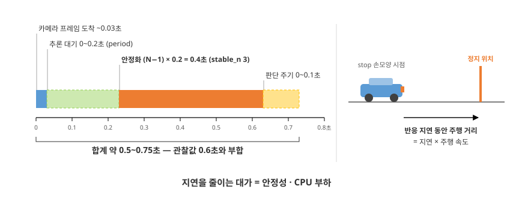

**움직이는 그림 M8-3 — 반응 지연의 구간 누적(6.2)** (약 15.5초 자동 반복)


**측정 방법 ① — rqt_plot** (Day 2 자료 7.6):

- `/hand_confidence`와 `/cmd_vel/linear/x`를 함께 표시
- `stop` 손모양을 만드는 순간 신뢰도가 상승하고, 잠시 뒤 `linear.x`가 0으로 내려감 — **두 변화의 간격이 반응 지연**
- `/hand_stable`은 문자열이므로 그래프로 표시할 수 없음 — rqt_plot은 수치 토픽만 표시

**측정 방법 ② — bag 타임라인**:

```bash
ros2 bag record /hand_stable /cmd_vel -o delay_test    # 기록하며 stop 손모양을 3회 반복
rqt_bag delay_test                                     # 타임라인에서 두 토픽의 변화 시점 대조
```

- `rqt_bag` — bag 파일을 시간축 위에 표시하는 도구. 메시지 하나하나의 기록 시각을 확인할 수 있음

> **예측** — `stable_n`을 3에서 2로 낮추면 손모양이 바뀐 순간부터 정지 명령까지의 시간은 얼마나 줄어듭니까? 4로 올리면 얼마나 늘어납니까?

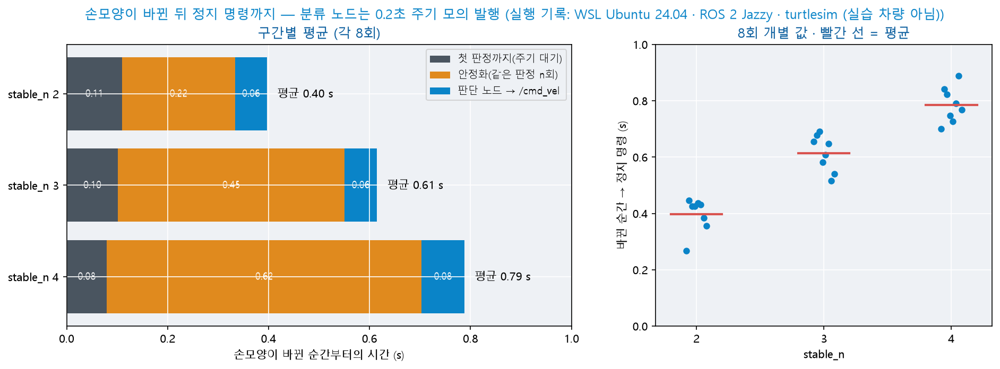

- 왼쪽 = 구간별 평균(각 8회) · 오른쪽 = 8회의 개별 값
- 늘어나고 줄어드는 것은 **안정화 구간**(주황)뿐입니다 — 첫 판정까지(주기 대기)와 판단 노드 구간은 `stable_n`과 무관합니다
- 같은 설정에서도 개별 값이 약 0.2초 범위로 흩어집니다 — 손모양이 바뀐 순간이 추론 주기의 어느 시점인지에 따라 달라지기 때문입니다
- 그림은 PC의 WSL2에서 분류 노드를 0.2초 주기로 모의 발행해 측정한 기록입니다(카메라 · 실습 차량 아님)

<details>
<summary>예측 대조</summary>

- `stable_n` 1 감소 = 약 0.2초(추론 주기 1회) 감소 — 3 → 2에서 평균 0.61 → 0.40초

- 4로 올리면 약 0.2초 증가 — 평균 0.79초

- 위 구간 표의 「(N−1) × 0.2」가 측정으로 확인됩니다

</details>

파라미터를 바꾸어 재측정 — **지연은 안정성·부하와 교환하는 관계**임을 확인:

| 조정 | 지연 변화 | 대가 |
|------|------|------|
| `stable_n` 3 → 2 | 안정화 0.4 → 0.2초 | 불안정한 판정이 통과하기 쉬워짐(Day 5 자료 11.2) |
| `period` 0.2 → 0.1 | 추론 대기 절반 | CPU 부하 증가(Day 5 자료 10.2) |
| `resume_delay` 축소 | 재출발이 빨라짐 | 손을 내린 직후 급출발 위험 |

- **Day 9 대응** — 실물의 제동 거리 ≈ 반응 지연 × 주행 속도. **주행 속도의 상한을 정하는 근거**가 이 측정입니다

### 6.3 판정과 신뢰도를 한 메시지로 — 커스텀 인터페이스 적용

`hand_classifier`는 `/hand_stable`(String)과 `/hand_confidence`(Float32)를 **별개 토픽**으로 발행합니다(Day 5 자료 10.2). 서로 다른 토픽이므로 도착 시점이 어긋날 수 있습니다 — "판정은 `stop`이지만 신뢰도는 직전 프레임의 값"인 순간이 생깁니다. **Day 3 자료 7.1의 "나누어 보내면 동시성이 깨진다"가 실제로 나타나는 지점**입니다.

`my_msgs/msg/HandResult.msg` 신설(Day 3 자료 7.2 절차 재사용):

```
string  name          # 판정 클래스 — labels.txt의 6종
float32 confidence    # 그 판정의 신뢰도 0.0 ~ 1.0
```

| 순서 | 작업 |
|:--:|------|
| 1 | `.msg` 추가 + `CMakeLists.txt`의 `rosidl_generate_interfaces`에 등록(Day 3 자료 7.3) |
| 2 | **`my_msgs`부터 빌드** — 사용하는 패키지만 빌드하면 옛 정의가 남음(Day 3 자료 7.4) |
| 3 | 사용하는 패키지의 `package.xml`에 `<depend>my_msgs</depend>` — Day 3에서 기선언했다면 생략 |

```bash
cd ~/ros2_ws
colcon build --packages-select my_msgs && source install/local_setup.bash
colcon build --packages-select my_car_pkg && source install/local_setup.bash
```

- `ros2 interface show my_msgs/msg/HandResult`에 두 필드가 출력되면 → 아래 코드 교체로 진행
- `Could not find the resource 'my_msgs'`가 나오면 → 1의 `CMakeLists.txt` 등록을 확인하고 **`my_msgs`부터 다시** 빌드
- 실행할 때 `ModuleNotFoundError: my_msgs`가 나오면 → `source` 줄을 실행하고 **다시** 실행
- 필드 이름이 예전 정의로 표시되면 → 2를 건너뛴 것입니다. **`my_msgs`부터 다시** 빌드

발행 노드(`hand_classifier`) 교체:

```python
from my_msgs.msg import HandResult

self.result_pub = self.create_publisher(HandResult, '/hand_result', 10)
...
out = HandResult()                        # infer 말미 — 한 메시지에 담아 발행
out.name, out.confidence = name, conf
self.result_pub.publish(out)
```

구독 노드(`decision_maker`):

```python
from my_msgs.msg import HandResult
self.sub = self.create_subscription(HandResult, '/hand_result', self.on_hand, 10)

def on_hand(self, msg):
    self.hand = msg.name
    self.conf = msg.confidence            # 같은 시점의 값임이 보장됨
```

- 신뢰도 활용 예 — 신뢰도가 낮은 `stop`도 **정지**로 처리(7.2 안전 우선 — 놓치는 것보다 과잉 정지가 안전) + 신뢰도를 로그에 함께 기록
- 기존 두 토픽을 유지한 채 **병행 발행**할 수도 있습니다 — 판단 노드만 `/hand_result`로 전환하는 **점진 이행**이 가능(계약 변경의 실무 방식)

### 6.4 launch 인자 — 실행 시점에 값 주입

5.1의 `full_launch.py`는 파라미터가 파일에 고정되어 있습니다 — 값을 바꾸려면 파일을 수정해야 합니다. **launch 인자**를 선언하면 실행 명령에서 값을 전달할 수 있습니다.

```python
from launch import LaunchDescription
from launch.actions import DeclareLaunchArgument          # 인자 선언
from launch.substitutions import LaunchConfiguration      # 선언된 인자의 값 참조
from launch_ros.actions import Node

def generate_launch_description():
    return LaunchDescription([
        DeclareLaunchArgument('resume_delay', default_value='2.0',      # ① 인자 + 기본값
                              description='재출발 대기 시간(초)'),
        Node(package='my_car_pkg', executable='decision_maker',
             parameters=[{'resume_delay': LaunchConfiguration('resume_delay')}]),   # ②
    ])
```

```bash
ros2 launch my_car_pkg full_launch.py                      # 기본값 2.0으로 실행
ros2 launch my_car_pkg full_launch.py resume_delay:=1.0    # 인자 주입
ros2 launch my_car_pkg full_launch.py --show-args          # 인자 목록·설명 확인
```

- `--show-args`에 `resume_delay`와 설명이 출력되면 → 인자 주입으로 진행
- `is not a valid launch argument`가 나오면 → `DeclareLaunchArgument`의 이름과 명령에 적은 이름이 같은지 확인하고 **다시** 실행
- 값을 넣어도 동작이 달라지지 않으면 → `ros2 param get /decision_maker resume_delay`로 **실제 주입된 값**을 먼저 확인(`LaunchConfiguration` 연결 누락이 흔한 원인)

| # | 설명 |
|:--:|------|
| ① | 인자 이름·기본값·설명 선언 — **기본값은 문자열로** 적음(`'2.0'`). 실행 시점에 launch가 해석 |
| ② | `LaunchConfiguration` = 자리 표시 — 실행 명령의 값이 여기에 대입됨 |

파라미터 주입 4방식 — 지금까지 배운 것의 총정리:

| 방식 | 값의 위치 | 적합한 상황 | 출처 |
|------|------|------|:--:|
| `--ros-args -p` | 명령 줄 | 노드 하나로 실험 | Day 3 자료 5.4 |
| `param set` | 실행 중 | 동작을 관찰하며 튜닝 | Day 3 자료 5.6 |
| launch 고정값 | launch 파일 | 확정 구성의 반복 실행 | Day 3 자료 8.4 |
| **launch 인자** | **파일 + 명령 줄** | **구성은 고정하되 일부 값만 실행마다 변경** | 오늘 |

> **자주 하는 실수 —** `default_value=2.0`처럼 **숫자로 적으면 오류**가 발생합니다. launch 인자의 기본값은 문자열(`'2.0'`)로 적습니다. 노드의 파라미터 타입으로는 실행 시점에 변환됩니다.

- Day 12 대응 — 팀 시연 장면마다 속도·지연을 다르게 실행할 때 파일 수정 없이 인자로 처리

### 6.5 응용 실습 — 판정 토픽을 바꾼 뒤의 신호 두절 감시

- 6.1에서 감시를 추가한 `decision_maker`가 구독하는 토픽을 6.3의 `/hand_result`로 바꿉니다. 이번에는 **새 콜백 `on_result`를 만들고**, 기존 `on_hand`와 `/hand_stable` 구독은 지웁니다 — AI 코딩 도구로 작성합니다

| 조건 | 내용 |
|------|------|
| 구독 | `/hand_result`(`HandResult`) 1개 — 콜백 `on_result` |
| 감시 | 6.1과 같은 동작 — 인식 노드가 종료되면 1초 뒤 정지 · 경고 1회 |
| 로그 | 상태가 바뀔 때 그 시점의 신뢰도를 함께 출력 |

- **확인** — ① 통합 실행에서 정상 주행 ② `hand_classifier`를 `Ctrl+C`로 종료하면 1초 뒤 정지 ③ 재실행하면 주행 복귀

<details>
<summary>실습 정리</summary>

- 마지막 수신 시각의 갱신 줄이 지운 `on_hand`와 함께 삭제되면 ①이 실패합니다 — 수신이 있어도 1초 뒤 정지하고 경고가 출력됩니다

- 갱신 줄을 `control()`로 옮기면 ②가 실패합니다 — 타이머가 매 주기 갱신하므로 인식이 끊겨도 감시가 동작하지 않습니다

- 「마지막으로 받은 시각」은 **수신 콜백에서만** 갱신합니다. 콜백을 바꾸면 감시 코드의 갱신 위치도 함께 옮깁니다

</details>

### 6.6 응용 실습 — 측정값에서 설정값 찾기

- 다음 표는 다른 학생의 노드에서 손모양이 바뀐 뒤 정지 명령까지를 8회 측정한 평균입니다. 이 노드의 `period`와 `stable_n`을 추정합니다

| 구간 | 평균(초) |
|------|:--:|
| 첫 판정까지(주기 대기) | 0.04 |
| 안정화 | 0.32 |
| 판단 노드 → `/cmd_vel` | 0.10 |

- 후보 조합(`period` 0.05\~0.4 · `stable_n` 2\~6)마다 두 구간의 기대값을 계산해 측정값과 차이가 작은 순으로 출력하는 스크립트를 AI 코딩 도구로 작성합니다

<details>
<summary>실습 정리</summary>

- 첫 판정까지의 평균 ≈ `period`의 절반 → `period` ≈ 0.1초(H4의 `period` 0.2초에서는 0.10초)

- 안정화 ≈ (`stable_n` − 1) × `period` → 0.32 ÷ 0.1 ≈ 3 → `stable_n` = 4 (이 강의 준비 실측 = `period` 0.1 · `stable_n` 4)

- 안정화 값 하나만 확인하면 `period` 0.3 · `stable_n` 2도 성립합니다 — **두 구간을 함께 고려해야** 하나로 정해집니다. 판단 노드 구간은 `decision_maker`의 타이머로 정해지므로 두 설정과 무관합니다

</details>

### 6.7 응용 실습 — 판정을 그래프로 그리기

- rqt_plot은 문자열 토픽(`/hand_stable`)을 표시하지 못합니다(6.2). **판정 이름을 번호로 바꾸어 발행하는 노드** `hand_to_id`를 AI 코딩 도구로 작성합니다

| 조건 | 내용 |
|------|------|
| 입력 · 출력 | `/hand_stable`(String) → `/hand_stable_id`(`std_msgs/msg/Int32`) |
| 번호 | `labels.txt`의 번호와 같음(2.6) · 목록에 없는 이름은 −1 |

- **확인** — rqt_plot에 `/hand_confidence/data`와 `/hand_stable_id/data`를 함께 표시하고 손모양을 바꿉니다. 판정 번호의 계단이 신뢰도 변화보다 늦게 나타나야 합니다

<details>
<summary>실습 정리</summary>

- 두 변화의 간격이 안정화 구간입니다 — H4의 주황 구간을 그래프에서 직접 읽는 방법입니다

- 번호를 노드 안에 직접 적지 않고 `labels.txt`에서 읽으면 클래스를 다시 학습해 순서가 바뀌어도 코드를 고칠 필요가 없습니다

</details>

### 6.8 응용 실습 — launch 인자로 지연 표 재현

- 6.2의 지연 측정을 `stable_n` 2 · 3 · 4로 반복합니다. 파일을 고치지 않고 명령에서 값을 바꾸도록 `full_launch.py`에 launch 인자를 추가합니다 — AI 코딩 도구로 작성합니다

| 조건 | 내용 |
|------|------|
| 인자 | `stable_n`(기본 `'3'`) → `hand_classifier` · `resume_delay`(기본 `'2.0'`) → `decision_maker` |
| 측정 | 설정마다 `stop` 손모양 3회 · bag 기록(6.2 측정 방법 ②) |
| 기록 | 설정별 평균을 표 1개로 정리 |

- **확인** — `--show-args`에 인자 2개가 출력되고, `ros2 param get /hand_classifier stable_n`이 명령에 지정한 값과 같아야 합니다

<details>
<summary>실습 정리</summary>

- 인자 하나가 노드 하나의 파라미터로 연결됩니다 — 연결하는 줄(`LaunchConfiguration`)이 빠지면 오류 없이 기본값으로 실행되므로 `param get`으로 실제 값을 확인합니다

- 실제 손모양으로 실습하면 모양을 바꾸는 동작 자체에 시간이 걸리므로 모의 발행으로 측정한 H4와 값이 다를 수 있습니다 — 평균과 함께 최솟값 · 최댓값을 기록합니다

</details>

---

## 7. 미니프로젝트 — 손모양 명령 주행

### 7.1 과제 — 손모양으로 turtle 움직이기

| 손모양 | 명령 | 실행 후 |
|------|------|------|
| `go` | 직진 | 다른 명령까지 계속 직진 |
| `stop` | 정지 | 회전 중에도 즉시 정지 |
| `left` · `right` | 제자리 90° 회전 | 회전 전 상태(직진 · 정지)로 복귀 |
| `uturn` | 제자리 180° 회전 | 회전 전 상태로 복귀 |
| `none` | 명령 없음 | 현재 동작 유지 |

- 확인 순서 = **직진 → 정지 → 좌우회전 → 180° 회전**(turtlesim · 7.4) → 같은 노드로 **실습 차량**(7.5)
- 이 과제에서는 판단 노드 `hand_driver`를 새로 만듭니다 — 4장의 `decision_maker`는 `stop`만 구분하므로 6종 명령을 처리하지 못합니다

### 7.2 설계 — 상태 반응과 명령 실행

4장의 `decision_maker`와 오늘의 `hand_driver`는 판정을 처리하는 방식이 다릅니다.

> **예측** — `left` 손모양을 2초 동안 유지합니다. `decision_maker`처럼 **매 주기 현재 판정에 반응**하는 방식으로 회전을 처리하면 turtle은 어떻게 움직입니까? 회전은 몇 번 시작됩니까?

<details>
<summary>예측 대조</summary>

- 90° 회전을 마치는 즉시 다시 회전을 시작합니다 — 손을 내릴 때까지 멈추지 않고 계속 회전합니다

- `hand_driver`처럼 **판정이 바뀐 순간**만 처리하면 회전은 한 번입니다 — 7.2 비교 표의 「명령 실행」

</details>

| 구분 | `decision_maker`(4장) | `hand_driver`(7장) |
|------|------|------|
| 처리 방식 | **상태 반응** — 판정이 유지되는 동안 계속 반응 | **명령 실행** — 판정이 바뀐 순간 한 번 실행 |
| 예 | `stop`을 유지하는 동안 정지 | `left`를 유지해도 회전은 한 번 |
| 판정 확인 | 매 주기 현재 판정 | 직전 판정과 비교(`!=`) |

- `left`를 2초 동안 유지했을 때 매 주기 회전을 시작하면 turtle이 멈추지 않고 계속 회전합니다 — **판정이 바뀐 순간**만 명령으로 처리합니다
- 같은 명령을 다시 실행하려면 손을 내려 `none`을 거친 뒤 손모양을 새로 만듭니다

**상태와 우선순위**

| 상태 | 동작 | 다음 상태 |
|------|------|------|
| `STOP` | 정지 — 시작 상태 | `go` → `DRIVE` · 회전 명령 → `TURN` |
| `DRIVE` | 직진 | `stop` → `STOP` · 회전 명령 → `TURN` |
| `TURN` | 제자리 회전 | 목표 각도 도달 → 회전 전 상태 · `stop` → `STOP` |

> **안전한 동작이 우선입니다 —** 회전 중에는 다른 명령을 무시하지만 **`stop`은 즉시 처리**합니다. 두 판단이 다를 때 **멈추는 동작**을 택하는 것이 자율주행 설계의 기본 원칙입니다. 이 원칙은 7.5의 실습 차량에서 더 중요합니다 — 잘못 움직이면 차량이 파손됩니다.

**회전량 판정 — 두 방식**

| 방식 | 원리 | 적용 대상 |
|------|------|------|
| **방향 누적** | `/turtle1/pose`의 `theta` 변화를 매 주기 더해 목표 각도와 비교 | turtlesim |
| **시간** | 회전 시작 이후 경과한 시간을 실측한 회전 시간과 비교 | 실습 차량(7.5) |

- 방향 누적은 Day 7 자료 13장 `random_avoid`의 방식과 같습니다 — 각도 차를 −π\~π로 바로잡는 `normalize`도 동일합니다
- 실습 차량에는 바퀴 회전을 측정하는 장치(엔코더)가 없어 방향을 알 수 없습니다 — 따라서 **시간 방식**을 사용합니다. 그 시간은 실측으로 정합니다(7.5)

### 7.3 구현 힌트

| 항목 | 내용 |
|------|------|
| 노드 이름 | `hand_driver` |
| 구독 | `/hand_stable`(`String`) · `/turtle1/pose`(`turtlesim/msg/Pose`) |
| 발행 | `/cmd_vel`(`Twist`) |
| 파라미터 | `linear_speed` · `turn_speed` · `use_pose` · `sec_per_90` · `sec_per_180` |
| 상태 | `STOP` · `DRIVE` · `TURN` + 회전 전 상태 `prev_state` |
| 제어 주기 | 10Hz(타이머) — 구독 콜백은 보관만(4.2와 같은 구조) |

`hand_driver`를 4단계로 나누어 작성합니다. 코드를 AI 코딩 도구로 작성하고 단계의 힌트와 접힌 풀이로 대조합니다. 단계마다 turtlesim에서 판정 메시지를 명령으로 발행해 확인한 뒤 다음 단계로 넘어갑니다.

| 단계 | 추가 항목 | 확인 |
|:--:|------|------|
| 1 | 판정이 바뀐 순간만 로그 | 같은 판정을 연속 발행 → 로그 1줄 |
| 2 | 직진 · 정지 | `go` → 직진 · `stop` → 정지 |
| 3 | 회전 — 시간 방식 | `left` → 회전을 마친 뒤 이전 상태로 |
| 4 | 회전 — 방향 누적 | `left` 연속 · `uturn` → 목표 각도에서 정지 |

**단계 1 — 판정이 바뀐 순간만 로그**(AI 코딩 도구로 작성)

- 요청에 포함할 조건 = 노드 이름 · 구독 · 발행 · 제어 주기는 7.3 표와 같음 · 판정이 바뀐 순간 `run_command(cmd)`를 호출 · 지금은 `run_command`가 로그 `command <이름>`만 출력

**힌트 ① 판정이 바뀐 순간만 처리**

```python
def control(self):
    if self.hand != self.last_cmd:        # 직전에 처리한 판정과 다를 때만
        self.last_cmd = self.hand
        self.run_command(self.hand)       # 명령 처리는 별도 메서드로
```

> **자주 하는 실수 — 메서드 이름 `handle` —** 명령 처리 메서드의 이름을 `handle`로 지으면 노드가 실행되지 않습니다. rclpy의 `Node`에 같은 이름의 속성이 있어 노드를 만드는 단계에서 `TypeError: 'method' object does not support the context manager protocol`이 출력됩니다(이 강의 준비 실행에서 확인). `run_command`처럼 다른 이름을 사용합니다.

`setup.py`와 `package.xml` 등록 — 단계 1 실행 전에 한 번:

```python
'hand_driver = my_car_pkg.hand_driver:main',
```

```xml
<depend>turtlesim</depend>
```

- `turtlesim/msg/Pose`를 사용하므로 `package.xml`에 의존성을 선언합니다(Day 3 자료 6장과 같은 이유)
- 실행 = 7.4의 터미널 1(turtlesim) · 터미널 4(`hand_driver`) — 카메라 노드와 인식 노드 없이 판정을 터미널 3에서 발행합니다

```bash
ros2 topic pub /hand_stable std_msgs/msg/String "{data: 'left'}" --once
```

- **확인** — `left`를 두 번 연속 발행하면 로그는 1줄입니다. `none`을 발행한 뒤 `left`를 다시 발행했을 때 1줄씩 더 출력되면 → 단계 2로 진행

**단계 2 — 직진 · 정지**(AI 코딩 도구로 작성)

| 요청에 포함할 조건 | 내용 |
|------|------|
| 상태 | `STOP`(시작) · `DRIVE` |
| 명령 | `go` → `DRIVE` · `stop` → `STOP` · `none` → 무시 |
| 행동 | `DRIVE`이면 `linear_speed`로 직진 · `STOP`이면 0 발행 |

- **확인** — 실행 직후 정지 · `go` 발행 → 직진 · `stop` 발행 → 정지하면 단계 3으로 진행

**단계 3 — 회전(시간 방식)**(AI 코딩 도구로 작성)

**힌트 ② 회전 시작 — 목표 각도와 돌아갈 상태를 기억**

```python
TURNS = {'left': 90.0, 'right': -90.0, 'uturn': 180.0}   # 양수 = 반시계(왼쪽)
...
self.prev_state = self.state                   # 회전을 마친 뒤 돌아갈 상태
self.target = math.radians(TURNS[cmd])         # 도 → 라디안
self.state = 'TURN'
```

| 요청에 포함할 조건 | 내용 |
|------|------|
| 회전 방향 | 목표 각도가 양수면 `+turn_speed` · 음수면 `-turn_speed` |
| 종료 | 회전 시작부터 0.1초씩 누적 → 90°는 `sec_per_90` · 180°는 `sec_per_180` 이상이면 `prev_state`로 |
| 우선순위 | 회전 중 `stop` = 즉시 `STOP` · 그 밖의 명령 = 무시(7.2) |

- **확인** — `left` → 회전 후 정지 · `go` → `right` → 회전 후 다시 직진하면 단계 4로 진행
- turtlesim에서 `sec_per_90` 1.6 · `turn_speed` 1.0이면 turtle이 계산값(약 92°)보다 작게 회전합니다 — 원인과 보정은 7.5 ④에서 다룹니다

**단계 4 — 회전(방향 누적)**(AI 코딩 도구로 작성)

**힌트 ③ 회전 종료 판정 — 방향 누적**

```python
def normalize(angle):                          # 각도 차를 −π~π로(Day 7 자료 13장)
    return math.atan2(math.sin(angle), math.cos(angle))
...
self.turned += abs(normalize(self.yaw - self.last_yaw))   # 이번 주기의 회전량
self.last_yaw = self.yaw
return self.turned >= abs(self.target)
```

- 요청에 포함할 조건 = 파라미터 `use_pose`(True = 방향 누적 · False = 단계 3의 시간 방식) · 회전을 시작할 때 누적값과 직전 방향을 다시 설정

> **예측** — turtle이 `left`를 3번 연속 실행합니다. `/turtle1/pose`의 `theta`가 π(약 3.14)를 넘으면 값은 어떻게 됩니까?

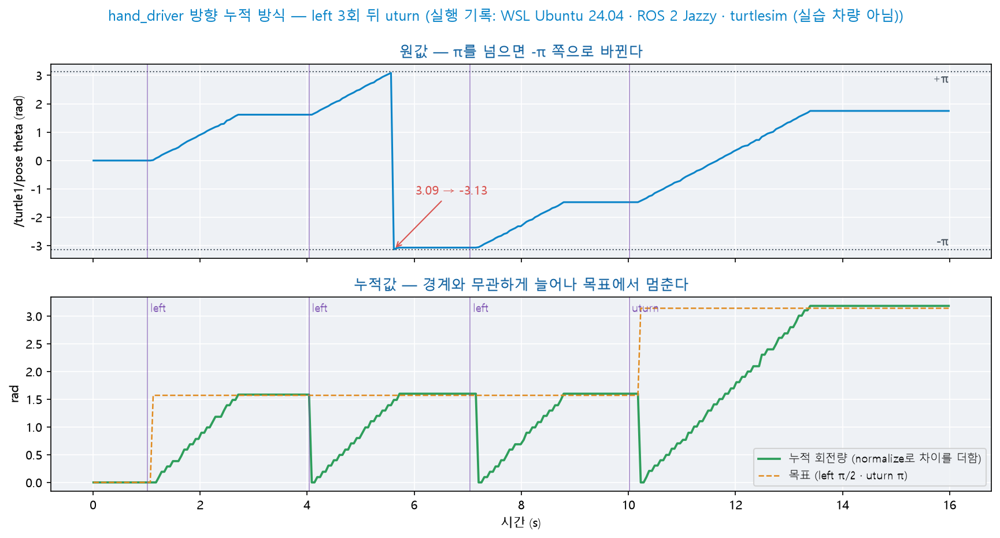

- 위 = `theta` 원값 · 아래 = 이번 회전의 누적 회전량과 목표
- 두 번째 `left`에서 `theta`가 3.09 → −3.13으로 바뀝니다. 원값의 차가 약 −6.2이므로 `normalize` 없이 `abs`만 적용하면 이 한 주기에 약 6.2(거의 한 바퀴)가 더해져 회전이 곧바로 끝납니다
- 누적값은 경계와 무관하게 늘어나 목표에서 멈춥니다(`left` 약 1.58\~1.60 · `uturn` 약 3.18) — 목표를 넘은 첫 주기에 종료하므로 목표보다 조금 큽니다
- 그림은 PC의 WSL2에서 turtlesim과 `hand_driver`를 실행한 기록입니다(실습 차량 아님)

<details>
<summary>예측 대조</summary>

- −π 근처의 값으로 바뀝니다(3.09 → −3.13) — `theta`의 범위가 −π\~π이기 때문입니다

- `normalize`로 차를 −π\~π로 바로잡아야 이 주기의 회전량이 약 0.06으로 계산됩니다

</details>

**코드 읽기 — Python 문법 ② 딕셔너리와 수학 함수**

| 코드 | 뜻 |
|------|------|
| `TURNS = {'left': 90.0, …}` | 딕셔너리 — 이름(키)으로 값을 찾는 표 |
| `cmd in TURNS` | 키가 딕셔너리에 있는지 확인 — 참·거짓 |
| `TURNS[cmd]` | 키로 값을 조회 — `TURNS['right']` → `-90.0` |
| `math.radians(90.0)` | 도를 라디안으로 — 약 1.571 |
| `math.atan2(y, x)` | 두 값으로 각도를 구함 — 결과는 항상 −π\~π |
| `abs(x)` | 절댓값 — 왼쪽(+)·오른쪽(−) 회전을 같은 크기로 비교 |

**코드 읽기 — Python 문법 ③ 비교와 조건 선택** — 4.2의 형태가 다시 나타납니다.

| 코드 | 뜻 |
|------|------|
| `self.hand != self.last_cmd` | `!=` = 다름 — 판정이 바뀐 순간을 찾는 비교 |
| `if …:` `elif …:` `elif …:` | 위에서부터 **처음 참이 된 경우 하나만** 실행 |
| `speed if self.target > 0 else -speed` | 조건부 표현식 — 한 줄로 값을 선택(Day 5 문법 ⑦) |
| `self.turned += …` | 기존 값에 더해 다시 대입 — 회전량 누적 |
| `return 조건식` | 조건의 결과(참·거짓)를 그대로 반환함 |

- 위 표는 **Day 9의 코드에도 같은 형태로 다시 실립니다** — 지금 모두 암기할 필요는 없고, 코드를 읽을 때마다 표를 참조하며 확인합니다

<details>
<summary>풀이 ① `hand_driver.py` 전체 코드 보기</summary>

`~/ros2_ws/src/my_car_pkg/my_car_pkg/hand_driver.py`:

```python
import math
import rclpy
from rclpy.node import Node
from std_msgs.msg import String
from geometry_msgs.msg import Twist
from turtlesim.msg import Pose

TURNS = {'left': 90.0, 'right': -90.0, 'uturn': 180.0}   # ① 명령별 회전각(도) — 양수 = 반시계

def normalize(angle):                                     # ② 각도 차를 −π~π로
    return math.atan2(math.sin(angle), math.cos(angle))

class HandDriver(Node):
    def __init__(self):
        super().__init__('hand_driver')
        self.declare_parameter('linear_speed', 1.0)
        self.declare_parameter('turn_speed', 1.0)          # 회전 각속도(rad/s)
        self.declare_parameter('use_pose', True)           # ③ True = 방향 누적 / False = 시간
        self.declare_parameter('sec_per_90', 1.6)          # 시간 방식의 90° 회전 시간(초)
        self.declare_parameter('sec_per_180', 3.1)         # 시간 방식의 180° 회전 시간(초)

        self.state = 'STOP'                                # ④ 시작은 정지
        self.prev_state = 'STOP'                           # 회전을 마친 뒤 돌아갈 상태
        self.hand = 'none'
        self.last_cmd = 'none'                             # ⑤ 직전에 처리한 판정
        self.target = 0.0
        self.turned = 0.0
        self.elapsed = 0.0
        self.by_pose = False
        self.yaw = None
        self.last_yaw = None

        self.create_subscription(String, '/hand_stable', self.on_hand, 10)
        self.create_subscription(Pose, '/turtle1/pose', self.on_pose, 10)
        self.pub = self.create_publisher(Twist, '/cmd_vel', 10)
        self.create_timer(0.1, self.control)
        self.get_logger().info('hand_driver started — state: STOP')

    def on_hand(self, msg):
        self.hand = msg.data                               # 보관만

    def on_pose(self, msg):
        self.yaw = msg.theta                               # turtle의 방향(rad)

    def control(self):
        if self.hand != self.last_cmd:                     # ⑥ 판정이 바뀐 순간에만
            self.last_cmd = self.hand
            self.run_command(self.hand)

        twist = Twist()
        if self.state == 'DRIVE':
            twist.linear.x = self.get_parameter('linear_speed').value
        elif self.state == 'TURN':
            if self.turn_done():
                self.get_logger().info(f'TURN done -> {self.prev_state}')
                self.state = self.prev_state
            else:
                speed = self.get_parameter('turn_speed').value
                twist.angular.z = speed if self.target > 0 else -speed
        self.pub.publish(twist)                            # STOP은 0으로 발행

    def run_command(self, cmd):                            # handle은 Node의 속성 이름이므로 사용하지 않음
        if cmd == 'stop':                                  # ⑦ 정지는 회전 중에도 즉시
            self.state = 'STOP'
        elif self.state == 'TURN' or cmd == 'none':        # 회전 중 명령 · none은 무시
            return
        elif cmd == 'go':
            self.state = 'DRIVE'
        elif cmd in TURNS:                                 # ⑧ 회전 시작
            self.prev_state = self.state
            self.target = math.radians(TURNS[cmd])
            self.turned = 0.0
            self.elapsed = 0.0
            self.by_pose = self.get_parameter('use_pose').value and self.yaw is not None
            self.last_yaw = self.yaw
            self.state = 'TURN'
        else:
            return                                         # 모르는 이름은 무시
        self.get_logger().info(f'command {cmd} -> {self.state}')

    def turn_done(self):                                   # ⑨ 회전 종료 판정
        if self.by_pose:
            self.turned += abs(normalize(self.yaw - self.last_yaw))
            self.last_yaw = self.yaw
            return self.turned >= abs(self.target)
        self.elapsed += 0.1                                # 제어 주기만큼 경과
        key = 'sec_per_90' if abs(self.target) < 3.0 else 'sec_per_180'
        return self.elapsed >= self.get_parameter(key).value

def main(args=None):
    rclpy.init(args=args)
    node = HandDriver()
    try:
        rclpy.spin(node)
    except KeyboardInterrupt:
        pass
    finally:
        node.destroy_node()
        rclpy.shutdown()
```

</details>

<details>
<summary>풀이 ② 번호별 설명 보기</summary>

| # | 설명 |
|:--:|------|
| ① | 명령별 회전각 — 양수는 반시계(왼쪽) · 음수는 시계(오른쪽) |
| ② | 각도 차를 −π\~π로 바로잡음 — π ↔ −π 경계에서 2π가 더해지는 것을 방지 |
| ③ | `/turtle1/pose`를 받지 못하면(실습 차량) 회전 시작 때 자동으로 시간 방식 |
| ④ | 시작은 정지 — `go`를 받아야 출발 |
| ⑤⑥ | 직전에 처리한 판정과 다를 때만 `run_command` 호출 — 한 번 인식에 한 번 실행 |
| ⑦ | `stop`을 가장 먼저 확인 — 회전 중에도 즉시 정지(7.2 안전 우선) |
| ⑧ | 회전 전 상태 저장 · 목표 각도 설정 · 누적값 초기화 · 판정 방식 결정 |
| ⑨ | 방향 누적 또는 경과 시간으로 회전 종료를 판정 |

</details>

### 7.4 turtlesim에서 명령 주행 확인

```bash
cd ~/ros2_ws && colcon build && source install/local_setup.bash
# 터미널 1 — RPi5 원격 데스크톱 화면의 터미널
ros2 run turtlesim turtlesim_node --ros-args -r /turtle1/cmd_vel:=/cmd_vel
# 터미널 2 · 3 — 2.8의 camera_node · hand_classifier를 그대로 유지
# 터미널 4 — decision_maker가 실행 중이면 먼저 Ctrl+C로 종료
ros2 run my_car_pkg hand_driver
```

- `/cmd_vel` 발행 노드는 하나뿐이어야 합니다(3.2) — `decision_maker`·`full_launch.py`를 종료한 뒤 실행합니다

| 순서 | 손모양 | 예상 |
|:--:|------|------|
| 1 | `go` | 직진 · 로그 `command go -> DRIVE` |
| 2 | `stop` | 정지 · 로그 `command stop -> STOP` |
| 3 | `left` → 손을 내림 | 제자리 좌회전 90° 후 정지 · `TURN done -> STOP` |
| 4 | `right` → 손을 내림 | 제자리 우회전 90° 후 정지 |
| 5 | `go` → `uturn` | 직진하다가 180° 회전 후 다시 직진 |

- 표대로 동작하면 → 단계별 과제로 진행
- turtle이 움직이지 않으면 → `ros2 topic info /cmd_vel`의 구독자 · 발행자 수 확인 → 구독자가 0이면 **터미널 1부터 다시**(`-r` 누락) · 발행자가 2이면 다른 판단 노드를 종료
- 회전이 끝나지 않고 계속되면 → `ros2 topic echo /turtle1/pose --once`로 `theta`가 출력되는지 확인 → 출력되지 않으면 turtlesim이 실행 중인지 확인하고 **터미널 4부터 다시** 실행
- 로그가 바뀌고 회전이 한 번 더 일어나면 → 손을 내리기 전에 판정이 `none`으로 바뀌었다가 다시 같은 손모양으로 판정된 것입니다. `stable_n`을 높여 판정을 안정화(5.2)

### 7.5 실습 차량 실험 — 회전 시간과 직진 속도 실측

turtlesim을 Day 6의 모터 노드로 교체합니다. **`hand_driver`의 코드는 고치지 않습니다.**

- 실습 차량은 **팀 공용 1대**입니다 — 차량에 장착한 RPi5에 팀이 사용할 손모양 모델을 적용해 둡니다(2.7)
- 차량에는 `/turtle1/pose`가 없으므로 **시간 방식**(`use_pose:=false`)으로 실행합니다

```bash
# 터미널 1 — 차량의 RPi5
ros2 run my_car_pkg motor_node
# 터미널 4
ros2 run my_car_pkg hand_driver --ros-args -p use_pose:=false -p turn_speed:=2.0
```

- `motor_node`는 `/cmd_vel`을 그대로 구독하므로 remapping이 필요하지 않습니다

**① 공중 확인** — 바퀴를 띄운 상태에서 명령 방향을 확인합니다.

| 명령 | 바퀴 |
|------|------|
| `go` | 네 바퀴가 앞으로 |
| `left` | 왼쪽 바퀴 뒤로 · 오른쪽 바퀴 앞으로 |
| `right` | 왼쪽 바퀴 앞으로 · 오른쪽 바퀴 뒤로 |
| `stop` | 모두 정지 |

- 표대로 회전하면 → ②로 진행
- 한쪽 바퀴가 반대로 회전하면 → Day 6 자료 7.3의 방향 값 전환(`left_forward`·`right_forward`) 후 **①을 다시** 확인
- 회전 명령에 바퀴가 회전하지 않으면 → `turn_speed`를 높여(`ros2 param set /hand_driver turn_speed 3.0`) **①을 다시** 확인 — 듀티가 낮으면 모터가 회전하지 않습니다(Day 6 자료 10.3 최소 듀티)

**② 측정 준비** — 측정 중에는 인식을 거치지 않고 판정 메시지를 명령으로 발행합니다.

```bash
# 터미널 3의 hand_classifier를 Ctrl+C로 종료한 뒤
ros2 topic pub /hand_stable std_msgs/msg/String "{data: 'go'}" --once
ros2 topic pub /hand_stable std_msgs/msg/String "{data: 'stop'}" --once
```

- 인식 지연(약 0.6초 — 6.2)과 오판정을 측정에서 제외하기 위해서입니다
- 같은 명령을 다시 실행할 때는 그 사이에 `none`을 한 번 발행합니다 — 판정이 바뀐 순간만 처리하기 때문입니다(7.2)

> **자주 하는 실수 —** 바닥 실험은 넓은 공간에서 차량 앞에 사람이 없는 상태로 진행합니다. 차량이 멈추지 않으면 `hand_driver`를 Ctrl+C로 종료합니다 — `motor_node`는 0.5초 동안 명령이 없으면 정지합니다(Day 6 자료 7.2 ⑤).

**③ 직진 속도** — 바닥의 시작선에 차량을 놓고 `go` → 약 3초 뒤 `stop`을 발행합니다.

- 스톱워치로 **차량이 움직이기 시작한 순간부터 멈춘 순간까지** 측정합니다
- 이동 거리를 줄자로 측정하고 **속도 = 거리 ÷ 시간**을 계산합니다
- 3회 측정해 평균을 기록합니다 — 1회로 판단하지 않습니다(Day 3 자료 9장 2단계와 같은 원칙)

**④ 회전 시간** — 바닥의 기준선 테이프에 차량 방향을 맞추고 `right`를 발행합니다.

- 회전 뒤 차량 방향과 기준선이 이루는 각도를 확인합니다

> **예측** — `sec_per_90` 1.6에서 차량이 100° 회전했습니다. `sec_per_90`을 늘립니까, 줄입니까? 얼마로 바꿉니까?

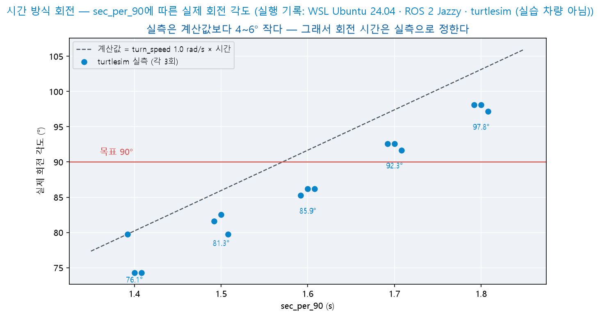

- 회전 각도는 회전 시간에 거의 비례해 늘어납니다
- turtlesim에서도 계산값(`turn_speed` × 시간)보다 4\~6° 작게 회전했습니다 — 계산값을 그대로 사용하지 않고 실측으로 정하는 이유입니다
- 그림은 PC의 WSL2에서 turtlesim으로 측정한 기록입니다(각 3회) — 실습 차량의 값은 ④에서 직접 측정합니다

<details>
<summary>예측 대조</summary>

- 줄입니다 — 각도가 시간에 비례한다고 보면 1.6 × 90 ÷ 100 ≈ **1.44**

- 비례 관계가 정확하지 않으므로 바꾼 값으로 다시 측정해 확인합니다 — 90°보다 작으면 늘리고, 크면 줄이는 과정을 1\~2회 반복합니다

</details>

- `ros2 param set /hand_driver sec_per_90 1.44`처럼 값을 바꾸고 `none` → `right`를 다시 발행합니다
- `left`도 같은 값으로 90°가 되는지 확인합니다 — 좌우 차이가 크면 Day 6 자료 7.4의 `trim`을 조정
- 같은 방법으로 `uturn`의 `sec_per_180`을 정합니다

**⑤ 실측 표** — 팀이 표 하나를 작성해 Day 9에서 사용합니다.

| 항목 | 설정 | 실측 | 비고 |
|------|------|:--:|------|
| 직진 속도 | `linear_speed` 1.0 | ___ cm/s | 3회 평균 |
| 90° 회전 시간 | `turn_speed` 2.0 | `sec_per_90` = ___ s | 좌 · 우 각도 |
| 180° 회전 시간 | `turn_speed` 2.0 | `sec_per_180` = ___ s | — |
| 배터리 상태 | — | 충전 직후 · 사용 중 | 전압이 내려가면 같은 시간에 덜 회전 |

```bash
ros2 param dump /hand_driver > ~/hand_params.yaml    # 실측값 저장(Day 3 자료 5장)
```

**⑥ 손모양으로 차량 움직이기** — `hand_classifier`를 다시 실행하고 손모양으로 명령합니다.

- 카메라 시야 안에 손을 두되 **차량 진행 방향에 서지 않고** 옆에서 팔을 뻗습니다
- 실측한 회전 시간으로 `left` · `right` · `uturn`이 의도한 각도에 가까운지 확인합니다
- 판정이 불안정하면 차량 카메라와 손의 거리 · 배경이 학습 조건과 다른 것입니다 — Day 9에서 차량 시점 사진을 더해 다시 학습합니다

### 7.6 단계별 과제

| 단계 | 과제 |
|:--:|------|
| **필수** | turtlesim에서 `go` · `stop` · `left` · `right` · `uturn`이 **각각 한 번씩** 실행되는지 확인(7.4) |
| **도달** | 실습 차량에서 회전 시간과 직진 속도를 측정해 실측 표를 완성(7.5) |
| **도전** | 아래 3항 중 선택 |

- 도전 ⓐ 회전 중에 받은 `go`를 기억해 두었다가 회전이 끝난 뒤 실행
- 도전 ⓑ 6.1의 안전 감시(마지막 수신 시각)를 `hand_driver`에 추가
- 도전 ⓒ turtlesim에서 `use_pose:=false`로 실행해 두 방식의 회전 오차를 `theta`로 비교하고, 실습 차량이 시간 방식을 사용하는 이유를 설명

- **필수 단계는 전원 완료** — turtlesim 명령 주행 확인
- **Day 9 대응** — 실측 표의 회전 시간 · 직진 속도는 Day 9의 갈림길 회전과 되돌아가기에 사용합니다. turtlesim을 모터 노드로 바꾸어도 **인식 · 판단 코드는 한 줄도 고치지 않았다**는 사실이 오늘 확인할 핵심입니다

### 7.7 응용 실습 — 회전 각도를 도 단위 파라미터로 바꾸기

- `left` · `right`의 회전 각도를 파라미터 `turn_deg`(도 단위 · 기본 90)로 바꿀 수 있게 `hand_driver`를 고칩니다 — AI 코딩 도구로 작성합니다

| 조건 | 내용 |
|------|------|
| 적용 | `left` = `+turn_deg` · `right` = `−turn_deg` · `uturn`은 180° 그대로 |
| 방향 누적 | 목표 각도를 라디안으로 바꾸어 비교 |
| 시간 방식 | `sec_per_90 × turn_deg ÷ 90` |

- **확인** — `ros2 param set /hand_driver turn_deg 45` 뒤 `left` → turtlesim에서 약 45° 회전합니다(`theta` 변화 약 0.79)

<details>
<summary>실습 정리</summary>

- 라디안 변환을 빠뜨리면 목표가 45 rad(약 7바퀴)가 되어 회전이 끝나지 않는 것처럼 보입니다 — 누적값은 라디안이고 파라미터는 도입니다

- 사람이 입력하는 값은 도 단위로, 계산은 라디안으로 두고 **변환은 한 곳**(회전을 시작할 때)에서만 합니다

</details>

### 7.8 응용 실습 — 그래프에서 90°가 되는 시간 찾기

- 아래 표는 7.5 ④ 그림의 turtlesim 측정값입니다. 정확히 90°가 되는 `sec_per_90`을 구합니다

| `sec_per_90` | 1.4 | 1.5 | 1.6 | 1.7 | 1.8 |
|------|:--:|:--:|:--:|:--:|:--:|
| 회전 각도(°, 3회 평균) | 76.1 | 81.3 | 85.9 | 92.3 | 97.8 |

- 이웃한 두 점 사이의 보간과 다섯 점 전체에 맞춘 직선의 두 방법으로 계산하는 스크립트를 AI 코딩 도구로 작성합니다
- **확인** — 구한 값으로 turtlesim에서 `left`를 실행하고 `theta` 변화로 각도를 확인합니다

<details>
<summary>실습 정리</summary>

- 두 점 보간 = 1.6 + 0.1 × (90 − 85.9) ÷ (92.3 − 85.9) ≈ **1.66** · 다섯 점 직선 ≈ 1.66 — 두 방법의 값이 같습니다

- 직선의 기울기 ≈ 54°/s — `turn_speed` 1.0 rad/s의 계산값 57.3°/s보다 작습니다. 실습 차량도 같은 방법으로 2\~3개 값을 측정하면 가까운 값을 한 번에 찾을 수 있습니다

</details>

### 7.9 응용 실습 — 회전 종료의 두 가지 증상

- 두 학생의 `hand_driver`(방향 누적)에서 다음 증상이 나타났습니다. 각 증상의 원인이 되는 누락을 찾습니다

| 학생 | 증상 |
|:--:|------|
| A | `left`는 90°에서 멈추지만 `right`는 멈추지 않고 계속 회전 |
| B | 첫 회전은 정상이지만 두 번째 회전부터 시작하자마자(0.1초) 끝남 |

- 후보 = `abs` 누락 · 회전 시작 때 누적값 `turned` 초기화 누락
- `theta` 열을 직접 만들어 입력하고 `turn_done`의 판정을 확인하는 시험 스크립트(ROS 없이 실행)를 AI 코딩 도구로 작성해 두 누락을 각각 재현합니다

<details>
<summary>실습 정리</summary>

- A = `abs` 누락 — 오른쪽 회전은 방향 차가 음수이므로 누적값이 줄어들어 목표에 도달하지 않습니다

- B = `turned` 초기화 누락 — 첫 회전의 누적값(약 1.58)이 남아 두 번째 회전의 첫 주기에 목표를 넘습니다

- 같은 방식으로 직전 방향 갱신(`self.last_yaw = self.yaw`)을 빠뜨리면 회전 시작 방향과 이루는 차가 매 주기 다시 더해져 약 34°에서 일찍 끝납니다(모의 계산) — 세 누락 모두 오류 메시지 없이 **동작으로만** 드러납니다

</details>

### 7.10 응용 실습 — 실측값을 launch에서 불러오기

- 7.5 ⑤에서 저장한 `~/hand_params.yaml`을 불러와 실습 차량의 노드를 한 번에 실행하는 `car_launch.py`를 AI 코딩 도구로 작성합니다

| 조건 | 내용 |
|------|------|
| 노드 | `camera_node` · `hand_classifier` · `hand_driver` · `motor_node` |
| `hand_driver` 파라미터 | `~/hand_params.yaml` — 홈 폴더 경로는 `os.path.expanduser`로 절대 경로로 바꿈 |
| 파일 위치 | launch 인자 `params`로 다른 파일을 지정할 수 있음 |

- **확인** — `ros2 param get /hand_driver sec_per_90`의 출력이 실측 표의 값과 같고, `use_pose`가 `False`입니다

<details>
<summary>실습 정리</summary>

- `param dump` 파일의 첫 줄은 노드 이름(`/hand_driver:`)입니다 — launch에서 노드 이름을 바꾸면 이 파일의 값이 적용되지 않고 오류 없이 기본값으로 실행됩니다

- 실측값을 파일로 두면 배터리 교체 · 차량 교체 때 파일만 바꾸어 다시 실행합니다

</details>

---

## 8. 요약

| 항목 | 내용 |
|------|------|
| 3단 구조 | **인식 → 판단 → 행동** — 각 단계를 노드로 분리. 한쪽을 바꾸어도 나머지는 동일 |
| 손모양 학습 | 6종 촬영 · 재학습 · 반출 → 노드 코드는 그대로 두고 모델 · 라벨만 교체. **데이터가 결과를 정한다**(색 대신 모양) |
| 좌우 반전 | 학습 사진과 실행 영상의 좌우가 다르면 `left` ↔ `right`가 바뀜 → `flip` 파라미터 |
| 책임 범위 | 인식은 **행동을 결정하지 않고**, 판단은 **센서를 직접 읽지 않으며**, 행동은 **판단 근거를 참조하지 않음** |
| 토픽 계약 | 이름·타입·의미·주기 + **"없을 때 무엇을 보내는가"** — 침묵하면 고장과 구분되지 않음 |
| 발행자 단일 | `/cmd_vel`을 발행하는 노드는 **하나뿐** — 둘이면 명령이 뒤섞임 |

| 항목 | 내용 |
|------|------|
| 판단 노드 | 상태 기계(`DRIVE`·`STOP`·`RESUME`) — 구독은 보관, **제어는 타이머** |
| 단독 확인 | `topic pub`으로 **상위 노드의 발행을 대신해** 하위만 먼저 검증 |
| 통합 | `full_launch.py`로 4개 노드 일괄 기동(turtlesim은 remapping) · `rqt_graph`로 연결 대조 |
| 시스템 보강 | **안전 감시**(마지막 수신 시각 추적 → 정지 우선) · **반응 지연** 분해·실측 · **HandResult** 커스텀 msg(동시성) · **launch 인자** 주입 |
| 명령 실행 | `hand_driver` — **판정이 바뀐 순간 한 번 실행**(상태 반응과 구분) |
| 회전량 판정 | 방향 누적(turtlesim `theta`) / 시간(실습 차량 — 엔코더 없음) |
| 우선순위 | 판단이 충돌하면 **안전한 동작(정지)** — 회전 중에도 `stop`은 즉시 |
| 실습 차량 | turtlesim → 모터 노드 교체만으로 실습 차량 주행 · **회전 시간 · 직진 속도 실측 표** |
| **다음 시간** | **실물 통합**(Day 9 · 10/26) — 기준선 주행 + 손모양 명령 + 초음파 정지의 우선순위 결합 · 오늘의 실측값 사용 |

---

## 9. 보충

> 본 과정을 마치고 시간이 남을 때 다루는 소재입니다. 각 항목은 서로 독립이며 다음 시간의 선행 개념은 포함하지 않습니다.

### 9.1 판단 근거를 남기기

자율 시스템은 **왜 그렇게 움직였는지** 설명할 수 있어야 합니다.

```python
self.reason_pub = self.create_publisher(String, '/decision_reason', 10)
...
self.reason_pub.publish(String(data=f'{self.state} <- hand={self.hand}'))
```

```bash
ros2 bag record /cmd_vel /hand_stable /decision_reason -o run1
```

- 나중에 재생하며 **어느 시점에 무엇을 인식해 무엇을 실행했는지** 추적 가능(Day 2 수업 보충)
- Day 10\~12 팀 프로젝트의 시연 자료로도 활용

### 9.2 노드를 하나로 합치는 경우

`MultiThreadedExecutor`(Day 2 수업 보충)로 여러 노드를 한 프로세스에 담을 수 있습니다.

```python
exe = MultiThreadedExecutor()
exe.add_node(HandClassifier())
exe.add_node(DecisionMaker())
exe.spin()
```

| 장점 | 단점 |
|------|------|
| 프로세스 간 통신 비용 감소 | **한 노드가 종료되면 모두 정지** |
| 터미널 하나로 관리 | 공유 변수 경합 주의 |

- 이 과정은 **분리를 기본**으로 합니다 — RPi5의 부하가 문제가 될 때 검토

### 9.3 인식 노드를 바꾸어 보기

`decision_maker`는 `/hand_stable`만 구독합니다. 이 토픽을 **다른 방법으로 만들어도** 판단 노드는 그대로 동작합니다.

| 대체 방법 | 구현 |
|------|------|
| 색 검출(Day 5 자료 5장) | `color_tracker`가 빨간색 영역의 면적이 크면 `stop` 발행 |
| 키보드 입력 | 터미널에서 직접 발행 |
| 초음파(Day 6) | 거리가 가까우면 `stop` 발행 |

- **2.1에서 설명한 "교체 가능"의 사례** — 계약만 지키면 내부는 무엇이든 무방
- Day 9에서는 초음파 센서(Day 6)가 이 역할을 담당합니다

### 9.4 Deadline QoS — 수신 감시의 표준 장치

6.1에서 신호 두절을 코드로 직접 검출했습니다. 같은 감시를 **QoS 계층이 표준으로 제공**합니다 — Day 2 수업 보충에서 개념으로 배운 **Deadline**의 실제 적용입니다.

- Deadline = "이 토픽의 메시지는 **최소 이 주기로 도착해야 한다**"는 선언
- 위반이 발생하면 미들웨어가 **이벤트 콜백**을 호출 — 판단 로직과 감시 로직이 분리됨

구독 측(`decision_maker`)에 적용:

```python
from rclpy.qos import QoSProfile
from rclpy.duration import Duration
from rclpy.event_handler import SubscriptionEventCallbacks

qos = QoSProfile(depth=10)
qos.deadline = Duration(seconds=1.0)                      # ① 기대 수신 주기

self.sub = self.create_subscription(
    String, '/hand_stable', self.on_hand, qos,
    event_callbacks=SubscriptionEventCallbacks(
        deadline=self.on_deadline_missed))                # ② 위반 시 호출

def on_deadline_missed(self, event):
    self.pub.publish(Twist())                             # 정지 우선 — 6.1과 같은 원칙
    self.get_logger().warn('deadline missed — stopped')
```

| # | 설명 |
|:--:|------|
| ① | 허용 무수신 시간을 QoS 프로파일에 선언 — 6.1의 `signal_timeout`에 대응 |
| ② | 위반 검출을 미들웨어가 담당 — 타이머에서 경과를 계산하는 코드가 불필요해짐 |

6.1의 직접 구현과 대조:

| 항목 | 직접 구현(6.1) | Deadline QoS |
|------|------|------|
| 검출 주체 | 판단 노드의 타이머 코드 | DDS(Data Distribution Service) 미들웨어 |
| 장점 | 로직 자유(경고 1회·복귀 처리 등) · 어디서나 동작 | 표준 방식 · 판단 코드가 간결해짐 |
| 주의 | 감시 코드가 판단 코드에 포함됨 | **발행 측도 deadline을 선언해야 정합** — 양쪽 QoS 불일치 시 연결 자체가 성립하지 않을 수 있음(Day 2 자료 7.3) |

- 실무에서는 **두 방식을 병행**하기도 합니다 — QoS로 표준 검출, 코드로 복귀 정책 처리
- ⚠️ 이벤트 콜백의 임포트 경로·지원 범위는 RMW(ROS Middleware) 구현에 따라 차이가 있음 — 학기 중 실기에서 확인

### 9.5 이후에 다룰 주제

| 주제 | 내용 | 필요 조건 |
|------|------|------|
| TF2 | 센서·차체·지도의 좌표 관계 관리 | 개념 학습 — **Day 7에서 개념 확인** |
| URDF(Unified Robot Description Format) | 로봇 형상을 XML로 정의 | 개념 학습 |
| Nav2 | 경로 계획·장애물 회피 — **Day 7 시뮬레이션 실습에서 체험함** | 실물 적용은 LiDAR(Light Detection and Ranging)·오도메트리 |
| 객체 검출 | 위치까지 검출하는 AI | 연산 성능 |

- 이 과정에서 배운 **노드·토픽·서비스·액션·파라미터·launch**는 위 항목 전체의 공통 기반
- 도구가 바뀌어도 **체계는 같습니다** — 이것이 ROS2를 배우는 이유

### 9.6 손모양 혼동 표 — 어떤 모양끼리 혼동되는가

정확도 하나로는 **어느 모양이 어느 모양으로 잘못 판정되는지** 알 수 없습니다. 만든 모양과 판정 결과를 교차해 기록하는 표를 **혼동 표**(confusion matrix)라고 합니다.

1. `ros2 topic echo /hand`를 실행합니다 — 안정화 전의 판정을 관찰합니다
2. 손모양 하나를 5초 동안 유지하며 출력된 판정을 기록합니다
3. 6종 모두 같은 방식으로 반복해 혼동 표를 채웁니다

- `/hand_stable`이 아니라 `/hand`를 관찰하는 이유 — 안정화가 판정 변동을 걸러 내므로 혼동이 드러나지 않습니다

| 만든 모양 ＼ 판정 | `stop` | `go` | `left` | `right` | `uturn` | `none` |
|------|:--:|:--:|:--:|:--:|:--:|:--:|
| `stop` | | | | | | |
| `go` | | | | | | |
| `left` | | | | | | |
| `right` | | | | | | |
| `uturn` | | | | | | |
| `none` | | | | | | |

- 대각선 칸이 정답입니다 — **대각선 밖에서 값이 큰 칸**이 서로 혼동되는 두 모양을 나타냅니다
- 혼동 쌍이 확인되면 → 두 클래스의 사진을 보강해 재학습(2.6)하거나 모양을 더 다르게 정합니다(2.5)
- `left` ↔ `right`만 서로 크게 바뀌어 있으면 혼동이 아니라 좌우 반전 문제일 수 있습니다(2.8)

### 9.7 정지된 모양에서 움직임으로

오늘의 모델은 **사진 한 장**을 판정합니다. 손을 흔드는 동작처럼 **움직임으로 구분되는 명령**은 한 장에 담기지 않으므로 판정되지 않습니다.

| 방법 | 원리 | 비고 |
|------|------|------|
| 판정의 시간 순서 | 최근 판정 이력에서 `left` → `right` → `left`가 1초 안에 나타나면 「흔들기」 | 오늘의 모델 그대로 사용 |
| 손 관절 위치 추출 | 손가락 관절 좌표를 추출하는 모델로 그 변화를 판정 | 새 모델 · 연산량 증가 |
| 여러 장을 입력으로 받는 모델 | 연속된 영상 프레임을 한 번에 분류 | RPi5에서는 부담이 큼 |

판정의 시간 순서 — Day 5 자료 11.3의 「최근 N회 유지」 구조를 시각 기준으로 바꾼 형태입니다.

```python
# __init__
self.seq = []                                          # (시각, 판정) 기록
self.wave_pub = self.create_publisher(String, '/gesture', 10)

# infer 말미 — name이 정해진 뒤
now = self.get_clock().now().nanoseconds / 1e9
if not self.seq or self.seq[-1][1] != name:            # 판정이 바뀔 때만 기록
    self.seq.append((now, name))
self.seq = [s for s in self.seq if now - s[0] < 1.0]   # 최근 1초만 유지
names = [s[1] for s in self.seq]
if names[-3:] in (['left', 'right', 'left'], ['right', 'left', 'right']):
    self.wave_pub.publish(String(data='wave'))
```

- 정지된 모양의 분류기 위에 **시간 규칙**을 더해 움직임을 판정하는 방식입니다 — 새 학습 없이 구현할 수 있으나 판정 주기(0.2초)보다 빠른 동작은 놓칩니다
