# Day 9 — 실물 통합 · 라인 주행 · 손모양 명령 · 초음파 정지 · 팀 프로젝트 예고

**2026-10-26 · 한국폴리텍대학교 하이테크과정 ROS2**

이 자료는 수업의 개념 설명과 실습 절차·명령어를 복습용으로 정리한 문서입니다. 복습 기준 = 이 자료 + 수업 중 필기.

---

## 목차

1. [복습과 오늘의 목표](#1-복습과-오늘의-목표)
2. [실물 주행의 구조와 라인 인식](#2-실물-주행의-구조와-라인-인식)
3. [실습 ① — 라인 검출 노드](#3-실습---라인-검출-노드)
4. [실습 ② — 라인 추종 주행](#4-실습---라인-추종-주행)
5. [실습 ③ — 손모양 명령과 초음파 정지의 결합](#5-실습---손모양-명령과-초음파-정지의-결합)
6. [미니프로젝트 — 갈림길 코스 주행](#6-미니프로젝트--갈림길-코스-주행)
7. [팀 프로젝트 예고](#7-팀-프로젝트-예고)
8. [요약](#8-요약)
9. [보충](#9-보충)

---

## 1. 복습과 오늘의 목표

### 1.1 지난 시간 복습

| 산출물 | 토픽 | 오늘의 역할 |
|------|------|------|
| `us_node` (Day 6) | `/us_dist` 발행 — 정면 거리 [cm] | **인식** — 장애물 감지 |
| `motor_node` (Day 6) | `/cmd_vel` 구독 → 바퀴 구동 | **행동** — 신호 두절 정지 내장 |
| `hand_classifier` (Day 8 손모양 모델) | `/hand_stable` 발행 | **인식** — 손모양 명령 6종 |
| `hand_driver` (Day 8) | 판정이 바뀐 순간 명령 실행 | **판단**의 원형 — 오늘 라인 주행과 결합 |
| 실측 표 (Day 8 자료 7.5) | 직진 속도 · 회전 시간 | 갈림길 회전 · 되돌아가기의 값 |

- Day 8에서 turtlesim을 모터 노드로 바꾸어 **손모양 명령으로 실습 차량을 움직였습니다** — 오늘은 차량이 **바닥의 선을 따라 스스로 주행**하도록 합니다

### 1.2 오늘의 목표 — 세 가지 판단의 결합

| 인식 | 처리 방식 | 판단에 제공하는 정보 |
|------|------|------|
| 카메라 → 바닥의 선 | **고전 영상 처리**(밝기 이진화 — Day 5 자료 4장) | 얼마나 조향할지 — 연속값 |
| 카메라 → 손모양 | **학습 모델**(Day 8) | 무엇을 할지 — 명령 6종 |
| 초음파 → 거리 | 측정값 비교(Day 6) | 멈출지 — 안전 |

> **학습 인식에서 후퇴가 아니라 결합입니다 —** 선의 위치처럼 **규칙으로 정확히 계산할 수 있는 값**은 고전 처리가, 손모양처럼 **규칙으로 작성하기 어려운 구분**은 학습 모델이 담당합니다. 오늘의 판단 노드는 둘의 출력을 함께 받아 우선순위에 따라 동작을 결정합니다(2.7).

**오늘 완성할 것** — ① 검은 테이프 기준선을 따라가는 **라인 주행** ② 손모양으로 출발 · 정지 · 갈림길 방향 선택 ③ 장애물 앞 **초음파 정지** ④ **팀 프로젝트 진행 방식 확인**

### 1.3 오늘의 흐름

| 단계 | 절 | 내용 | 산출물 |
|:--:|:--:|------|------|
| ① 이론 | 1.5 · 2장 | 코스 준비 · 실물 구조 · 라인 인식 원리 · 정지 임계 | 코스 · 설계 기준 |
| ② 라인 검출 | 3장 | 영상 → 선의 위치 · 폭 | `line_detector` |
| ③ 라인 추종 | 4장 | 선의 위치 → 비례 조향 → 실차 주행 | `line_driver` 1단계 |
| ④ 결합 | 5장 | 차량 시점 손모양 점검 · 우선순위 결합 · 전체 launch | `line_driver` · `line_launch.py` |
| ⑤ 미니프로젝트 | 6장 | 갈림길 코스 주행 | 완성 구조 |
| ⑥ 프로젝트 예고 | 7장 | **팀 프로젝트 진행 방식 안내 · 차량 상태 기록** | Day 10 준비 |

- 8장 요약 이후의 **9장 보충**은 진도에 여유가 있을 때 다루는 독립 내용입니다
- **오늘 미완인 부분은 팀 프로젝트 구현(Day 10 오후부터)에서 이어 갑니다** — 7.2의 상태 표에 기록해 둡니다

### 1.4 준비물 확인

| 품목 | 확인 사항 |
|------|----------|
| 실습 차량(팀 공용 1대) | Day 8 자료 7.5 실측 표 · 손모양 모델 적용 · trim 보정값 |
| 초음파 · 카메라 | `/us_dist` · `/camera/image_raw` 발행 확인 |
| 검은 절연테이프 · 줄자 | 바닥 코스 제작(1.5) |
| 주행 공간 | 책상 위가 아닌 **바닥** — 광택이 적은 곳 · 장애물(상자 등) |
| 배터리 | **충전 상태 확인** — 방전되면 속도 · 회전 시간이 달라짐(Day 6 자료 10.4) |
| 필기구 | 「예측」 단계에서 실행 전에 결과를 적음 |
| AI 코딩 도구 | 응용 실습과 4.2 · 5.3 단계의 코드 작성 |

- 차량은 1대입니다 — **차량 시험은 교대**로 진행하고, 인식 조정은 녹화 영상으로 각자의 RPi5에서 수행합니다(3.5)

> **진행 방식 —** 각 절에서 설명과 실습을 단계별로 번갈아 진행합니다.
>
> - 실습에서는 단계마다 결과를 확인한 뒤 다음 단계로 넘어갑니다. 「예측」이 있는 단계에서는 실행 전에 결과를 먼저 적습니다
>
> - 그림의 수치는 실제 값입니다 — 이 강의를 준비하며 PC의 WSL2(Ubuntu 24.04 · Jazzy)에서 실행한 노드의 기록이거나, 합성 영상 · 모의 계산을 코드로 처리한 값입니다(그림 제목에 구분 표기). 실습 차량 · 실제 테이프의 값은 수업 중에 확인합니다
>
> - 절 끝의 「응용 실습」에는 코드가 없습니다 — AI 코딩 도구로 작성하는 과제입니다. 조건을 이해해야 해결할 수 있습니다

### 1.5 코스와 카메라 준비 — 오전 첫 활동

| 구간 | 구성 | 확인 |
|------|------|------|
| 직선 | 기준선 약 2m | 테이프가 끊기거나 들뜨지 않음 |
| 곡선 | 반경 약 50cm의 완만한 곡선 | 꺾인 모서리 없이 이어 붙임 |
| T자 갈림길 | 기준선 끝에 가로선(좌우 각 약 60cm) | 가로선과 기준선이 직각 |
| 장애물 자리 | 직선 구간 위 상자 1개 | 초음파 정지 시험용 |

- 바닥이 조명을 반사해 밝게 빛나는 곳은 피합니다 — 반사광이 선의 검출을 방해합니다
- 카메라 각도는 **차량 앞쪽 바닥이 화면 아래쪽에 담기도록** 고정합니다 — 고정 방법은 차량 장착 상태에 따라 교수가 안내합니다

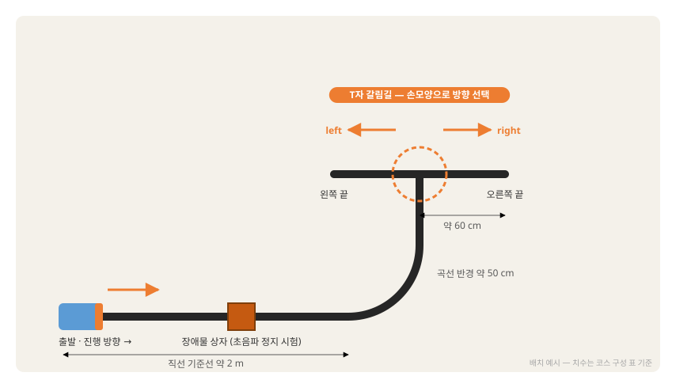

---

## 2. 실물 주행의 구조와 라인 인식

### 2.1 오늘의 노드 구성

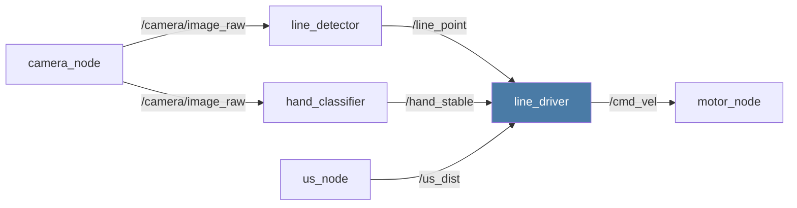

| 노드 | 단계 | 오늘 |
|------|------|------|
| `line_detector` | 인식 — 선의 위치 · 폭 | **신규**(3장) |
| `hand_classifier` | 인식 — 손모양 | Day 8 그대로 |
| `us_node` | 인식 — 거리 | Day 6 그대로 |
| **`line_driver`** | 판단 — 세 입력의 결합 | **신규**(4장 · 5장) |
| `motor_node` | 행동 | Day 6 그대로 |

- `/cmd_vel` 발행 노드는 `line_driver` **하나뿐**입니다(Day 8 자료 3.2)

**실물 환경의 성질** — turtlesim에는 없던 것

| 성질 | 내용 | 대응 |
|------|------|------|
| **측정 잡음** | `/us_dist`가 요동(반사면 · 각도 — Day 6 자료 4.4) · 선의 위치값도 변동 | 임계값에 여유 · 필터(Day 6 자료 10.1) |
| **반응 지연** | 감지 → 정지까지 시간이 소요됨 | **임계값 설계**(2.2) |
| **관성** | 정지 명령 후에도 차량이 밀려 나감 | 임계 여유 · 가감속 완화(9.1) |
| **환경 변수** | 바닥 마찰 · 조명 · 배터리 전압에 따라 거동 변화 | 파라미터 조정 — 값은 차량 고유 |

### 2.2 정지 임계 — 두 경로의 반응 지연

정지 명령은 두 경로로 전달됩니다. **경로마다 반응 지연이 다릅니다.**

| 경로 | 지연 구성 | 지연 합계 |
|------|------|:--:|
| 초음파 → 정지 | 측정 주기(0.1초) + 판단 주기(0.1초) | 약 0.2초 |
| 손모양 `stop` → 정지 | 추론 대기 · 안정화 · 판단 주기(Day 8 자료 6.2) | 약 0.5\~0.75초 |

> **예측** — 차량이 0.5 m/s로 주행합니다. 초음파 경로의 반응 지연(0.2초) 동안 몇 cm 이동합니까? 손모양 경로(0.75초)이면 몇 cm입니까?

<details>
<summary>예측 대조</summary>

- 초음파 경로 = 0.5 × 0.2 = 0.1 m = **10 cm** · 손모양 경로 = 0.5 × 0.75 ≈ **38 cm**

- 같은 속도에서 손모양 경로는 약 4배 먼 거리를 이동한 뒤 정지합니다 — 아래 산식은 0.3 m/s 기준입니다

</details>

```
정지 임계 ≥ 반응 지연 동안의 주행 거리 + 관성 밀림 + 여유
초음파:  0.3 m/s × 0.2초 ≈ 6cm  +  밀림 약 5cm  +  측정 잡음 여유  →  약 30cm에서 시작
손모양:  0.3 m/s × 0.75초 ≈ 23cm — 장애물 정지를 손모양에 맡기면 늦습니다
```

- 속도는 Day 8 자료 7.5 실측 표의 **직진 속도**로 계산합니다
- 장애물 정지는 **초음파 경로가 담당**하고, 손모양 `stop`은 사람의 명령으로만 사용합니다(5.2 우선순위)

| 파라미터 | 초기값 | 근거 |
|------|:--:|------|
| `stop_cm` | 30.0 | 위 계산 — 5.5에서 실측으로 보정 |

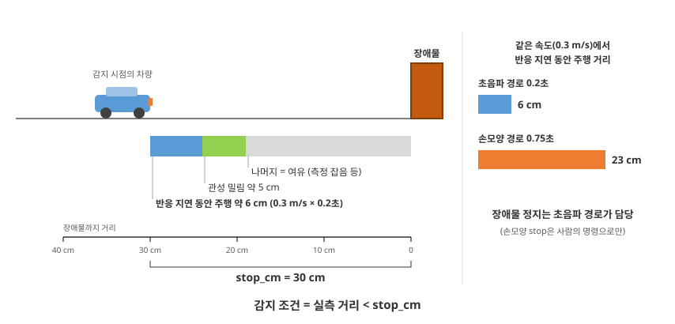

**움직이는 그림 M9-1 — 두 경로의 반응 지연과 주행 거리(2.2)** (약 11.5초 자동 반복)


### 2.3 라인 인식 원리 — 밝기로 선을 찾기

검은 테이프는 색이 아니라 **어둡다는 성질**로 찾습니다. Day 5 자료 12장(라인 인식 〔자습〕)의 관심 영역 · 오차 개념을 그대로 사용하고, 색 대신 밝기를 기준으로 삼습니다.

| 순서 | 처리 | 결과 |
|:--:|------|------|
| 1 | 관심 영역 — 영상 **아래쪽 1/3**만 사용 | 멀리 있는 선 · 손 · 배경을 제외 |
| 2 | 회색조 변환 + 흐림 처리 | 색 정보 제거 · 잡음 완화 |
| 3 | **밝기 이진화** — 기준보다 어두운 픽셀만 흰색 | 테이프만 흰색으로 남은 마스크 |
| 4 | 모폴로지 열림(Day 5 자료 4.3) | 작은 점 제거 |
| 5 | 무게중심(Day 5 자료 4.4) | 선의 가로 위치 `cx` |
| 6 | 오차 = (`cx` − 화면 중앙) ÷ 화면 절반 | −1(왼쪽) \~ 0(가운데) \~ 1(오른쪽) |

- 색 테이프에는 HSV(색상·채도·명도) 범위가 필요하지만(Day 5 자료 4.2) 검은 테이프는 **밝기 하나로 구분**됩니다 — 조정할 값이 `threshold` 하나입니다
- 오차를 −1\~1 범위로 환산해 두면 해상도가 바뀌어도 조향 계수(`gain`)를 그대로 사용할 수 있습니다 — Day 5 자료 12장에서는 오차를 픽셀 단위로 계산해 계수가 0.005였습니다

> **자주 하는 실수 —** 바닥이 어두운 색이거나 조명이 약하면 바닥까지 「어두운 영역」으로 판정되어 화면 전체가 흰색이 됩니다. `threshold`는 **테이프와 바닥의 밝기 사이**에 두어야 합니다 — 마스크 영상을 보며 조정합니다(3.4).

**움직이는 그림 M9-2 — 라인 검출의 변환 사슬(2.3)** (약 12.5초 자동 반복)


### 2.4 관찰 — 차량 카메라의 영상

코스 위에 차량을 놓고 카메라 영상을 확인합니다.

```bash
# 터미널 1 — 차량의 RPi5
ros2 run camera_ros camera_node --ros-args -p width:=640 -p height:=480
# 터미널 2 — RPi5 원격 데스크톱 화면의 터미널
ros2 run rqt_image_view rqt_image_view      # /camera/image_raw 선택
```

| 확인 | 기준 |
|------|------|
| 테이프의 위치 | 차량 앞 테이프가 화면 **아래쪽 1/3**에 담김 |
| 반사광 | 테이프 주변 바닥에 하얗게 빛나는 부분이 없음 |
| 손의 위치 | 손모양을 만들 때 손이 화면 **위쪽**에 들어옴 |

- 테이프가 화면 위쪽에만 보이면 → 카메라 각도를 더 아래로 고정하고 **다시** 확인
- 반사광이 강하면 → 차량 위치를 바꾸거나 조명 방향을 피해 코스를 옮김

### 2.5 비례 조향과 선을 잃었을 때

```
angular.z = − 오차 × gain        (선이 오른쪽 → 오차 양수 → 오른쪽으로 회전 = angular.z 음수)
```

| `gain` | 동작 |
|:--:|------|
| 너무 작음 | 곡선에서 선을 따라가지 못하고 바깥으로 이탈 |
| 적정 | 선 위를 부드럽게 따라감 |
| 너무 큼 | 좌우 진동 증가(지그재그) |

- 부호 반전의 이유 = 영상 좌표의 오른쪽(+)과 로봇 회전의 양수(반시계)가 반대 방향(Day 5 자료 12.2)
- **선을 잃었을 때** — 선이 보이지 않으면 **곧바로 정지**하고, 0.5초가 지나도(6번째 주기) 보이지 않으면 **마지막으로 검출한 방향으로 제자리 회전**하며 선을 찾습니다. 선을 잃은 채 직진하면 이탈 거리가 늘어납니다

### 2.6 갈림길 판정 — 선의 폭

T자 갈림길에 다가가면 가로선이 관심 영역을 가로지르므로 **검출된 선의 폭**이 크게 늘어납니다.

> **예측** — 차량이 T자 갈림길로 다가가는 동안 폭 비율(선의 폭 ÷ 화면 폭)은 서서히 늘어납니까, 한 번에 늘어납니까?

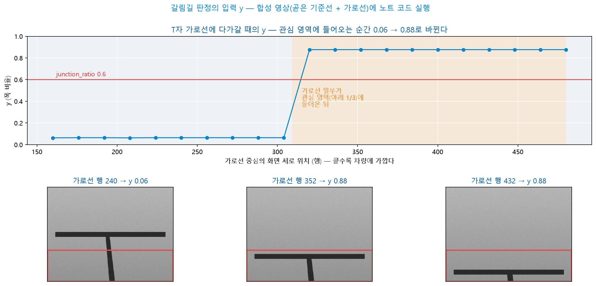

- 가로선이 화면 위쪽에 있을 때는 관심 영역(아래 1/3)에 기준선만 담겨 폭 비율이 약 0.06입니다
- 가로선의 일부가 관심 영역에 들어오는 순간 0.88로 바뀝니다 — 그 뒤로는 가로선이 더 가까워져도 같은 값입니다
- 그림은 곧은 기준선과 가로선을 그린 합성 영상에 3.2의 코드를 실행한 결과입니다(실제 테이프 아님)

<details>
<summary>예측 대조</summary>

- **한 번에** 늘어납니다 — 폭 비율은 흰색 영역을 감싸는 사각형의 폭을 화면 폭으로 나눈 값이므로, 가로선의 한 줄이라도 관심 영역에 들어오면 사각형이 가로선 전체 폭으로 넓어집니다

- 갈림길 판정 기준(`junction_ratio`)은 기준선과 가로선의 값 사이 어디에 두어도 판정 시점이 거의 같습니다 — 곡선의 값(2.6 표)보다 크게 두는 것이 중요합니다

</details>

| 상황 | 선의 폭 ÷ 화면 폭 |
|------|:--:|
| 기준선 주행 | 약 0.1 |
| 곡선 | 약 0.2\~0.4 |
| T자 가로선 | **0.6 이상**(`junction_ratio`) |

- 카메라는 바퀴보다 앞쪽 바닥을 촬영합니다 — 갈림길을 검출한 순간 방향을 바꾸면 **갈림길 중심에 도달하기 전에** 회전해 선을 놓칩니다. 검출 뒤 **잠시 직진**한 다음 회전합니다(`junction_go_sec`)
- 회전 방향은 **손모양으로 미리 예약**합니다(`left`·`right`). 예약이 없으면 차량은 갈림길에서 정지해 명령을 기다립니다
- 기준값 0.6과 직진 시간 0.5초는 시작값입니다 — 코스 · 카메라 각도에 맞추어 조정합니다

**움직이는 그림 M9-3 — 갈림길 판정 — 폭 비율의 급증과 그 뒤의 동작(2.6)** (약 13초 자동 반복)


### 2.7 역할 분담과 확인 활동

| 구분 | 고전 처리(라인) | 학습 모델(손모양) |
|------|------|------|
| 출력 | 연속값 −1 \~ 1 | 이름 6종 |
| 정하는 것 | 얼마나 조향할지 | 무엇을 할지 |
| 규칙 | 사람이 작성(밝기 · 무게중심) | 데이터로 학습 |
| 주의 | 조명 · 반사 | 학습하지 않은 조건 |

| # | 질문 | 확인하려는 것 |
|:--:|------|------|
| 1 | 장애물 정지를 손모양 `stop` 경로가 담당하면 무엇이 문제인가? | 2.2 — 경로별 지연 |
| 2 | 선이 화면 왼쪽에 있으면 `angular.z`의 부호는? | 2.5 — 부호 반전 |
| 3 | 갈림길을 검출한 순간 회전하면 어떻게 되는가? | 2.6 — 카메라와 바퀴의 위치 |
| 4 | 선의 위치를 학습 모델이 아니라 고전 처리로 계산하는 이유는? | 2.7 — 규칙으로 계산되는 값 |
| 5 | 바닥이 어두우면 `threshold`를 어떻게 조정하는가? | 2.3 — 테이프와 바닥의 밝기 사이 |

---

## 3. 실습 ① — 라인 검출 노드

### 3.1 노드 설계

| 항목 | 내용 |
|------|------|
| 노드 이름 | `line_detector` |
| 구독 | `/camera/image_raw` (`sensor_msgs/msg/Image`) |
| 발행 | `/line_point` (`geometry_msgs/msg/Point`) — `x` 오차 · `y` 폭 비율 · `z` 검출 여부 |
| | `/line_mask` (`sensor_msgs/msg/Image`) — 확인용 흑백 마스크 |
| 파라미터 | `threshold` · `roi_ratio` · `min_area` |
| 처리 주기 | 10Hz 타이머 — 구독은 보관만 |

- `Point`는 수치 세 개를 한 메시지로 보내는 표준 타입입니다 — Day 5 `color_tracker`가 `/target_point`의 `z`에 면적을 담은 것과 같은 방식으로, 오늘은 세 필드의 의미를 정해 계약으로 사용합니다
- `/line_point`는 선이 없을 때도 **0을 계속 발행**합니다 — 침묵과 고장을 구분하기 위해서입니다(Day 8 자료 3.1)

### 3.2 코드 작성 — 3단계

`~/ros2_ws/src/my_car_pkg/my_car_pkg/line_detector.py`를 3단계로 나누어 작성합니다. OpenCV 함수가 처음 나오므로 코드는 단계마다 제공합니다. 각 단계에서 빌드 · 실행해 값을 확인한 뒤 다음으로 넘어갑니다.

| 단계 | 추가 내용 | 확인 |
|:--:|------|------|
| 1 | 관심 영역 · 이진화 · 열림 → `/line_mask` 발행 | 마스크 영상 · 배열의 형상 |
| 2 | 무게중심 → 오차 `x` | `/line_point`의 `x` |
| 3 | 폭 비율 `y` · 검출 여부 `z` | `/line_point`의 `y` · `z` |

**단계 1 — 마스크 만들기**

```python
import rclpy
from rclpy.node import Node
from sensor_msgs.msg import Image
from cv_bridge import CvBridge
import numpy as np
import cv2

class LineDetector(Node):
    def __init__(self):
        super().__init__('line_detector')
        self.bridge = CvBridge()
        self.declare_parameter('threshold', 80)              # ① 이 밝기보다 어두우면 선(0~255)
        self.declare_parameter('roi_ratio', 0.33)            # ② 영상 아래쪽에서 사용할 비율

        self.latest = None
        self.sub = self.create_subscription(Image, '/camera/image_raw', self.on_image, 10)
        self.mask_pub = self.create_publisher(Image, '/line_mask', 10)
        self.timer = self.create_timer(0.1, self.process)    # ④ 10Hz 처리
        self.get_logger().info('line_detector started')

    def on_image(self, msg):
        self.latest = msg                                    # 보관만 — 변환은 타이머에서

    def process(self):
        if self.latest is None:
            return
        frame = self.bridge.imgmsg_to_cv2(self.latest, 'bgr8')
        h, w = frame.shape[:2]
        top = int(h * (1 - self.get_parameter('roi_ratio').value))
        roi = frame[top:, :]                                 # ⑤ 아래쪽 1/3

        gray = cv2.cvtColor(roi, cv2.COLOR_BGR2GRAY)
        gray = cv2.GaussianBlur(gray, (5, 5), 0)
        th = self.get_parameter('threshold').value
        _, mask = cv2.threshold(gray, th, 255, cv2.THRESH_BINARY_INV)   # ⑥ 어두운 곳 = 흰색
        mask = cv2.morphologyEx(mask, cv2.MORPH_OPEN, np.ones((5, 5), np.uint8))
        # (단계 2 · 3 — 이 자리에 추가)
        self.mask_pub.publish(self.bridge.cv2_to_imgmsg(mask, 'mono8'))   # ⑩ 확인용 마스크

def main(args=None):
    rclpy.init(args=args)
    node = LineDetector()
    try:
        rclpy.spin(node)
    except KeyboardInterrupt:
        pass
    finally:
        node.destroy_node()
        rclpy.shutdown()
```

`setup.py` 등록(단계 1에서 한 번) · 빌드 · 실행:

```python
'line_detector = my_car_pkg.line_detector:main',
```

```bash
cd ~/ros2_ws && colcon build && source install/local_setup.bash
# 터미널 1 — 2.4의 camera_node 유지 · 터미널 2
ros2 run my_car_pkg line_detector
# 터미널 3 — RPi5 원격 데스크톱 화면의 터미널
ros2 run rqt_image_view rqt_image_view      # /line_mask 선택
```

- 형상 확인 = 마스크 계산 다음 줄에 `self.get_logger().info(f'{frame.shape} {roi.shape} {gray.shape} {mask.shape} {np.unique(mask)}', once=True)`를 추가하면 처음 한 번만 출력됩니다

> **예측** — 카메라 해상도는 640 × 480입니다. `frame` · `roi` · `gray` · `mask`의 형상(`shape`)과 값의 범위를 적습니다.

| 배열 | 형상 | 값의 범위 |
|------|------|------|
| `frame` | | |
| `roi` | | |
| `gray` | | |
| `mask` | | |

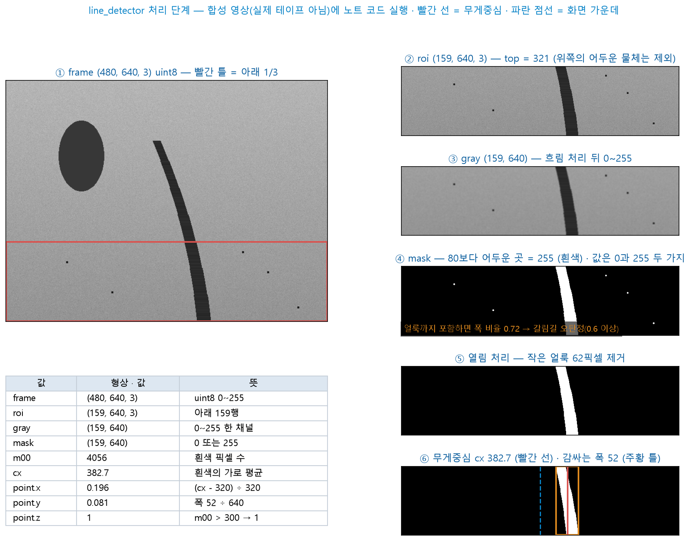

- 그림 왼쪽 아래의 표가 `frame`부터 `point`까지의 **형상 · 값 변화**입니다 — 단계 2 · 3에서 이어지는 값까지 함께 표시했습니다
- 관심 영역(②)에서 위쪽의 어두운 물체가 처음부터 제외됩니다 — 손도 같은 이유로 화면 위쪽에 두어야 합니다
- 열림 처리(⑤)가 작은 얼룩 62픽셀을 지웁니다 — 얼룩을 남기면 흰색 영역을 감싸는 폭이 화면 폭의 0.72가 되어 **갈림길로 잘못 판정**됩니다(0.6 이상)
- 그림은 기준선과 얼룩을 그린 합성 영상에 이 코드를 실행한 결과입니다(실제 테이프 아님)

<details>
<summary>예측 대조</summary>

| 배열 | 형상 | 값의 범위 |
|------|------|------|
| `frame` | (480, 640, 3) — 세로 · 가로 · 색 채널 | 0\~255 |
| `roi` | (159, 640, 3) — 아래 159행 | 0\~255 |
| `gray` | (159, 640) — 채널 1개 | 0\~255 |
| `mask` | (159, 640) | **0 또는 255** 두 값뿐 |

- `roi`의 세로 = 480 − `int(480 × 0.67)` = 480 − 321 = 159 — 0.33이 정확히 1/3이 아니어서 160이 아닙니다

- 형상은 배열의 **크기**이고, 값의 범위는 각 칸의 **값**입니다 — 회색조 변환은 채널 수를, 이진화는 값의 종류를 바꿉니다

</details>

**단계 2 — 무게중심 → 오차 `x`**

```python
from geometry_msgs.msg import Point                  # 맨 위 import에 추가

# __init__ — mask_pub 다음 줄
self.declare_parameter('min_area', 300)              # ③ 이보다 작은 영역 = 선 없음(픽셀 수)
self.point_pub = self.create_publisher(Point, '/line_point', 10)

# process — 「이 자리에 추가」 위치
m = cv2.moments(mask, binaryImage=True)              # ⑦ m00 = 흰색 픽셀 수
point = Point()                                      # 선이 없으면 x·y·z 모두 0
if m['m00'] > self.get_parameter('min_area').value:
    cx = m['m10'] / m['m00']                         # 무게중심의 가로 위치
    point.x = (cx - w / 2) / (w / 2)                 # ⑨ 오차 −1 ~ 1
self.point_pub.publish(point)
```

> **예측** — 테이프가 화면 왼쪽 1/4 지점(가로 160픽셀)에 있으면 `x`는 얼마입니까?

- **확인** — 빌드 → 터미널 2 다시 실행 → `ros2 topic echo /line_point`를 실행한 뒤 차량을 옮겨 테이프를 화면 왼쪽 · 가운데 · 오른쪽에 두며 `x`를 확인하면 단계 3으로 진행

<details>
<summary>예측 대조</summary>

- (160 − 320) ÷ 320 = **−0.5** — 왼쪽은 음수 · 가운데는 0 · 오른쪽 끝은 1에 가까움

- 테이프에는 폭이 있으므로 무게중심은 테이프의 가로 가운데에 놓입니다 — 그림의 예에서는 382.7픽셀 → `x` 0.196

</details>

**단계 3 — 폭 비율 `y` · 검출 여부 `z`**

```python
# 단계 2의 if 블록 안 — point.x 줄 다음
    _, _, bw, _ = cv2.boundingRect(mask)             # ⑧ 흰색 영역을 감싸는 사각형의 폭
    point.y = bw / w                                 # 폭 비율 — 갈림길 판정
    point.z = 1.0                                    # 검출 여부
```

- **확인** — 기준선 위에서 `y` 약 0.1 · `z` 1.0, 테이프 밖에서 `x` · `y` · `z` 모두 0이면 → 3.3으로 진행

<details>
<summary>참고 코드 — 단계 3까지 합친 `line_detector.py`</summary>

```python
import rclpy
from rclpy.node import Node
from sensor_msgs.msg import Image
from geometry_msgs.msg import Point
from cv_bridge import CvBridge
import numpy as np
import cv2

class LineDetector(Node):
    def __init__(self):
        super().__init__('line_detector')
        self.bridge = CvBridge()
        self.declare_parameter('threshold', 80)              # ① 이 밝기보다 어두우면 선(0~255)
        self.declare_parameter('roi_ratio', 0.33)            # ② 영상 아래쪽에서 사용할 비율
        self.declare_parameter('min_area', 300)              # ③ 이보다 작은 영역 = 선 없음(픽셀 수)

        self.latest = None
        self.sub = self.create_subscription(Image, '/camera/image_raw', self.on_image, 10)
        self.point_pub = self.create_publisher(Point, '/line_point', 10)
        self.mask_pub = self.create_publisher(Image, '/line_mask', 10)
        self.timer = self.create_timer(0.1, self.process)    # ④ 10Hz 처리
        self.get_logger().info('line_detector started')

    def on_image(self, msg):
        self.latest = msg                                    # 보관만 — 변환은 타이머에서

    def process(self):
        if self.latest is None:
            return
        frame = self.bridge.imgmsg_to_cv2(self.latest, 'bgr8')
        h, w = frame.shape[:2]
        top = int(h * (1 - self.get_parameter('roi_ratio').value))
        roi = frame[top:, :]                                 # ⑤ 아래쪽 1/3

        gray = cv2.cvtColor(roi, cv2.COLOR_BGR2GRAY)
        gray = cv2.GaussianBlur(gray, (5, 5), 0)
        th = self.get_parameter('threshold').value
        _, mask = cv2.threshold(gray, th, 255, cv2.THRESH_BINARY_INV)   # ⑥ 어두운 곳 = 흰색
        mask = cv2.morphologyEx(mask, cv2.MORPH_OPEN, np.ones((5, 5), np.uint8))

        m = cv2.moments(mask, binaryImage=True)              # ⑦ m00 = 흰색 픽셀 수
        point = Point()                                      # 선이 없으면 x·y·z 모두 0
        if m['m00'] > self.get_parameter('min_area').value:
            cx = m['m10'] / m['m00']                         # 무게중심의 가로 위치
            _, _, bw, _ = cv2.boundingRect(mask)             # ⑧ 흰색 영역을 감싸는 사각형의 폭
            point.x = (cx - w / 2) / (w / 2)                 # ⑨ 오차 −1 ~ 1
            point.y = bw / w                                 # 폭 비율 — 갈림길 판정
            point.z = 1.0                                    # 검출 여부
        self.point_pub.publish(point)
        self.mask_pub.publish(self.bridge.cv2_to_imgmsg(mask, 'mono8'))   # ⑩ 확인용 마스크

def main(args=None):
    rclpy.init(args=args)
    node = LineDetector()
    try:
        rclpy.spin(node)
    except KeyboardInterrupt:
        pass
    finally:
        node.destroy_node()
        rclpy.shutdown()
```

</details>

| # | 설명 |
|:--:|------|
| ①②③ | 밝기 기준 · 관심 영역 비율 · 최소 면적을 **파라미터로** — 코스 · 조명에 맞추어 조정 |
| ④ | 타이머로 10Hz 수행 — 카메라(30Hz)보다 낮은 주기로 처리해 RPi5 부하를 줄임(Day 5 자료 10.2와 같은 이유) |
| ⑤ | 아래쪽 1/3만 사용 — 멀리 있는 선 · 손 · 배경을 제외(2.3) |
| ⑥ | `THRESH_BINARY_INV` — 기준보다 **어두운** 픽셀을 흰색(255)으로. 검은 테이프가 흰색으로 남음 |
| ⑦ | `binaryImage=True` — 흰색 픽셀을 1로 계산해 `m00`이 픽셀 수가 됨(Day 5 자료 5장의 면적 판정과 같음) |
| ⑧⑨ | 선의 폭과 오차를 화면 폭으로 나누어 **해상도와 무관한 값**으로 |
| ⑩ | 마스크를 영상 토픽으로 발행 — `threshold` 조정의 근거(3.4) |

**코드 읽기 — Python 문법 ① 영상 배열과 슬라이싱** — Day 5 자료 12.2의 형태가 다시 나타납니다.

| 코드 | 뜻 |
|------|------|
| `h, w = frame.shape[:2]` | 동시 대입 — 세로 · 가로 두 값을 나누어 담음 |
| `int(h * (1 - …))` | 계산 결과는 실수 — 인덱스로 사용하려면 정수로 변환 |
| `frame[top:, :]` | 2차원 슬라이싱 — 행은 `top`부터 끝까지, 열은 전체 |
| `_, mask = cv2.threshold(…)` | 반환값 두 개 중 앞의 값은 사용하지 않음 — `_`는 불필요한 반환값에 관행적으로 붙이는 이름 |
| `np.ones((5, 5), np.uint8)` | 1로 채운 5×5 배열 — 모폴로지 연산의 범위 |

**코드 읽기 — Python 문법 ② 딕셔너리 조회와 메시지 필드**

| 코드 | 뜻 |
|------|------|
| `m['m00']` | 딕셔너리 조회 — `moments`의 결과 중 면적 |
| `_, _, bw, _ = cv2.boundingRect(mask)` | 네 값(x · y · 폭 · 높이) 중 폭만 사용 |
| `point = Point()` | 빈 메시지 객체 — 모든 필드가 기본값 0 |
| `point.x = …` | 메시지 필드에 대입(Day 8 자료 4.2 문법 ③) |
| `self.bridge.cv2_to_imgmsg(mask, 'mono8')` | OpenCV 배열 → ROS 영상 메시지(흑백 한 채널) — `imgmsg_to_cv2`의 반대 방향 |
| `try:` … `finally:` | Ctrl+C로 종료해도 `finally`의 정리는 반드시 실행 |

- **4장 · 5장의 코드에도 Python 문법 ① · ② 표를 같은 형태로 다시 싣습니다** — 지금 모두 암기할 필요는 없으며, 코드를 읽을 때마다 표를 참조하며 확인합니다

### 3.3 등록과 빌드

- `setup.py` 등록은 3.2 단계 1에서 한 번 합니다. 코드를 고칠 때마다 다시 빌드합니다

```bash
cd ~/ros2_ws && colcon build && source install/local_setup.bash
```

- `Summary: 1 package finished`가 출력되면 → 3.4로 진행
- `IndentationError`·`SyntaxError`가 나오면 → 오류가 가리키는 줄의 들여쓰기 · 괄호 · 따옴표를 확인하고 **빌드부터 다시** 실행

### 3.4 단독 확인과 기준값 조정

```bash
# 터미널 1 — 2.4의 camera_node를 그대로 유지
# 터미널 2
ros2 run my_car_pkg line_detector
# 터미널 3 — RPi5 원격 데스크톱 화면의 터미널
ros2 run rqt_image_view rqt_image_view      # /line_mask 선택
# 터미널 4
ros2 topic echo /line_point
```

| 차량 위치 | `/line_point` | `/line_mask` |
|------|------|------|
| 테이프가 화면 가운데 | `x` ≈ 0 · `z` = 1.0 | 가운데 세로 띠 |
| 테이프가 화면 오른쪽 | `x` 양수 | 오른쪽 띠 |
| 테이프 밖 | 모두 0 | 검은 화면 |
| T자 가로선 앞 | `y` 0.6 이상 | 가로 띠 |

- 표대로 출력되면 → 3.4 끝의 「기준값 조정」으로 진행
- `executable 'line_detector' not found`가 나오면 → `setup.py` 등록(3.2 단계 1)을 확인하고 **3.3부터 다시** 실행
- `/line_point`가 출력되지 않으면 → `ros2 topic hz /camera/image_raw`로 영상 수신을 확인 → 주기가 출력되지 않으면 **터미널 1부터 다시** 실행

> **예측** — `threshold`를 80에서 160으로 올리면 마스크는 어떻게 바뀝니까? 40으로 내리면 어떻게 됩니까?

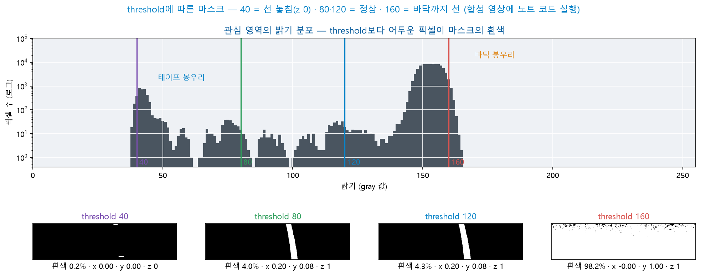

- 위 = 관심 영역의 밝기 분포 — 왼쪽 봉우리가 테이프, 오른쪽 봉우리가 바닥입니다
- `threshold`보다 어두운 픽셀이 마스크의 흰색이 됩니다 — `threshold`를 두 봉우리 **사이**에 두면 테이프만 남습니다
- 그림은 합성 영상에 이 노드의 코드를 실행한 결과입니다 — 실제 바닥 · 테이프의 봉우리 위치는 조명에 따라 다릅니다

<details>
<summary>예측 대조</summary>

- 160 = 바닥 봉우리의 대부분이 기준보다 어두워져 **화면의 98%가 흰색** · `y` 1.0 — 선의 위치를 알 수 없고, `y` 1.0이므로 갈림길로 잘못 판정됩니다

- 40 = 테이프 대부분의 밝기보다 낮아 흰색이 거의 없음(0.2%) · `z` 0 — 선을 놓칩니다

- 80 · 120은 둘 다 정상입니다 — 두 봉우리 사이의 넓은 범위가 모두 정답입니다. 조명이 바뀌어도 그 범위 안에 남는 값을 선택합니다

</details>

**기준값 조정** — 실제 코스에서 마스크를 보며 정합니다.

- 마스크에 바닥까지 흰색으로 넓게 나타나면 → `ros2 param set /line_detector threshold 60`처럼 **기준값을 낮추고** 다시 확인
- 테이프가 끊겨 보이거나 검출되지 않으면 → 기준값을 높여(예: `100`) 다시 확인
- 마스크가 정상이면 → 3.5로 진행

### 3.5 기록 영상으로 각자 조정

차량이 1대이므로 카메라 영상을 녹화해 두고, **각자의 RPi5에서 재생하며** 기준값을 조정합니다.

```bash
# 차량의 RPi5 — 차량을 코스를 따라 천천히 이동시키며 약 30초 녹화 후 Ctrl+C
ros2 bag record /camera/image_raw -o course_bag
```

- 영상 토픽은 30초만 녹화해도 파일 크기가 수백 MB입니다 — 복사와 재생 방법은 Day 5 자료 14.6과 같습니다

```bash
# 각자의 RPi5 — camera_node는 실행하지 않음(같은 토픽에 발행자가 둘이 됨)
ros2 bag play course_bag --loop
ros2 run my_car_pkg line_detector
```

- 곡선 · 갈림길 구간에서 `x` · `y`가 표대로 변하는지 확인합니다
- 팀은 결정한 `threshold`를 **하나로 맞추어** 차량의 launch에 적습니다(5.4)

### 3.6 응용 실습 — 밝기 분포에서 기준값 정하기

- 마스크를 보며 값을 바꾸어 보는 대신, **밝기 분포에서 `threshold`를 먼저 정한 뒤** 마스크로 검증합니다
- 3.5의 기록 영상에서 저장한 사진 1장의 밝기 분포를 그리고 기준값을 제안하는 스크립트를 AI 코딩 도구로 작성합니다

| 조건 | 내용 |
|------|------|
| 입력 | 코스 사진 1장 — `course_bag`을 재생하며 `image_saver`로 저장(Day 5 자료 14.1) |
| 처리 | 노드와 같은 관심 영역 · 회색조 · 흐림 처리 뒤의 밝기 분포(픽셀 수는 로그 축) |
| 출력 | 분포 그래프 + 두 봉우리 사이에서 픽셀 수가 가장 적은 밝기 |

- **확인** — 출력된 값으로 `ros2 param set /line_detector threshold <값>` → 마스크에 테이프만 남아야 합니다

<details>
<summary>실습 정리</summary>

- 출력에서 거꾸로 설정값을 찾는 방법입니다 — 분포의 두 봉우리(테이프 · 바닥)가 보이면 그 사이의 어떤 값으로 설정해도 정상 동작합니다(3.4 그림)

- 봉우리가 하나뿐이면 테이프가 관심 영역에 없거나 바닥과 밝기가 비슷한 것입니다 — 기준값으로는 해결되지 않으므로 카메라 각도나 조명을 먼저 바꿉니다

</details>

### 3.7 응용 실습 — 흰색 테이프 코스

- 어두운 바닥에 **흰색 테이프**로 만든 코스에서도 동작하도록 `line_detector`에 파라미터 `line_color`(`'black'` · `'white'`)를 추가합니다 — AI 코딩 도구로 작성합니다

| 조건 | 내용 |
|------|------|
| `black` | 지금과 같음 — 기준보다 어두운 픽셀이 선 |
| `white` | 기준보다 **밝은** 픽셀이 선 |
| 기준값 | `line_color`마다 별도 지정 가능 |

- **확인** — 흰 종이띠를 어두운 바닥(또는 검은 천)에 놓고 `white`로 실행하면 마스크에 종이띠만 남아야 합니다

<details>
<summary>실습 정리</summary>

- 이진화 방향(`THRESH_BINARY_INV` → `THRESH_BINARY`)만 바꾸고 기준값 80을 그대로 두면 **마스크에 바닥까지 흰색으로** 나타납니다 — 밝은 바닥은 80보다 밝기 때문입니다

- 기준값은 언제나 **선과 바닥의 밝기 사이**에 둡니다 — 선의 색이 달라지면 방향과 기준값을 함께 바꿉니다

- 밝은 바닥 위의 흰색 테이프처럼 두 밝기가 가까우면 어떤 기준값으로도 구분이 어렵습니다 — 바닥과 대비가 큰 테이프를 선택합니다

</details>

### 3.8 응용 실습 — 손이 선으로 검출되는 노드

- 증상 — 어떤 학생의 `line_detector`는 손모양을 보일 때마다 `x`가 크게 바뀝니다. 손이 없을 때에는 차량 바로 앞의 테이프를 잘 검출하지 못합니다
- 이 학생의 관심 영역 코드는 아래와 같습니다. 원인을 찾습니다. 기록 영상의 사진 1장에서 **잘라 낸 영역을 이미지로 저장하는 확인 스크립트**를 AI 코딩 도구로 작성해 수정 전후를 비교합니다

```python
top = int(h * (1 - self.get_parameter('roi_ratio').value))
roi = frame[:top, :]
```

<details>
<summary>실습 정리</summary>

- 원인 = `frame[:top, :]`은 **처음부터 `top` 앞까지**를 가리키므로 위쪽 2/3를 잘라 냅니다. 손 · 배경의 어두운 물체가 선으로 검출되고, 차량 바로 앞의 테이프는 빠집니다

- 아래쪽 1/3은 `frame[top:, :]` — 콜론의 앞이 시작, 뒤가 끝입니다(코드 읽기 ①)

- 잘라 낸 영역을 이미지 파일로 저장해 보면 원인이 드러납니다 — 수치로 나타나는 증상만으로 판단하기보다 중간 결과를 이미지로 직접 확인합니다

</details>

### 3.9 응용 실습 — 오차의 이동 평균

- `/line_point`의 `x`에 **최근 5회 이동 평균**을 적용해 `/line_x_avg`(`std_msgs/msg/Float32`)로 발행하는 기능을 `line_detector`에 추가합니다 — AI 코딩 도구로 작성합니다(Day 6 자료 10.1 · Day 8 자료 2.10과 같은 필터)

| 조건 | 내용 |
|------|------|
| 평균 대상 | 선이 검출된 프레임(`z` = 1)의 `x`만 |
| 기록 길이 | 5 — 파라미터 `avg_n` |
| 비교 | rqt_plot에 `/line_point/x` · `/line_x_avg/data`를 함께 표시 |

- **확인** — 기록 영상을 재생하며 평균 선이 원래 선보다 매끄럽고 조금 늦게 따라가야 합니다

<details>
<summary>실습 정리</summary>

- 선이 없는 프레임(`x` = 0)을 평균에 포함하면 평균이 0에 가까워져 실제보다 작은 오차가 산출됩니다 — 검출 여부로 먼저 거릅니다

- 평균은 잡음을 줄이는 대신 변화를 늦춥니다 — 조향에 사용하면 곡선에 들어갈 때 반응이 지연됩니다. 표시 · 분석용과 조향용을 구분해 판단합니다

</details>

---

## 4. 실습 ② — 라인 추종 주행

### 4.1 노드 설계 — 1단계

| 항목 | 내용 |
|------|------|
| 노드 이름 | `line_driver` |
| 구독 | `/line_point` (`geometry_msgs/msg/Point`) |
| 발행 | `/cmd_vel` (`geometry_msgs/msg/Twist`) |
| 파라미터 | `speed` · `gain` · `search_turn` |
| 제어 주기 | 10Hz 타이머 — 구독은 보관만(Day 8 자료 4.2와 같은 구조) |

- 1단계 = **라인 추종만** 합니다. 5.3에서 같은 파일에 손모양 명령 · 초음파 정지를 더해 완성합니다

### 4.2 코드 작성 — 2단계

`~/ros2_ws/src/my_car_pkg/my_car_pkg/line_driver.py`를 2단계로 작성합니다 — 단계 1(비례 조향)의 코드는 제공되며, 단계 2(선을 잃었을 때의 탐색)는 AI 코딩 도구로 작성합니다.

**단계 1 — 비례 조향**

```python
import rclpy
from rclpy.node import Node
from geometry_msgs.msg import Twist, Point

class LineDriver(Node):
    def __init__(self):
        super().__init__('line_driver')
        self.declare_parameter('speed', 1.0)             # ① 직진 속도 — Day 8 실측의 linear_speed
        self.declare_parameter('gain', 1.0)              # ② 비례 조향 계수

        self.line = Point()                              # 최신 선 정보 보관

        self.sub = self.create_subscription(Point, '/line_point', self.on_line, 10)
        self.pub = self.create_publisher(Twist, '/cmd_vel', 10)
        self.timer = self.create_timer(0.1, self.control)
        self.get_logger().info('line_driver started')

    def on_line(self, msg):
        self.line = msg                                  # 보관만

    def control(self):
        twist = Twist()
        if self.line.z > 0.5:                            # ④ 선이 검출됨
            twist.linear.x = self.get_parameter('speed').value
            twist.angular.z = -self.line.x * self.get_parameter('gain').value   # ⑤ 부호 반전
        self.pub.publish(twist)                          # 선이 없으면 모두 0 = 정지

def main(args=None):
    rclpy.init(args=args)
    node = LineDriver()
    try:
        rclpy.spin(node)
    except KeyboardInterrupt:
        pass
    finally:
        node.destroy_node()
        rclpy.shutdown()
```

`setup.py` 등록 후 빌드:

```python
'line_driver = my_car_pkg.line_driver:main',
```

```bash
cd ~/ros2_ws && colcon build && source install/local_setup.bash
```

- **확인** — 4.3의 명령 발행에서 `x: 0.5` · `x: -0.5` 두 행을 확인하면 단계 2로 진행

**단계 2 — 선을 잃었을 때의 탐색**(AI 코딩 도구로 작성)

| 요청에 포함할 조건 | 내용 |
|------|------|
| 파라미터 | `search_turn`(기본 1.2) — 탐색 회전 속도 |
| 집계 | 선이 보이지 않는 주기 수를 집계 · 선이 보이면 0으로 |
| 탐색 시작 | 5주기를 넘으면(6번째 주기부터) 제자리 회전 — 그 전에는 정지 |
| 회전 방향 | 마지막으로 선이 보인 쪽 — 선이 보일 때마다 갱신 |

- **확인** — 4.3의 `z: 0.0` 행까지 확인하면 4.4로 진행

<details>
<summary>참고 코드 — 단계 2까지 합친 `line_driver.py`</summary>

```python
import rclpy
from rclpy.node import Node
from geometry_msgs.msg import Twist, Point

class LineDriver(Node):
    def __init__(self):
        super().__init__('line_driver')
        self.declare_parameter('speed', 1.0)             # ① 직진 속도 — Day 8 실측의 linear_speed
        self.declare_parameter('gain', 1.0)              # ② 비례 조향 계수
        self.declare_parameter('search_turn', 1.2)       # ③ 선을 잃었을 때 회전 속도

        self.line = Point()                              # 최신 선 정보 보관
        self.lost = 0                                    # 선을 잃은 주기 수
        self.last_side = 1.0                             # 마지막으로 본 선의 쪽(+1 왼쪽 · −1 오른쪽)

        self.sub = self.create_subscription(Point, '/line_point', self.on_line, 10)
        self.pub = self.create_publisher(Twist, '/cmd_vel', 10)
        self.timer = self.create_timer(0.1, self.control)
        self.get_logger().info('line_driver started')

    def on_line(self, msg):
        self.line = msg                                  # 보관만

    def control(self):
        twist = Twist()
        if self.line.z > 0.5:                            # ④ 선이 검출됨
            self.lost = 0
            twist.linear.x = self.get_parameter('speed').value
            twist.angular.z = -self.line.x * self.get_parameter('gain').value   # ⑤ 부호 반전
            self.last_side = 1.0 if self.line.x < 0 else -1.0
        else:
            self.lost += 1
            if self.lost > 5:                            # ⑥ 6번째 주기(약 0.6초)부터 제자리 탐색
                twist.angular.z = self.get_parameter('search_turn').value * self.last_side
        self.pub.publish(twist)

def main(args=None):
    rclpy.init(args=args)
    node = LineDriver()
    try:
        rclpy.spin(node)
    except KeyboardInterrupt:
        pass
    finally:
        node.destroy_node()
        rclpy.shutdown()
```

</details>

| # | 설명 |
|:--:|------|
| ① | 직진 속도 — Day 8 자료 7.5에서 실측한 `linear_speed`와 같은 값으로 시작 |
| ②⑤ | 오차(−1\~1) × 계수 = 회전 명령 — 선이 오른쪽(오차 양수)이면 오른쪽으로 회전(음수) |
| ③⑥ | 선을 잃으면 곧바로 정지하고, 6번째 주기부터 **마지막으로 선이 보인 방향**으로 제자리 회전 — 선을 잃은 채 직진하면 이탈 거리가 늘어남 |
| ④ | `z`가 검출 여부(3.1 계약) — 실수 비교이므로 `z == 1.0` 대신 `z > 0.5` |

**코드 읽기 — Python 문법 ③ 조건과 조건부 표현식** — Day 8 자료 7.3의 형태가 다시 나타납니다.

| 코드 | 뜻 |
|------|------|
| `if self.line.z > 0.5:` … `else:` | 두 경우의 분기 — 검출됨 / 검출되지 않음 |
| `-self.line.x * …` | 앞의 `-`가 부호를 반전함 — 영상 좌표와 회전 방향이 반대이기 때문(2.5) |
| `1.0 if self.line.x < 0 else -1.0` | 조건부 표현식 — 조건이 참이면 앞의 값, 거짓이면 뒤의 값 |
| `self.lost += 1` | 기존 값에 더해 다시 대입 — 선을 잃은 주기 수 누적 |
| `self.lost = 0` | 선이 다시 보이면 누적을 0으로 초기화함 |

- **5.3의 코드에도 이 표를 같은 형태로 다시 싣습니다** — 지금 모두 암기할 필요는 없습니다

### 4.3 단독 확인 — 명령으로 발행

카메라 없이 **선 정보를 명령으로 발행해** 판단 노드만 먼저 확인합니다(Day 8 자료 4.3과 같은 절차).

```bash
# 터미널 1
ros2 run my_car_pkg line_driver
# 터미널 2 — 선이 오른쪽에 있다고 가정
ros2 topic pub --rate 10 /line_point geometry_msgs/msg/Point "{x: 0.5, y: 0.1, z: 1.0}"
# 터미널 3
ros2 topic echo /cmd_vel
```

| 발행 값 | `/cmd_vel` 예측(실행 전에 적음) |
|------|------|
| `x: 0.5` · `z: 1.0` | `linear.x` · `angular.z` |
| `x: -0.5` · `z: 1.0` | `angular.z` |
| `x: 0.5`를 발행하다가 `z: 0.0`으로 바꿈 | 정지 여부 · 회전을 시작하는 시점과 방향 |

<details>
<summary>예측 대조</summary>

- `x: 0.5` = `linear.x` 1.0 · `angular.z` **−0.5**(`gain` 1.0) · `x: -0.5` = `angular.z` +0.5

- `z: 0.0` = **곧바로** `linear.x` 0 · `angular.z` 0으로 정지 → **6번째 주기**(약 0.6초 뒤)부터 `angular.z` −1.2 — 마지막으로 선이 보인 쪽(오른쪽)으로 회전

- 이 강의 준비 실행 기록 = 선을 잃은 시각 2.017초 → 탐색 시작 2.617초(PC의 WSL2)

</details>

- 예측과 대조해 같으면 → 4.4로 진행
- `executable 'line_driver' not found`가 나오면 → `setup.py` 등록을 확인하고 **빌드부터 다시** 실행
- `angular.z`의 부호가 예측 대조와 반대이면 → ⑤의 `-`가 빠진 것입니다. 코드를 고치고 **빌드부터 다시** 실행
- `/cmd_vel`이 출력되지 않으면 → `ros2 node list`에 `/line_driver`가 있는지 확인 → 없으면 **터미널 1을 다시** 실행

### 4.4 시운전 — 기준선 주행

`~/ros2_ws/src/my_car_pkg/launch/line_launch.py`:

```python
from launch import LaunchDescription
from launch_ros.actions import Node

def generate_launch_description():
    return LaunchDescription([
        Node(package='camera_ros', executable='camera_node',
             parameters=[{'width': 640, 'height': 480}]),
        Node(package='my_car_pkg', executable='line_detector',
             parameters=[{'threshold': 80}]),               # 3.4에서 정한 값
        Node(package='my_car_pkg', executable='line_driver',
             parameters=[{'speed': 1.0, 'gain': 1.0}]),
        Node(package='my_car_pkg', executable='motor_node',
             parameters=[{'trim': 0.0}]),                    # 차량의 보정값(Day 6 자료 7.4)
    ])
```

```bash
cd ~/ros2_ws && colcon build && source install/local_setup.bash
ros2 launch my_car_pkg line_launch.py
```

**첫 기동은 바퀴를 띄운 상태로** 합니다 — 차량을 들어 카메라 아래에서 테이프 조각을 좌우로 옮기며 바퀴 방향을 확인합니다. 그다음 기준선 위에 내려놓습니다.

- 테이프를 오른쪽에 두었을 때 왼쪽 바퀴가 오른쪽 바퀴보다 빠르게 회전하면(오른쪽으로 회전하는 방향) → 기준선 위에 내려놓고 주행
- `file 'line_launch.py' was not found`가 나오면 → `setup.py`의 `data_files`에 `launch` 폴더가 등록되었는지 확인하고 **빌드부터 다시** 실행(Day 3 자료 8.3)
- 노드 중 일부만 실행되면 → `ros2 node list`로 누락 노드를 확인하고, 그 노드를 단독 실행해 오류를 파악한 뒤 **launch를 다시** 실행
- 직선에서도 **한쪽으로 휘면** → `trim`이 반영되지 않은 것입니다. launch의 `trim`을 차량의 값으로 고치고 **빌드부터 다시** 실행

| 관찰 | 판단 | 조치 |
|------|------|------|
| 선 위를 부드럽게 따라감 | 적정 | 유지 |
| 곡선에서 바깥으로 이탈 | 조향 부족 | `gain` 상향 또는 `speed` 하향 |
| 좌우로 크게 진동하며 진행 | 조향 과잉 | `gain` 하향 |
| 선을 잃고 계속 회전만 함 | 검출 실패 | 3.4에서 `threshold` 재조정 |

```bash
ros2 param set /line_driver gain 1.5       # 실행 중 조정(Day 3 자료 5.6)
ros2 param set /line_driver speed 0.8
```

> **자주 하는 실수 —** 주행 중 `line_detector`를 종료해도 차량은 **마지막으로 받은 선의 위치로 계속 움직입니다.** `line_driver`가 `/cmd_vel`을 끊임없이 발행하므로 `motor_node`의 0.5초 감시(Day 6 자료 7.2 ⑤)도 동작하지 않습니다. 수신 감시는 5.3에서 추가합니다 — 그때까지는 `line_driver`를 먼저 종료합니다.

### 4.5 관찰 — 오차와 조향의 비례

```bash
ros2 run rqt_plot rqt_plot /line_point/x /cmd_vel/angular/z      # RPi5 원격 데스크톱 화면
```

- 두 선이 **위아래로 뒤집힌 같은 모양**으로 움직입니다 — 크기는 비례하고 부호는 반대입니다(2.5)
- 이 비례 관계가 **비례 제어**입니다 — Day 6 자료 10.5(거리에 비례하는 속도)와 같은 원리를 조향에 적용했습니다
- `gain`을 0.5와 2.0으로 바꾸어 비교합니다

> **예측** — `gain`을 1.0에서 2.0으로 올리면 `/line_point/x` 그래프는 어떻게 바뀝니까? 0.5로 내리면 곡선에서 어떻게 됩니까?

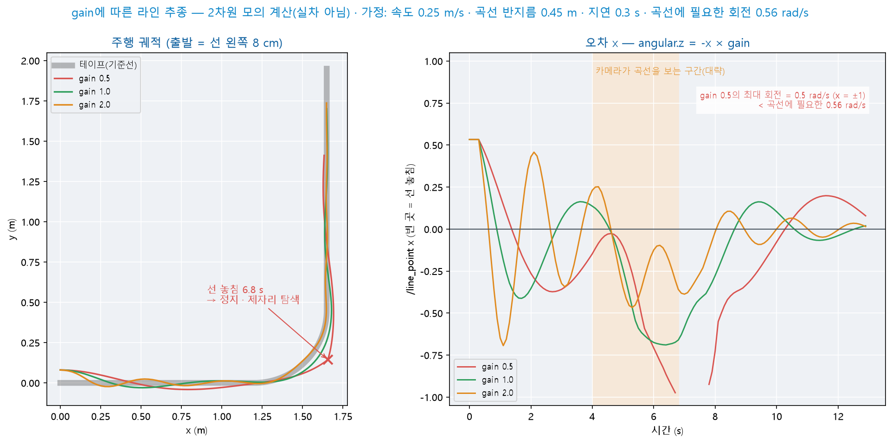

- 왼쪽 = 주행 궤적 · 오른쪽 = 오차 `x` — 세 경우 모두 선의 왼쪽 8 cm에서 출발합니다
- `gain` 0.5에서는 오차가 최대(1)여도 회전 명령이 0.5 rad/s입니다 — 곡선에 필요한 0.56 rad/s보다 작아 6.8초에 선을 놓칩니다
- 그림은 2차원 모의 계산입니다(실차 아님) — 속도 0.25 m/s · 곡선 반지름 0.45 m · 반응 지연 0.3초는 가정값이며, 실제 차량의 값과 다를 수 있습니다

<details>
<summary>예측 대조</summary>

- 2.0 = 진동의 **폭이 늘고 횟수가 많아집니다** — 첫 골 −0.41 → −0.69 · `x`의 부호가 바뀐 횟수 6 → 10회. 진폭이 정확히 2배가 되지는 않습니다

- 0.5 = 곡선에서 조향이 부족해 바깥으로 벗어나고 선을 놓칩니다 — 오차를 줄이는 속도가 느려 직선에서도 선에 늦게 수렴합니다

- 알맞은 `gain`은 속도 · 곡선 반지름 · 반응 지연에 따라 달라집니다 — 실제 차량에서는 4.4의 표로 조정합니다

</details>

### 4.6 응용 실습 — 선에서 멀어지는 차량

- 증상 — 어떤 학생의 차량을 기준선 위에 내려놓으면 **선에서 점점 멀어지다가** 선을 놓칩니다. 바퀴를 띄우고 테이프를 화면 오른쪽에 두면 오른쪽 바퀴가 왼쪽 바퀴보다 빠르게 회전합니다
- 원인이 되는 코드 한 곳을 찾습니다. `x` 값 −1 · −0.5 · 0 · 0.5 · 1에서 `angular.z`를 계산해 표로 출력하는 시험 스크립트(ROS 없이 실행)를 AI 코딩 도구로 작성해 수정 전후를 비교합니다

<details>
<summary>실습 정리</summary>

- 원인 = ⑤의 `-` 누락 — 선이 오른쪽에 있으면(`x` 양수) 왼쪽으로 회전해 오차가 더 커집니다. 오차를 줄이는 방향이 아니라 **늘리는 방향**으로 반응하므로 선에서 멀어집니다

- 부호 확인은 값 한 쌍으로 충분합니다 — `x` 0.5에서 `angular.z`가 음수인지 확인하면 됩니다(4.3). 실제 차량에서는 4.4의 바퀴 띄우기 첫 기동에서 발견합니다

</details>

### 4.7 응용 실습 — 테이프가 끊긴 구간 지나가기

- 테이프가 가운데에서 잠시 끊긴 구간에서는 탐색하지 않고 **1초 동안 직진해 지나가도록** `line_driver`를 고칩니다 — AI 코딩 도구로 작성합니다

| 조건 | 내용 |
|------|------|
| 판정 | 선이 사라지기 직전의 `x` 크기가 0.3보다 작으면 「가운데에서 끊김」 |
| 동작 | 끊김 = 1초(10주기) 동안 `speed`로 직진한 뒤 4.2의 탐색 동작 · 그 밖 = 변경 없음 |
| 기록 | 사라지기 직전의 `x`는 **선이 검출된 프레임에서만** 기록 |

- **확인** — ① `x: 0.1` 발행 뒤 `z: 0.0` → 1초 직진 후 탐색 ② `x: 0.8` 발행 뒤 `z: 0.0` → 곧바로 정지하고 약 0.6초 뒤 탐색

<details>
<summary>실습 정리</summary>

- 매 주기 `x`를 기록하면 ②가 실패합니다 — 선이 없는 동안 입력되는 `x`는 0이므로 기록이 0으로 덮여 모든 경우가 「가운데에서 끊김」으로 판정됩니다

- 선이 없는 프레임의 `x` · `y`는 「값이 0」이 아니라 「**값이 없음**」입니다(3.1 계약) — `z`로 먼저 걸러야 합니다

</details>

### 4.8 응용 실습 — 선을 놓치지 않는 최소 `gain`

- 4.5 그림과 같은 가정(곡선에 필요한 회전 0.56 rad/s)에서 `gain`을 바꾸며 모의 계산한 결과입니다

| `gain` | 0.5 | 0.55 | 0.6 | 0.65 | 0.7 | 0.8 | 1.0 |
|------|:--:|:--:|:--:|:--:|:--:|:--:|:--:|
| 선을 놓친 시각(초) | 6.8 | 6.8 | 6.9 | 7.1 | 없음 | 없음 | 없음 |

- ① 계산으로 최소 `gain`을 추정합니다(오차의 최대 = 1) ② 표에서 최소 `gain`을 찾고 ①과 다른 이유를 설명합니다 — 표를 그래프로 그리는 스크립트를 AI 코딩 도구로 작성해 확인합니다

<details>
<summary>실습 정리</summary>

- ① 계산 = 0.56 ÷ 1 = **0.56** · ② 모의 계산 = **0.7**부터 놓치지 않음

- 회전 명령이 0.56에 이르려면 오차가 0.56 ÷ `gain`이어야 합니다 — `gain` 0.6이면 그 값이 0.93입니다. 선이 화면 가장자리에 있어야 하므로 조금만 더 벗어나도 선을 놓칩니다. 반응 지연(0.3초) 동안 회전이 늦는 것도 여유를 줄입니다

- 계산값은 **하한**입니다 — 실제 차량에서는 계산한 값보다 여유 있게 시작해 시운전으로 확인합니다

</details>

---

## 5. 실습 ③ — 손모양 명령과 초음파 정지의 결합

### 5.1 차량 시점 손모양 점검 · 재학습

Day 8에서는 **PC 웹캠**으로 촬영한 사진으로 손모양 모델을 학습했습니다. 차량 카메라는 위치 · 각도 · 배경이 다릅니다.

| 조건 | Day 8 학습 | 오늘 차량 |
|------|------|------|
| 카메라 | PC 웹캠 — 정면 · 눈높이 | 차량 카메라 — 낮은 위치 · 아래로 기움 |
| 배경 | 강의실 벽 · 사람 | 바닥 · 테이프 · 다리 |
| 손의 위치 | 화면 가운데 | 화면 위쪽 — 아래쪽은 선 검출 영역(2.3) |

```bash
# 터미널 1 — 2.4의 camera_node 유지
# 터미널 2 — Day 8 자료 2.8에서 flip을 true로 정했으면 -p flip:=true를 붙임
ros2 run my_car_pkg hand_classifier
# 터미널 3 · 4
ros2 topic echo /hand_stable
ros2 topic echo /hand_confidence
```

| 확인 | 기준 |
|------|------|
| 차량 앞에서 손모양 5종을 차례로 만듦 | `/hand_stable`이 같은 이름으로 바뀜 |
| 손을 내림 — 바닥 · 테이프만 보임 | `none` |
| 손모양을 유지하며 차량에서 멀어짐 | 판정이 유지되는 거리 확인 |

- 6종이 모두 맞게 판정되면 → **재학습 없이** 5.2로 진행
- 손이 없는 장면에서 `none`이 아닌 이름이 출력되면 → 바닥 · 테이프를 손모양으로 판정한 것입니다. 5.1 끝의 **재학습**으로 진행
- 특정 손모양의 `/hand_confidence`가 0.7 아래에 머물면 → 손을 화면 위쪽 가운데로 옮겨 **다시** 확인 → 그래도 낮으면 5.1 끝의 **재학습**으로 진행
- `left` · `right`가 서로 바뀌어 판정되면 → `flip` 값을 반대로 바꾸어 **터미널 2를 다시** 실행(Day 8 자료 2.7)
- `left` · `right`는 **차량 기준** 방향입니다 — 차량 앞에 선 사람에게는 반대쪽이므로, 손모양을 제시하는 위치와 방향의 기준을 팀이 정해 둡니다

**재학습 — 차량 영상을 데이터에 추가**

| 순서 | 작업 |
|:--:|------|
| 1 | 차량 카메라 영상을 사진으로 저장 — Day 5 자료 14.1 ②의 `image_saver` · 클래스마다 파일 이름 앞부분을 바꿈(예: `left_%04d.jpg`) |
| 2 | 사진을 PC로 옮김 — VS Code 원격 탐색기에서 사진을 오른쪽 클릭 → **Download** |
| 3 | Day 8 자료 2.6에서 저장한 Teachable Machine 프로젝트를 열고 클래스마다 **Upload**로 사진 추가 |
| 4 | `none`에는 **손이 없는 바닥 · 테이프 장면**을 추가 — 차량을 코스 위에서 이동하며 저장 |
| 5 | Train Model → Export → `model_unquant.tflite` · `labels.txt` 반출 — Day 8 자료 2.7 ①부터 같은 절차 |

- 재학습 뒤 5.1의 확인 표로 **다시** 점검합니다
- 차량이 1대이므로 사진 저장은 팀이 함께 하고, 학습은 한 사람의 PC에서 진행합니다

### 5.2 우선순위 설계 — 세 입력의 결합

| 순위 | 조건 | 행동 | 근거 |
|:--:|------|------|------|
| 1 | 거리 · 선 정보가 1초 넘게 끊김 · **거리 < `stop_cm`** | 정지 | 안전 — 다른 판단보다 먼저(Day 6 자료 7.2 ⑤ · Day 8 자료 6.1) |
| 2 | 손모양 `stop` | 정지 · 명령 대기 | 사람의 명령 |
| 3 | 회전 동작 중 | 회전 계속 | 시작한 동작을 끝까지 |
| 4 | 그 밖 | 라인 추종 | 기본 동작 |

- 장애물 정지를 1순위에 두는 이유는 반응 지연이 짧은 경로가 담당해야 하기 때문입니다(2.2)
- 손모양 명령은 Day 8 `hand_driver`와 같이 **판정이 바뀐 순간 한 번** 처리합니다(Day 8 자료 7.2)

| 상태 | 뜻 | 바뀌는 조건 |
|------|------|------|
| `STOP` | 정지 · 명령 대기 | 시작 상태 · `stop` 수신으로 진입 · `go` 수신 → `FOLLOW` |
| `FOLLOW` | 라인 추종 | 폭 비율 ≥ `junction_ratio` → `APPROACH` · `uturn` → `TURN` |
| `APPROACH` | 갈림길 중심까지 직진 | `junction_go_sec` 뒤 — 예약 있음 → `TURN` · 없음 → `WAIT` |
| `WAIT` | 갈림길에서 명령 대기 | `left` · `right` · `uturn` → `TURN` · `go` → `FOLLOW` |
| `TURN` | 실측 시간만큼 회전 | 시간 종료 → `FOLLOW` |

- 주행 중(`FOLLOW` · `APPROACH`)에 받은 `left` · `right`는 **다음 갈림길의 방향으로 예약**합니다(2.6)

> **예측** — 차량이 기준선을 따라 주행하다가 상자 앞에서 초음파로 정지했습니다. 이때 `go` 손모양을 제시하면 출발합니까? 상자를 치우면 어떻게 됩니까?

<details>
<summary>예측 대조</summary>

- 출발하지 않습니다 — 1순위 확인에서 정지 명령을 발행하고 `return`하므로 손모양 명령의 처리에 이르지 않습니다

- 상자를 치우면 `go` 없이 **곧바로 다시 주행**합니다 — 장애물 정지는 상태를 바꾸지 않으므로 `FOLLOW`가 유지됩니다(5.3 그림의 3.16 \~ 4.73초)

</details>

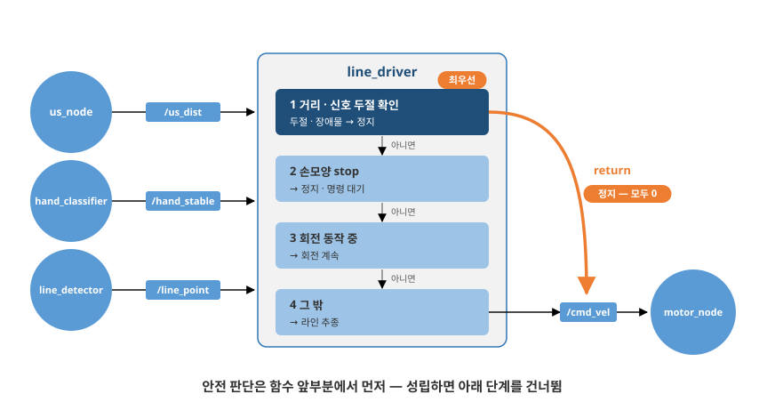

**움직이는 그림 M9-4 — 세 입력의 우선순위 — 평소와 장애물 정지(5.2)** (약 15초 자동 반복)


### 5.3 결합 노드 — line_driver 완성

4장의 `line_driver`에 거리 · 손모양 입력과 상태를 더합니다.

| 항목 | 내용 |
|------|------|
| 구독 추가 | `/us_dist` (`my_msgs/msg/DistMsg`) · `/hand_stable` (`std_msgs/msg/String`) |
| 파라미터 추가 — 정지 · 회전 | `stop_cm` · `turn_speed` · `sec_per_90` · `sec_per_180` |
| 파라미터 추가 — 갈림길 | `junction_ratio` · `junction_go_sec` |
| 상태 | `STOP` · `FOLLOW` · `APPROACH` · `WAIT` · `TURN`(5.2) |
| 명령 처리 | 판정이 바뀐 순간 한 번 — Day 8 `hand_driver`와 같음 |

4.2의 `line_driver`에 4단계로 더합니다. AI 코딩 도구로 코드를 작성한 뒤 아래 힌트와 접힌 풀이로 대조합니다.

| 단계 | 추가하는 것 | 힌트 |
|:--:|------|:--:|
| 1 | 거리 구독 · 1순위 정지(두절 · 장애물) | ① |
| 2 | 손모양 구독 · `stop` · `go` · 상태 `STOP` · `FOLLOW` | ② |
| 3 | 갈림길 `APPROACH` · `WAIT` | — |
| 4 | 예약 · 회전(`TURN`) · 회전 뒤 판정 중지 | ③ ④ |

**구현 힌트**

- ① 안전 판단을 `control` **맨 앞**에 두고, 조건이 성립하면 정지 명령을 발행한 뒤 `return`
- ② 명령은 `if self.hand != self.last_cmd:` 안에서만 처리 — Day 8 자료 7.3 풀이와 같은 형태. 명령 처리 메서드의 이름은 `handle`이 아닌 `run_command`(Day 8 자료 7.3 「자주 하는 실수」)
- ③ 회전은 실측 시간으로 판정 — 차량에는 `/turtle1/pose`가 없으므로 Day 8 자료 7.5의 `sec_per_90` · `sec_per_180`을 기본값으로
- ④ 회전을 마친 직후 2초는 갈림길 판정을 하지 않음 — 가로선이 화면에 남아 있어 갈림길로 다시 판정됨

**단계마다 확인** — 차량 없이 입력을 명령으로 발행합니다(4.3과 같은 방법).

```bash
# 터미널 1
ros2 run my_car_pkg line_driver
# 터미널 2 · 3 — 선 · 거리를 계속 발행(1순위 정지 조건을 풀어 둠)
ros2 topic pub --rate 10 /line_point geometry_msgs/msg/Point "{x: 0.0, y: 0.1, z: 1.0}"
ros2 topic pub --rate 10 /us_dist my_msgs/msg/DistMsg "{dist: 100.0}"
# 터미널 4 — 손모양 판정 · 터미널 5 — ros2 topic echo /cmd_vel
ros2 topic pub /hand_stable std_msgs/msg/String "{data: 'go'}" --once
```

| 단계 | 확인 |
|:--:|------|
| 1 | 터미널 3을 `{dist: 20.0}`으로 바꾸면 정지 · 터미널 2를 `Ctrl+C`로 멈추면 약 1초 뒤 정지 |
| 2 | 실행 직후 정지 · `go` → 라인 추종 · `stop` → 정지 |
| 3 | 주행 중 터미널 2를 `y: 0.8`로 바꾸면 약 0.5초 직진 후 정지(`WAIT`) |
| 4 | 주행 중 `left` → `none` → `y: 0.8`이면 약 0.5초 직진 후 왼쪽 회전 → 라인 추종 |

<details>
<summary>풀이 ① line_driver 전체 코드</summary>

`~/ros2_ws/src/my_car_pkg/my_car_pkg/line_driver.py`(4.2 파일을 교체):

```python
import rclpy
from rclpy.node import Node
from geometry_msgs.msg import Twist, Point
from std_msgs.msg import String
from my_msgs.msg import DistMsg

TURNS = {'left': ('sec_per_90', 1.0), 'right': ('sec_per_90', -1.0),
         'uturn': ('sec_per_180', 1.0)}                     # ① 명령 → (시간 파라미터, 방향)

class LineDriver(Node):
    def __init__(self):
        super().__init__('line_driver')
        for name, value in [('speed', 1.0), ('gain', 1.0), ('search_turn', 1.2),
                            ('stop_cm', 30.0), ('turn_speed', 2.0),
                            ('sec_per_90', 1.6), ('sec_per_180', 3.1),
                            ('junction_ratio', 0.6), ('junction_go_sec', 0.5)]:
            self.declare_parameter(name, value)             # ② 파라미터 9개를 반복문으로 선언

        self.line = Point()
        self.dist = 999.0
        self.hand = 'none'
        self.last_cmd = 'none'
        self.state = 'STOP'                                 # ③ 시작 = 정지 · go로 출발
        self.reserved = None                                # 다음 갈림길의 방향(예약)
        self.turn_sec = 0.0
        self.turn_dir = 0.0
        self.elapsed = 0.0
        self.cooldown = 0.0
        self.lost = 0
        self.last_side = 1.0
        self.line_time = self.get_clock().now()
        self.dist_time = self.get_clock().now()

        self.create_subscription(Point, '/line_point', self.on_line, 10)
        self.create_subscription(DistMsg, '/us_dist', self.on_dist, 10)
        self.create_subscription(String, '/hand_stable', self.on_hand, 10)
        self.pub = self.create_publisher(Twist, '/cmd_vel', 10)
        self.timer = self.create_timer(0.1, self.control)
        self.get_logger().info('line_driver started')

    def on_line(self, msg):
        self.line = msg
        self.line_time = self.get_clock().now()

    def on_dist(self, msg):
        self.dist = msg.dist
        self.dist_time = self.get_clock().now()

    def on_hand(self, msg):
        self.hand = msg.data

    def age(self, stamp):                                   # ④ 마지막 수신 뒤 경과(초)
        return (self.get_clock().now() - stamp).nanoseconds / 1e9
```

</details>

<details>
<summary>풀이 ① (계속) — 판단 · 명령 · 회전</summary>

```python
    def control(self):
        twist = Twist()
        if (self.age(self.dist_time) > 1.0 or self.age(self.line_time) > 1.0
                or self.dist < self.get_parameter('stop_cm').value):
            self.pub.publish(twist)                         # ⑤ 1순위 — 두절 · 장애물 = 정지
            return

        if self.hand != self.last_cmd:                      # ⑥ 판정이 바뀐 순간만 처리
            self.last_cmd = self.hand
            self.run_command(self.hand)
        if self.cooldown > 0:
            self.cooldown -= 0.1

        if self.state == 'TURN':                            # ⑦ 3순위 — 회전 동작
            self.elapsed += 0.1
            if self.elapsed >= self.turn_sec:
                self.state = 'FOLLOW'
                self.cooldown = 2.0
            else:
                twist.angular.z = self.get_parameter('turn_speed').value * self.turn_dir
        elif self.state == 'APPROACH':                      # ⑧ 갈림길 중심까지 직진
            self.elapsed += 0.1
            if self.elapsed < self.get_parameter('junction_go_sec').value:
                twist.linear.x = self.get_parameter('speed').value
            elif self.reserved:
                self.start_turn(self.reserved)
                self.reserved = None
            else:
                self.state = 'WAIT'
        elif self.state == 'FOLLOW':                        # ⑨ 4순위 — 라인 추종
            if (self.line.z > 0.5 and self.cooldown <= 0
                    and self.line.y >= self.get_parameter('junction_ratio').value):
                self.state = 'APPROACH'
                self.elapsed = 0.0
                twist.linear.x = self.get_parameter('speed').value
            else:
                self.follow(twist)
        self.pub.publish(twist)                             # STOP · WAIT = 모두 0

    def follow(self, twist):                                # 4.2 control의 본문
        if self.line.z > 0.5:
            self.lost = 0
            twist.linear.x = self.get_parameter('speed').value
            twist.angular.z = -self.line.x * self.get_parameter('gain').value
            self.last_side = 1.0 if self.line.x < 0 else -1.0
        else:
            self.lost += 1
            if self.lost > 5:
                twist.angular.z = self.get_parameter('search_turn').value * self.last_side
```

</details>

<details>
<summary>풀이 ① (계속) — 명령 처리 · 회전 시작 · main</summary>

```python
    def run_command(self, cmd):                             # ⑩ 2순위 — 손모양 명령(이름 handle 금지 — Node 속성과 겹침)
        if cmd == 'stop':
            self.state = 'STOP'
        elif cmd == 'go' and self.state in ('STOP', 'WAIT'):
            if self.state == 'WAIT':
                self.cooldown = 2.0                         # 갈림길 위에서 출발 = 즉시 재판정하지 않음
            self.state = 'FOLLOW'
        elif cmd in ('left', 'right'):
            if self.state == 'WAIT':
                self.start_turn(cmd)                        # 갈림길에서 대기 중 = 즉시 회전
            elif self.state in ('FOLLOW', 'APPROACH'):
                self.reserved = cmd                         # 주행 중 = 다음 갈림길 방향 예약
        elif cmd == 'uturn' and self.state in ('FOLLOW', 'WAIT'):
            self.start_turn(cmd)                            # 되돌아가기

    def start_turn(self, cmd):
        key, direction = TURNS[cmd]                         # ⑪ 튜플을 두 변수로
        self.turn_sec = self.get_parameter(key).value
        self.turn_dir = direction
        self.elapsed = 0.0
        self.state = 'TURN'

def main(args=None):
    rclpy.init(args=args)
    node = LineDriver()
    try:
        rclpy.spin(node)
    except KeyboardInterrupt:
        pass
    finally:
        node.destroy_node()
        rclpy.shutdown()
```

`package.xml`에 `<depend>my_msgs</depend>`가 없으면 추가합니다(Day 6 자료 4.2 ⑤에서 이미 추가했다면 추가하지 않습니다).

</details>

<details>
<summary>풀이 ② 번호 설명</summary>

| # | 설명 |
|:--:|------|
| ① | 명령마다 시간 파라미터의 이름과 회전 방향(+1 왼쪽 · −1 오른쪽) — `uturn`은 왼쪽으로 180° |
| ② | 이름과 기본값의 쌍을 반복문으로 선언 — `declare_parameter` 9줄과 같은 결과 |
| ③ | 시작 = `STOP` — 실행하자마자 출발하지 않고 `go` 손모양을 대기 |
| ④ | 메시지가 마지막으로 도착한 뒤 지난 시간 — 1초를 넘으면 메시지를 발행하는 노드가 멈춘 것으로 판단 |
| ⑤ | 1순위 — 상태와 무관하게 정지하고 `return`(4.4 「자주 하는 실수」의 해결) |
| ⑥ | 같은 명령을 다시 실행하려면 사이에 `none`이 입력되어야 함(Day 8 자료 7.2) |
| ⑦ | 실측 시간만큼 회전한 뒤 라인 추종으로 복귀 — 2초 동안 갈림길 판정 중지 |
| ⑧ | 카메라의 시야가 바퀴보다 앞에 있으므로 잠시 직진한 뒤 회전(2.6) — 예약이 없으면 대기 |
| ⑨ | 폭 비율이 기준 이상이면 갈림길 — 그렇지 않으면 4장의 라인 추종 |
| ⑩ | `stop`은 어느 상태에서나 정지 · `left` · `right`는 대기 중이면 즉시 회전, 주행 중이면 예약 |
| ⑪ | 딕셔너리 값이 튜플 — 한 줄에서 두 변수로 나누어 담음 |

</details>

**코드 읽기 — Python 문법 ④ 반복과 묶음 자료** — Day 8 자료 7.3의 형태가 다시 나타납니다.

| 코드 | 뜻 |
|------|------|
| `for name, value in [(…), (…)]:` | 목록의 쌍을 하나씩 가져와 두 변수에 나누어 담으며 반복 |
| `TURNS = {'left': ('sec_per_90', 1.0), …}` | 딕셔너리의 값이 **튜플**(괄호로 묶은 값 여러 개) |
| `key, direction = TURNS[cmd]` | 튜플을 두 변수로 나누어 대입 — 3.2 문법 ①의 동시 대입과 같은 원리 |
| `self.state in ('STOP', 'WAIT')` | 여러 값 가운데 하나와 같은지 검사 |
| `elif self.reserved:` | `None`은 거짓 · 문자열은 참 — 예약 여부 검사 |
| `(a - b).nanoseconds / 1e9` | 두 시각의 차를 초로 환산(Day 6 자료 7.2 문법 ⑦) |
| `if (… or …` 다음 줄 `or …):` | 괄호 안에서는 줄을 나누어 작성해도 하나의 조건 |

- Day 10 이후 팀 프로젝트에서 코드를 읽을 때도 이 표를 참조합니다 — 지금 모두 암기할 필요는 없습니다

```bash
cd ~/ros2_ws && colcon build && source install/local_setup.bash
```

- 빌드가 끝나면 → 5.4로 진행
- `ModuleNotFoundError: No module named 'my_msgs'`가 나오면 → `package.xml`의 `<depend>my_msgs</depend>`를 확인하고 **빌드부터 다시** 실행
- `/line_point` · `/us_dist`를 명령으로 발행해 단독으로 확인할 수도 있습니다 — 두 토픽 가운데 하나라도 발행하지 않으면 1순위 조건으로 정지 상태가 유지됩니다

> **예측** — 「단계마다 확인」 명령으로 `go` → 주행 중 `left` → 손을 내림(`none`) → 갈림길(`y: 0.8`)을 차례로 발행합니다. 차량은 갈림길에서 어떻게 움직입니까? 회전하는 동안 `stop`을 발행하면 어떻게 됩니까?

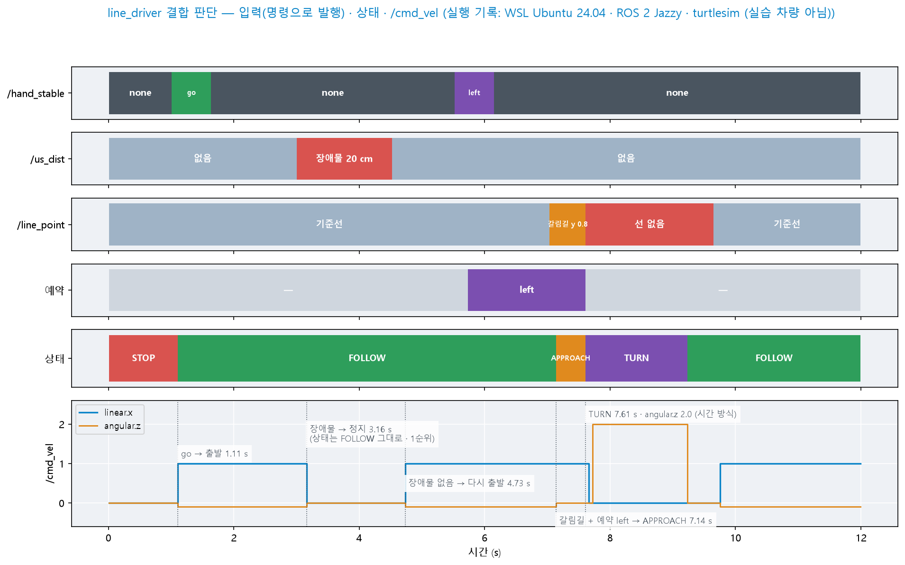

- 위에서부터 입력 3개 · 예약 · 상태 · `/cmd_vel`입니다 — 입력은 명령으로 발행했습니다
- `left`는 주행 중이므로 예약만 됩니다(5.7초) — 손을 내려도 예약은 남습니다
- 갈림길(7.14초) → `APPROACH`에서 0.47초 직진 → `TURN`(7.61초)에서 1.6초 동안 `angular.z` 2.0 → `FOLLOW`(9.23초)
- 3.16 \~ 4.73초 = 장애물 정지 — 상태는 `FOLLOW`로 유지되고 `/cmd_vel`만 0입니다(1순위 조기 종료)
- 그림은 PC의 WSL2에서 `line_driver`를 실행하고 입력을 명령으로 발행한 기록입니다(실습 차량 아님)

<details>
<summary>예측 대조</summary>

- 갈림길 = 약 0.5초 직진한 뒤 **예약대로 왼쪽으로** 회전하고 라인 추종으로 돌아갑니다 — 손을 내린 뒤에도 예약은 유지됩니다

- 회전 중 `stop` = **즉시 정지** — 손모양 `stop`(2순위)이 회전 동작(3순위)보다 먼저 처리됩니다

</details>

**움직이는 그림 M9-5 — 결합 노드의 상태 전이(5.3 그림의 실측 시각)** (약 12.4초 자동 반복)


### 5.4 전체 launch — 6노드

4.4의 `line_launch.py`에 손모양 · 초음파 노드를 더하고 Day 8 자료 7.5의 실측값을 파라미터로 적습니다.

```python
from launch import LaunchDescription
from launch_ros.actions import Node

def generate_launch_description():
    return LaunchDescription([
        Node(package='camera_ros', executable='camera_node',
             parameters=[{'width': 640, 'height': 480}]),
        Node(package='my_car_pkg', executable='hand_classifier',
             parameters=[{'threshold': 0.7, 'period': 0.2, 'stable_n': 3,
                          'flip': False}]),                  # Day 8 자료 2.8 · 5.1의 값
        Node(package='my_car_pkg', executable='line_detector',
             parameters=[{'threshold': 80}]),                # 3.4 · 3.5에서 정한 값
        Node(package='my_car_pkg', executable='us_node'),
        Node(package='my_car_pkg', executable='line_driver',
             parameters=[{'speed': 1.0, 'gain': 1.0, 'stop_cm': 30.0,
                          'sec_per_90': 1.6, 'sec_per_180': 3.1}]),   # Day 8 자료 7.5 실측값
        Node(package='my_car_pkg', executable='motor_node',
             parameters=[{'trim': 0.0}]),                    # 차량의 보정값(Day 6 자료 7.4)
    ])
```

```bash
cd ~/ros2_ws && colcon build && source install/local_setup.bash
ros2 launch my_car_pkg line_launch.py
# 다른 터미널 — RPi5 원격 데스크톱 화면
ros2 run rqt_graph rqt_graph        # 2.1의 연결도와 대조
ros2 topic info /cmd_vel            # Publisher count: 1 확인
```

- 연결도가 2.1과 같고 `/cmd_vel` 발행자가 1이면 → **전체 기동 성립** · 차량을 기준선 위에 두고 `go` 손모양으로 출발
- `camera_node`가 실행되지 않으면 → Day 4 자료 5장의 카메라 확인으로 **돌아가** 발행을 먼저 검증하고 **launch를 다시** 실행
- `hand_classifier`가 실행되지 않으면 → 모델 · 라벨 경로 문제입니다. Day 5 자료 10.4의 확인 순서로 **돌아가** 단독 실행으로 오류를 확인
- `/cmd_vel` 발행자가 **둘 이상**이면 → 이전 터미널의 `line_driver`나 `hand_driver`가 남아 있는 것입니다. 해당 터미널에서 `Ctrl+C`로 종료하고 **launch를 다시** 실행
- 위 조치로도 실행되지 않으면 → 교수에게 알림

- ⚠️ **CPU(Central Processing Unit) 부하 확인** — 카메라 · 추론 · 라인 검출이 동시에 실행됩니다. 다른 터미널에서 `top`으로 점유율을 확인합니다
- 반응이 느리면 → `hand_classifier`의 `period`를 0.3으로 늘리거나 해상도를 낮추고(Day 5 자료 10.4) **launch를 다시** 실행
- Day 8 `full_launch.py`와 비교하면 turtlesim 행이 `motor_node`로 바뀌고 라인 · 초음파 노드가 추가되었습니다

### 5.5 정지 거리 실측 · 값 저장

2.2의 `stop_cm` 30cm가 차량에 적합한지 실측으로 확인합니다.

| 순서 | 방법 |
|:--:|------|
| 1 | 직선 구간 끝에 상자를 두고 그 지점에서 약 1.5m 떨어진 기준선 위에서 `go`로 출발 |
| 2 | 멈춘 차량의 **앞면과 상자 사이의 거리**를 줄자로 측정 |
| 3 | `stop_cm` − 측정 거리 = **반응 지연 · 밀림으로 더 나아간 거리** |
| 4 | `speed`를 바꾸어 같은 측정을 반복 — 속도와 더 나아간 거리의 비례 확인 |

> **예측** — `speed`를 1.0에서 0.7로 낮추면 **멈춘 뒤 거리**(차량 앞면 \~ 상자)는 늘어납니까, 줄어듭니까?

<details>
<summary>예측 대조</summary>

- 늘어납니다 — 반응 지연 동안의 이동 거리(속도 × 지연)와 관성 밀림이 함께 줄어 더 일찍 멈춥니다

- 실제 값은 5.5의 기록 표에 적습니다 — 실습 차량에서 측정하는 값입니다(이 강의 준비에서는 측정하지 않음)

</details>

| `speed` | `stop_cm` | 멈춘 뒤 거리 | 더 나아간 거리 |
|:--:|:--:|:--:|:--:|
| 1.0 | 30 | (기록) | (계산) |
| 0.7 | 30 | (기록) | (계산) |

- 멈춘 뒤 거리가 10cm보다 작으면 → 여유가 부족합니다. `ros2 param set /line_driver stop_cm 40.0`처럼 올리거나 `speed`를 낮춘 뒤 **1부터 다시** 측정
- 멈추지 않고 상자에 닿으면 → `ros2 topic echo /us_dist`로 거리값을 확인합니다. 값이 변하지 않으면 Day 6 자료 4.4의 측정 확인으로 **돌아가** 센서를 점검
- 정한 값은 파일로 저장해 팀 프로젝트에서 사용합니다

```bash
ros2 param dump /line_driver > ~/line_params.yaml
ros2 param dump /line_detector > ~/line_detector_params.yaml
```

- **속도와 정지 거리는 한 쌍으로** 기록합니다 — 속도를 바꾸면 정지 거리도 다시 확인합니다(2.2)

### 5.6 응용 실습 — 되돌아가기도 예약하기

- 지금은 주행 중 `uturn`을 받으면 **그 자리에서** 180° 회전합니다. 파라미터 `uturn_at_junction`이 True이면 주행 중의 `uturn`을 **다음 갈림길의 예약**으로 처리하도록 `line_driver`를 고칩니다 — AI 코딩 도구로 작성합니다

| 조건 | 내용 |
|------|------|
| True | `FOLLOW` · `APPROACH` 중 `uturn` = 예약 · `WAIT` 중 `uturn` = 즉시 회전 |
| False | 지금과 같음 |
| 회전 | 예약된 `uturn`은 갈림길 중심에서 `sec_per_180` 동안 회전 |

- **확인** — 「단계마다 확인」 명령으로 주행 중 `uturn` → 계속 주행 · `y: 0.8` → 약 0.5초 직진 후 180° 회전

<details>
<summary>실습 정리</summary>

- 예약 변수 하나에 `left` · `right` · `uturn`을 모두 담을 수 있습니다 — 회전 시작은 `TURNS` 딕셔너리의 키로 처리하므로 추가 분기가 거의 필요 없습니다

- 예약은 마지막 명령으로 덮어써집니다 — `left` 뒤에 `uturn`을 보이면 `uturn`만 남습니다

</details>

### 5.7 응용 실습 — 회전하자마자 다시 멈추는 차량

- 증상 — 어떤 학생의 차량은 갈림길에서 왼쪽으로 회전한 직후 약 0.5초 직진하고 다시 멈춥니다. 상태 변화를 기록하자 아래 순서가 출력되었습니다

```
FOLLOW -> APPROACH -> TURN -> FOLLOW -> APPROACH -> WAIT
```

- 원인을 찾습니다. 상태가 바뀔 때마다 로그를 남기는 코드(Day 8 자료 4.2 ⑥과 같은 형태)를 AI 코딩 도구로 추가하고, 회전이 끝난 뒤에도 `y: 0.8`을 계속 발행해 증상을 재현합니다

<details>
<summary>실습 정리</summary>

- 원인 = 회전 뒤 판정 중지(5.3 구현 힌트 ④ · 풀이 ①의 `cooldown`) 누락 — 카메라가 바퀴보다 앞을 보므로 회전을 마친 순간에도 가로선이 관심 영역에 남아 갈림길로 다시 판정됩니다

- 고치는 방법은 둘입니다 — 일정 시간 판정을 멈추거나(풀이 방식), 폭 비율이 기준 아래로 내려간 뒤에만 다시 판정합니다

- 상태 변화 로그가 없으면 「회전 뒤 멈춤」만 관찰됩니다 — 로그로 상태의 순서를 확인해야 원인 구간을 좁힐 수 있습니다

</details>

### 5.8 응용 실습 — 정지의 두 종류와 예약

- 손모양 `stop`을 받으면 **남아 있는 예약을 지우도록** `line_driver`를 고칩니다. 단, **장애물 정지(1순위)로 멈춘 경우에는 예약을 유지**합니다 — AI 코딩 도구로 작성합니다

| 조건 | 내용 |
|------|------|
| 손모양 `stop` | 정지 + 예약 삭제 — 사람이 계획을 취소한 것 |
| 장애물 · 두절 정지 | 정지만 — 예약 · 상태는 유지 |

- **확인**
	- ① `left` 예약 → `stop` → `go` → 갈림길 = 대기(`WAIT`)
	- ② `left` 예약 → 거리 `20.0`으로 정지 → 거리 `100.0` → 갈림길 = 왼쪽 회전

<details>
<summary>실습 정리</summary>

- 「정지하면 예약 삭제」를 정지 명령을 발행하는 곳(1순위 블록)에 두면 5.8 확인 ②(장애물 정지 뒤 갈림길 회전)가 실패합니다 — 장애물 앞에서 잠시 멈출 때마다 예약이 사라집니다

- 사람의 `stop`은 **계획의 취소**이지만 장애물 정지는 **일시 중단**입니다 — 같은 「정지」라도 의미가 달라 처리하는 위치가 다릅니다

- 1순위 블록은 상태와 예약을 바꾸지 않고 정지만 발행합니다(5.3 그림 — 장애물 정지 중에도 상태 `FOLLOW`)

</details>

### 5.9 응용 실습 — 저장한 값으로 launch 실행

- 5.5에서 저장한 `~/line_params.yaml` · `~/line_detector_params.yaml`을 불러오도록 `line_launch.py`를 고칩니다 — AI 코딩 도구로 작성합니다

| 항목 | 내용 |
|------|------|
| 적용 | `line_driver` · `line_detector`에 각 파일 |
| 경로 | 홈 폴더 경로는 `os.path.expanduser`로 절대 경로로 바꿈 |
| 파일 위치 | launch 인자 `params_dir`(기본 = 홈 폴더)로 다른 폴더를 지정할 수 있음 |

- **확인** — `ros2 param get /line_driver stop_cm`이 5.5에서 정한 값과 같아야 합니다. launch에 고정값도 함께 적었다면 어느 값이 적용되는지 같은 명령으로 확인합니다

<details>
<summary>실습 정리</summary>

- 파일 첫 줄의 노드 이름(`/line_driver:`)과 launch의 노드 이름이 같아야 값이 적용됩니다 — 다르면 오류 없이 기본값으로 실행됩니다(Day 8 자료 7.10)

- 값의 출처를 한 곳으로 정합니다 — 파일과 launch에 같은 파라미터를 함께 적으면 어느 값이 실행에 사용되었는지 확인하기 어렵습니다

</details>

### 5.10 응용 실습 — 정지 거리에서 반응 지연 구하기

- 아래는 **가상의 예시 측정값**입니다(실습 차량의 값은 5.5 표에서 직접 측정). 속도와 「더 나아간 거리」의 관계에서 반응 지연과 관성 밀림을 구합니다

| 속도(m/s) | 0.15 | 0.20 | 0.30 |
|------|:--:|:--:|:--:|
| 더 나아간 거리(cm) | 5.5 | 7.0 | 10.0 |

- 세 점에 직선을 맞추어 기울기와 절편을 구하는 스크립트를 AI 코딩 도구로 작성합니다. 같은 스크립트에 5.5의 실측값을 넣어 차량의 값도 구합니다

<details>
<summary>실습 정리</summary>

- 더 나아간 거리 = 속도 × 반응 지연 + 관성 밀림 → 기울기 = 3.0 cm ÷ 0.1 m/s = **0.3초**(반응 지연) · 절편 = **1 cm**(속도와 무관한 거리)

- 예시 값의 0.3초는 2.2의 추정(0.2초)보다 깁니다 — 실제 차량에서 이렇게 나타나면 계산에 포함하지 않은 지연(모터가 멈추기까지의 시간 등)이 있다는 뜻입니다. 실측한 지연으로 `stop_cm`을 다시 계산합니다

- 결과에서 거꾸로 원인 값을 구하는 방법입니다 — 측정점이 2개 이상이어야 기울기와 절편을 나눌 수 있습니다

</details>

---

## 6. 미니프로젝트 — 갈림길 코스 주행

### 6.1 과제 — 요구 동작

1.5의 코스(직선 → 곡선 → T자 갈림길)에서 다음 동작을 차례로 확인합니다.

**요구 동작**:

1. `go` 손모양으로 출발해 기준선을 따라 주행
2. 직선 구간의 상자 앞에서 **초음파로 정지** — 상자를 치우면 다시 주행
3. 주행 중 `left` 또는 `right`로 **갈림길 방향을 예약** → 갈림길에서 그 방향으로 회전
4. 예약 없이 갈림길에 도착하면 정지 → 손모양으로 방향 선택
5. 어느 지점에서든 `stop` 손모양으로 정지

- 차량은 교대로 사용합니다 — 한 사람은 손모양을 제시하고 다른 사람은 정지 거리 · 동작을 기록합니다

### 6.2 시운전 중 확인

요구 동작 1\~5를 순서대로 확인하고 증상이 나타나면 그 자리에서 분기합니다.

- 다섯 가지 동작이 모두 나타나면 → **통합 성립** · 6.3 단계별 과제로 진행
- 출발하지 않으면 → `ros2 topic echo /hand_stable`로 `go` 판정을 확인 → 다른 이름이면 5.1의 점검으로 **돌아감** → `go`로 확인되지만 출발하지 않으면 `ros2 topic hz /line_point`와 `/us_dist`로 두 토픽의 발행을 확인(5.2 1순위 정지 조건)
- 곡선에서 선을 벗어나면 → 4.4의 `gain` · `speed` 조정으로 **돌아가** 값을 바꾸고 다시 주행
- 갈림길을 지나쳐 직진하면 → `/line_point`의 `y`가 `junction_ratio`(0.6)에 이르지 않은 것입니다. `ros2 param set /line_driver junction_ratio 0.5`처럼 낮추고 **다시** 주행
- 곡선을 갈림길로 판정해 멈추면 → `junction_ratio`를 높임(예: 0.7)

- 회전이 부족하거나 지나치면 → `sec_per_90`을 조정합니다(Day 8 자료 7.5 ④와 같은 방법)
- 회전 뒤 선을 찾지 못하고 계속 회전하면 → `junction_go_sec`를 늘려 갈림길 중심까지 더 나아간 뒤 회전하게 하고 다시 주행
- 상자 앞에서 멈추지 않으면 → 5.5의 정지 거리 실측으로 **돌아감**
- 손모양을 제시할 때 조향이 크게 바뀌거나 멈추면 → 손이 화면 아래쪽(선 검출 영역)에 들어간 것입니다. 손모양을 화면 위쪽에서 제시
- 동작이 전반적으로 느리면 → 5.4의 CPU 부하 확인
- 주행 중 갑자기 멈추면 → 배터리 전압 저하 또는 입력 두절 정지(5.2 1순위)입니다. `ros2 node list`로 노드가 모두 실행 중인지 확인하고 배터리를 교체
- 위 조치로도 해결되지 않으면 → 교수에게 알림

### 6.3 단계별 과제

| 단계 | 과제 |
|:--:|------|
| **필수** | **기준선 주행 + 초음파 정지** — 출발점에서 갈림길 직전까지 이탈 없이 주행하고 상자 앞에서 정지 |
| **도달** | **손모양 출발 · 정지 + 갈림길 방향 선택** — 예약과 대기 두 경우 모두 |
| **도전 ⓐ** | **되돌아가기** — 갈림길 끝에서 `uturn`으로 돌아와 출발점까지 주행 |
| **도전 ⓑ** | **선 검출로 회전 종료** — 시간 대신, 회전 중 `/line_point`의 `z`가 1.0이고 `x`가 0 근처가 되면 회전을 끝냄 |
| **도전 ⓒ** | 판단 근거를 `/decision_reason`으로 발행 · 기록(Day 8 자료 9.1) |

- **필수 단계는 전원 완료** — 라인 주행과 초음파 정지가 오늘의 최소 목표입니다. 손모양 결합은 도달 목표입니다(개인차 흡수)
- 여기서 완성한 구조가 **팀 프로젝트의 기반**입니다 — 7장으로 이어집니다

---

## 7. 팀 프로젝트 예고

### 7.1 팀 프로젝트 진행 방식

남은 세 번의 수업(Day 10\~12)은 **팀 프로젝트**로 진행됩니다. 수업에 참여하는 학생 전원이 한 팀이 되어 주제를 직접 정하고, 실습 차량 1대로 구현해 시연합니다.

| 일자 | 진행 |
|------|------|
| Day 10 (11/2) | 조원 논의 → 설계 확정 · 문서 작성 → 구현 착수 |
| Day 11 (11/9) | 구현 → 리허설 → 보완 |
| Day 12 (11/16) | 완성 → 팀 시연 |

- 주제 조건 = 차량 1대 · 보유 부품 · 인식 → 판단 → 행동의 노드 구조 — 조건 안에서 주제는 자유입니다
- 팀 프로젝트 문서의 목차 · 양식과 시연 규정은 Day 10에 `팀 프로젝트 사양서`로 안내됩니다
- 오늘 완성한 라인 주행 · 손모양 명령 · 초음파 정지 구조는 주제를 정할 때 활용할 수 있는 기반입니다

### 7.2 차량 상태 기록과 다음 시간 준비

차량의 현재 상태를 기록해 둡니다. 이 기록은 Day 10 설계에서 재사용할 노드를 정하는 기준이 됩니다.

| # | 확인 | 상태 |
|:--:|------|:--:|
| 1 | 수동 주행 4방향 + trim 보정 (Day 6) | ⬜ |
| 2 | `/us_dist` 안정 발행·상한 처리 | ⬜ |
| 3 | 기준선 주행 + 초음파 정지 — 필수 기준 충족 (6.3) | ⬜ |
| 4 | 손모양 명령 · 갈림길 방향 선택 (도달) | ⬜ |
| 5 | 파라미터 저장 (`param dump` — 속도 · `gain` · `threshold` · `stop_cm` · 회전 시간 · trim) | ⬜ |
| 6 | launch 일괄 실행 (`line_launch.py`) | ⬜ |

- 다음 시간까지 차량·배터리를 **주행 가능한 상태로 보관**합니다 — 배선을 풀지 않습니다

---

## 8. 요약

| 항목 | 내용 |
|------|------|
| 실물의 성질 | 측정 잡음 · **반응 지연** · 관성 · 환경 변수 — turtlesim과 다른 점 |
| 정지 임계 | **정지 임계 ≥ 지연 × 속도 + 밀림 + 여유** — 장애물 정지는 지연이 짧은 초음파 경로가 담당 |
| 라인 인식 | 하단 1/3 · 밝기 이진화 · 무게중심 → `/line_point`(오차 · 폭 비율 · 검출 여부) |
| 라인 추종 | `angular.z = −오차 × gain` · 선을 잃으면 마지막 방향으로 탐색 |
| 갈림길 | 폭 비율 ≥ 0.6 → 잠시 직진 → 예약 방향으로 회전 · 예약이 없으면 대기 |

| 항목 | 내용 |
|------|------|
| 우선순위 | 두절 · 장애물 > 손모양 `stop` > 회전 동작 > 라인 추종 — 안전 판단은 함수 앞에서 `return` |
| 역할 분담 | 고전 처리 = 얼마나 조향할지 · 학습 모델 = 무엇을 할지 |
| 통합 | `line_launch.py` 6노드 · `/cmd_vel` 발행자 1 · 값은 `param dump`로 저장 |
| 팀 프로젝트 | Day 10\~12 — 팀이 주제를 정해 차량 1대로 구현 · Day 12 팀 시연 |
| 다음 시간 | Day 10 — **조원 논의 → 설계 확정 · 문서 작성** → 구현 착수 |

---

## 9. 보충

> 본 과정을 마치고 시간이 남을 때 다루는 소재입니다. 각 항목은 서로 독립이며 다음 시간의 선행 개념은 포함하지 않습니다.

### 9.1 가감속 완화 — 부드러운 출발과 정지

명령 속도를 한 번에 적용하면 **급출발·급정지**가 됩니다 — 관성 밀림이 커지고 전류 피크로 전원 부담도 커집니다(Day 6 자료 10.4). 주기마다 명령 속도를 **일정량씩 목표에 접근**시킵니다.

```python
# motor_node의 drive()에 적용하는 방식
self.declare_parameter('accel_step', 0.08)        # 주기당 변화 한도

step = self.get_parameter('accel_step').value
self.current = self.current + max(-step, min(step, target - self.current))
# current를 바퀴에 적용 — target에 도달할 때까지 주기마다 접근
```

**코드 읽기 — 재등장 문법**

| 코드 | 뜻 |
|------|------|
| `max(-step, min(step, …))` | 안쪽 `min`이 위를, 바깥 `max`가 아래를 자름 — 변화량을 **±step 이내로 제한**(Day 6 자료 7.2 ⑥) |
| `self.current = self.current + …` | 현재값에 제한된 변화량을 더해 목표에 **단계적으로 접근** |

| accel_step | 성질 |
|:--:|------|
| 0.2 | 즉각 반응 — 급출발에 가까움 |
| 0.05 | 부드러움 — **정지도 느려짐**(임계 여유 필요) |

- ⚠️ **정지만은 즉시**로 두는 절충이 일반적 — 출발은 완화하고, 안전 정지(손모양 `stop` · 두절 · 장애물)는 한 번에 0으로
- 관성 밀림이 줄면 `stop_cm`을 낮출 수 있음 — 좁은 코스 대응력 향상

### 9.2 장애물 회피 — 정지 대신 피해 가기

오늘의 차량은 장애물 앞에서 **멈춥니다**. 선이 없는 공간에서는 멈추는 대신 **피해 가는** 동작이 필요합니다 — 후진 → 회전 → 전진의 상태 기계입니다.

| 항목 | 내용 |
|------|------|
| 노드 이름 | `avoid_driver` |
| 구독 | `/us_dist` (`my_msgs/msg/DistMsg`) |
| 발행 | `/cmd_vel` (`geometry_msgs/msg/Twist`) |
| 파라미터 | `stop_cm` · `run_speed` · `back_ticks` · `turn_ticks` |
| 상태 | `RUN`(전진) · `BACK`(후진) · `TURN`(회전) — Day 3 자료 9.2 |

- Day 6 자료 8.4 과제 「랜덤 주행 차량」의 `random_driver`와 **같은 구조**입니다 — 회전 방향 · 시간을 난수로 정하지 않고 고정한 형태
- 팀 프로젝트에서 장애물 회피를 주제로 선택하면 이 노드에서 시작할 수 있습니다

`~/ros2_ws/src/my_car_pkg/my_car_pkg/avoid_driver.py`:

```python
import rclpy
from rclpy.node import Node
from geometry_msgs.msg import Twist
from my_msgs.msg import DistMsg

class AvoidDriver(Node):
    def __init__(self):
        super().__init__('avoid_driver')
        self.declare_parameter('stop_cm', 35.0)               # ① 정지 임계 — 2.2 계산값
        self.declare_parameter('run_speed', 1.0)
        self.declare_parameter('back_ticks', 5)               # 0.5초 후진
        self.declare_parameter('turn_ticks', 8)               # 0.8초 회전

        self.dist = 999.0                                     # ② 최신 거리 보관
        self.state = 'RUN'
        self.tick = 0

        self.sub = self.create_subscription(DistMsg, '/us_dist', self.on_dist, 10)
        self.pub = self.create_publisher(Twist, '/cmd_vel', 10)
        self.timer = self.create_timer(0.1, self.control)     # ③ 10Hz 제어
        self.get_logger().info('avoid_driver started — state: RUN')

    def on_dist(self, msg):
        self.dist = msg.dist                                  # 보관만

    def control(self):
        prev = self.state
        msg = Twist()

        if self.state == 'RUN':
            if self.dist < self.get_parameter('stop_cm').value:   # ④ 감지 조건 = 실측 거리
                self.state, self.tick = 'BACK', 0
            else:
                msg.linear.x = self.get_parameter('run_speed').value
        elif self.state == 'BACK':
            msg.linear.x = -1.0
            self.tick += 1
            if self.tick >= self.get_parameter('back_ticks').value:
                self.state, self.tick = 'TURN', 0
        else:                                                 # TURN
            msg.angular.z = 1.5
            self.tick += 1
            if self.tick >= self.get_parameter('turn_ticks').value:
                self.state = 'RUN'

        if prev != self.state:                                # ⑤ 변화 시에만 로그
            self.get_logger().info(f'{prev} -> {self.state}  (dist {self.dist:.0f}cm)')
        self.pub.publish(msg)

def main(args=None):
    rclpy.init(args=args)
    node = AvoidDriver()
    try:
        rclpy.spin(node)
    except KeyboardInterrupt:
        pass
    finally:
        node.destroy_node()
        rclpy.shutdown()
```

| # | 설명 |
|:--:|------|
| ① | 정지 임계를 **파라미터로** — 값은 실측으로 보정(5.5와 같은 방법) |
| ② | 초기값 999 = 「아직 수신 없음」을 개방 상태로 처리 — 첫 수신 전에 후진하지 않도록 |
| ③ | 구독은 보관 · 판단은 타이머 — Day 8 자료 4.2와 같은 구조 |
| ④ | **Day 3 미로와 다른 유일한 점** — `hit()` 좌표 판정이 실측 거리 비교로 교체됨 |
| ⑤ | 상태 전이 로그에 **당시 거리를 함께 기록** — 오동작 원인 추적의 근거(9.3) |

**코드 읽기 — 재등장 문법**

| 코드 | 뜻 |
|------|------|
| `self.state, self.tick = 'BACK', 0` | 다중 대입 — 상태와 카운터를 한 줄에서 함께 바꿈 |
| `self.tick += 1` | 누적 — `self.tick = self.tick + 1`의 줄임 |
| `f'… (dist {self.dist:.0f}cm)'` | f-문자열 + 형식 지정 `:.0f` = 소수점 없이(Day 6 자료 4.3 ②) |

`setup.py`에 `'avoid_driver = my_car_pkg.avoid_driver:main',`을 등록하고 빌드한 뒤, 바퀴를 공중에 띄운 상태로 확인합니다.

```bash
ros2 run my_car_pkg avoid_driver
# 다른 터미널 — 거리를 명령으로 발행
ros2 topic pub --rate 10 /us_dist my_msgs/msg/DistMsg "{dist: 100.0}"   # RUN 유지
ros2 topic pub --rate 10 /us_dist my_msgs/msg/DistMsg "{dist: 20.0}"    # BACK → TURN → RUN 순환
```

- 실차에서는 `line_launch.py`의 `line_driver` 대신 `avoid_driver`를 실행합니다 — `/cmd_vel` 발행자는 하나뿐이어야 합니다(2.1)

| 회피 방향 전략 | 구현 | 성질 |
|------|------|------|
| 고정 방향 (`avoid_driver` 코드) | `angular.z = 1.5` | 단순 · 같은 자리 반복 위험 |
| **랜덤** | `random.choice([-1.5, 1.5])` | Day 3 미로 · Day 6 자료 8.4 방식 — 반복 탈출 |
| 교대 | 회피마다 방향 반전 | 지그재그 — 통로 진행에 유리 |

- 초음파는 **정면 한 점만** 측정합니다(Day 6 자료 3.1) — 어느 쪽이 열려 있는지 모르는 상태에서 방향을 선택해야 한다는 점이 이 문제의 본질입니다

### 9.3 주행 기록 분석

시연 중 오동작의 원인은 현장에서 놓치기 쉽습니다 — **기록해 두면 재현 없이 분석**할 수 있습니다(Day 2 수업 보충).

```bash
ros2 bag record /us_dist /hand_stable /line_point /cmd_vel -o final_run    # 주행하며 기록
rqt_bag final_run                                                          # 타임라인 대조 (Day 8 자료 6.2)
```

| 분석 | 확인 대상 |
|------|------|
| 장애물 정지 | 직전 `/us_dist` 값 — 감지가 늦었는가, 감지했지만 정지가 늦었는가 |
| 선 이탈 | `/line_point`의 `z`가 0이 된 시점과 그 직전의 `x` — 조향 부족인가, 검출 실패인가 |
| 오정지 | `/hand_stable`에 잘못된 `stop`이 있었는가 — 인식 문제와 판단 문제의 구분 |
| 판단 추적 | `/decision_reason`(6.3 도전 ⓒ)을 함께 기록하면 상태 전이의 이유까지 남음 |

- **Day 12 활용** — 시연 전 연습 주행을 기록해 두면 시연에서 문제가 생겼을 때 원인을 설명하는 자료가 됩니다

### 9.4 학습형 라인 추종 — 같은 문제를 학습 모델로

선의 위치도 Teachable Machine으로 학습할 수 있습니다 — 차량 카메라 영상을 **위치에 따라 4클래스**로 분류합니다.

| 클래스 | 영상 | 판단 |
|------|------|------|
| `left` | 선이 화면 왼쪽 | 왼쪽으로 조향 |
| `center` | 선이 가운데 | 직진 |
| `right` | 선이 화면 오른쪽 | 오른쪽으로 조향 |
| `none` | 선이 없음 | 탐색 |

- 데이터 = 3.5의 `course_bag`을 재생하며 `image_saver`(Day 5 자료 14.1)로 저장 → 위치별로 나누어 업로드
- 판단 = 클래스마다 `angular.z`를 정한 값으로(예: `left` = 0.6 · `center` = 0 · `right` = −0.6)

| 비교 | 고전 처리(3장 · 4장) | 학습형 |
|------|------|------|
| 출력 | 연속값 −1 \~ 1 | 4단계 |
| 조향 | 오차에 비례 — 부드러움 | 계단식 — 지그재그가 생기기 쉬움 |
| 준비 | `threshold` 조정 | 촬영 · 학습 |
| 조명 변화 | 기준값 재조정 | 여러 조명을 학습하면 대응 |
| 처리 부하 | 낮음 | 추론 — 손모양 모델과 함께 두 모델 |

- 정확한 수치를 계산할 수 있는 대상은 고전 처리가, 규칙으로 작성하기 어려운 판정은 학습이 유리합니다(2.7) — 같은 코스에서 두 방식을 비교해 이 원칙을 확인합니다
- 두 번째 분류 노드를 실행하려면 모델 파일을 구분하고 노드 · 토픽 이름을 바꾸어야 합니다(Day 3 수업 보충 remapping)

### 9.5 두 줄 차선 — 차선 사이를 주행

실제 도로에서는 한 줄이 아니라 **좌우 두 줄 사이**를 주행합니다.

| 방식 | 처리 |
|------|------|
| 한 줄(오늘) | 선의 무게중심 = 따라갈 위치 |
| 두 줄 | 관심 영역을 좌우 절반으로 나누어 각 선의 위치를 구하고 **두 위치의 가운데**를 따라갈 위치로 |

```python
# line_detector의 process()에서 — mask를 좌우 절반으로 나누어 계산
min_area = self.get_parameter('min_area').value
left, right = mask[:, :w // 2], mask[:, w // 2:]
ml = cv2.moments(left, binaryImage=True)
mr = cv2.moments(right, binaryImage=True)
if ml['m00'] > min_area and mr['m00'] > min_area:
    cl = ml['m10'] / ml['m00']                 # 왼쪽 선의 위치
    cr = mr['m10'] / mr['m00'] + w // 2        # 오른쪽 선의 위치 — 오른쪽 절반의 시작만큼 더함
    cx = (cl + cr) / 2                         # 두 선의 가운데
```

- 한쪽 선만 검출되면 → 차선 폭의 절반만큼 떨어진 위치를 따라갑니다(차선 폭은 실측)
- `w // 2` = 정수 나눗셈 — 배열 인덱스는 정수여야 합니다(3.2 문법 ①의 `int()`와 같은 이유)
