# Day 10 — 팀 프로젝트 · 수행 과정 · 문서 작성

**2026-11-02 · 한국폴리텍대학교 하이테크과정 ROS2**

이 자료는 수업의 개념 설명과 실습 절차·명령어를 복습용으로 정리한 문서입니다. 복습 기준 = 이 자료 + 수업 중 필기.

---

## 목차

1. [일정](#1-일정)
2. [프로젝트 수행 과정](#2-프로젝트-수행-과정)
3. [과정별 안내](#3-과정별-안내)
4. [팀 프로젝트 문서](#4-팀-프로젝트-문서)
5. [팀 프로젝트 사양](#5-팀-프로젝트-사양)
6. [요약](#6-요약)

---

## 1. 일정

| 일자 | 진행 |
|------|------|
| Day 10 (11/2) | 조원 논의 → 설계 확정 · 문서 작성(목차 · 양식 준수) → 구현 착수 |
| Day 11 (11/9) | 구현 → 리허설 → 보완 |
| Day 12 (11/16) | 완성 → 시연 |

---

## 2. 프로젝트 수행 과정

| 과정 | 시기 | 작성할 문서 항목(5.4의 번호) |
|------|------|------|
| 주제 | Day 10 오전 | 1 |
| 설계 | Day 10 오전 | 2 · 3 · 4 |
| 구현 | Day 10 오후 \~ Day 12 오전 | 5 |
| 시험 | Day 11 | 6 |
| 시연 | Day 12 | 7 |

**움직이는 그림 M10-1 — 수행 과정과 과정별 작성 문서(2장 · 3장)** (약 13초 자동 반복)

---

## 3. 과정별 안내

### 3.1 주제

- 과업 — 조원 논의로 주제와 시연 동작을 정함(조건 = 5.3)
- 작성 — 문서 1항
- 완료 기준 — 주제 한 문장에 조원 전원 합의

### 3.2 설계

- 과업 — 노드와 토픽의 구성 · 단계 구분 · 역할과 일정 확정
- 작성 — 문서 2 · 3 · 4항
- 완료 기준 — 문서 1\~4항 완성 · 최소 완성 단계 정의

### 3.3 구현

- 과업 — 최소 완성 단계부터 구현 · 지금까지 작성한 노드 재사용 가능
- 작성 — 문서 5항(구현하면서 기록)
- 완료 기준 — 최소 완성 단계의 동작 확인

### 3.4 시험

- 과업 — 시연 동작을 차량에서 실행해 확인 · Day 11 리허설
- 작성 — 문서 6항
- 완료 기준 — 리허설에서 시연 동작 1회 실행

### 3.5 시연

- 과업 — Day 12 팀 시연(규정 = 5.5)
- 작성 — 문서 7항
- 완료 기준 — 시연 완료 · 문서 전 항목 작성

---

## 4. 팀 프로젝트 문서

- 목차와 작성할 내용 = 5.4(7항)
- 작성 방법 = 5.4의 목차 순서대로 작성
- 작성 시점 — 1\~4항 = Day 10 오전 · 5\~6항 = 구현 중 · 7항 = Day 12

---

## 5. 팀 프로젝트 사양

팀 프로젝트의 진행 방식 · 주제 조건 · 문서 목차 · 시연 규정입니다.

### 5.1 프로젝트 개요

| 항목 | 내용 |
|------|------|
| 형태 | 수강생 4명이 한 팀으로 진행 |
| 주제 | 팀이 직접 정함 — 5.3의 조건 안에서 자유 |
| 차량 | 실습 차량 1대(PiCar-R5 · 카메라 · 초음파 센서 · Raspberry Pi 5)를 팀이 함께 사용 |
| 기간 | Day 10(11/2) \~ Day 12(11/16) |
| 산출물 | 팀 프로젝트 문서(5.4) · 구현 코드 · Day 12 시연 |

### 5.2 진행 일정

| 일자 | 오전 | 오후 |
|------|------|------|
| Day 10 (11/2) | 조원 논의 → 설계 확정 · 문서 1\~4 작성 | 구현 착수 |
| Day 11 (11/9) | 구현 | 리허설(시연 동작 1회 실행) → 보완 |
| Day 12 (11/16) | 완성 | 팀 시연 |

- 구현은 설계를 확정한 뒤에 시작합니다.
- Day 9까지 완성하지 못한 기능(라인 주행 · 손모양 명령 · 초음파 정지의 결합)은 팀 프로젝트 구현에서 필요한 만큼 이어 갑니다.

### 5.3 주제 조건

| 조건 | 내용 |
|------|------|
| 차량 | 실습 차량 1대로 구현합니다 |
| 부품 | 보유 부품(제어보드 · 모터 4개 · 카메라 · 초음파 센서 · Raspberry Pi 5)만 사용합니다 |
| 구조 | 인식 → 판단 → 행동의 노드 구조로 구성합니다(Day 8) |

- 세 조건을 지키면 주제는 자유입니다.
- 지금까지 작성한 노드를 재사용해도 되고, 새로 작성해도 됩니다.

### 5.4 팀 프로젝트 문서 — 목차와 작성할 내용

| # | 목차 | 작성할 내용 |
|:--:|------|------|
| 1 | 주제 | 주제 한 문장 · 시연에서 실행할 동작 |
| 2 | 시스템 구성 | 인식 · 판단 · 행동의 노드와 그 사이의 토픽(구성도 1장) |
| 3 | 단계 구분 | 최소 완성(이것만 되면 시연 가능) · 목표 · 도전 |
| 4 | 역할과 일정 | 팀원별 담당 · Day 10\~12 일정 · 차량 사용 순서 |
| 5 | 구현 기록 | 노드별로 새로 작성하거나 바꾼 내용 · 확정한 파라미터 |
| 6 | 시험 결과 | 확인한 동작과 결과 · 발생한 문제와 해결 |
| 7 | 시연 결과 | 시연한 동작 · 남은 과제 |

- 1\~4는 Day 10 오전까지 작성하고, 5 · 6은 구현하면서 채우며, 7은 Day 12에 작성합니다.

### 5.5 시연 (Day 12)

| 항목 | 규정 |
|------|------|
| 진행 방식 | 팀이 정함 — 문서 1항의 시연 동작 기준 |
| 미완인 경우 | 완성된 단계까지 시연하고, 어디까지 진행했고 무엇이 남았는지 설명 |
| 재시도 | 허용 |

### 5.6 개발 환경

- 차량(Raspberry Pi 5)에 SSH로 연결해 개발합니다(Day 5 개발 환경).
- 강의실 PC의 WSL2에서는 차량의 토픽이 조회되지 않습니다. 차량의 토픽은 차량에 연결한 터미널에서 확인합니다.
- 판단 노드는 turtlesim으로 먼저 확인할 수 있습니다 — 차량에 연결한 원격 데스크톱 화면에서 실행합니다. 토픽 계약이 같으면 모터 노드로 바꾸어도 같은 방식으로 연결됩니다(Day 8).
- 확정한 파라미터는 `ros2 param dump`로 저장합니다(Day 9).
- 동작하지 않을 때는 배선 → 전원 → 인식 → 판단 → 행동 → 연결의 순서로 확인합니다.

---

## 6. 요약

| 항목 | 내용 |
|------|------|
| 수행 과정 | 주제 → 설계 → 구현 → 시험 → 시연 |
| 문서 | 5.4의 목차에 따라 작성 |
| Day 10 | 설계 확정 · 문서 1\~4항 작성 · 구현 착수 |
| 다음 시간 | Day 11 — 구현 · 리허설(시연 동작 1회 실행) |
